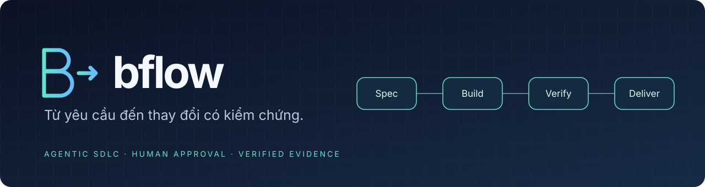
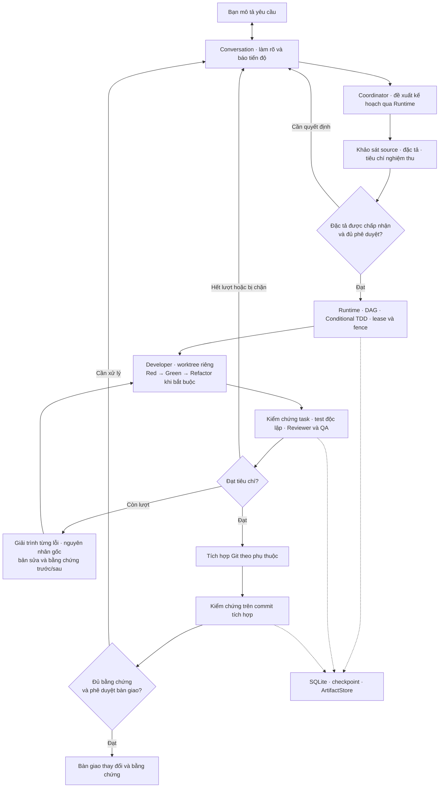

<div align="center">



**Điều phối AI coding agents từ yêu cầu đến bàn giao, với đặc tả, kiểm thử và phê duyệt rõ ràng.**

[](https://github.com/qxbao/bflow/actions/workflows/ci.yml)
[](docs/guide/installation.md)
[](package.json)
[](LICENSE)

[Bắt đầu](#bắt-đầu) · [Luồng thực thi](#luồng-thực-thi) · [Tài liệu](docs/README.md) · [Giới hạn hiện tại](docs/known-limitations-v3.md)

</div>

## Bflow giúp bạn làm gì?

Bạn mô tả công việc trong một cuộc hội thoại. Bflow đưa yêu cầu qua phân tích, đặc tả, lập kế hoạch, triển khai và kiểm chứng; mỗi Developer làm việc trong Git worktree riêng. Bạn theo dõi tiến độ và trả lời các yêu cầu phê duyệt tại cùng một nơi.

| Bạn cần | Bflow cung cấp |
| --- | --- |
| Một đầu mối làm việc | Conversation Agent nhận yêu cầu, làm rõ phạm vi và báo tiến độ |
| Phân công nhiều agent | Coordinator lập DAG; Runtime quản lý phụ thuộc, concurrency và quyền thực thi |
| Kết quả có thể kiểm tra | Đặc tả và tiêu chí nghiệm thu, Conditional TDD, Reviewer/QA độc lập, kiểm tra sau tích hợp |
| Chọn provider theo vai trò | Claude Code, Codex và Agy qua adapter; model, effort và profile riêng cho từng role |
| Dùng lại công cụ đã thiết lập | Shared MCP Gateway cho DeepWiki, GitNexus, MemPalace và browser; RTK xử lý output CLI |
| Tiếp tục sau gián đoạn | SQLite event log, checkpoint, artifact có checksum và đối soát delivery |

**Trạng thái:** đã có mã nguồn và kiểm thử tích hợp cục bộ cho Runtime/platform (bao gồm GitNexus và browser MCP resource transactions, regression scope, test-integrity gate, task handovers và read-only telemetry). Các báo cáo probe thật có phạm vi riêng; nghiệm thu đầy đủ SDLC với provider/Chrome thật và chiến dịch lỗi khi đang chạy vẫn còn mở. Xem [trạng thái triển khai](docs/implementation-status.md). Agy hiện chưa dùng được cho vai trò Conversation hoặc chế độ unattended.

## Bắt đầu

### 1. Build và setup một lần

Cần **Node.js ≥22.13**, **pnpm 12.5.1**, Git và filesystem cục bộ. Linux dùng `systemd --user`; macOS dùng `launchd`, cần Apple Command Line Tools, Python ≥3.11 cho profile sync và `flock` hỗ trợ inherited file descriptor. Xem [hướng dẫn cài đặt](docs/guide/installation.md) để chuẩn bị sandbox kiểm thử.

```bash
git clone https://github.com/qxbao/bflow.git
cd bflow
pnpm install --frozen-lockfile
pnpm build

# Chỉ cần gọi bin.js để bootstrap lần đầu.
node apps/cli/dist/bin.js setup
```

Setup hiển thị kế hoạch để bạn duyệt, cài công cụ theo catalog, chuẩn bị skills/Gateway và tạo lệnh tắt **`bflow`** trong PATH. Sau khi setup thành công, **mở terminal mới hoặc nạp lại file shell mà setup thông báo** rồi kiểm tra:

```bash
bflow --help
bflow setup --check
```

Từ đây dùng **`bflow …`**, không cần gõ lại `node …/bin.js`. “Alias `bflow`” ở đây là launcher do setup quản lý; bạn không cần tự thêm shell alias. Giữ source checkout tại vị trí đã setup vì launcher trỏ tới bản build đó. `bflow setup` có phạm vi cấp máy (chạy một lần cho toàn bộ môi trường máy; `bflow setup --check` cho cùng kết quả từ bất kỳ thư mục nào); việc khởi tạo và đăng ký GitNexus theo từng dự án nằm ở `bflow init`.

> Setup không đăng nhập thay bạn. Hoàn tất đăng nhập CLI của provider được chọn trước `bflow up`. Dùng `bflow setup --dry-run` để xem kế hoạch, hoặc `--yes` khi đã chấp thuận plan trong môi trường không tương tác. [Chi tiết setup →](docs/setup-guide.md)

### 2. Khởi tạo dự án của bạn

Chạy trong Git repository có commit đầu tiên, đã cài dependency của chính dự án:

```bash
cd /path/to/your-project
bflow init --provider codex
bflow init --check
bflow doctor

# Xem lại cấu hình trước khi commit.
git add .bflow/.gitignore .bflow/config.yml
git commit -m "chore: configure bflow"

bflow up
bflow attach
```

`init` tạo `.bflow/config.yml` có chú thích tại thư mục gốc Git chuẩn, lập chỉ mục GitNexus của repository (hỏi xác nhận giấy phép PolyForm-Noncommercial lần đầu, hoặc truyền `--yes`; dùng `--no-gitnexus` nếu muốn bỏ qua) và đăng ký dịch vụ `gitnexus-<repo>` trên Gateway đang chạy (`bflow init --remove` để gỡ đăng ký). Bạn có thể chọn `--provider claude`, hoặc cấu hình provider/profile theo từng role. Với Agy specialist, giữ Conversation trên Claude hoặc Codex. Working tree cần sạch trước khi Runtime cấp worktree cho Developer.

Trong Conversation, bắt đầu bằng một yêu cầu có thể kiểm chứng:

> Sửa `sum` để ném `RangeError` khi kết quả vượt giới hạn số nguyên an toàn. Giữ nguyên API hiện tại và bổ sung kiểm thử hồi quy cho lỗi này.

Conversation sẽ làm rõ yêu cầu khi cần và trình các quyết định thuộc quyền bạn bằng tiếng Việt dễ hiểu. Mỗi việc có nhãn như `Việc #2`, thẻ cần quyết định có mã như `#3`; trả lời theo hướng dẫn của thẻ, ví dụ `#3: 1`. Bạn có thể hỏi “xem chi tiết #3” hoặc mở tab Logs để điều tra thêm. [Đọc cập nhật và trả lời](docs/guide/conversation-updates.md) · [Repository mẫu](docs/guide/getting-started.md).

### 3. Theo dõi và kết thúc phiên

```bash
bflow status                           # Môi trường và trạng thái host hiện tại
bflow status <run-id> --telemetry      # Báo cáo metric chỉ đọc của lượt chạy qua host đang hoạt động
bflow doctor                           # Chẩn đoán cấu hình, provider, công cụ và verification sandbox
bflow mcp status                       # Inventory MCP; giới hạn live port được ghi bên dưới
bflow tool status                      # Công cụ đã cài
bflow down                             # Dừng an toàn khi không còn công việc active
```

`mcp status` hiện đọc cấu hình nhưng chưa có kết nối kiểm tra health mặc định, nên có thể báo `configured: false` dù Gateway đang chạy. Dùng `bflow doctor` để chẩn đoán platform và `bflow docs status` để probe DeepWiki; xem [giới hạn lệnh](apps/cli/docs/command-reference.md#tích-hợp-và-giới-hạn-hiện-tại).

Nếu cần dừng khi còn công việc, `bflow down --yes` xác nhận việc dừng có checkpoint; Runtime vẫn thực thi shutdown barrier. Với run bị chặn, đọc hướng dẫn trong Conversation trước khi trả lời `tiếp tục việc #2` theo nhãn đang hiển thị. [Khôi phục phiên →](docs/guide/session-recovery.md)

## Luồng thực thi

Sơ đồ mô tả luồng do Runtime kiểm soát. Mỗi bước cần đúng quyền, bằng chứng và phê duyệt tương ứng.



Herdr quản lý tiến trình và các pane; Runtime quyết định điều gì được phép thực thi. Trạng thái Herdr `done`, một lệnh test exit 0 hoặc thông báo “đã xong” của agent đều cần được đối chiếu với kết quả có tương quan, tiêu chí nghiệm thu và cổng kiểm chứng.

## Cấu hình theo cách bạn làm việc

- **Provider và model:** chọn theo role trong `.bflow/config.yml`; hỗ trợ profile đã tạo qua `bflow iso`. [Vai trò](docs/guide/agent-roles.md) · [Cấu hình](docs/guide/configuration-reference.md)
- **Kiểm thử và tốc độ:** Runtime phát hiện các runner được hỗ trợ; `.bflow/verification.json` là override tùy chọn của owner. `environment.verification.regressionScope` (`affected` mặc định, `full`, `mapped_only`) điều khiển kiểm thử hồi quy tự động cho JS/TS; `environment.fastPath.mode` (`auto` mặc định, `off`) cấu hình fast-path cho thay đổi rủi ro thấp, nhưng bộ cổng mặc định có `host-test-integrity` sẽ hạ cấp fast-path để giữ Reviewer độc lập thẩm định các ứng viên làm yếu test/config. [Verification runners](docs/verification-runners.md) · [SDLC policies](docs/sdlc-policies.md)
- **Công cụ:** các tích hợp mặc định là tùy chọn; công cụ thiếu sẽ báo degraded, công cụ bắt buộc thiếu sẽ chặn. Grant phụ thuộc inventory, scope, readiness và lease giao dịch (`GitNexusResourceTransactions`, `BrowserResourceTransactions`). [Tool policy](docs/tools-sdlc-integration.md)
- **NFR, test design và bàn giao tác vụ:** chỉ làm rõ metric/oracle, workload và góc nhìn rủi ro liên quan; thiếu ngưỡng hay evidence vẫn chưa được pass. Tác vụ bị dừng giữa chừng có thể lưu và đọc lại biên bản bàn giao có giới hạn (`propose_task_handover` / `read_task_handover`). [Hướng dẫn NFR](docs/nfr-and-test-design.md) · [Runtime README](packages/runtime/README.md)
- **Rework có dẫn chứng:** mỗi finding cần giải trình gắn với source/revision và verification độc lập; xem [cơ chế và giới hạn enforcement](docs/rework-causality.md).

- **Nâng cấp cấu hình:** dùng `bflow init --update` để bổ sung defaults/comment và giữ giá trị đã có; dùng `bflow config-migrate` cho file `.yaml`/`.json` cũ. [Hướng dẫn init](docs/guide/bflow-init.md)

## Tài liệu

| Mục tiêu | Đọc tại |
| --- | --- |
| Cài đặt và chạy phiên đầu tiên | [Installation](docs/guide/installation.md) · [Getting started](docs/guide/getting-started.md) |
| Tra cứu lệnh | `bflow --help` · [CLI reference](apps/cli/COMMAND_REFERENCE.md) |
| Vận hành và xử lý lỗi | [Runbook](docs/operations-runbook.md) · [Troubleshooting](docs/guide/troubleshooting.md) |
| Hiểu cơ chế hoạt động | [Architecture overview](docs/guide/architecture-overview.md) · [Runtime v3](docs/runtime-architecture-v3.md) |
| Kiểm tra mức hỗ trợ | [Implementation status](docs/implementation-status.md) · [Compatibility](docs/compatibility-matrix.md) · [Known limitations](docs/known-limitations-v3.md) · [Các commit mới đã đối chiếu](docs/main-updates-2026-10-25.md) |
| Phát triển Bflow | [Documentation index](docs/README.md) · [AGENTS.md](AGENTS.md) |

## Phát triển từ source

Workspace gồm CLI và các package cho Core, Runtime, provider, transport, storage, specification, verification, Git, Gateway và skills. Xem [bản đồ package](docs/implementation-status.md#bản-đồ-package).

```bash
pnpm check:deps
pnpm typecheck
pnpm test
git diff --check
```

Chạy trên checkout sạch khi kiểm tra runner definitions vì test đối chiếu manifest với commit. Trên macOS, dùng `TMPDIR=/private/tmp pnpm test` để fixture có đường dẫn chuẩn. Build trước khi chạy ví dụ hoặc kiểm thử subprocess vì chúng nạp `dist/`. [Runtime demo](examples/runtime-demo/README.md) sử dụng transport có kiểm soát; [portable Node example](examples/portable-node/README.md) dành cho repository thử nghiệm độc lập. Các test live là opt-in và có thể tiêu hao usage.

## Giấy phép

Bflow được phát hành theo **GNU Affero General Public License v3.0 (AGPL-3.0-only)**. Xem toàn văn tại [LICENSE](LICENSE). Công cụ và dịch vụ bên thứ ba được tích hợp vẫn tuân theo giấy phép và điều khoản riêng của chúng.
