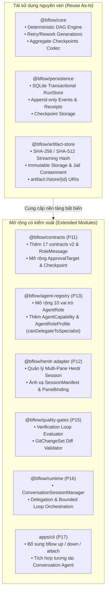
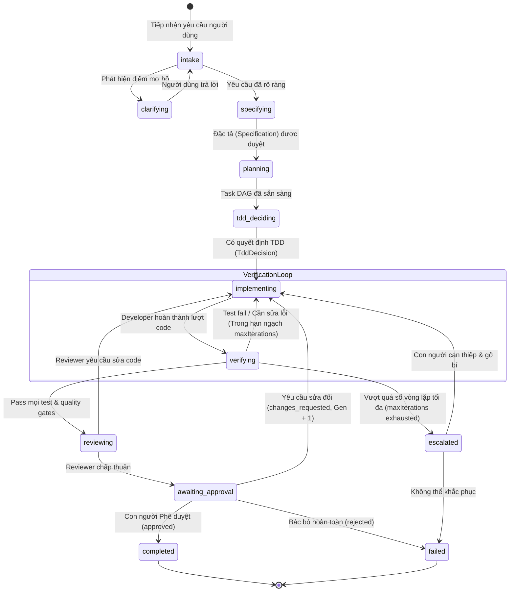
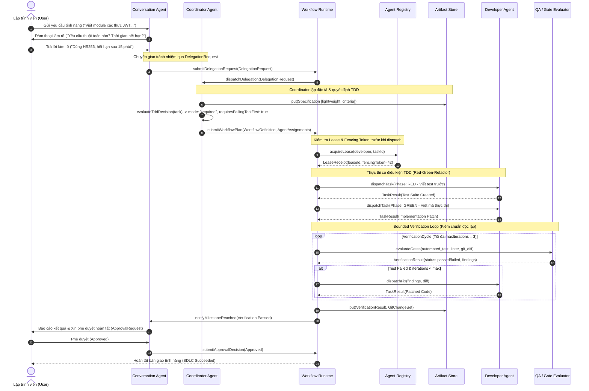
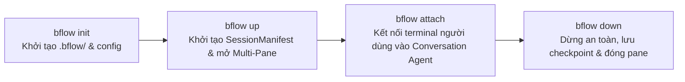

# Kiến Trúc Hệ Thống bflow v2: Agentic SDLC Multi-Agent Framework

Tài liệu này xác lập đặc tả kiến trúc kỹ thuật chuẩn mực và có thẩm quyền (authoritative architectural specification) cho phiên bản nâng cấp v2 của nền tảng **bflow**. Kiến trúc này nâng tầm bflow từ một workflow engine đơn lẻ (P00–P10) thành một khung điều phối đa tác tử thông minh (Agentic SDLC Multi-Agent Framework, P11–P18), tích hợp chặt chẽ với Herdr để quản lý môi trường multi-pane, tương tác đàm thoại tự nhiên với người dùng (Conversation Agent), phân rã bài toán và điều phối chiến lược (Coordinator Agent), phát triển hướng đặc tả (Spec-Driven Development), TDD có điều kiện (Conditional TDD), và vòng lặp kiểm chuẩn có chặn (Bounded Verification Loop).

---

## Mục lục

1. [Section 1: Kiểm toán hiện trạng (P00–P10 Codebase Audit)](#section-1-kiểm-toán-hiện-trạng-p00p10-codebase-audit)
   - 1.1. Hiện trạng triển khai tại Baseline `b10380d`
   - 1.2. Khoảng trống năng lực hiện tại (Architectural Gaps v2)
   - 1.3. Phân loại Module: Tái sử dụng (As-is) vs Mở rộng (Extended) & Cân nhắc tương thích (Compatibility/Migration)
2. [Section 2: Phân tách 4 miền trạng thái (Four Distinct State Domains)](#section-2-phân-tách-4-miền-trạng-thái-four-distinct-state-domains)
   - 2.1. Động lực kiến trúc và nguyên tắc bất biến (Architectural Invariant)
   - 2.2. Chi tiết 4 miền trạng thái độc lập
   - 2.3. Bảng đối chiếu và ma trận tương tác giữa các miền trạng thái
   - 2.4. Sơ đồ chuyển đổi trạng thái (Mermaid State Diagrams)
3. [Section 3: Ranh giới trách nhiệm (Responsibility Boundaries)](#section-3-ranh-giới-trách-nhiệm-responsibility-boundaries)
   - 3.1. Sơ đồ kiến trúc tổng thể (Architecture Flowchart)
   - 3.2. Sơ đồ tuần tự tương tác (SDLC Sequence Diagram)
   - 3.3. Ranh giới và điều cấm kỵ của 5 thành phần cốt lõi
4. [Section 4: Quản lý phiên đa Pane và CLI `bflow init/up/down/attach`](#section-4-quản-lý-phiên-đa-pane-và-cli-bflow-initupdownattach)
   - 4.1. Cấu trúc `SessionManifest` và `PaneBinding`
   - 4.2. Vòng đời phiên đa Pane và các lệnh CLI tương tác
5. [Section 5: Quyền sở hữu đường dẫn cho P12–P18 (Path Ownership & Wave Plan)](#section-5-quyền-sở-hữu-đường-dẫn-cho-p12p18-path-ownership--wave-plan)
   - 5.1. Bảng phân định quyền sở hữu đường dẫn cho P12–P18
   - 5.2. Các quy tắc ranh giới bất biến khi triển khai song song
   - 5.3. Tiêu chí nghiệm thu tích hợp từng pha

---

## Section 1: Kiểm toán hiện trạng (P00–P10 Codebase Audit)

Kiểm toán được thực hiện trực tiếp trên nhánh `main` tại commit tích hợp `b10380d` (Rebrand repository to bflow, update README, and add CI/CD workflows).

### 1.1. Hiện trạng triển khai tại Baseline `b10380d`

Hệ thống bflow v1 đã hoàn thành đầy đủ các gói chức năng cơ sở với mức độ bao phủ kiểm thử cao và ranh giới mô-đun nghiêm ngặt:

1. **`@bflow/contracts` (v1 Ports & Schemas)**:
   - Toàn bộ dữ liệu trao đổi qua ranh giới gói đều được xác thực lúc thực thi (runtime validation) bằng các schema Zod nghiêm ngặt (`strict()`), không dùng type assertion lỏng lẻo.
   - Chuẩn hoá kết quả xử lý bất đồng bộ qua kiểu `OperationResult<T>` (`{ ok: true; value: T } | { ok: false; error: ContractError }`) với mã lỗi phân biệt (`ContractErrorCode`).
   - Cung cấp các schema v1 cốt lõi: `WorkflowDefinition`, `TaskDefinition`, `AgentRequest`, `AgentSubmissionReceipt`, `AgentExecutionHandle`, `AgentResult`, `ArtifactProposal`, `ArtifactReference`, `ApprovalRequest`, `ApprovalDecision`, `DomainEvent`, và `RecoveryCheckpoint`.
   - Cung cấp các hàm kiểm tra logic thuần túy (pure validators): `validateTaskTransition`, `validateRunTransition`, và `validateEventBatch`.

2. **`@bflow/core` (Deterministic Workflow Engine)**:
   - Triển khai động cơ `WorkflowEngineImpl` hoàn toàn tiền định (deterministic), không gọi trực tiếp bất kỳ thao tác I/O nào.
   - Đánh giá DAG công việc thông qua thuật toán sắp xếp topo (topological sort) và phát hiện chu trình (cycle detection).
   - Kiểm soát giới hạn thực thi đồng thời thông qua tham số `maxConcurrency`.
   - Hỗ trợ chính sách thử lại (retry) với thuật toán exponential backoff kết hợp jitter tiền định tính toán từ hàm băm SHA-256 (không sinh số ngẫu nhiên runtime để đảm bảo replay nhất quán).
   - Hỗ trợ cơ chế làm lại (rework) với thế hệ tăng dần (`generation` N -> N+1, trạng thái `succeeded -> ready`), phân biệt rành mạch giữa `attempt` (chạy lại do lỗi kỹ thuật) và `generation` (làm lại do yêu cầu thay đổi nghiệp vụ).
   - Hỗ trợ lưu trữ trạng thái tổng hợp qua codec `bflow.workflow-aggregate+json` và xuất biên lai lệnh (`CommandReceipt`) được băm dấu vân tay SHA-256 (`fingerprint`) để chống lặp lệnh (idempotent command processing).

3. **`@bflow/herdr-adapter` (Herdr CLI Adapter)**:
   - Tương thích với Herdr CLI phiên bản `0.9.1`, protocol `22`, schema version `1`.
   - Triển khai cổng `AgentTransport`: `initialize`, `send`, `wait`, `read`, `reconcile`, `cancel`.
   - Cơ chế single-flight: Chỉ cho phép một lệnh prompt đang bay tại một thời điểm trên mỗi handle.
   - Trả về biên lai `AgentSubmissionReceipt` thay vì kết quả công việc; ghi nhận trạng thái giao vận `AgentTransportState` (`starting`, `accepted`, `idle`, `working`, `blocked`, `done`, `unknown`, `disconnected`, `cancelled`).
   - Xử lý bất định giao vận: Khi gặp `unknown_delivery`, adapter nghiêm cấm tự động gửi lại (resend forbidden) cho đến khi `reconcile` xác nhận rõ ràng `not_delivered`.

4. **`@bflow/persistence` (SQLite RunStore)**:
   - Triển khai `RunStoreImpl` dựa trên mô-đun chuẩn `node:sqlite` không cờ kích hoạt của Node.js >= 22.13 (đã kiểm định trên Node 22.23.2).
   - Đảm bảo tính toàn vẹn ACID bằng cách thực thi việc ghi sự kiện (`events`), cập nhật snapshot (`snapshots`), và lưu biên lai (`command_receipts`) trong cùng một giao dịch SQLite duy nhất.
   - Hỗ trợ kiểm tra optimistic version (`expectedVersion`) và tính toán số thứ tự stream liên tục (`expectedLastSequence`).
   - Tích hợp bộ upcaster tương thích để nâng cấp checkpoint từ định dạng v0 (thiếu metadata phiên bản) lên định dạng v1 có cấu trúc.
   - Cung cấp cả hai chế độ khôi phục: replay toàn bộ từ sự kiện đầu tiên (`run.created`) và replay từ checkpoint tổng hợp (`tail-only replay`).

5. **`@bflow/artifact-store` (Filesystem ArtifactStore)**:
   - Triển khai `ArtifactStoreImpl` lưu trữ tệp tin trên hệ thống tệp cục bộ (local POSIX filesystem).
   - Đảm bảo tính toàn vẹn nghiêm ngặt: Tính toán đồng thời cả hai mã băm SHA-256 và SHA-512 trên luồng dữ liệu (streaming hash verification).
   - Kiểm soát an toàn đường dẫn (jail validation): Nghiêm cấm directory traversal, từ chối symlink và các tệp đặc biệt (FIFO, socket, device), đảm bảo tệp nằm trọn vẹn trong thư mục gốc được cấp phép.
   - Ghi dữ liệu nguyên tử (atomic write) thông qua việc ghi vào tệp tạm (`.staging`) rồi đổi tên nguyên tử (`rename`).
   - Chỉ trả về `ArtifactReference` tin cậy với định dạng URI bất biến `artifact://store/{id}` sau khi đã kiểm tra băm và kích thước thành công; hỗ trợ đánh dấu bia mộ (`tombstone`) khi xóa theo vòng đời.

6. **`@bflow/agent-registry` (File-backed Registry & Leases)**:
   - Triển khai `FileAgentRegistry` dựa trên hệ thống tệp tin JSON với cơ chế khóa file nguyên tử.
   - Phân định rạch ròi giữa việc tra cứu cấu hình (`resolve`) và giữ chỗ năng lực thực thi (`acquireLease`, `renewLease`, `releaseLease`).
   - Quản lý hạn ngạch tải thông qua `maxConcurrentTasks`, thời gian sống của lease (`leaseTtlMs`), phiên bản lease lạc quan, và thẻ hàng rào đơn điệu tăng (`fencingToken`).
   - Hỗ trợ 4 vai trò tĩnh MVP (`MVP_ROLES`: `planner`, `developer`, `reviewer`, `qa`) kèm mẫu cấu hình và template prompt mặc định.

7. **`@bflow/quality-gates` (Evaluators & Human Approvals)**:
   - Triển khai các cổng chất lượng độc lập với lõi workflow:
     - `CommandRunnerGate`: Thực thi các lệnh kiểm thử, linter trong subprocess bị cô lập, có giới hạn thời gian (timeout) và hủy bỏ an toàn (`AbortSignal`).
     - `SecurityPolicyGate`: Quét lỗ hổng bảo mật, kiểm tra sự hiện diện của các token/bí mật hoặc các mẫu bị cấm.
     - `HumanApprovalGate`: Quản lý yêu cầu phê duyệt có kiểm soát vai trò (RBAC), kiểm tra chữ ký định danh người duyệt.
   - Xuất dữ liệu đánh giá dưới dạng các phát hiện (`GateFinding`) và `ArtifactProposal`, không trực tiếp biến đổi trạng thái của run/task.

8. **`@bflow/runtime` (RuntimeService & Orchestration)**:
   - Đóng vai trò lớp facade hợp thành các cổng: `RuntimeServiceImpl`, `TaskDispatcher`, và `SdlcWorkflowOrchestrator`.
   - Bảo đảm thứ tự giao dịch an toàn: Bắt buộc ghi nhận ý định điều phối (`task.dispatch_requested`) vào persistence trước khi gửi transport; bắt buộc ghi nhận liên kết thực thi (`agent.execution_bound`) trước khi dựa vào handle để theo dõi.
   - Xử lý bất định giao vận `unknown_delivery` bằng cách chuyển trạng thái run sang `blocked` và yêu cầu đối soát (`reconcile`).
   - Điều phối tuần tự các cổng chất lượng và yêu cầu phê duyệt con người trước khi cho phép task hoàn tất.

9. **`apps/cli` (`bflow` CLI Tool)**:
   - Cung cấp giao diện dòng lệnh dựa trên Node.js, biên dịch thành nhị phân `bflow`.
   - Các lệnh đã triển khai:
     - `bflow init`: Khởi tạo file cấu hình `.bflow.json` và thư mục làm việc.
     - `bflow run`: Khởi chạy một workflow từ định nghĩa tệp tin JSON/YAML.
     - `bflow status`: Truy vấn trạng thái snapshot hiện tại của run.
     - `bflow approve`: Gửi quyết định phê duyệt (`approved`, `rejected`, `changes_requested`).
     - `bflow resume`: Khôi phục chạy tiếp một run đang bị tạm dừng hoặc lỗi.
     - `bflow cancel`: Yêu cầu hủy bỏ một run đang thực thi.
     - `bflow help`, `bflow version`: Hiển thị trợ giúp và phiên bản.

10. **`tests/e2e` (Integration & Resilience Suites)**:
    - Bộ kiểm thử hộp xám và hộp đen hoàn chỉnh kiểm chứng khả năng phục hồi sau sự cố:
      - Ranh giới sập nguồn mô phỏng `SIGKILL` giữa các bước dispatch và bind handle.
      - Chèn lỗi giao vận (transport failure injection), mạng chập chờn, và timeout.
      - Xung đột thẻ hàng rào lease (`fencing token conflict`).
      - Khôi phục tính nhất quán dữ liệu từ SQLite event log sau khởi động lại tiến trình.

---

### 1.2. Khoảng trống năng lực hiện tại (Architectural Gaps v2)

Mặc dù nền tảng v1 rất vững chắc về khả năng chịu lỗi và tính tiền định, hệ thống vẫn tồn tại các khoảng trống lớn để trở thành một hệ thống SDLC tự trị thực thụ (Agentic SDLC):

| Thành phần thiếu hụt | Hợp đồng / Cơ chế chưa có | Hậu quả / Rào cản ở v1 |
| --- | --- | --- |
| **Conversation Agent** | Hợp đồng `ConversationSession`, `ConversationMessage`, bảng trạng thái `ConversationSessionStatus`. | Người dùng chỉ có thể dùng lệnh CLI tĩnh hoặc truyền file cấu hình workflow DAG cố định; không có giao diện đàm thoại để thảo luận ý tưởng, giải quyết mơ hồ, hoặc theo dõi tiến độ tự nhiên. |
| **Coordinator Agent** | Hợp đồng `DelegationRequest`, `AgentAssignment`, cơ chế phân rã bài toán động. | Không có agent đóng vai trò Tech Lead để tiếp nhận yêu cầu cấp cao, tự động phân tích độ phức tạp, lập kế hoạch nhiệm vụ, và phân công vai trò chuyên trách. |
| **Multi-Pane Herdr Session** | Hợp đồng `SessionManifest`, `PaneBinding`, quản lý phiên đa terminal. | Herdr adapter hiện tại chỉ tương tác với một terminal/pane đơn lẻ; không thể khởi chạy song song 4–8 terminal pane trực quan cho từng vai trò agent. |
| **CLI Tương tác Nâng cao** | Lệnh `bflow up`, `bflow down`, `bflow attach`. | Người dùng không thể khởi chạy toàn bộ môi trường agent trong một thao tác (`up`), không thể attach terminal vào phiên đàm thoại (`attach`), và không thể dọn dẹp môi trường sạch sẽ (`down`). |
| **Spec-Driven Development (SDD)** | Hợp đồng `Specification`, `AcceptanceCriterion`, phân cấp `lightweight` vs `full`. | Developer agent bắt tay vào code ngay mà không có bản đặc tả có cấu trúc; thiếu tiêu chí nghiệm thu rõ ràng dẫn đến code sai lệch mục tiêu nghiệp vụ. |
| **Conditional TDD** | Hợp đồng `TddDecision`, `TestStrategy`, quy trình bắt buộc Red-Green-Refactor. | Không có cơ chế đánh giá xem một task có bắt buộc phải viết test trước (TDD) hay không; thiếu chiến lược kiểm thử tự động thích ứng với mức độ rủi ro của task. |
| **Bounded Verification Loop** | Hợp đồng `VerificationCycle`, `VerificationResult`, `GitChangeSet`. | Khi task gặp lỗi, v1 chỉ có cơ chế retry/rework mức thô; thiếu vòng lặp sửa lỗi cục bộ kết hợp giữa test, lint và git diff, dễ gây lặp vô hạn và cạn kiệt token ngân sách. |

---

### 1.3. Phân loại Module: Tái sử dụng (As-is) vs Mở rộng (Extended) & Cân nhắc tương thích (Compatibility/Migration)

Để đảm bảo nguyên tắc bảo toàn kiến trúc và không phá vỡ các thành quả đã đạt được từ P00–P10, việc nâng cấp lên v2 tuân thủ chiến lược phân loại nghiêm ngặt:



#### Phân tích chi tiết:

1. **Các mô-đun tái sử dụng nguyên vẹn (Reuse As-Is)**:
   - **`@bflow/core`**: Giữ nguyên toàn bộ logic xử lý DAG, chuyển đổi trạng thái hợp lệ, tính toán jitter tiền định, và quản lý thế hệ rework (`generation`). Các quy trình nghiệp vụ mới (như bước tạo Spec, quyết định TDD, vòng lặp Verification) sẽ được Coordinator mô hình hóa thành các `TaskDefinition` chuẩn trong `WorkflowDefinition`. Engine không cần sửa đổi lõi chuyển trạng thái.
   - **`@bflow/artifact-store`**: Giữ nguyên thiết kế lưu trữ nhị phân bất biến. Các tài liệu sinh ra trong v2 (bản đặc tả markdown, tệp patch git diff, log kiểm thử) đều được lưu trữ dưới dạng artifact thông thường với mã định danh URI `artifact://store/{id}`.
   - **`@bflow/persistence`**: Giữ nguyên bảng lưu trữ SQLite và cơ chế append-only event log. Các sự kiện mới của v2 tuân thủ `DomainEventSchema` mở rộng.

2. **Các mô-đun mở rộng có kiểm soát và kế hoạch tương thích (Compatibility/Migration Plan)**:
   - **`@bflow/contracts`**:
     - Bổ sung 17 hợp đồng v2 mà không làm thay đổi các schema v1 hiện hữu.
     - `ApprovalTargetSchema`: Mở rộng từ 3 loại (`run`, `task`, `quality_gate`) thành hợp nhất phân biệt (discriminated union) hỗ trợ thêm `specification`, `tdd_decision`, `verification_escalation`, `git_changeset`, và `delegation`. Các bản ghi approval v1 cũ vẫn hoàn toàn hợp lệ mà không cần migration.
     - `WorkflowAggregateCheckpointStateSchema`: Bổ sung trường ngữ cảnh phục hồi `sdlcContext?: SdlcRecoveryContext` (chứa `conversationSession`, `sessionManifest`, `specifications`, `activeAssignments`, `verificationCycles`, `gitChangeSets`). Bộ giải mã (codec) v1 vẫn đọc được các checkpoint v2 mà không bị lỗi xác thực (`strip` hoặc bỏ qua an toàn).
   - **`@bflow/agent-registry` (P13)**:
     - Mở rộng danh sách vai trò: Nâng cấp từ hằng số 4 `MVP_ROLES` (`["planner", "developer", "reviewer", "qa"]`) thành 10 vai trò chuẩn `AgentRole` (`conversation`, `coordinator`, `planner`, `architect`, `specifier`, `developer`, `tester`, `reviewer`, `qa`, `security`).
     - *Kế hoạch tương thích*: Mã hiện tại kiểm tra `isMvpRole` sẽ được mở rộng bằng hàm `isAgentRole` tương thích ngược. Mọi vai trò cũ trong các tệp cấu hình `.bflow.json` vẫn tiếp tục hoạt động.
     - *Ràng buộc ủy quyền*: Bổ sung `AgentRoleProfile` với trường `canDelegateToSpecialist`. Quy tắc an toàn bắt buộc: Chỉ duy nhất vai trò `coordinator` được phép thiết lập `canDelegateToSpecialist: true`. Các vai trò khác (kể cả `conversation` và `developer`) nếu có cờ này sẽ bị Registry từ chối lúc khởi tạo (`validation error`).
   - **`@bflow/herdr-adapter` (P12)**:
     - Giữ nguyên cổng `AgentTransport` cho từng pane đơn lẻ.
     - Mở rộng thêm `MultiPaneSessionManager` quản lý một mảng các `PaneBinding` bên trong `SessionManifest`. Mỗi pane được gắn với một terminal Herdr độc lập.
   - **`@bflow/runtime` & `apps/cli` (P16, P17)**:
     - Runtime tích hợp thêm bộ điều phối đàm thoại (`ConversationSessionManager`).
     - CLI bổ sung các lệnh tương tác `up`, `down`, `attach` mà không ảnh hưởng đến các lệnh chạy batch truyền thống (`run`, `status`, `approve`).

---

## Section 2: Phân tách 4 miền trạng thái (Four Distinct State Domains)

### 2.1. Động lực kiến trúc và nguyên tắc bất biến (Architectural Invariant)

Một trong những sai lầm phổ biến và nguy hiểm nhất trong các hệ thống Multi-Agent là sự nhập nhằng giữa các tầng trạng thái: coi trạng thái kết thúc lượt chạy của agent transport (Herdr trả về `done`) là bằng chứng cho thấy công việc SDLC đã thành công (`succeeded`).

> [!CAUTION]
> **Nguyên tắc bất biến tối thượng**:
> 1. Trạng thái giao vận (`AgentTransportState`) là quan sát vật lý của tầng truyền thông Herdr. Giá trị `done` của Herdr chỉ có nghĩa là tiến trình agent đã hoàn thành việc xuất dữ liệu ra terminal/socket; nó **TUYỆT ĐỐI KHÔNG** chứng minh rằng nhiệm vụ SDLC đã hoàn thành thành công hay đáp ứng yêu cầu chất lượng.
> 2. Chỉ có **Workflow Engine** kết hợp với **Quality Gates** độc lập mới có thẩm quyền chuyển trạng thái công việc SDLC sang `succeeded`.
> 3. Hệ thống bflow v2 thiết lập sự phân tách tuyệt đối giữa 4 miền trạng thái trực giao (orthogonal state domains).

---

### 2.2. Chi tiết 4 miền trạng thái độc lập

```mermaid
flowchart LR
  subgraph D1["1. AgentTransportState (Herdr Transport)"]
    direction TB
    T_start["starting"] --> T_acc["accepted"]
    T_acc --> T_work["working"]
    T_work --> T_idle["idle"]
    T_work --> T_done["done (Turn Finished)"]
    T_work --> T_block["blocked"]
    T_work --> T_unk["unknown"]
    T_work --> T_disc["disconnected"]
    T_work --> T_canc["cancelled"]
  end

  subgraph D2["2. SdlcWorkStatus (SDLC Task/Run)"]
    direction TB
    S_intake["intake"] --> S_clar["clarifying"]
    S_clar --> S_spec["specifying"]
    S_spec --> S_plan["planning"]
    S_plan --> S_tdd["tdd_deciding"]
    S_tdd --> S_impl["implementing"]
    S_impl --> S_ver["verifying"]
    S_ver --> S_rev["reviewing"]
    S_rev --> S_app["awaiting_approval"]
    S_app --> S_succ["completed / succeeded"]
    S_ver -. Lỗi .- -> S_fail["failed"]
    S_app -. Yêu cầu làm lại .- -> S_rework["implementing (Gen+1)"]
  end

  subgraph D3["3. ConversationSessionStatus (Hội thoại người dùng)"]
    direction TB
    C_act["active"] --> C_clar["awaiting_user_clarification"]
    C_clar --> C_del["delegated_to_coordinator"]
    C_del --> C_rep["reporting_progress"]
    C_rep --> C_app["awaiting_user_approval"]
    C_app --> C_comp["completed"]
    C_del -. Tạm dừng .- -> C_pause["paused"]
    C_comp --> C_arch["closed / archived"]
  end

  subgraph D4["4. ApprovalStatus (Phê duyệt & Governance)"]
    direction TB
    A_pend["pending"] --> A_app["approved"]
    A_pend --> A_chg["changes_requested"]
    A_pend --> A_rej["rejected"]
    A_pend --> A_exp["expired"]
    A_pend --> A_canc["cancelled"]
    A_pend --> A_sup["superseded"]
  end
```

#### Miền 1: Trạng thái thực thi giao vận Herdr (`AgentTransportState`)
- **Phạm vi quản lý**: Tầng truyền thông `AgentTransport` và tiến trình Herdr pane.
- **Tập giá trị hợp lệ**:
  - `starting`: Đang khởi tạo tiến trình agent hoặc khởi tạo kết nối socket.
  - `accepted`: Herdr đã nhận diện lệnh dispatch và gán handle thực thi.
  - `idle`: Agent đang trực tuyến, không có công việc xử lý, sẵn sàng nhận prompt.
  - `working`: Agent đang tích cực tính toán, chạy công cụ, hoặc sinh phản hồi.
  - `blocked`: Tiến trình agent bị khóa tài nguyên, chờ cấp quota, hoặc chờ terminal input.
  - `done`: Agent đã hoàn tất một lượt chạy (turn execution). Lưu ý: Đây là trạng thái transport, chưa qua thẩm định kết quả.
  - `unknown`: Mất khả năng quan sát trạng thái (ví dụ mạng timeout, process crash chưa rõ nguyên nhân).
  - `disconnected`: Kết nối IPC/Socket với Herdr daemon bị ngắt.
  - `cancelled`: Tiến trình agent đã bị dừng theo lệnh hủy.

#### Miền 2: Trạng thái công việc SDLC (`SdlcWorkStatus` / `TaskStatus`)
- **Phạm vi quản lý**: `@bflow/core` và `@bflow/runtime`.
- **Tập giá trị hợp lệ của quy trình SDLC v2**:
  - `intake`: Tiếp nhận yêu cầu thô từ phiên đàm thoại.
  - `clarifying`: Đang trong tiến trình làm rõ các điểm chưa sáng tỏ.
  - `specifying`: Đang tạo tài liệu đặc tả kỹ thuật (`Specification`).
  - `planning`: Đang lập kế hoạch phân rã task DAG và gán vai trò.
  - `tdd_deciding`: Đang đánh giá chiến lược kiểm thử và quyết định TDD (`TddDecision`).
  - `implementing`: Developer agent đang viết code hoặc sửa mã nguồn.
  - `verifying`: Đang thực thi vòng lặp kiểm chuẩn tự động (`VerificationCycle`).
  - `reviewing`: Chuyên gia đánh giá (`reviewer`) đang kiểm tra mã nguồn và diff.
  - `awaiting_approval`: Đang chờ quyết định phê duyệt con người hoặc gate cấp cao.
  - `completed` (hoặc `succeeded` ở cấp Task/Run): Nghiệp vụ đã hoàn tất thành công và được nghiệm thu.
  - `escalated`: Gặp bế tắc không thể tự giải quyết, cần leo thang lên con người.
  - `failed`: Nhiệm vụ thất bại sau khi đã cạn kiệt số lần thử lại (retries exhausted).
  - `cancelled`: Nhiệm vụ đã bị hủy bỏ bởi người dùng hoặc hệ thống.

#### Miền 3: Trạng thái phiên hội thoại (`ConversationSessionStatus`)
- **Phạm vi quản lý**: Conversation Agent và `ConversationSessionManager`.
- **Tập giá trị hợp lệ**:
  - `active`: Phiên hội thoại đang mở và sẵn sàng đàm thoại.
  - `awaiting_user_clarification`: Hệ thống đã đặt câu hỏi và đang chờ người dùng trả lời làm rõ.
  - `delegated_to_coordinator`: Đã bàn giao yêu cầu đã làm rõ cho Coordinator Agent xử lý.
  - `reporting_progress`: Đang cập nhật tiến độ định kỳ hoặc theo mốc cho người dùng xem.
  - `awaiting_user_approval`: Đang chờ người dùng đưa ra quyết định phê duyệt cuối cùng trên UI/CLI.
  - `completed`: Toàn bộ mục tiêu đàm thoại đã đạt được.
  - `paused`: Phiên làm việc tạm dừng (ví dụ người dùng detach hoặc tạm nghỉ).
  - `closed`: Phiên đàm thoại kết thúc bình thường.
  - `archived`: Toàn bộ nhật ký và artifact của phiên được đóng gói lưu trữ.

#### Miền 4: Trạng thái phê duyệt (`ApprovalStatus`)
- **Phạm vi quản lý**: Governance engine, `HumanApprovalGate`, và CLI approval.
- **Tập giá trị hợp lệ**:
  - `pending`: Yêu cầu phê duyệt đã được tạo, các bên liên quan được thông báo và đang chờ quyết định.
  - `approved`: Người có thẩm quyền đã chấp thuận; quy trình được phép đi tiếp.
  - `changes_requested`: Người phê duyệt yêu cầu chỉnh sửa; kích hoạt thế hệ làm lại (`generation` + 1).
  - `rejected`: Người phê duyệt bác bỏ dứt khoát; công việc dừng lại hoặc chuyển sang nhánh thất bại.
  - `expired`: Yêu cầu phê duyệt vượt quá thời gian chờ (timeout policy).
  - `cancelled`: Yêu cầu phê duyệt bị hủy bỏ do toàn bộ run bị hủy.
  - `superseded`: Yêu cầu phê duyệt bị thay thế bởi một yêu cầu phê duyệt mới hơn có thẩm quyền cao hơn.

---

### 2.3. Bảng đối chiếu và ma trận tương tác giữa các miền trạng thái

Bảng dưới đây chỉ rõ sự khác biệt ngữ nghĩa và cách thức hệ thống phản ứng khi một trạng thái thay đổi:

| Tình huống thực tế | Trạng thái Transport (`AgentTransportState`) | Trạng thái SDLC (`SdlcWorkStatus`) | Trạng thái Hội thoại (`ConversationSessionStatus`) | Trạng thái Phê duyệt (`ApprovalStatus`) | Hành động của Hệ thống |
| --- | --- | --- | --- | --- | --- |
| Người dùng gõ câu lệnh đầu tiên vào CLI attach | `idle` (Conversation Agent) | `intake` | `active` | N/A | Conversation Agent nhận prompt và phân tích ngữ nghĩa. |
| Phát hiện yêu cầu còn mơ hồ, cần hỏi thêm | `working` -> `idle` | `clarifying` | `awaiting_user_clarification` | N/A | Gửi câu hỏi lên màn hình terminal người dùng; chờ nhập liệu. |
| Đã đủ yêu cầu, chuyển cho Tech Lead | `idle` | `specifying` / `planning` | `delegated_to_coordinator` | N/A | Gửi `DelegationRequest` cho Coordinator Agent qua Runtime. |
| Developer đang viết code trong pane riêng | `working` (Developer Agent) | `implementing` | `reporting_progress` | N/A | Runtime giám sát token & thời gian; định kỳ báo cáo tiến độ. |
| Developer kết thúc lệnh chạy (`done`) | **`done`** | **`verifying`** (CHƯA xong) | `reporting_progress` | N/A | Runtime nhận `done`, kiểm tra biên lai, kích hoạt ngay `VerificationCycle`. |
| Chạy test tự động bị fail | `idle` (QA Agent) | `implementing` (lặp sửa lỗi) | `reporting_progress` | N/A | Verification Cycle ghi nhận thất bại; trả lỗi cho Developer sửa tiếp. |
| Code đã pass mọi test, cần con người nghiệm thu | `idle` | `awaiting_approval` | `awaiting_user_approval` | `pending` | Phát ra `ApprovalRequest`, dừng workflow chờ con người `bflow approve`. |
| Con người bấm reject hoặc yêu cầu sửa | `idle` | `implementing` (Rework Gen+1) | `reporting_progress` | `changes_requested` | Tăng `generation` lên 1, kích hoạt Developer agent làm lại theo feedback. |
| Nghiệm thu thành công trọn vẹn | `idle` | `completed` | `completed` | `approved` | Đóng phiên làm việc, xuất báo cáo tổng kết và các artifact hoàn chỉnh. |

---

### 2.4. Sơ đồ chuyển đổi trạng thái (Mermaid State Diagrams)

#### Sơ đồ chuyển đổi trạng thái SDLC (`SdlcWorkStatus`):



---

## Section 3: Ranh giới trách nhiệm (Responsibility Boundaries)

### 3.1. Sơ đồ kiến trúc tổng thể (Architecture Flowchart)

```mermaid
flowchart TD
  User([User / Developer Terminal]) <-->|bflow attach| ConvAgent[Conversation Agent<br/>• Sole User Interface<br/>• Clarification Dialogue<br/>• Progress Reporting]

  subgraph Coordination_Layer["Tầng Điều Phối & Lập Chiến Lược (Strategic Coordination)"]
    ConvAgent -->|DelegationRequest| CoordAgent[Coordinator Agent<br/>• SDD Level Decision<br/>• Conditional TDD Decision<br/>• Task DAG Decomposition<br/>• AgentAssignment]
  end

  subgraph Runtime_Core["Lõi Thực Thi Hệ Thống (Workflow Runtime & Core)"]
    CoordAgent <-->|Execute via WorkflowRuntime ONLY| RuntimeService[Workflow Runtime Service<br/>• Concurrency & DAG Control<br/>• Lease & Fencing Enforcement<br/>• Retry, Rework & Bounded Verification Limits<br/>• Independent Acceptance Gates]
    RuntimeService <--> CoreEngine["@bflow/core Engine<br/>• Deterministic State Machine<br/>• Aggregate Recovery Codec"]
  end

  subgraph Execution_Layer["Tầng Thực Thi & Giao Vận (Herdr Multi-Pane Execution)"]
    RuntimeService <-->|AgentTransport| HerdrAdapter["@bflow/herdr-adapter<br/>• SessionManifest & PaneBindings<br/>• Protocol 22 Single-Flight"]
    HerdrAdapter <--> PaneConv[Pane: Conversation]
    HerdrAdapter <--> PaneCoord[Pane: Coordinator]
    HerdrAdapter <--> PaneDev[Pane: Developer]
    HerdrAdapter <--> PaneQA[Pane: QA / Reviewer]
  end

  subgraph Storage_Layer["Tầng Dữ Liệu & Bằng Chứng Bất Biến (Storage & Persistence)"]
    RuntimeService <-->|ACID Events & Snapshots| RunStore["@bflow/persistence<br/>• SQLite Transactional Store<br/>• Recovery Checkpoints"]
    RuntimeService <-->|artifact://store/{id}| ArtifactStore["@bflow/artifact-store<br/>• Specification & Git Patches<br/>• Test Results & Verification Logs"]
  end
```

---

### 3.2. Sơ đồ tuần tự tương tác (SDLC Sequence Diagram)



---

### 3.3. Ranh giới và điều cấm kỵ của 5 thành phần cốt lõi

#### 1. Conversation Agent
- **Trách nhiệm chính**:
  - Là điểm tiếp xúc duy nhất trực tiếp với người dùng (`bflow attach` chỉ kết nối vào terminal pane này).
  - Thu nhận yêu cầu tự nhiên của người dùng, phân tích ý định (intent detection).
  - Tiến hành đối thoại làm rõ (clarification dialogue) để biến các yêu cầu trừu tượng/mơ hồ thành các mục tiêu cụ thể.
  - Cập nhật và báo cáo tiến độ trực quan theo thời gian thực cho người dùng.
  - Chuyển giao yêu cầu đã làm rõ cho Coordinator Agent thông qua hợp đồng chuẩn `DelegationRequest`.
  - Trình bày kết quả nghiệm thu cuối cùng và tiếp nhận phản hồi/phê duyệt từ người dùng.
- **Điều cấm kỵ (Invariants)**:
  - **TUYỆT ĐỐI KHÔNG** tự mình phân rã các task kỹ thuật của DAG workflow.
  - **TUYỆT ĐỐI KHÔNG** trực tiếp dispatch lệnh cho Developer, Reviewer hay QA Agent.
  - **TUYỆT ĐỐI KHÔNG** trực tiếp sửa đổi mã nguồn trong kho lưu trữ.

#### 2. Coordinator Agent
- **Trách nhiệm chính**:
  - Đóng vai trò là Technical Lead / Solution Architect trong hệ thống.
  - Tiếp nhận `DelegationRequest` từ Conversation Agent.
  - Quyết định mức độ chi tiết của đặc tả SDD (`Specification` với cấp độ `lightweight` cho tác vụ nhỏ/ít rủi ro hoặc `full` cho tính năng lớn).
  - Đưa ra quyết định kiểm thử có điều kiện (`TddDecision`): Quyết định xem task có bắt buộc phải áp dụng TDD (Red-Green-Refactor) hay không, cùng với `TestStrategy`.
  - Phân rã mục tiêu thành đồ thị công việc (Task DAG) và lập bảng phân công chuyên gia (`AgentAssignment`).
  - Giao tiếp với các agent chuyên môn khác thông qua phong bì thông điệp chuẩn hóa `RoleMessage`.
- **Điều cấm kỵ (Invariants)**:
  - **TUYỆT ĐỐI KHÔNG** tự ý thực thi các lệnh hệ thống (subprocess execution) bên ngoài ranh giới được kiểm soát.
  - **TUYỆT ĐỐI KHÔNG** tự ý điều phối hay gửi lệnh trực tiếp tới agent mà không thông qua **Workflow Runtime**.
  - **TUYỆT ĐỐI KHÔNG** được phép bỏ qua các chính sách an toàn, rào chắn chất lượng (Quality Gates), cơ chế lease, hoặc giới hạn vòng lặp tối đa (`maxIterations`).

#### 3. Workflow Runtime
- **Trách nhiệm chính**:
  - Là "trọng tài tối cao" và động cơ thực thi toàn bộ luồng công việc của hệ thống.
  - Quản lý vòng đời đồ thị công việc (Task DAG) và giới hạn tải đồng thời (`maxConcurrency`).
  - Kiểm tra tính hợp lệ của mọi bước chuyển trạng thái thông qua các bộ thẩm định thuần túy (`validateTaskTransition`, `validateRunTransition`).
  - Quản lý việc cấp phát và thu hồi lease thực thi, kiểm tra thẻ hàng rào đơn điệu (`fencingToken`) trước mọi hành vi gửi tin qua transport.
  - Kiểm soát nghiêm ngặt các hạn ngạch: Số lần thử lại tối đa (`maxAttempts`), số thế hệ làm lại tối đa (`maxReworks`), và số vòng lặp kiểm chuẩn tối đa (`maxIterations`).
  - Kích hoạt và tổng hợp kết quả từ các Quality Gates độc lập; chỉ cho phép task chuyển sang `succeeded` khi có bằng chứng khách quan đã được xác minh.
- **Quyền hạn đặc biệt**: Có quyền đơn phương ngắt, hủy bỏ hoặc đóng băng bất kỳ tác tử nào nếu phát hiện vi phạm chính sách, rò rỉ token, hoặc xung đột hàng rào bảo vệ (fencing token violation).

#### 4. Herdr
- **Trách nhiệm chính**:
  - Là nền tảng cơ sở hạ tầng quản lý tiến trình và giao diện đa terminal (Multi-Pane Orchestration).
  - Quản lý các terminal pane vật lý tương ứng với từng vai trò agent theo `SessionManifest` (`PaneBinding`).
  - Đảm bảo môi trường thực thi độc lập (isolated worktrees / environment variables) cho từng agent.
  - Cung cấp kênh truyền thông bất đồng bộ qua giao thức CLI/Socket (giao thức 22) kết nối giữa Workflow Runtime và các tiến trình agent.
- **Ranh giới**: Herdr hoàn toàn không có nhận thức về mặt nghiệp vụ SDLC. Trạng thái `done` của Herdr chỉ là một sự kiện transport thuần túy.

#### 5. Artifact Store
- **Trách nhiệm chính**:
  - Là kho lưu trữ bất biến tin cậy tuyệt đối (Content-Addressable Trusted Storage).
  - Tiếp nhận và thẩm định các đề xuất artifact (`ArtifactProposal`), tính toán mã băm kép SHA-256 / SHA-512 trên luồng dữ liệu, và chỉ phát hành `ArtifactReference` sau khi lưu trữ an toàn.
  - Lưu trữ các tài liệu đặc tả (`Specification`), các bản vá mã nguồn (`GitChangeSet`), kết quả kiểm thử, và nhật ký kiểm chuẩn (`VerificationResult`).
  - Đảm bảo việc truy cập dữ liệu an toàn thông qua định dạng URI `artifact://store/{id}`, cách ly hoàn toàn người dùng khỏi đường dẫn hệ thống tệp vật lý.
- **Điều cấm kỵ (Invariants)**:
  - **TUYỆT ĐỐI KHÔNG** được sử dụng Artifact Store như một kênh truyền thông điệp tương tác thời gian thực hoặc polling thay thế cho Herdr transport.

---

## Section 4: Quản lý phiên đa Pane và CLI `bflow init/up/down/attach`

### 4.1. Cấu trúc `SessionManifest` và `PaneBinding`

Để người dùng có thể trực quan hóa toàn bộ quá trình hợp tác giữa các agent trong một giao diện terminal duy nhất (hoặc giao diện chia ô tmux/zellij/herdr), bflow v2 chuẩn hóa việc quản lý phiên đa pane thông qua hai hợp đồng:

```ts
interface PaneBinding {
  readonly schemaVersion: 2;
  readonly bindingId: string;
  readonly sessionId: string;
  readonly role: AgentRole;
  readonly agentId: string;
  readonly workspaceId: string;
  readonly tabId: string;
  readonly paneId: string;
  readonly terminalId?: string;
  readonly session?: AgentSessionLocator;
  readonly provider: string;
  readonly agentKind: string;
  readonly model?: string;
  readonly cwd: string;
  readonly worktreePath?: string;
  readonly isolationMode: "dedicated_pane";
  readonly readOnlyWorkspace: boolean;
  readonly transportState: AgentTransportState;
  readonly boundAt: string;
  readonly lastHeartbeatAt?: string;
  readonly metadata?: Metadata;
}

interface SessionManifest {
  readonly schemaVersion: 2;
  readonly sessionId: string;
  readonly projectName: string;
  readonly workspaceRoot: string;
  readonly herdrWorkspaceId: string;
  readonly herdrTabId: string;
  readonly status: "initializing" | "up" | "degraded" | "stopping" | "down";
  readonly conversationSessionId: string;
  readonly activeRunIds: readonly string[];
  readonly panes: readonly PaneBinding[];
  readonly attachTarget: {
    readonly role: "conversation";
    readonly paneId: string;
    readonly terminalId?: string;
  };
  readonly createdAt: string;
  readonly updatedAt: string;
  readonly stoppedAt?: string;
  readonly metadata?: Metadata;
}
```

Mỗi vai trò tham gia vào dự án sẽ được cấp phát một pane vật lý riêng biệt:
- **Pane 1**: `conversation` (Giao diện đàm thoại với người dùng)
- **Pane 2**: `coordinator` (Nhật ký điều phối, lập kế hoạch, và giám sát DAG)
- **Pane 3**: `developer` (Quá trình viết mã nguồn, sửa lỗi, áp dụng patch)
- **Pane 4**: `qa` / `reviewer` (Quá trình chạy test suite, kiểm tra lint, và review diff)

---

### 4.2. Vòng đời phiên đa Pane và các lệnh CLI tương tác

Quy trình sử dụng bflow v2 xoay quanh 4 lệnh tương tác chủ đạo:



#### 1. Lệnh `bflow init`
- **Mục đích**: Thiết lập cấu hình ban đầu cho không gian làm việc.
- **Hành vi**:
  - Tạo thư mục `.bflow/` chứa cơ sở dữ liệu SQLite (`bflow.db`) và kho artifact cục bộ (`.bflow/artifacts/`).
  - Tạo tệp cấu hình `bflow.config.json` khai báo các vai trò agent tham gia, chính sách SDLC mặc định (mức độ đặc tả tối thiểu, có bắt buộc TDD hay không, hạn ngạch số lần lặp).
  - Khởi tạo template đăng ký agent trong file registry.

#### 2. Lệnh `bflow up`
- **Mục đích**: Khởi chạy toàn bộ môi trường làm việc đa tác tử.
- **Hành vi**:
  - Đọc cấu hình `bflow.config.json` và khởi tạo kết nối tới Herdr daemon.
  - Tạo `SessionManifest` với cấu hình chia ô trực quan (ví dụ layout dạng lưới `grid` 4 ô).
  - Cấp phát các pane vật lý tương ứng với từng `AgentRole` thông qua các lệnh Herdr `agent start`.
  - Thiết lập kênh lắng nghe Socket IPC giữa Workflow Runtime và từng terminal pane.
  - Kiểm tra trạng thái sẵn sàng (`idle`) của tất cả các agent; nếu một agent khởi động lỗi (`errored`), tiến hành dọn dẹp và báo cáo lỗi chính xác.
  - Tiến trình chạy ngầm (hoặc chạy daemon) và sẵn sàng cho việc attach.

#### 3. Lệnh `bflow attach`
- **Mục đích**: Kết nối trực tiếp terminal của lập trình viên vào không gian làm việc của hệ thống.
- **Nguyên tắc an toàn**:
  - Lệnh `bflow attach` **CHỈ KẾT NỐI DUY NHẤT** vào pane của **Conversation Agent** (`attachTarget.paneId` trong `SessionManifest`).
  - Tuyệt đối không bao giờ attach trực tiếp người dùng vào pane của Developer hay Coordinator để tránh việc người dùng can thiệp làm sai lệch trạng thái của tiến trình tự động.
- **Trải nghiệm tương tác**:
  - Người dùng có thể trò chuyện tự nhiên, giải thích yêu cầu dự án.
  - Xem các câu hỏi làm rõ từ Conversation Agent và phản hồi trực tiếp.
  - Quan sát thanh tiến trình tổng quan của các task trong DAG đang chạy ở các pane ngầm.
  - Người dùng có thể nhấn phím thoát an toàn (`Ctrl+C` hoặc `detach`) để rời khỏi terminal đàm thoại mà không làm gián đoạn các workflow đang chạy nền.

#### 4. Lệnh `bflow down`
- **Mục đích**: Tắt và dọn dẹp toàn bộ môi trường làm việc một cách an toàn (graceful shutdown).
- **Hành vi**:
  - Gửi tín hiệu thông báo hủy/dừng có trật tự tới tất cả các tiến trình agent đang chạy.
  - Chờ các agent đang thực thi dở dang hoàn tất việc xả dữ liệu hoặc dừng an toàn.
  - Thu hồi toàn bộ các lease và hủy bỏ thẻ hàng rào trong `FileAgentRegistry`.
  - Xuất và lưu trữ checkpoint tổng hợp cuối cùng (`RecoveryCheckpoint`) vào SQLite `RunStore` để sẵn sàng phục hồi khi chạy lại.
  - Đóng và giải phóng toàn bộ các pane trong Herdr session; dọn dẹp các tệp staging tạm thời.

---

## Section 5: Quyền sở hữu đường dẫn cho P12–P18 (Path Ownership & Wave Plan)

Nhằm đảm bảo quá trình phát triển song song của 5 subagent không gây ra xung đột mã nguồn (merge conflict) hoặc xâm lấn phạm vi trách nhiệm, hệ thống phân định quyền sở hữu đường dẫn tuyệt đối cho các giai đoạn từ P11 đến P18:

### 5.1. Bảng phân định quyền sở hữu đường dẫn cho P12–P18

| Pha | Nhiệm vụ trọng tâm | Gói sở hữu (Owned Paths) | Trách nhiệm chính của Agent đảm nhiệm |
| --- | --- | --- | --- |
| **P11** | Public Contracts v2 | `packages/contracts/**` | Xuất bản đầy đủ 17 Zod schema v2, `RoleMessage` envelope, và pure transition validators. |
| **P12** | Herdr Multi-Pane Session | `packages/herdr-adapter/**` | Triển khai `MultiPaneSessionManager`, ánh xạ `SessionManifest`, `PaneBinding`, quản lý lifecycle đa terminal trên Herdr 0.9.1. |
| **P13** | Agent Registry v2 & Capabilities | `packages/agent-registry/**` | Mở rộng 10 vai trò `AgentRole`, `AgentCapability` & `AgentRoleProfile`, bảo vệ ràng buộc `canDelegateToSpecialist` (chỉ cho Coordinator), quản lý lease & fencing token. |
| **P14** | Core SDD, TDD & Loop Rules | `packages/core/**` | Bổ sung các rule nghiệm thu đặc tả (`Specification`), đánh giá quyết định TDD (`TddDecision`), tính toán số vòng lặp tối đa `maxIterations` của `VerificationCycle`. |
| **P15** | Quality Gates & Verification | `packages/quality-gates/**` | Triển khai `VerificationCycleEvaluator`, bộ thẩm định `GitChangeSet` diff, phân tích phát hiện kiểm chuẩn (`GateFinding`), bảo đảm an toàn thực thi subprocess. |
| **P16** | Runtime & Persistence Orchestration | `packages/runtime/**`, `packages/persistence/**` | Điều phối `ConversationSessionManager`, `DelegationRequest`, kết nối Coordinator với WorkflowRuntime, mở rộng codec checkpoint tổng hợp trong SQLite. |
| **P17** | CLI Multi-Pane Commands | `apps/cli/**` | Mở rộng bộ phân tích lệnh và bộ xử lý cho `bflow init`, `bflow up`, `bflow down`, `bflow attach`, tích hợp I/O tương tác người dùng. |
| **P18** | E2E Agentic SDLC Verification | `tests/e2e/**` | Xây dựng kịch bản kiểm thử tích hợp toàn diện: Đàm thoại làm rõ -> Đặc tả SDD -> TDD Red-Green-Refactor -> Verification Loop -> Nghiệm thu hoàn tất. |

---

### 5.2. Các quy tắc ranh giới bất biến khi triển khai song song

1. **Ranh giới bất biến của Shared Contracts**:
   - Gói `packages/contracts/**` do Pha P11 thiết lập là chuẩn giao tiếp bất biến.
   - Các agent triển khai P12–P18 **TUYỆT ĐỐI KHÔNG** được tự ý chỉnh sửa tệp trong `packages/contracts/**` để phục vụ sự tiện lợi cục bộ.
   - Nếu phát hiện điểm bất hợp lý, agent phải báo cáo đề xuất sửa đổi và cung cấp fixture lỗi để xem xét tích hợp.

2. **Cách ly hoàn toàn giữa các Leaf Packages**:
   - `packages/core/**` tuyệt đối không được import hay phụ thuộc vào `packages/herdr-adapter/**`.
   - Các gói lá phụ thuộc duy nhất vào `@bflow/contracts`, không phụ thuộc chéo lẫn nhau.
   - `@bflow/runtime` chỉ hợp thành các gói lá thông qua các giao diện Port trừu tượng.

3. **Nguyên tắc an toàn dữ liệu và hàng rào Lease**:
   - Trước bất kỳ hành vi phát lệnh nào ra Herdr transport, Runtime bắt buộc phải kiểm tra thẻ hàng rào (`fencingToken`) và thời hạn lease còn hiệu lực từ `AgentRegistry`.
   - Một thẻ hàng rào cũ/lỗi thời (`stale fence`) phải bị từ chối ngay lập tức, ngăn ngừa hiện tượng split-brain giữa các agent.

4. **Nguyên tắc bằng chứng khách quan cho kết quả nghiệp vụ**:
   - Tuyệt đối không bao giờ suy diễn kết quả thành công của task từ trạng thái `done` của Herdr.
   - Một task chỉ được coi là thành công khi có `AgentResult` có chữ ký tương quan (`verified: true`), vượt qua toàn bộ các cổng chất lượng độc lập, và được xác nhận bằng `ArtifactReference` có mã băm SHA-256 hợp lệ trong `ArtifactStore`.

---

### 5.3. Tiêu chí nghiệm thu tích hợp từng pha

- **Mỗi pha phải vượt qua 100% các bài kiểm tra chất lượng**:
  ```bash
  pnpm check:deps
  pnpm typecheck
  pnpm test
  git diff --check
  git status --short
  ```
- **Không có hồi quy (Zero Regressions)**: Toàn bộ các bài test của P00–P10 (bao gồm cả các bài test kiểm tra sập nguồn `SIGKILL` và khôi phục SQLite) phải tiếp tục pass 100%.
- **Tài liệu đồng bộ**: Mỗi thay đổi mã nguồn phải đi kèm việc cập nhật tài liệu kiểm chứng và cập nhật README của gói tương ứng.
