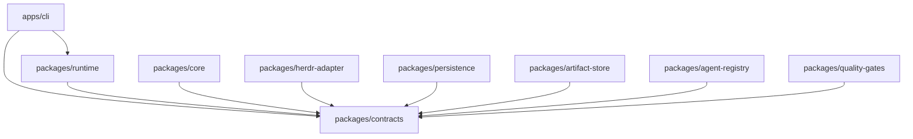

# Architecture

## Scope

This bootstrap defines the module boundaries and durable public contracts for AI Flow SDLC. The platform owns workflow orchestration, state, result/artifact tracking, recovery, and quality control. Herdr is an external execution mechanism reached only through `AgentTransport`.

This phase does not implement a complete orchestrator, infer undocumented Herdr behavior, select a final SQLite driver, or provide fake adapters.

## Modules and dependency direction

`contracts` is the only shared dependency. Runtime implementations will receive the other modules as ports, allowing local composition without creating a microservice topology or package cycle. In particular, `core` cannot import Herdr.

| Module | Owns | Does not own yet |
| --- | --- | --- |
| `contracts` | Zod exchange schemas, inferred types, public ports | Business logic and infrastructure |
| `core` | DAG planning, state transitions, scheduling/recovery decisions | Transport, persistence, CLI |
| `herdr-adapter` | Future verified `AgentTransport` implementation | Workflow policy |
| `persistence` | Future SQLite run/event/checkpoint storage | Artifact bytes and orchestration |
| `artifact-store` | Future local artifact bytes and references | Run state |
| `agent-registry` | Future role/capability resolution | Agent execution |
| `quality-gates` | Future acceptance evaluators | Task scheduling |
| `runtime` | Future use-case composition and transaction boundaries | CLI rendering and concrete adapters |
| `apps/cli` | Future command parsing, output, exit codes | Domain decisions |

## Execution model

1. `RuntimeService.start` validates a `WorkflowDefinition` and delegates run creation to the engine.
2. The engine derives runnable tasks from an acyclic dependency graph and emits ordered `DomainEvent` values for durable changes.
3. Runtime resolves the requested role with `AgentRegistry`, constructs an `AgentRequest`, and dispatches it through `AgentTransport`.
4. Transport output can be streamed with `read`; terminal reconciliation uses `wait`. A stream ending is not itself a terminal result.
5. Artifacts are persisted through `ArtifactStore` before their references are committed to run history.
6. Applicable `QualityGate` implementations evaluate the result and artifacts. Required failures affect task/run state through the engine.
7. `RunStore` atomically appends events using an expected aggregate version. Snapshots/checkpoints accelerate recovery but the event history is authoritative.

## State and failure semantics

Task states are `pending`, `ready`, `running`, `waiting`, `retrying`, `blocked`, `succeeded`, `failed`, `cancelling`, and `cancelled`. Run states are `queued`, `running`, `waiting`, `blocked`, `succeeded`, `failed`, `cancelling`, and `cancelled`.

Only the workflow engine decides legal transitions. Adapters report facts; they do not directly mutate workflow state. `blocked` means progress needs an external condition or decision and includes a structured `Blockage`. It is different from terminal `failed`.

Retry policy is explicit per task/request. A new attempt uses a new request ID but preserves a stable idempotency/fingerprint relationship. Timeouts are observations by the caller: because remote execution may continue, runtime must reconcile a known execution handle before issuing a retry. Cancellation is request/acknowledgement based and progresses through `cancelling`; it is not assumed synchronous.

## Idempotency and consistency

- Commands and events carry idempotency keys.
- Agent requests include a scope and deterministic fingerprint.
- `RunStore.appendEvents` uses optimistic `expectedVersion` and ordered sequence numbers.
- Duplicate commands must return/reconstruct the original outcome without duplicating side effects.
- Artifact writes carry an idempotency key and content checksum.
- Implementations must make reservation/write semantics atomic at their own boundary; process-local maps are insufficient for SQLite-backed execution.

## Recovery after interruption

Recovery loads the latest valid checkpoint, then replays events after its sequence. Without a checkpoint it replays from the beginning. An in-flight agent execution is reconciled through the stored handle/resume cursor according to `staleExecution`: reconcile, retry, or block. A retry is forbidden until reconciliation shows that duplicate execution is safe.

Checkpoints are optimization data, not an alternate source of truth. Their aggregate version and event sequence must match the event stream prefix. Corrupt or incompatible checkpoints are discarded and replay resumes from an earlier valid point.

## Local deployment

The intended first deployment is a single Node.js process using SQLite, local artifact storage, Git worktrees for task isolation, and one or more Herdr transports. Module boundaries are maintained in-process and can be tested independently; there is no need to introduce network services.

The SQLite driver, migration tool, artifact directory layout, and Herdr bindings remain implementation decisions for their owning agents. Those decisions must preserve the contracts and be documented before integration.
