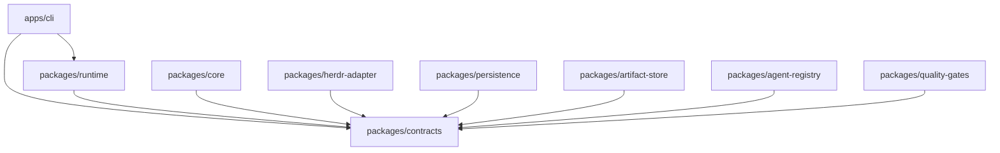
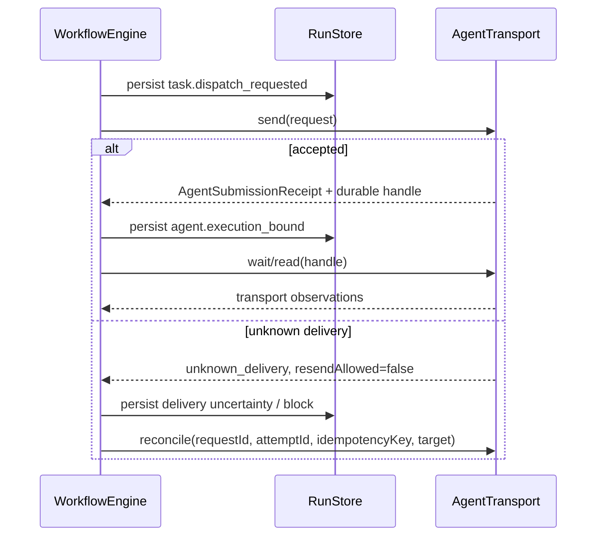

# Kiến trúc

## Phạm vi

> Ghi chú (2026-10-17): tài liệu này là phạm vi và sơ đồ baseline P00. Các module P01–P10 đã được triển khai; sơ đồ phụ thuộc dưới đây không liệt kê các package về sau (pane-manager, conversation, specification, test-strategy, verification, git-orchestrator, agent-providers, machine-setup, tool-installer, mcp-gateway, mcp-services, skills). Xem [architecture v2](architecture-v2.md) và [runtime architecture v3](runtime-architecture-v3.md); câu "does not implement ..." bên dưới chỉ mô tả P00.

P00 định nghĩa ranh giới module, dữ liệu trao đổi đã được validate, các port công khai và các bất biến thuần túy cho bflow. Nó không triển khai scheduling, Herdr adapter, persistence SQLite, I/O artifact, lease, thực thi lệnh quality, recovery, hành vi CLI hay workflow end-to-end.

Lần triển khai đầu tiên vẫn là một process Node.js theo hướng module-first. Herdr là cơ chế thực thi bên ngoài, chỉ được truy cập qua `AgentTransport`; các core contract không chứa wire type của Herdr.

## Các module và hướng phụ thuộc

`contracts` là dependency dùng chung. Runtime sẽ compose các triển khai thông qua port. Các package triển khai leaf không phụ thuộc lẫn nhau, và `core` không phụ thuộc Herdr.

| Module | Trách nhiệm trong tương lai | Loại trừ khỏi P00 |
| --- | --- | --- |
| `contracts` | Zod exchange schema, port, các validator thuần túy cho compatibility/transition/batch | Triển khai I/O và orchestration |
| `core` | Lập kế hoạch DAG, transition hợp lệ, quyết định scheduling và recovery | Transport và storage |
| `herdr-adapter` | Ánh xạ đã xác minh từ Herdr sang `AgentTransport` | Workflow policy và suy luận task-success |
| `persistence` | Lưu trữ event/checkpoint SQLite nguyên tử và tiến hóa schema | Byte của artifact |
| `artifact-store` | Lưu trữ artifact bất biến đã validate | Run state |
| `agent-registry` | Tra cứu role và execution lease nguyên tử | Thực thi agent |
| `quality-gates` | Các gate evaluator | Thay đổi state |
| `runtime` | Thứ tự transaction/use-case giữa các port | Rò rỉ concrete adapter |
| `apps/cli` | Phân tích lệnh và trình bày | Quyết định domain |

## Dispatch, quan sát và task outcome

`AgentExecutionHandle` lưu orchestration execution identity, request/attempt identity, idempotency key, locator trung lập với transport, nguồn gốc correlation và recovery cursor. Một handle chỉ bền vững sau khi `agent.execution_bound` được append. Sau khi delivery không chắc chắn, việc tự động gửi lại bị cấm cho đến khi reconciliation chứng minh `not_delivered`. Nếu transport không thể chứng minh được cả hai kết quả, nó trả về `unknown_delivery` kèm yêu cầu can thiệp thủ công; exactly-once delivery không được hứa hẹn.

Transport state và task outcome là hai domain tách biệt. `wait` trả về `AgentTransportObservation`, không bao giờ là `AgentResult`. `done` chỉ có nghĩa là transport quan sát thấy trạng thái giống terminal của nó. Một `AgentResult` đã xác minh cần bằng chứng outcome riêng được correlate với submission. Output không correlate được vẫn là `unverified` và không thể được `RecordAgentResultCommandSchema` chấp nhận.

## Ranh giới tương thích Herdr 0.9.1

P00 đã kiểm tra CLI đã cài và schema đi kèm ở chế độ chỉ đọc:

- protocol `22`, schema version `1`;
- các agent state `idle`, `working`, `blocked`, `done` và `unknown`;
- `AgentInfo` expose các identifier workspace/tab/pane/terminal, revision, state-change sequence và một agent-session locator tùy chọn;
- `agent start` yêu cầu name, kind và pane;
- `agent prompt --wait` tường minh không theo dõi turn khi target đang working.

Do đó Herdr `done` không phải bằng chứng task thành công, và bản thân Herdr 0.9.1 không thiết lập được prompt-level idempotency hay turn correlation đáng tin cậy. Phase adapter phải ánh xạ các field locator có sẵn, giữ `unknown_delivery`, và báo cáo các observation chưa xác minh khi không chứng minh được correlation. P00 không đưa ra tuyên bố tích hợp live nào.

## Mô hình state và concurrency

Workflow definition biểu diễn các dependency DAG, task song song, và concurrency của workflow có giới hạn bằng `maxConcurrency`. `validateTaskTransition` và `validateRunTransition` là các guard ngữ nghĩa bắt buộc; task state terminal không thể khởi động lại qua một transition thông thường. Rework tường minh là `succeeded -> ready` với generation tăng một bước. Retry tường minh là `failed -> retrying`.

Số lần retry được đếm trong từng rework generation; task attempt identity vẫn tăng đơn điệu xuyên suốt run. `task.retry_scheduled` ghi lại thời điểm eligibility suy ra từ policy. `advance` chỉ có thể làm retry thành ready tại hoặc sau timestamp đó. Runtime sau này cung cấp việc lập lịch đánh thức; Core không bao giờ khởi động timer. Jitter, khi được bật, mang tính xác định từ run/task/generation/attempt identity để replay không bao giờ lấy mẫu ngẫu nhiên.

Registry lookup và execution capacity là hai việc tách biệt. `resolve` chọn cấu hình; `acquireLease`, `renewLease` và `releaseLease` định nghĩa ranh giới nguyên tử cho capacity. Lease ID, expiry, optimistic version, fencing token và idempotency key cho phép một triển khai sau này từ chối các owner cũ. P00 không triển khai tính nguyên tử đó.

## Mô hình persistence và recovery

Event là nguồn có thẩm quyền. Mỗi event có event schema version, aggregate version và stream sequence là các field riêng biệt. `validateEventBatch` kiểm tra một run ID duy nhất, sequence/version liên tục, và event/idempotency identity là duy nhất trước khi `RunStore.appendEvents` thực hiện transaction trong tương lai.

Checkpoint là tối ưu hóa. Chúng khai báo checkpoint schema version cùng codec name/version. Các helper tương thích upcast hình dạng v0 gốc của P00 (thiếu các field version tường minh) lên v1, từ chối các version không được hỗ trợ bằng lỗi có kiểu, và validate schema hiện tại thu được. Một recovery engine trong tương lai phải tải checkpoint tương thích, replay các event sau đó, và reconcile mọi agent submission đang bay hoặc không chắc chắn trước khi retry.

Việc khắc phục P01 dùng `command.completed` làm command receipt bền vững trong cùng event batch với các effect của nó. Full replay dựng lại các command outcome đã cache. Aggregate checkpoint codec thu thập toàn bộ trạng thái phụ trợ và outcome đã cache; checkpoint chỉ có snapshot không thể hỗ trợ tail-only recovery. `createCheckpoint` của Core xuất state mà không persist nó. P03 phải lưu event và receipt một cách nguyên tử, và P06 phải persist trước các side effect; cả storage lẫn transport đều không được triển khai trong P01.

## Ranh giới artifact, approval, gate và cancellation

- Output của agent/gate dùng `ArtifactProposal` không đáng tin; chỉ `ArtifactStore.put` thành công mới trả về `ArtifactReference` đáng tin với URI `artifact://` và checksum đã xác minh.
- Approval request và decision có target có kiểu bắt buộc, revision, generation, idempotency key và evidence/feedback reference. Từ chối và yêu cầu thay đổi cần có lý do.
- Workflow task bind các quality gate đã khai báo. Command và event yêu cầu/kết quả đánh giá mang evaluation identity, expected aggregate version và idempotency.
- Cancellation là bất đồng bộ: request, accepted/refused và confirmed stop là các bản ghi riêng biệt. Acceptance không phải bằng chứng của việc dừng. Một completion có thể hợp lệ thắng khi state là `cancelling`.

## Bảo đảm của contract so với việc thực thi sau này

P00 bảo đảm việc từ chối schema, hình dạng kết quả công khai có kiểu, ngữ nghĩa được tài liệu hóa và các validator thuần túy. Các triển khai sau này phải thực thi database transaction nguyên tử, hiệu ứng idempotency exactly-once, lease fencing, xác minh checksum khi streaming, phân giải filesystem an toàn, transport reconciliation, ủy quyền command, event upcasting trong lúc replay và các race của cancellation. Riêng type không cung cấp các thuộc tính runtime đó.
