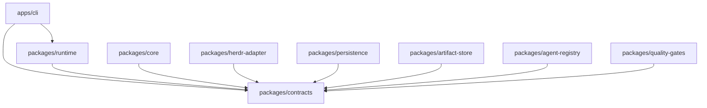
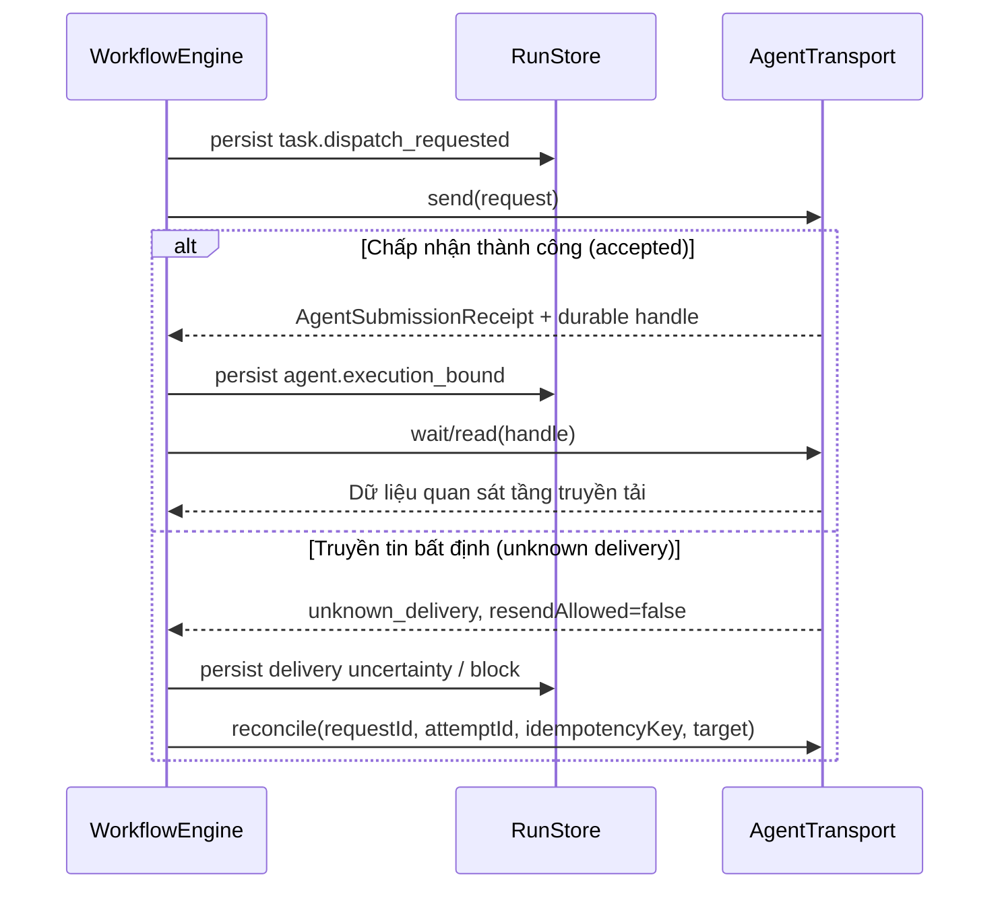

# Kiến trúc Hệ thống (Architecture)

> **Cách đọc:** quyết định/spec và audit gốc bên dưới giữ phạm vi lịch sử. [Implementation status](implementation-status.md) mô tả source tích hợp hiện tại, gồm các thay đổi sau baseline; không suy một plan hoặc acceptance criterion là kết quả đã nghiệm thu.

## 1. Phạm vi kiến trúc

> [!NOTE]
> *(Cập nhật ngày 17/10/2026)*: Tài liệu này mô tả phạm vi kiến trúc và sơ đồ phụ thuộc thuộc giai đoạn nền tảng P00. Các phân hệ từ P01–P10 đã được triển khai đầy đủ; sơ đồ phụ thuộc dưới đây chưa bao gồm các package mở rộng phát triển sau đó (như `pane-manager`, `conversation`, `specification`, `test-strategy`, `verification`, `git-orchestrator`, `agent-providers`, `machine-setup`, `tool-installer`, `mcp-gateway`, `mcp-services`, `skills`). Vui lòng tham khảo thêm tài liệu [Kiến trúc v2](architecture-v2.md) và [Kiến trúc Runtime v3](runtime-architecture-v3.md).

Giai đoạn P00 tập trung định nghĩa ranh giới giữa các module, chuẩn hóa dữ liệu trao đổi đã qua thẩm định schema, thiết lập các cổng giao tiếp công khai (public ports) và các bất biến thuần túy cho hệ thống Bflow. Giai đoạn này không đảm nhiệm việc triển khai lập lịch DAG, bộ điều hợp Herdr, tầng lưu trữ SQLite, thao tác I/O artifact, quản lý lease, thực thi lệnh kiểm tra chất lượng, cơ chế phục hồi hay hành vi đầu-cuối của CLI.

Kiến trúc ban đầu được xây dựng dưới dạng một tiến trình Node.js theo định hướng ưu tiên module hoá (module-first). Herdr đóng vai trò là cơ chế thực thi tiến trình bên ngoài, chỉ được tương tác gián tiếp thông qua giao diện `AgentTransport`; các hợp đồng cốt lõi tuyệt đối không phụ thuộc vào kiểu dữ liệu truyền tải (wire types) của Herdr.

---

## 2. Các module và Chiều phụ thuộc

Gói `contracts` là thành phần phụ thuộc dùng chung duy nhất cho toàn bộ hệ thống. Tầng `runtime` sẽ tổ hợp các bản hiện thực thông qua các cổng giao tiếp chuẩn hóa. Các gói triển khai độc lập (leaf packages) tuyệt đối không phụ thuộc lẫn nhau, và khối `core` không bao giờ phụ thuộc trực tiếp vào Herdr.

| Module | Trách nhiệm thiết kế | Phạm vi loại trừ ở P00 |
| :--- | :--- | :--- |
| **`contracts`** | Lược đồ trao đổi dữ liệu Zod, giao diện port, các bộ kiểm tra thuần túy về tính tương thích, chuyển trạng thái và tính hợp lệ theo lô | Không triển khai I/O và logic điều phối |
| **`core`** | Đánh giá đồ thị DAG, kiểm soát chuyển trạng thái hợp lệ, đưa ra quyết định lập lịch và khôi phục | Không đảm nhiệm tầng truyền tải và lưu trữ |
| **`herdr-adapter`** | Ánh xạ chuẩn mực từ lệnh Herdr sang giao diện `AgentTransport` | Không quản lý chính sách quy trình và không tự suy đoán thành bại của tác vụ |
| **`persistence`** | Lưu trữ nguyên tử sự kiện/checkpoint trên SQLite và quản lý tiến hóa lược đồ | Không lưu trữ trực tiếp nội dung byte của artifact |
| **`artifact-store`** | Kho lưu trữ artifact bất biến đã được xác thực toàn vẹn | Không quản lý trạng thái của lượt chạy |
| **`agent-registry`** | Tra cứu vai trò và cấp phát lease thực thi một cách nguyên tử | Không trực tiếp vận hành agent |
| **`quality-gates`** | Bộ đánh giá các cổng kiểm soát chất lượng | Không thay đổi trạng thái của quy trình |
| **`runtime`** | Điều phối thứ tự giao dịch và ca sử dụng giữa các port | Không để lộ bộ điều hợp cụ thể ra bên ngoài |
| **`apps/cli`** | Phân tích cú pháp dòng lệnh và hiển thị giao diện | Không đưa ra các quyết định nghiệp vụ domain |

---

## 3. Quy trình Phân phối (Dispatch), Quan sát và Kết quả Tác vụ

Bộ điều phối `AgentExecutionHandle` lưu giữ đầy đủ thông tin định danh thực thi, định danh yêu cầu/lần thử, khóa lũy thừa (idempotency key), định vị trung lập với tầng truyền tải, nguồn gốc liên kết và con trỏ phục hồi (recovery cursor). Một handle chỉ được coi là bền vững sau khi sự kiện `agent.execution_bound` đã được ghi nhận vào cơ sở dữ liệu. 

Khi xảy ra tình trạng truyền tin bất định, hệ thống nghiêm cấm việc tự động gửi lại thông điệp cho tới khi quá trình đối soát chứng minh được trạng thái `not_delivered`. Nếu tầng truyền tải không thể đưa ra bằng chứng kết luận, hệ thống sẽ trả về mã `unknown_delivery` và yêu cầu con người can thiệp thủ công; hệ thống không cam kết khả năng chuyển phát chính xác một lần (exactly-once delivery).

> [!IMPORTANT]
> **Trạng thái truyền tải và kết quả tác vụ là hai miền dữ liệu hoàn toàn tách biệt**:
> Phương thức `wait` chỉ trả về quan sát tầng truyền tải `AgentTransportObservation`, tuyệt đối không đại diện cho kết quả nghiệp vụ `AgentResult`. Trạng thái `done` chỉ mang ý nghĩa agent đã hoàn tất lượt tương tác. Một `AgentResult` hợp lệ đòi hỏi phải có bằng chứng khách quan độc lập được liên kết chuẩn xác với lượt giao nhiệm vụ ban đầu. Mọi đầu ra không thể đối soát đều bị coi là chưa xác thực (`unverified`) và sẽ bị từ chối bởi `RecordAgentResultCommandSchema`.

---

## 4. Ranh giới tương thích với Herdr 0.9.1

Giai đoạn P00 tiến hành thẩm định Herdr CLI và lược đồ dữ liệu đi kèm ở chế độ chỉ đọc:
- Sử dụng giao thức **Protocol `22`**, phiên bản lược đồ **Schema `1`**.
- Các trạng thái vận hành của agent: `idle`, `working`, `blocked`, `done` và `unknown`.
- Thực thể `AgentInfo` cung cấp định danh cho workspace, tab, pane, terminal, phiên bản sửa đổi (revision), chuỗi thay đổi trạng thái và định vị phiên agent tùy chọn.
- Lệnh `agent start` yêu cầu bắt buộc các tham số: `name`, `kind` và `pane`.
- Lệnh `agent prompt --wait` chủ động không theo dõi lượt phản hồi khi đối tượng đích đang ở trạng thái làm việc (`working`).

Do đó, trạng thái `done` của Herdr không được coi là bằng chứng cho thấy tác vụ thành công, và bản thân Herdr 0.9.1 không tự động đảm bảo tính lũy thừa ở cấp độ prompt hay sự liên kết phản hồi đáng tin cậy. Bộ điều hợp phải chịu trách nhiệm ánh xạ các trường định vị sẵn có, duy trì trạng thái `unknown_delivery`, và cảnh báo khi thiếu bằng chứng liên kết.

---

## 5. Mô hình Trạng thái và Xử lý Song song (Concurrency)

Định nghĩa quy trình công việc biểu diễn đồ thị phụ thuộc DAG, hỗ trợ các tác vụ song song với giới hạn mức độ đồng thời thông qua trường `maxConcurrency`. Hai hàm kiểm tra `validateTaskTransition` và `validateRunTransition` đóng vai trò là các chốt chặn ngữ nghĩa bắt buộc: trạng thái kết thúc (terminal state) của một tác vụ không bao giờ được phép khởi động lại qua chuyển trạng thái thông thường.
- Thao tác sửa đổi (Rework) tường minh: chuyển từ `succeeded → ready` với thế hệ (generation) tăng một bước.
- Thao tác thử lại (Retry) tường minh: chuyển từ `failed → retrying`.

Số lần thử lại được giới hạn chặt chẽ trong từng thế hệ sửa đổi; định danh lần thử (`attempt`) luôn tăng đơn điệu trong suốt vòng đời của lượt chạy. Sự kiện `task.retry_scheduled` ghi lại mốc thời gian đủ điều kiện kích hoạt theo chính sách. Phương thức `advance` chỉ có thể chuyển trạng thái từ retry sang ready khi đã chạm hoặc vượt qua mốc thời gian đó. Biến thiên thời gian (jitter) khi được kích hoạt sẽ mang tính xác định từ định danh run/task/generation/attempt, đảm bảo việc phát lại sự kiện (replay) không bao giờ bị phụ thuộc vào yếu tố ngẫu nhiên.

---

## 6. Mô hình Lưu trữ Bền vững và Khôi phục

- **Sự kiện là nguồn gốc chân lý (Source of Truth)**: Mỗi sự kiện đều mang phiên bản lược đồ sự kiện, phiên bản tổng hợp và số thứ tự luồng (stream sequence) riêng biệt. Hàm `validateEventBatch` kiểm tra tính duy nhất của run ID, tính liên tục của chuỗi thứ tự và tính duy nhất của khóa lũy thừa trước khi cho phép ghi nhận giao dịch vào `RunStore`.
- **Điểm kiểm tra (Checkpoint) là cơ chế tối ưu hóa**: Checkpoint lưu trữ phiên bản lược đồ cùng tên và phiên bản codec tương ứng. Khi khôi phục trạng thái, động cơ phục hồi phải nạp checkpoint tương thích, phát lại toàn bộ các sự kiện kế tiếp, và đối soát toàn bộ các yêu cầu đang gửi dở dang trước khi cho phép thử lại.

---

## 7. Ranh giới Quản trị: Artifact, Phê duyệt, Cổng Kiểm soát và Hủy bỏ

- **Bảo chứng Artifact**: Đầu ra của agent hoặc cổng kiểm tra ban đầu chỉ là đề xuất chưa được xác thực (`ArtifactProposal`); chỉ sau khi được ghi nhận thành công qua `ArtifactStore.put`, hệ thống mới cấp phát tham chiếu tin cậy `ArtifactReference` với định dạng URI `artifact://` cùng mã băm checksum đã xác minh.
- **Tính chuẩn mực của Phê duyệt**: Yêu cầu và quyết định phê duyệt bắt buộc phải có đối tượng mục tiêu cụ thể, phiên bản mã nguồn, thế hệ tác vụ, khóa lũy thừa và tham chiếu bằng chứng kiểm thử đi kèm. Mọi quyết định từ chối hoặc yêu cầu sửa đổi đều phải nêu rõ lý do kỹ thuật.
- **Cổng kiểm soát chất lượng (Quality Gates)**: Tác vụ quy trình liên kết chặt chẽ với các cổng chất lượng đã khai báo; mọi yêu cầu và kết quả đánh giá đều mang định danh đánh giá riêng và kỳ vọng phiên bản tổng hợp chính xác.
- **Hủy bỏ bất đồng bộ**: Yêu cầu hủy bỏ, chấp nhận/từ chối hủy và xác nhận dừng hoàn toàn là các bản ghi sự kiện riêng biệt; việc chấp nhận yêu cầu hủy không đồng nghĩa với việc tiến trình đã dừng hẳn.
