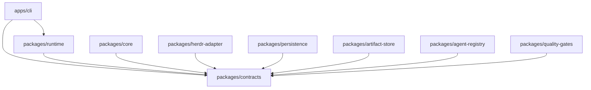
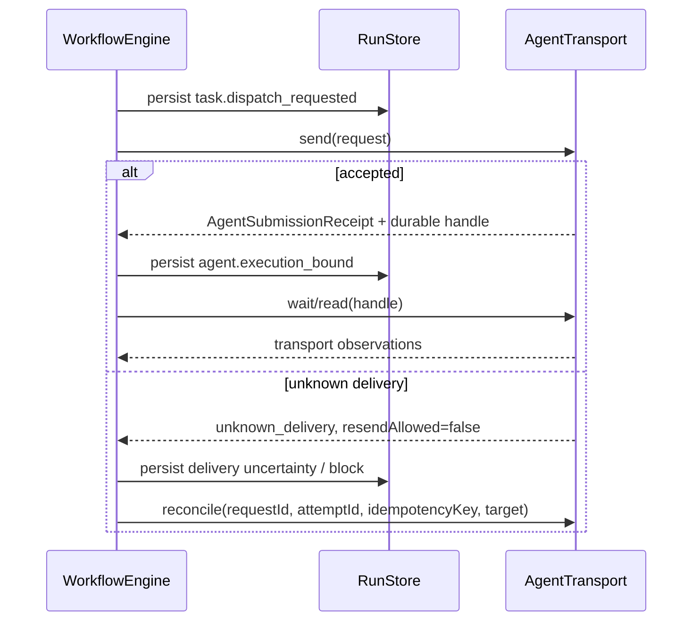

# Architecture

## Scope

P00 defines module boundaries, validated exchange data, public ports, and pure invariants for bflow. It does not implement scheduling, a Herdr adapter, SQLite persistence, artifact I/O, leases, quality command execution, recovery, CLI behavior, or end-to-end workflows.

The first deployment remains a module-first Node.js process. Herdr is an external execution mechanism reached only through `AgentTransport`; core contracts contain no Herdr wire types.

## Modules and dependency direction

`contracts` is the shared dependency. Runtime will compose implementations through ports. Leaf implementation packages do not depend on each other, and `core` does not depend on Herdr.

| Module | Future responsibility | Excluded from P00 |
| --- | --- | --- |
| `contracts` | Zod exchange schemas, ports, pure compatibility/transition/batch validators | I/O and orchestration implementation |
| `core` | DAG planning, legal transitions, scheduling and recovery decisions | Transport and storage |
| `herdr-adapter` | Verified mapping from Herdr to `AgentTransport` | Workflow policy and task-success inference |
| `persistence` | Atomic SQLite event/checkpoint storage and schema evolution | Artifact bytes |
| `artifact-store` | Validated immutable artifact storage | Run state |
| `agent-registry` | Role lookup and atomic execution leases | Agent execution |
| `quality-gates` | Gate evaluators | State mutation |
| `runtime` | Transaction/use-case ordering across ports | Concrete adapter leakage |
| `apps/cli` | Command parsing and presentation | Domain decisions |

## Dispatch, observation, and task outcome

`AgentExecutionHandle` stores orchestration execution identity, request/attempt identity, idempotency key, a transport-neutral locator, correlation provenance, and a recovery cursor. A handle is durable only after `agent.execution_bound` is appended. After uncertain delivery, automatic resend is forbidden until reconciliation proves `not_delivered`. If the transport cannot prove either outcome, it returns `unknown_delivery` with manual intervention required; exactly-once delivery is not promised.

Transport state and task outcome are separate domains. `wait` returns `AgentTransportObservation`, never `AgentResult`. `done` means only that the transport observed its terminal-like state. A verified `AgentResult` requires separate outcome evidence correlated to the submission. Uncorrelated output stays `unverified` and cannot be accepted by `RecordAgentResultCommandSchema`.

## Herdr 0.9.1 compatibility boundary

P00 inspected the installed CLI and bundled schema read-only:

- protocol `22`, schema version `1`;
- agent states `idle`, `working`, `blocked`, `done`, and `unknown`;
- `AgentInfo` exposes workspace/tab/pane/terminal identifiers, revision, state-change sequence, and an optional agent-session locator;
- `agent start` requires name, kind, and pane;
- `agent prompt --wait` explicitly does not track turns when the target is already working.

Therefore Herdr `done` is not evidence of task success, and Herdr 0.9.1 does not by itself establish prompt-level idempotency or reliable turn correlation. The adapter phase must map available locator fields, preserve `unknown_delivery`, and report unverified observations where correlation cannot be proven. No live integration claim is made by P00.

## State and concurrency model

Workflow definitions represent DAG dependencies, parallel tasks, and bounded workflow concurrency with `maxConcurrency`. `validateTaskTransition` and `validateRunTransition` are mandatory semantic guards; terminal task states cannot restart through a normal transition. Rework is explicitly `succeeded -> ready` with a one-step generation increment. Retry is explicitly `failed -> retrying`.

Retry attempts are counted within each rework generation; the task attempt identity remains monotonic across the run. `task.retry_scheduled` captures the policy-derived eligibility time. `advance` may make a retry ready only at or after that timestamp. Runtime later supplies wake-up scheduling; Core never starts a timer. Jitter, when enabled, is deterministic from run/task/generation/attempt identity so replay never samples randomness.

Registry lookup and execution capacity are separate. `resolve` selects configuration; `acquireLease`, `renewLease`, and `releaseLease` define the atomic boundary for capacity. Lease ID, expiry, optimistic version, fencing token, and idempotency key allow a later implementation to reject stale owners. P00 does not implement that atomicity.

## Persistence and recovery model

Events are authoritative. Every event has event schema version, aggregate version, and stream sequence as distinct fields. `validateEventBatch` verifies one run ID, contiguous sequence/version, and unique event/idempotency identities before `RunStore.appendEvents` performs its future transaction.

Checkpoints are optimizations. They declare checkpoint schema version plus codec name/version. Compatibility helpers upcast the original P00 v0 shape (missing explicit version fields) to v1, reject unsupported versions with typed errors, and validate the resulting current schema. A future recovery engine must load a compatible checkpoint, replay later events, and reconcile every in-flight or uncertain agent submission before retrying.

P01 remediation uses `command.completed` as the durable command receipt in the same event batch as its effects. Full replay reconstructs cached command outcomes. The aggregate checkpoint codec captures all auxiliary state and cached outcomes; a snapshot-only checkpoint cannot support tail-only recovery. Core's `createCheckpoint` exports state without persisting it. P03 must atomically store events and receipts, and P06 must persist before side effects; neither storage nor transport is implemented in P01.

## Artifact, approval, gate, and cancellation boundaries

- Agent/gate output uses untrusted `ArtifactProposal`; only successful `ArtifactStore.put` returns a trusted `ArtifactReference` with `artifact://` URI and verified checksum.
- Approval requests and decisions have a required typed target, revision, generation, idempotency key, and evidence/feedback references. Rejection and requested changes require a reason.
- Workflow tasks bind declared quality gates. Evaluation request/result commands and events carry evaluation identity, expected aggregate version, and idempotency.
- Cancellation is asynchronous: request, accepted/refused, and confirmed stop are distinct records. Acceptance is not proof of stop. A completion may legally win while state is `cancelling`.

## Contract guarantees versus later enforcement

P00 guarantees schema rejection, typed public result shapes, documented semantics, and pure validators. Later implementations must enforce atomic database transactions, exactly-once idempotency effects, lease fencing, checksum verification while streaming, safe filesystem resolution, transport reconciliation, command authorization, event upcasting during replay, and cancellation races. Types alone do not provide those runtime properties.
