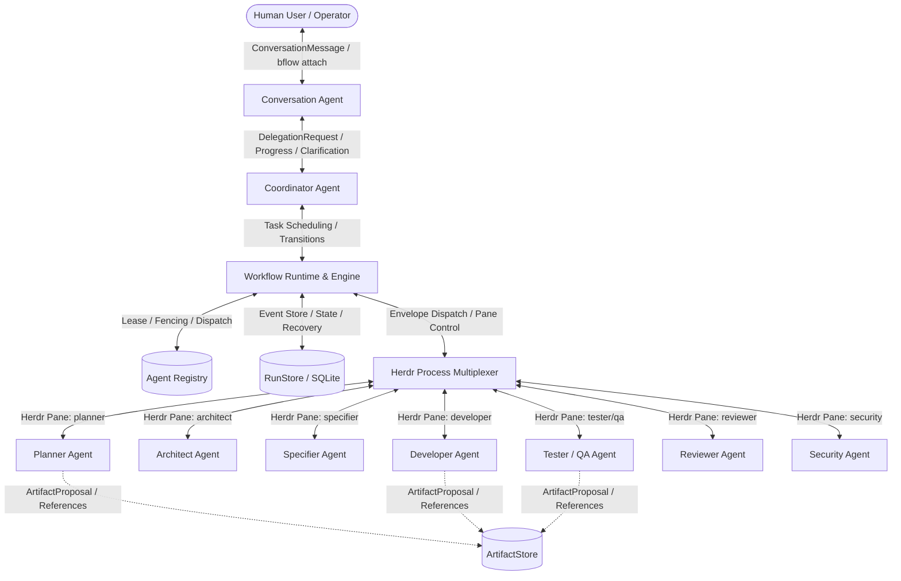
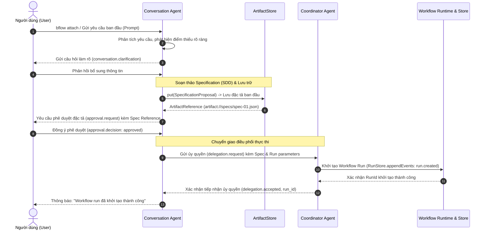
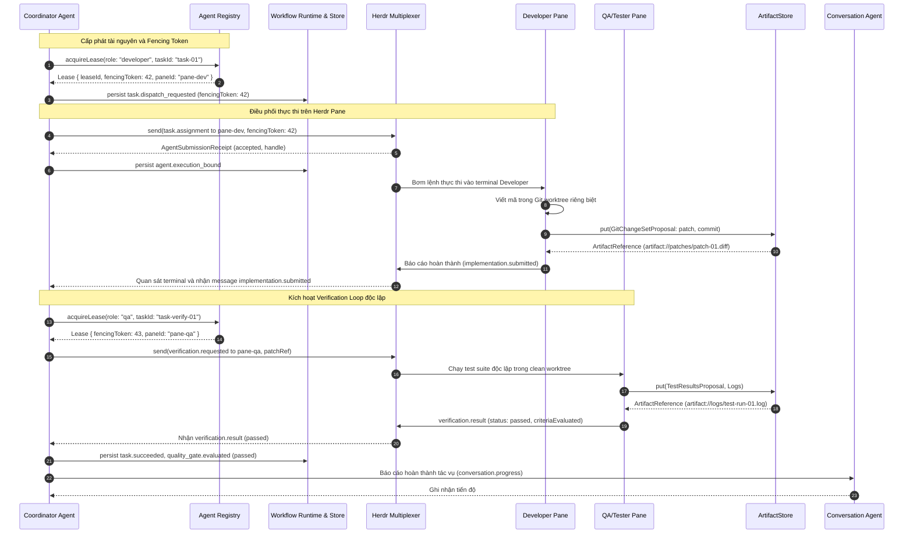
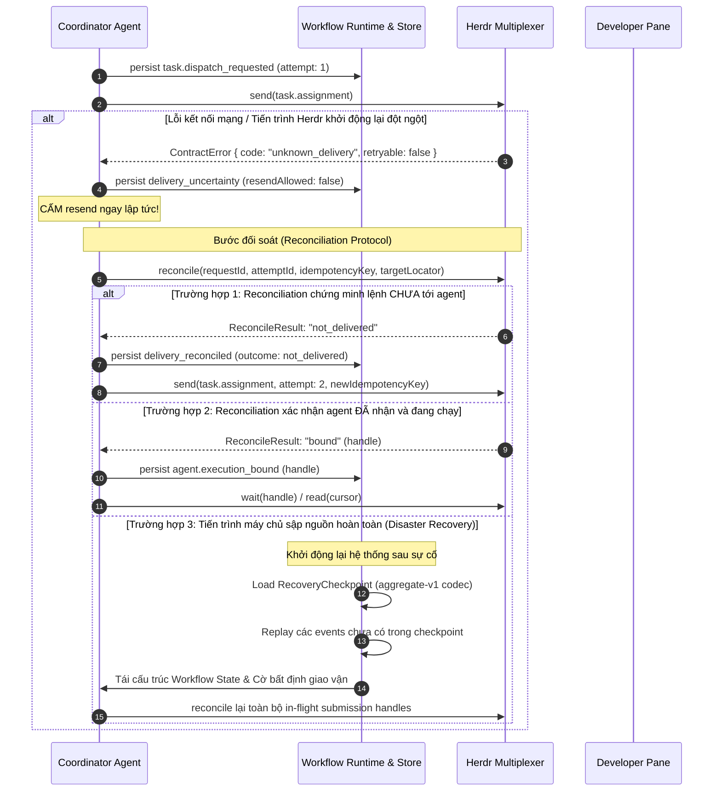

# Giao thức truyền thông liên vai trò Bflow v2 (Inter-Role Communication Protocol)

## 1. Tổng quan và Mục đích

Tài liệu này đặc tả quy chuẩn giao thức truyền thông liên vai trò (**Bflow v2 Inter-Role Communication Protocol Specification**) cho nền tảng điều phối phát triển phần mềm tự động hóa Bflow.

Giao thức thiết lập một ranh giới giao tiếp chính quy, an toàn, có khả năng phục hồi và truy vết toàn diện giữa:
- **Người dùng (Human User / Operator)**
- **Conversation Agent** (Tác nhân giao tiếp & tiếp nhận)
- **Coordinator Agent** (Tác nhân điều phối tổng thể)
- **Workflow Runtime** (Hệ thống thực thi workflow & quản lý lease/fencing)
- **Specialist Roles** (`planner`, `architect`, `specifier`, `developer`, `tester`, `reviewer`, `qa`, `security`) hoạt động trên các Herdr pane độc lập.



---

## 2. Nguyên tắc kiến trúc cốt lõi

1. **Zero Unverified Trust (Không tin tưởng báo cáo tự xưng)**:
   Không bao giờ suy diễn tính đúng đắn của tác vụ từ trạng thái `done` của Herdr hay lời tự nhận thành công từ agent. Mọi kết quả nghiệm thu phải dựa trên `AgentResult` có đối soát tương quan (`SubmissionCorrelation`), các tạo phẩm bất biến (`ArtifactReference`) và cổng chất lượng (`QualityGate`) chạy độc lập.

2. **Decoupling of Transport and Storage (Phân tách phương tiện truyền dẫn và kho lưu trữ)**:
   - **Herdr** là hạ tầng ghép kênh tiến trình (multiplexer), quản lý vòng đời phiên terminal (`PaneBinding`), truyền tải các tín hiệu điều khiển và message envelope nhỏ gọn.
   - **Artifact Store** là kho lưu trữ dữ liệu lớn, tài liệu đặc tả, mã nguồn vá (`patch`), log thực thi và báo cáo kiểm thử. Dữ liệu trong Artifact Store có tính địa chỉ theo nội dung (content-addressable), kiểm chứng bằng mã băm SHA-256/SHA-512 và gắn cờ tin cậy `trust: "stored"`.
   - **Cấm tuyệt đối**: Không dùng Artifact Store làm hàng đợi tin nhắn (polling queue) hay hộp thư trao đổi giữa các role. Các role chỉ truyền tham chiếu `ArtifactReference` bên trong message envelope qua Herdr.

3. **Explicit Boundary & Strict Encapsulation (Ranh giới giao tiếp nghiêm ngặt)**:
   Các vai trò chỉ được phép trao đổi theo đúng kênh được cấp quyền trong Ma trận Định tuyến. Bất kỳ thông điệp nào vi phạm ranh giới đều bị Workflow Runtime chặn và ghi nhận vi phạm an ninh.

4. **Idempotency & Correlation Guarantee (Tính lũy nghiệm và định danh tương quan)**:
   Mọi message trao đổi đều mang `message_id`, `correlation_id` duy nhất và phiên bản hợp đồng `schema_version: 2`. Việc gửi lặp lại thông điệp cùng `message_id` hoặc cùng fingerprint sẽ được xử lý lũy nghiệm mà không gây đột biến trạng thái phụ.

---

## 3. Đặc tả Envelope chuẩn: `RoleMessageSchema`

Mọi gói tin trao đổi giữa các vai trò trong hệ thống Bflow v2 bắt buộc phải được đóng gói trong envelope chuẩn `RoleMessageSchema` (hay `InterRoleMessageSchema`).

### 3.1. Định nghĩa Zod Schema chính quy

```typescript
import { z } from "zod";
import {
  IdentifierSchema,
  IdempotencyKeySchema,
  IsoDateTimeSchema,
  JsonValueSchema,
  MetadataSchema
} from "@bflow/contracts";
import { ArtifactReferenceSchema } from "@bflow/contracts";

export const AGENT_ROLES = [
  "conversation",
  "coordinator",
  "planner",
  "architect",
  "specifier",
  "developer",
  "tester",
  "reviewer",
  "qa",
  "security"
] as const;

export const AgentRoleSchema = z.enum(AGENT_ROLES);
export type AgentRole = z.infer<typeof AgentRoleSchema>;

export const RoleParticipantSchema = z
  .object({
    role: z.union([AgentRoleSchema, z.literal("user"), z.literal("runtime")]),
    agent_id: IdentifierSchema.optional(),
    pane_id: IdentifierSchema.optional()
  })
  .strict();
export type RoleParticipant = z.infer<typeof RoleParticipantSchema>;

export const RoleMessageTypeSchema = z.enum([
  // Nhóm hội thoại và tiếp nhận yêu cầu (Conversation Phase)
  "conversation.intake",
  "conversation.clarification",
  "conversation.progress",

  // Nhóm ủy quyền điều phối (Delegation Phase)
  "delegation.request",
  "delegation.accepted",

  // Nhóm đặc tả kỹ thuật (Specification Phase)
  "spec.draft",
  "spec.approved",

  // Nhóm chiến lược kiểm thử (TDD Phase)
  "tdd.decision",

  // Nhóm phân công và trạng thái tác vụ (Task Execution Phase)
  "task.assignment",
  "task.status",
  "implementation.submitted",
  "execution.receipt",

  // Nhóm kiểm thử và chu trình nghiệm thu (Verification Loop)
  "verification.requested",
  "verification.result",
  "verification.escalation",

  // Nhóm đánh giá và phê duyệt (Review & Approval Phase)
  "review.verdict",
  "approval.request",
  "approval.decision"
]);
export type RoleMessageType = z.infer<typeof RoleMessageTypeSchema>;

export const RoleMessageSchema = z
  .object({
    schema_version: z.literal(2),
    message_id: IdentifierSchema,
    correlation_id: IdentifierSchema,
    causation_id: IdentifierSchema.optional(),
    run_id: IdentifierSchema.optional(),
    sender: RoleParticipantSchema,
    recipient: RoleParticipantSchema,
    type: RoleMessageTypeSchema,
    payload: JsonValueSchema,
    artifact_references: z.array(ArtifactReferenceSchema),
    occurred_at: IsoDateTimeSchema.optional(),
    idempotency_key: IdempotencyKeySchema.optional(),
    metadata: MetadataSchema.optional()
  })
  .strict()
  .superRefine((message, context) => {
    // 1. Quy tắc bắt buộc run_id:
    // Ngoại trừ giai đoạn tiền khởi tạo workflow (conversation.intake, conversation.clarification),
    // mọi thông điệp thuộc về một workflow run bắt buộc phải có run_id.
    if (message.type !== "conversation.intake" && message.type !== "conversation.clarification") {
      if (message.run_id === undefined) {
        context.addIssue({
          code: z.ZodIssueCode.custom,
          message: `run_id is required for workflow-scoped message type ${message.type}`,
          path: ["run_id"]
        });
      }
    }

    // 2. Quy tắc ràng buộc runId của ArtifactReference:
    if (message.run_id !== undefined) {
      message.artifact_references.forEach((ref, index) => {
        if (ref.runId !== message.run_id) {
          context.addIssue({
            code: z.ZodIssueCode.custom,
            message: `artifact reference runId ${ref.runId} must match message run_id ${message.run_id}`,
            path: ["artifact_references", index, "runId"]
          });
        }
      });
    }

    // 3. Ràng buộc ranh giới User:
    // User chỉ được giao tiếp trực tiếp với Conversation Agent.
    if (message.sender.role === "user" && message.recipient.role !== "conversation") {
      context.addIssue({
        code: z.ZodIssueCode.custom,
        message: "user can only send messages to conversation",
        path: ["recipient", "role"]
      });
    }
    if (message.recipient.role === "user" && message.sender.role !== "conversation") {
      context.addIssue({
        code: z.ZodIssueCode.custom,
        message: "user can only receive messages from conversation",
        path: ["sender", "role"]
      });
    }

    // 4. Ràng buộc ranh giới Conversation Agent:
    // Conversation Agent chỉ được giao tiếp với user, coordinator, và runtime.
    const allowedForConversation = new Set(["user", "coordinator", "runtime"]);
    if (message.sender.role === "conversation" && !allowedForConversation.has(message.recipient.role)) {
      context.addIssue({
        code: z.ZodIssueCode.custom,
        message: `conversation cannot send message to ${message.recipient.role}`,
        path: ["recipient", "role"]
      });
    }
    if (message.recipient.role === "conversation" && !allowedForConversation.has(message.sender.role)) {
      context.addIssue({
        code: z.ZodIssueCode.custom,
        message: `conversation cannot receive message from ${message.sender.role}`,
        path: ["sender", "role"]
      });
    }
  });

export const InterRoleMessageSchema = RoleMessageSchema;
export type RoleMessage = z.infer<typeof RoleMessageSchema>;
export type InterRoleMessage = z.infer<typeof InterRoleMessageSchema>;
```

### 3.2. Bảng mô tả chi tiết các trường trong Envelope

| Tên trường | Kiểu dữ liệu / Schema | Bắt buộc | Ý nghĩa và Quy tắc chuẩn hóa |
| :--- | :--- | :--- | :--- |
| `schema_version` | `z.literal(2)` | **Có** | Hằng số nguyên `2`, định danh phiên bản hợp đồng giao thức Bflow v2. |
| `message_id` | `IdentifierSchema` | **Có** | Định danh duy nhất toàn cục của gói tin (UUID v4 hoặc định danh an toàn). Dùng để khử trùng lặp (deduplication) tại ingress. |
| `correlation_id` | `IdentifierSchema` | **Có** | Định danh chuỗi ngữ cảnh xuyên suốt từ yêu cầu gốc của User cho đến khi hoàn tất deliverable. Giữ nguyên không đổi qua tất cả các chặng rẽ nhánh. |
| `causation_id` | `IdentifierSchema` | Không | `message_id` của gói tin trực tiếp kích hoạt gói tin này. Cho phép dựng cây phả hệ nguyên nhân - kết quả (causal graph). |
| `run_id` | `IdentifierSchema` | **Có\*** | Định danh của phiên workflow run đang chạy. <br>\* **Bắt buộc** đối với tất cả message type, **chỉ được phép vắng mặt** ở `conversation.intake` và `conversation.clarification` trước khi workflow run được tạo ra. |
| `sender` | `RoleParticipantSchema` | **Có** | Thông tin bên gửi: gồm `role` (`AgentRole \| "user" \| "runtime"`), `agent_id` (nếu đã gắn kết), và `pane_id` của Herdr pane tương ứng. |
| `recipient` | `RoleParticipantSchema` | **Có** | Thông tin bên nhận: gồm `role` (`AgentRole \| "user" \| "runtime"`), `agent_id` (tùy chọn), và `pane_id` (tùy chọn). |
| `type` | `RoleMessageTypeSchema` | **Có** | Loại thông điệp nghiệp vụ (1 trong 17 loại đã định nghĩa). Quyết định cấu trúc schema của `payload`. |
| `payload` | `JsonValueSchema` | **Có** | Dữ liệu nghiệp vụ thuần túy, được serialize dưới dạng JSON Object tuân thủ schema chi tiết của từng `type`. |
| `artifact_references` | `ArtifactReference[]` | **Có** | Mảng các tham chiếu tạo phẩm đã lưu trữ an toàn trong `ArtifactStore` (`trust: "stored"`, URI dạng `artifact://...`, kèm checksum SHA-256 hoặc SHA-512). |
| `occurred_at` | `IsoDateTimeSchema` | Không | Thời điểm phát sinh thông điệp theo chuẩn ISO 8601 UTC có offset (ví dụ `2026-10-15T19:30:00.000Z`). |
| `idempotency_key` | `IdempotencyKeySchema` | Không | Khóa lũy nghiệm nhằm bảo vệ chống trùng lặp khi tái gửi gói tin trên tầng transport. |
| `metadata` | `MetadataSchema` | Không | Dữ liệu bổ trợ phi cấu trúc gắn kèm thông điệp (key-value). |

---

## 4. Phân tách vai trò giữa Herdr và Artifact Store

Kiến trúc Bflow v2 quy định ranh giới nghiêm ngặt giữa tầng **Phương tiện truyền dẫn (Transport/Multiplexing)** và tầng **Kho dữ liệu bất biến (Content-Addressable Storage)**:

```
+-----------------------------------------------------------------------------------+
|                                HERDR RUNTIME LAYER                                |
|  - Process isolation (tmux panes / pseudo-terminals)                              |
|  - Interactive terminal observation & prompt injection                            |
|  - Lightweight message signaling (RoleMessage Envelope < 64KB)                    |
|  - Pane lifecycle management (start, restart, attach, stop)                       |
+-----------------------------------------------------------------------------------+
                                        |
                 chỉ truyền metadata    |   tham chiếu URI & Checksum
                 & tín hiệu điều khiển  |   (artifact://store/{artifactId})
                                        v
+-----------------------------------------------------------------------------------+
|                              ARTIFACT STORE LAYER                                 |
|  - Immutable content-addressable storage on filesystem                            |
|  - Strong integrity check: SHA-256 / SHA-512 calculated upon ingestion            |
|  - Safe path containment: ID không chứa "/", "\", "..", "."                       |
|  - Lưu trữ: Specifications, Source Patches, Test Logs, Coverage, Audit Reports    |
+-----------------------------------------------------------------------------------+
```

### 4.1. Quy định đối với Herdr
- **Herdr Multiplexer** sở hữu các pseudo-terminal panes được định danh qua `PaneBinding` (`workspaceId`, `tabId`, `paneId`).
- Mỗi agent specialist chạy thường trực hoặc theo lượt trong pane riêng biệt với môi trường làm việc độc lập (Git worktree riêng cho `developer`, read-only workspace cho `planner`, `tester`, `qa`, `reviewer`).
- Herdr truyền tải nội dung lệnh và thông điệp qua stream ký tự chuẩn hoặc Socket API. Kích thước payload trên Herdr bị giới hạn không vượt quá **64 KB**.
- Trạng thái `done`, `working`, `blocked` của Herdr chỉ là tín hiệu quan sát mức tiến trình (process observation), **không bao giờ được xem là kết quả hoàn thành nghiệp vụ**.

### 4.2. Quy định đối với Artifact Store
- **Không bao giờ dùng Artifact Store làm hộp thư**: Tuyệt đối không cho phép Agent ghi file vào Artifact Store rồi yêu cầu Agent khác định kỳ quét thư mục (polling) để nhận lệnh.
- **Quy trình nạp tạo phẩm an toàn**:
  1. Agent sinh ra nội dung (ví dụ mã vá lỗi, log test) dưới dạng `ArtifactProposal` (chưa tin cậy).
  2. Runtime / Ingestion Service xác thực nội dung, tính toán checksum độc lập, ghi vào filesystem dưới dạng tệp bất biến.
  3. Runtime cấp phát `ArtifactReference` có `trust: "stored"` cùng URI `artifact://{storeId}/{artifactId}`.
  4. Agent gửi `RoleMessage` qua Herdr, kèm `ArtifactReference` trong mảng `artifact_references`.
  5. Agent nhận chỉ đọc tệp thông qua `ArtifactStore.get(reference)`, xác thực lại checksum trước khi phân tích.

---

## 5. Ma trận định tuyến & Ranh giới giao tiếp (Routing Matrix & Allowed Channels)

### 5.1. Bảng ma trận định tuyến hợp lệ

| Nguồn (Sender) | Đích (Recipient) | Loại thông điệp cho phép | Phương thức kết nối & Rào chắn |
| :--- | :--- | :--- | :--- |
| `user` | `conversation` | `conversation.intake`, `conversation.clarification`, `approval.decision` | CLI terminal, `bflow attach`, Socket I/O. |
| `conversation` | `user` | `conversation.clarification`, `conversation.progress`, `approval.request` | CLI display, phản hồi hội thoại trực tiếp. |
| `conversation` | `coordinator` | `delegation.request`, `approval.decision` | Internal event bus / Runtime command queue. |
| `coordinator` | `conversation` | `delegation.accepted`, `conversation.progress`, `approval.request`, `verification.escalation` | Internal event bus / Runtime notification. |
| `coordinator` | `planner` | `task.assignment` | Herdr pane injection (`pane-planner`). |
| `planner` | `coordinator` | `task.status`, `spec.draft` | Herdr terminal observation -> Runtime ingest. |
| `coordinator` | `architect` | `task.assignment` | Herdr pane injection (`pane-architect`). |
| `architect` | `coordinator` | `task.status`, `spec.draft` | Herdr terminal observation -> Runtime ingest. |
| `coordinator` | `specifier` | `task.assignment` | Herdr pane injection (`pane-specifier`). |
| `specifier` | `coordinator` | `task.status`, `spec.draft`, `tdd.decision` | Herdr terminal observation -> Runtime ingest. |
| `coordinator` | `developer` | `task.assignment` | Herdr pane injection (`pane-developer`) có Worktree riêng. |
| `developer` | `coordinator` | `task.status`, `implementation.submitted` | Herdr terminal observation -> Runtime ingest. |
| `coordinator` | `tester` / `qa`| `task.assignment`, `verification.requested` | Herdr pane injection (`pane-tester` / `pane-qa`) read-only worktree. |
| `tester` / `qa` | `coordinator` | `task.status`, `verification.result`, `verification.escalation` | Herdr terminal observation -> Runtime ingest. |
| `coordinator` | `reviewer` | `task.assignment`, `verification.requested` | Herdr pane injection (`pane-reviewer`). |
| `reviewer` | `coordinator` | `task.status`, `review.verdict` | Herdr terminal observation -> Runtime ingest. |
| `coordinator` | `security` | `task.assignment`, `verification.requested` | Herdr pane injection (`pane-security`). |
| `security` | `coordinator` | `task.status`, `review.verdict`, `verification.result` | Herdr terminal observation -> Runtime ingest. |
| `runtime` | `conversation` | `conversation.progress`, `task.status`, `approval.request` | Internal event bus / Notification delivery. |
| `conversation` | `runtime` | `conversation.progress`, `task.status` | Internal event bus / Runtime notification. |
| `runtime` | `coordinator` | `task.assignment`, `verification.requested`, `approval.decision` | Internal event dispatch & lease resolution. |
| `coordinator` | `runtime` | `task.status`, `delegation.accepted`, `approval.request` | Internal command dispatch & state update. |

### 5.2. Các đường dẫn bị cấm tuyệt đối (Forbidden Paths)

> [!CAUTION]
> Hệ thống Runtime thực thi bộ lọc nghiêm ngặt ở tầng ingress. Mọi nỗ lực gửi message thuộc các đường dẫn dưới đây sẽ lập tức bị hủy bỏ và kích hoạt cảnh báo an ninh `SECURITY_VIOLATION`:

1. **Cấm Conversation Agent điều phối trực tiếp Specialist Roles (`conversation` ➔ `developer`, `tester`, `planner`, v.v.)**:
   - *Lý do*: Conversation Agent không có quyền hạn và cơ chế quản lý vòng đời tác vụ, lease concurrency, DAG dependency hay fencing token. Mọi ủy quyền phải thông qua `Coordinator Agent`.
2. **Cấm Specialist Roles và Coordinator giao tiếp trực tiếp với User (`developer`, `tester`, `coordinator`, v.v. ➔ `user`)**:
   - *Lý do*: Đảm bảo trải nghiệm đơn điểm tiếp xúc (Single Point of Contact). Mọi câu hỏi làm rõ hoặc yêu cầu phê duyệt bắt buộc phải chuyển tiếp qua Conversation Agent để tổng hợp và tương tác lịch sự, nhất quán với người dùng.
3. **Cấm giao tiếp trực tiếp giữa Specialist Role với Specialist Role (`developer` ↔ `tester`, `planner` ↔ `developer`)**:
   - *Lý do*: Tránh tình trạng thỏa hiệp ngầm, sửa mã không qua kiểm duyệt, hoặc bypass quy trình verification loop. Mọi tương tác phải đi qua trung tâm điều phối `Coordinator` và `Workflow Runtime`.
4. **Cấm chia sẻ trạng thái qua file nội bộ hoặc Artifact Store bỏ qua Runtime**:
   - *Lý do*: Tránh race condition, dữ liệu rác không kiểm soát checksum và mất dấu vết kiểm toán (audit trail).

---

## 6. Sơ đồ tuần tự các luồng nghiệp vụ chuẩn (Sequence Diagrams)

### 6.1. Luồng 1: Tiếp nhận yêu cầu → Làm rõ → Phê duyệt Spec → Ủy quyền cho Coordinator



### 6.2. Luồng 2: Phân công → Cấp phát Lease/Fencing → Thực thi Herdr Pane → Verification Loop → Báo cáo kết quả



### 6.3. Luồng 3: Xử lý `unknown_delivery`, Reconciliation và Phục hồi từ `RecoveryCheckpoint`



---

## 7. Chi tiết Payload Schemas cho các Message Types

Để đảm bảo tính toàn vẹn dữ liệu, mọi `payload` trong `RoleMessage` phải được xác thực theo Zod schema chuyên biệt tương ứng với trường `type`.

### 7.1. Nhóm hội thoại và ủy quyền

#### `conversation.intake` & `conversation.clarification`
Dùng cho luồng tương tác giữa User và Conversation Agent:
```typescript
export const ConversationClarificationPayloadSchema = z
  .object({
    topic: z.string().min(1),
    question: z.string().min(1),
    contextSnippet: z.string().optional(),
    options: z.array(z.string()).optional(),
    answer: z.string().optional()
  })
  .strict();
```

#### `delegation.request` & `delegation.accepted`
Dùng khi Conversation Agent chuyển giao điều phối cho Coordinator:
```typescript
export const DelegationRequestPayloadSchema = z
  .object({
    delegationId: IdentifierSchema,
    specificationRef: ArtifactReferenceSchema,
    requestedMode: z.enum(["feature", "bugfix", "refactor", "spike"]),
    priority: z.number().int().min(1).max(100).default(50),
    constraints: z
      .object({
        maxConcurrency: z.number().int().min(1).max(10).default(2),
        timeoutMinutes: z.number().int().min(1).max(1440).default(120),
        requireHumanApprovalForReview: z.boolean().default(true)
      })
      .strict()
  })
  .strict();

export const DelegationAcceptedPayloadSchema = z
  .object({
    delegationId: IdentifierSchema,
    runId: IdentifierSchema,
    acceptedAt: IsoDateTimeSchema
  })
  .strict();
```

### 7.2. Nhóm đặc tả và phân công tác vụ

#### `spec.draft` & `spec.approved`
Tài liệu đặc tả SDD được gửi kèm trong mảng `artifact_references`, payload chứa metadata xác nhận:
```typescript
export const SpecDraftPayloadSchema = z
  .object({
    specId: IdentifierSchema,
    specLevel: z.enum(["lightweight", "full"]),
    title: z.string().min(1),
    authorRole: AgentRoleSchema,
    summary: z.string().min(1),
    affectedPaths: z.array(z.string()).min(1)
  })
  .strict();

export const SpecApprovedPayloadSchema = z
  .object({
    specId: IdentifierSchema,
    approvedBy: z.string().min(1),
    approvedAt: IsoDateTimeSchema,
    notes: z.string().optional()
  })
  .strict();
```

#### `task.assignment` & `task.status`
Coordinator giao tác vụ cho Specialist Agent:
```typescript
export const TaskAssignmentPayloadSchema = z
  .object({
    taskId: IdentifierSchema,
    taskName: z.string().min(1),
    role: AgentRoleSchema,
    instruction: z.string().min(1),
    fencingToken: z.number().int().positive(),
    leaseId: IdentifierSchema,
    worktreePath: z.string().optional(),
    timeoutSeconds: z.number().int().positive().default(1800),
    contextArtifacts: z.array(ArtifactReferenceSchema).default([])
  })
  .strict();

export const TaskStatusPayloadSchema = z
  .object({
    taskId: IdentifierSchema,
    state: z.enum(["starting", "running", "blocked", "completed", "failed"]),
    progressPercentage: z.number().min(0).max(100).optional(),
    message: z.string().optional(),
    blockageReason: z.string().optional()
  })
  .strict();
```

### 7.3. Nhóm nộp mã và chu trình nghiệm thu (Verification Loop)

#### `implementation.submitted`
Developer nộp kết quả công việc kèm mã vá:
```typescript
export const ImplementationSubmittedPayloadSchema = z
  .object({
    taskId: IdentifierSchema,
    developerAgentId: IdentifierSchema,
    commitHash: z.string().regex(/^[a-f0-9]{40}$/i),
    filesChanged: z.array(z.string()).min(1),
    selfReportedTestsPassed: z.boolean(),
    notes: z.string().optional()
  })
  .strict();
```

#### `verification.requested`, `verification.result` & `verification.escalation`
Coordinator điều phối kiểm thử khách quan và xử lý khi chạm ngưỡng:
```typescript
export const VerificationRequestedPayloadSchema = z
  .object({
    verificationId: IdentifierSchema,
    taskId: IdentifierSchema,
    iteration: z.number().int().positive(),
    patchRef: ArtifactReferenceSchema,
    testCommands: z.array(z.string()).min(1),
    cleanWorktreeRequired: z.literal(true)
  })
  .strict();

export const CriterionEvaluationSchema = z
  .object({
    criterionId: IdentifierSchema,
    description: z.string(),
    status: z.enum(["passed", "failed", "skipped"]),
    exitCode: z.number().int(),
    evidenceArtifactId: IdentifierSchema,
    observation: z.string()
  })
  .strict();

export const VerificationResultPayloadSchema = z
  .object({
    verificationId: IdentifierSchema,
    taskId: IdentifierSchema,
    iteration: z.number().int().positive(),
    independentExecution: z.literal(true),
    overallStatus: z.enum(["passed", "failed"]),
    evaluatedCriteria: z.array(CriterionEvaluationSchema).min(1),
    durationMs: z.number().int().nonnegative(),
    failureSummary: z.string().optional()
  })
  .strict();

export const VerificationEscalationPayloadSchema = z
  .object({
    verificationId: IdentifierSchema,
    taskId: IdentifierSchema,
    currentIteration: z.number().int().positive(),
    maxIterations: z.number().int().positive(),
    escalationReason: z.enum([
      "max_iterations_exhausted",
      "environment_unrecoverable",
      "contract_incompatibility",
      "security_violation"
    ]),
    details: z.string().min(10),
    unresolvedCriteria: z.array(CriterionEvaluationSchema),
    recommendedAction: z.enum([
      "human_intervention_required",
      "adjust_specification",
      "abort_run"
    ])
  })
  .strict();
```

---

## 8. Xử lý sự cố, Phục hồi và Tính toàn vẹn

1. **Ngăn ngừa Split-Brain bằng Fencing Token**:
   Mọi `task.assignment` đều mang một `fencingToken` nguyên dương tăng dần được cấp từ `AgentRegistry.acquireLease`. Nếu một agent cũ bị lag phản hồi trễ, Runtime sẽ kiểm tra `fencingToken` trên message; nếu token thấp hơn phiên hiện tại, thông điệp sẽ bị hủy bỏ ngay lập tức nhằm ngăn ngừa xung đột dữ liệu.

2. **Quy tắc xử lý sự cố mạng và timeout**:
   - Khi gọi `AgentTransport.send` gặp lỗi timeout, socket reset hoặc tiến trình Herdr chết đột ngột: Runtime tuyệt đối không coi là thành công cũng như không được tự động gửi lại.
   - Ghi nhận `unknown_delivery` với cờ `resendAllowed: false`.
   - Bắt buộc thực hiện giao thức **Reconciliation** đối soát trạng thái thực tế của agent thông qua `reconcile(requestId, attemptId, idempotencyKey, target)`. Chỉ khi nào kết quả trả về `not_delivered` thì mới được phép tái gửi (resend) với `attemptId` mới.

3. **Tính toàn vẹn kiểm toán (Audit Trail)**:
   Mọi `RoleMessage` sau khi được xác thực hợp lệ đều được ghi nhận vào nhật ký sự kiện của `RunStore` thông qua sự kiện `domain_event`. Không một thông điệp nào có thể bị xóa hoặc sửa đổi sau khi đã được chắp bút vào stream.


## Authenticated binding receipts (ADR 0003)

`execution.receipt` carries a signed `AgentBindingReceipt` inside the existing
schema-version-2 RoleMessage envelope. It preserves correlation/causation, pins the
original raw handle and pane/session, and is delivered through the native Herdr
plugin action surface. The private signing key belongs to the trusted native host,
not the model prompt. Runtime verifies sender/assignment/lease, ingests immutable
receipt bytes through ArtifactStore, and calls the additive
`AuthenticatedWorkflowEngine.verifyAgentBinding` capability. Core verifies the
configured issuer's Ed25519 signature and immutable identity before persisting
`agent.binding_verified` (event envelope v2). It never rewrites the original handle
or calls Herdr done proof of success. Independent acceptance gates still apply.

The native ingress adapter verifies a signature over the entire RoleMessage before
installing per-invocation authentication context. It is an adapter endpoint for a
message already carried through Herdr, not a direct agent-to-agent socket channel.
Aggregate codec v2 retains proof/command history; legacy receipt-free event and
checkpoint shapes remain unchanged. See ADR 0003 for fail-closed compatibility.
