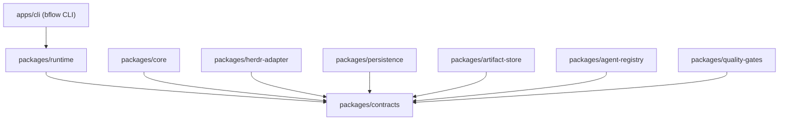
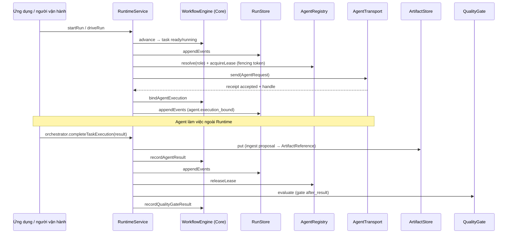

# 1. Tổng quan kiến trúc

bflow là một nền tảng TypeScript theo module để điều phối các AI coding agent qua quy trình phát triển phần mềm. **Herdr vận hành agent**; dự án này sở hữu quyết định workflow, bản ghi thực thi bền vững, artifact và các ranh giới tích hợp.

Hiện tại sản phẩm là **tập thư viện** trong một pnpm workspace. Không có tiến trình server, CLI thực thi hay lệnh `start`. Ứng dụng nhúng các package và tự ghép chúng qua `createRuntimeService` — xem ví dụ [runtime-demo](../../examples/runtime-demo/README.md).

## Các package

| Package | Entry point chính | Vai trò |
| --- | --- | --- |
| `@bflow/contracts` | Zod schema, port, validator | Dữ liệu trao đổi; mọi dữ liệu qua ranh giới package được parse bằng schema |
| `@bflow/core` | `DeterministicWorkflowEngine` | DAG, chuyển trạng thái hợp lệ, retry/rework, approval, gate, cancellation, replay, aggregate checkpoint. Không I/O |
| `@bflow/persistence` | `openSqliteRunStore` | Event, receipt, projection, checkpoint trong SQLite (`node:sqlite`) |
| `@bflow/artifact-store` | `openFilesystemArtifactStore` | Lưu artifact bất biến, kiểm tra checksum, trả về `ArtifactReference` tin cậy |
| `@bflow/agent-registry` | `createAgentRegistry`, `seedMvpAgentRegistry`, `loadWorkflowDefinition` | Cấu hình role → agent, lease/fencing, MVP roles, workflow template, prompt, kiểm tra output |
| `@bflow/herdr-adapter` | `createHerdrAdapter` | `AgentTransport` gọi Herdr CLI 0.9.1 |
| `@bflow/quality-gates` | `createPresetQualityGate`, `createDefaultSecurityPolicy` | Chạy lệnh kiểm tra độc lập, security policy, RBAC/human governance |
| `@bflow/runtime` | `createRuntimeService` | Ghép các port: dispatch, ingest artifact, gate, approval, cancel, recovery, event stream |
| `@bflow/cli` | `runCli`, binary `bflow` | Giao diện dòng lệnh (`init`, `run`, `status`, `approve`, `resume`, `cancel`) |

Package lá chỉ phụ thuộc `contracts`. `runtime` khai báo các package khác là `devDependencies` (cho test); ứng dụng tự tạo instance cụ thể rồi truyền vào `createRuntimeService(ports)`.

## Luồng một task trong Runtime

Điểm quan trọng:

- **Event là nguồn sự thật.** Mỗi lệnh thay đổi trạng thái tạo một lô event được ghi nguyên tử vào SQLite trước khi Runtime thực hiện side effect tiếp theo. Checkpoint aggregate (`bflow.workflow-aggregate+json` v1) chỉ là tối ưu cho recovery.
- **Kết quả agent là đầu vào từ người gọi.** Runtime không tự gọi `transport.wait`/`read` để lấy kết quả. Người gọi phải gọi `service.orchestrator.completeTaskExecution(runId, taskId, result)`.
- **Herdr `done` không phải thành công.** Core chỉ chấp nhận `AgentResult` khi handle đã bind có correlation `verified: true`.
- **Agent output là `ArtifactProposal` không tin cậy.** Chỉ `ArtifactStore.put` thành công mới sinh `ArtifactReference` (`artifact://<storeId>/<artifactId>`).
- **Quality gate độc lập với agent.** Gate chạy lại lệnh (`pnpm test`, …) và không tin lời agent tự báo.
- **Approval bắt buộc là của con người.** `decidedBy` có tiền tố như `agent`, `ai`, `bot`, `system`, `qa`, `reviewer`, `claude`, `gpt`… bị từ chối.
- SQLite, filesystem artifact và Herdr **không** cùng một transaction nguyên tử.

Thiết kế hợp đồng chi tiết: [architecture.md](../architecture.md), [contracts.md](../contracts.md), [ADR](../adr/).
