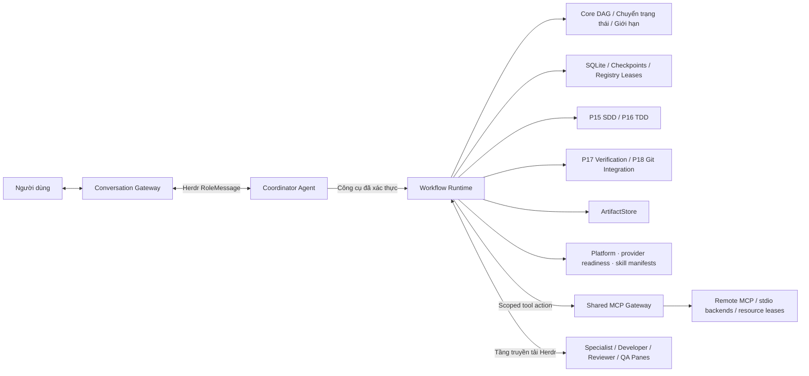

# Tổng quan kiến trúc (Architecture Overview)

Kiến trúc Bflow được cấu thành từ năm thành phần cốt lõi:
1. **Conversation Agent**: Điểm giao tiếp duy nhất tương tác với người dùng (`bflow attach` gắn trực tiếp vào pane này); làm rõ yêu cầu, báo cáo tiến độ và tiếp nhận quyết định phê duyệt.
2. **Coordinator Agent**: Đóng vai trò trưởng nhóm kỹ thuật; phân tích yêu cầu, xây dựng đồ thị tác vụ có hướng (DAG), phân bổ chuyên gia và điều phối thông qua các công cụ của Runtime.
3. **Workflow Runtime**: Cơ quan trung tâm phân xử và kiểm soát thực thi; quản lý chuyển trạng thái tất định, thực thi rào chắn an toàn, giới hạn số lần thử và gọi các cổng chất lượng độc lập.
4. **Herdr**: Tầng điều phối tiến trình và môi trường hiển thị đa pane vật lý; vận hành các tiến trình agent trong các terminal pane riêng biệt và vận chuyển thông điệp theo giao thức chuẩn.
5. **ArtifactStore**: Kho lưu trữ bất biến có định danh theo nội dung (content-addressed) và xác thực mã băm SHA-256; lưu trữ an toàn các tài liệu đặc tả, bản vá (patch) và kết quả kiểm thử.

CLI lifecycle hiện ghép persistent host và platform P30. Setup tạo machine inventory/Gateway/skills; repo chọn desired config; session pin grant/manifest/generation. Tool policy D-TOOLS-01 phân biệt catalog ID, service và upstream operation, còn inter-role messages vẫn qua Herdr. Context khảo sát source là bằng chứng implementation, không là business intent đã duyệt. Xem [trạng thái hiện tại](../implementation-status.md) và [tool integration](../tools-sdlc-integration.md).

Thành phần Core của Bflow hoàn toàn mang tính tất định (deterministic), không phụ thuộc trực tiếp vào Herdr; Runtime kết hợp các gói thành phần thông qua các hợp đồng giao tiếp chuẩn hóa (`@bflow/contracts`).

---

## 1. Sơ đồ luồng tương tác kiến trúc

---

## 2. Phân vùng Topo và Phiên làm việc (P12 & P13)

Vòng đời môi trường khởi tạo topo trong một phiên Herdr được cấp riêng cho repository hiện hành:
- **Tab Conversation**: Chứa pane `chat` của Conversation Agent.
- **Tab Coordination**: Bố cục lưới 2x2 chứa các vai trò `coordinator`, `planner`, `analyst` và `architect`.
- **Tab Verification**: Chứa các vai trò `reviewer` và `qa-verifier`.
- **Vai trò Developer**: Được cấp phát động đi kèm Git worktree và pane riêng biệt khi có tác vụ cần thực hiện.

Lệnh `bflow attach` chỉ tập trung tiêu điểm vào Conversation Agent. Cần lưu ý rằng định danh cấu hình của Bflow độc lập với cấu hình giao diện/provider của Herdr; tên phiên làm việc mang tính chất phân tách logic, không phải là ranh giới phân quyền bảo mật ở cấp hệ điều hành.

---

## 3. Bốn miền trạng thái trực giao (Four Distinct State Domains)

Hệ thống phân định nghiêm ngặt bốn miền trạng thái hoàn toàn độc lập và không bao giờ đánh đồng lẫn nhau:

| Miền trạng thái | Ví dụ các giá trị trạng thái | Nguyên tắc và ranh giới suy diễn |
| :--- | :--- | :--- |
| **`AgentTransportState`** | `idle`, `working`, `done`, `disconnected` | Trạng thái `done` chỉ phản ánh việc kết thúc lượt xử lý của agent, **không chứng minh tác vụ đã thành công**. |
| **`SdlcWorkStatus`** | `specifying`, `implementing`, `verifying`, `completed` | Phản ánh giai đoạn nghiệp vụ SDLC cấp cao; không thay thế cho trạng thái kỹ thuật `TaskStatus` hoặc `RunStatus` của Core Engine. |
| **`ConversationSessionStatus`** | `active`, `awaiting_user_approval`, `paused` | Trạng thái phiên tương tác người dùng; việc đóng cửa sổ chat không đồng nghĩa với việc các quy trình nền đã dừng lại. |
| **`ApprovalStatus`** | `pending`, `approved`, `rejected`, `superseded` | Vòng đời của các quyết định phê duyệt; một quyết định phê duyệt cho một phạm vi cụ thể không cấp quyền tự động cho phạm vi khác. |

---

## 4. Chuỗi đảm bảo tính bền vững (Durability Chain)

Để đảm bảo tính bền vững của dữ liệu, mọi thao tác phân phối tác vụ bắt buộc phải tuân thủ nghiêm ngặt chuỗi tuần tự sau:
1. Ghi nhận ý định phân phối (`intent`).
2. Kiểm tra tính hợp lệ của lease hiện thời và token hàng rào (`fencing token`).
3. Truyền tải thông điệp qua Herdr transport.
4. Nhận biên nhận gắn kết (`binding receipt`).
5. Tiếp nhận kết quả đã xác thực (`authenticated result`).
6. Nạp artifact vào ArtifactStore tin cậy để lấy tham chiếu an toàn.
7. Thực hiện xác minh độc lập qua cổng kiểm tra (P17).
8. Tiếp nhận phê duyệt chính thức từ người vận hành.

Do SQLite, hệ thống tệp tin và Herdr không nằm trong cùng một giao dịch nguyên tử (atomic transaction), hệ thống sử dụng nhật ký journal và cơ chế đối soát (reconciliation) để kiểm soát các trạng thái truyền tin bất định (`uncertain_delivery`), tuyệt đối không gửi lại thông điệp một cách mù quáng.

Tham khảo thêm tài liệu kiến trúc chi tiết tại:
- [Kiến trúc v2](../architecture-v2.md)
- [Bản ghi quyết định kiến trúc ADR 0003](../adr/0003-authenticated-herdr-receipts.md)
- [Tài liệu kỹ thuật Runtime](../../packages/runtime/README.md)
