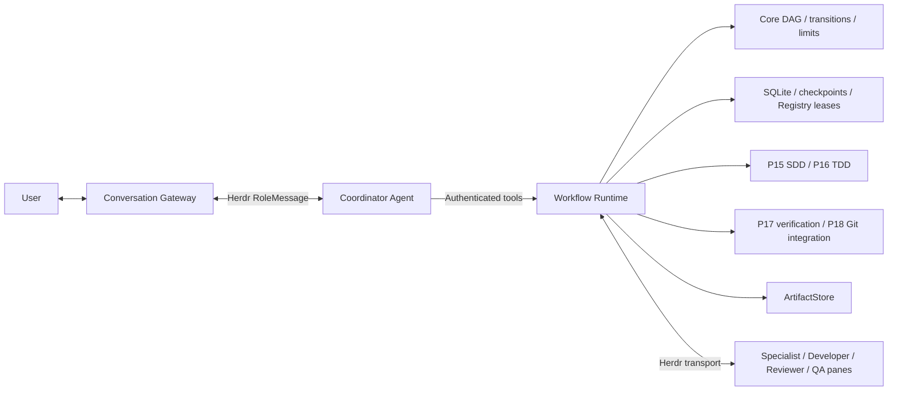

# Architecture Overview

Bflow gồm năm thành phần: Conversation là giao diện user; Coordinator lập kế
hoạch và dùng tools; Workflow Runtime là arbiter thực thi; Herdr quản lý process/
pane và transport; ArtifactStore lưu tài liệu/evidence có checksum. Core thuần
deterministic không phụ thuộc Herdr; runtime compose các leaf packages qua contracts.

P12/P13 lifecycle tạo topology trong session dành riêng cho canonical checkout:
Conversation tab chứa chat; Coordination chứa coordinator/planner/analyst/architect;
Verification chứa reviewer/qa-verifier. Developer worktree/pane được allocate động.
`bflow attach` chỉ focus Conversation. Bflow identity/config khác Herdr provider/UI
config; session name không phải authorization boundary của hệ điều hành.

P19 `openAgenticWorkspace` compose P14–P18 cùng Core/SQLite/Registry/ArtifactStore
trên session P12/P13 đã up. Host phải nạp prompts/tools, chạy scheduler/inbound pump,
cung cấp independent check runners và auth. CLI lifecycle chưa tự mở host đó;
legacy CLI `run/approve/resume/cancel` vẫn dùng `openWorkspaceRuntime`.

| State domain | Ví dụ | Không được suy ra |
| --- | --- | --- |
| AgentTransportState | idle, working, done, disconnected | done không chứng minh task pass |
| SdlcWorkStatus | specifying, implementing, verifying, completed | Không thay TaskStatus/RunStatus của Core |
| ConversationSessionStatus | active, awaiting_user_approval, paused | Chat đóng không chứng minh workflow dừng |
| ApprovalStatus | pending, approved, rejected, superseded | Một decision không cấp quyền cho scope khác |

Durability cần thứ tự intent → current lease/fencing → transport → binding/receipt
→ authenticated result → trusted artifact ingest → independent verification →
approval. SQLite, filesystem và Herdr không nằm trong một atomic transaction;
journal/reconciliation giữ trạng thái uncertain thay vì resend mù.

Đã có source implementation cho engine, storage, lifecycle, P14–P19 và native
receipt host/plugin. Tự động host boot/shutdown từ CLI, provider-specific tool
registration và live model-generated SDLC E2E vẫn cần tích hợp/kiểm chứng cụ thể.
Không diễn giải passing fake transport tests hoặc native transport smoke là
delivery bằng AI đã hoàn thành. Tham chiếu
[architecture v2](../architecture-v2.md), [ADR 0003](../adr/0003-authenticated-herdr-receipts.md)
và [Runtime README](../../packages/runtime/README.md).
