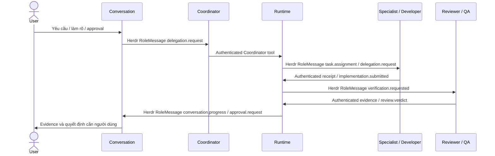

# Giao tiếp agent-to-agent qua Herdr

Herdr vận chuyển tương tác và quản lý process/pane. Runtime quyết định task có
được dispatch hoặc hoàn tất hay không. ArtifactStore lưu evidence bất biến có
checksum, không dùng làm thư mục polling/mailbox giữa agent.

Mọi cross-role message parse bằng `@bflow/contracts.RoleMessageSchema` tại ingress.
Envelope dùng `schema_version: 2` và snake_case:

| Field | Quy tắc |
| --- | --- |
| `message_id` | ID message ổn định khi retry; conflicting reuse bị từ chối |
| `correlation_id` | Liên kết cùng yêu cầu/luồng, không lấy từ pane title |
| `causation_id` | Message gây ra message này; dùng bind assignment/reply |
| `run_id` | Bắt buộc cho workflow-scoped message; intake/clarification có thể chưa có |
| `sender`, `recipient` | Contract roles; host xác thực agent/pane/session thực |
| `type`, `payload` | Type được schema cho phép và payload contract tương ứng |
| `artifact_references` | Reference đáng tin từ ArtifactStore, cùng run; dùng `[]` nếu chưa có |
| `occurred_at`, `idempotency_key` | Optional ở envelope schema; host dùng provenance/idempotency của operation |

Xem [task-status.json](../../templates/node-typescript/messages/task-status.json),
đã parse bằng schema thật. Các agent/pane/message IDs trong file là dữ liệu minh
họa, không phải execution receipt hợp lệ để submit vào session đang chạy. Host
phải bind envelope với identity đã xác thực; schema-valid không chứng minh sender.

Conversation chỉ giao Coordinator, không trực tiếp giao Developer. Specialist chỉ
trao đổi với Coordinator/Runtime. Coordinator tools cũng không lấy principal từ
model arguments; host inject principal. Chi tiết type/routing tại
[session contracts](../../packages/contracts/src/session.ts) và
[communication protocol](../communication-protocol.md).

P19 durable outbox ghi dispatch intent trước transport, kiểm tra lease/fencing
trước side effect và giữ uncertain delivery qua restart. Busy pane giữ message
trong queue; enqueue receipt không phải remote receipt. Coordinator `tick` trả
ngay và phải yield turn; host giữ inbound pump và scheduler hoạt động độc lập,
không chặn handler chờ chính pane của nó trả lời.

Herdr `done` chỉ là hết turn. CLI submission handle gốc vẫn `verified: false`.
ADR 0003 thêm `execution.receipt` được trusted native host ký Ed25519, bind đúng
assignment/target/native session/lease; Core ghi proof event rồi mới chấp nhận
correlated result. Signed binding chưa chứng minh correctness: cần P17 độc lập.
Host phải xác thực result/evidence/gate result và human approval riêng.

Native plugin đã có tại `agents/coordinator/herdr-receipts`. Key private và
`host.json` là host-local, không track trong repo hoặc đưa vào prompt. Historical
issuer public keys cần giữ để replay receipt. Tích hợp provider/tool registration
và automatic CLI host boot vẫn cần host cụ thể; không có CLI `bflow send` hoặc
`bflow agent message` để thay ingress. Hướng dẫn này không giả lập lệnh Herdr
`send/wait` mới: live transport test dùng API/plugin thật đã có trong implementation.

Kiểm chứng đã chạy: protocol 22/schema 1 và signed structured message qua native
plugin trên Herdr 0.9.5 trong session tạm, không model/provider. Custom test actor
không có native agent_session phù hợp để chứng minh binding attestation; không
coi smoke pass là successful AI assignment hay SDLC E2E. Xem
[validation report](../../templates/node-typescript/VALIDATION.md).
