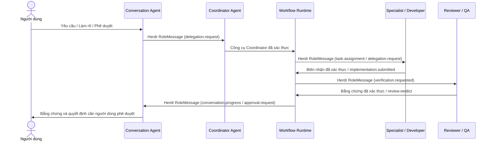

# Giao tiếp liên Agent qua Herdr (Herdr Communication)

Trong hệ thống Bflow, **Herdr** đóng vai trò là tầng vận chuyển tương tác và quản lý tiến trình/pane vật lý, trong khi **Workflow Runtime** là cơ quan có thẩm quyền cao nhất quyết định một tác vụ có được phân phối (dispatch) hay công nhận hoàn tất (complete) hay không. Kho lưu trữ **ArtifactStore** chịu trách nhiệm lưu giữ các bằng chứng bất biến có kiểm tra mã băm toàn vẹn (checksum), tuyệt đối không được sử dụng làm thư mục polling hay hộp thư chia sẻ tạm giữa các agent.

---

## 1. Sơ đồ tuần tự tương tác (Interaction Sequence)

---

## 2. Cấu trúc phong bì thông điệp RoleMessage

Mọi thông điệp trao đổi chéo giữa các vai trò (cross-role message) đều bắt buộc phải được kiểm tra tính hợp lệ tại ranh giới tiếp nhận (ingress) bằng `@bflow/contracts.RoleMessageSchema`. Phong bì chuẩn sử dụng phiên bản `schema_version: 2` với định dạng khóa kiểu snake_case:

| Trường dữ liệu | Quy tắc và ràng buộc vận hành |
| :--- | :--- |
| `message_id` | Mã định danh thông điệp duy nhất, được giữ ổn định khi thử lại; hệ thống sẽ từ chối nếu phát hiện việc tái sử dụng ID gây xung đột |
| `correlation_id` | Định danh liên kết toàn bộ chuỗi tương tác thuộc cùng một luồng nghiệp vụ; tuyệt đối không lấy từ tiêu đề pane |
| `causation_id` | Định danh của thông điệp trực tiếp kích hoạt thông điệp này; dùng để liên kết phản hồi với nhiệm vụ được giao |
| `run_id` | Bắt buộc đối với các thông điệp có phạm vi quy trình (workflow-scoped); giai đoạn tiếp nhận/làm rõ ban đầu có thể để trống |
| `sender`, `recipient` | Tên vai trò theo hợp đồng (contract roles); host có trách nhiệm xác thực danh tính agent/pane/session thực tế |
| `type`, `payload` | Loại thông điệp hợp lệ theo schema và tải trọng dữ liệu (payload) tương ứng |
| `artifact_references` | Danh sách tham chiếu artifact tin cậy từ ArtifactStore thuộc cùng một lượt chạy; truyền mảng rỗng `[]` nếu chưa có |
| `occurred_at`, `idempotency_key` | Tùy chọn trong schema phong bì; host sử dụng để chứng minh nguồn gốc dữ liệu và đảm bảo tính lũy thừa |

Tham khảo tệp mẫu chuẩn [task-status.json](../../templates/node-typescript/messages/task-status.json) đã được xác thực bởi schema thực tế. Các ID trong tệp mẫu chỉ nhằm mục đích minh họa, không phải là biên nhận thực thi hợp lệ để gửi vào một phiên đang chạy. Host bắt buộc phải liên kết phong bì với danh tính đã được xác thực; việc một thông điệp hợp lệ về mặt schema không đồng nghĩa với việc người gửi đã được chứng thực.

---

## 3. Ranh giới điều phối và hàng đợi Outbox bền vững

- **Nguyên tắc phân quyền giao tiếp**: Conversation Agent chỉ giao tiếp với Coordinator, tuyệt đối không gửi nhiệm vụ trực tiếp cho Developer. Các chuyên gia kỹ thuật (Specialist) chỉ trao đổi thông tin với Coordinator hoặc Runtime. Các công cụ của Coordinator không tiếp nhận thông tin danh tính từ tham số của mô hình; host sẽ chịu trách nhiệm tiêm (inject) danh tính đã xác thực. Xem chi tiết tại [hợp đồng phiên](../../packages/contracts/src/session.ts) và [giao thức giao tiếp](../communication-protocol.md).
- **Hàng đợi Outbox bền vững (P19)**: Ghi nhận ý định phân phối (`dispatch intent`) xuống đĩa trước khi gửi qua tầng truyền tải, kiểm tra tính hợp lệ của lease và fencing token trước khi tạo tác dụng phụ, đồng thời bảo lưu trạng thái truyền tin bất định (`uncertain_delivery`) qua các lần khởi động lại.
- **Xử lý bất đồng bộ**: Khi pane bận, thông điệp được giữ an toàn trong hàng đợi; biên nhận đưa vào hàng đợi (`enqueue receipt`) không tương đương với biên nhận từ phía nhận. Chu kỳ `tick` của Coordinator sẽ trả về ngay lập tức để nhường lượt (yield turn); host duy trì bộ bơm dữ liệu đến (`inbound pump`) và bộ lập lịch chạy hoàn toàn độc lập, không chặn luồng xử lý để chờ đợi phản hồi từ chính pane đó.

---

## 4. Biên nhận thực thi và chữ ký số Ed25519 (ADR 0003)

Cần đặc biệt lưu ý rằng trạng thái `done` của Herdr chỉ phản ánh việc kết thúc lượt xử lý của agent. Mã xử lý của CLI (`submission handle`) ban đầu vẫn mang cờ `verified: false`. 

Theo tài liệu quyết định kiến trúc [ADR 0003](../adr/0003-authenticated-herdr-receipts.md), hệ thống bổ sung biên nhận thực thi `execution.receipt` có chữ ký số Ed25519 được cấp bởi native host tin cậy, liên kết chặt chẽ với nhiệm vụ, mục tiêu, phiên làm việc bản địa và lease hợp lệ. Core Engine sẽ ghi nhận sự kiện chứng thực (`proof event`) trước khi chấp nhận kết quả tương ứng. Chữ ký xác thực này khẳng định nguồn gốc thông điệp nhưng chưa chứng minh tính đúng đắn về mặt kỹ thuật của mã nguồn; việc thẩm định chất lượng bắt buộc phải thông qua động cơ kiểm tra độc lập P17.

Các khóa bí mật và tệp `host.json` được lưu trữ an toàn cục bộ trên host, tuyệt đối không được đưa vào kho mã nguồn hoặc nhúng vào prompt. Lịch sử khóa công khai của bên phát hành phải được lưu giữ đầy đủ để phục vụ việc phát lại và đối soát biên nhận sau này. Tham khảo thêm [Báo cáo xác thực](../../templates/node-typescript/VALIDATION.md).
