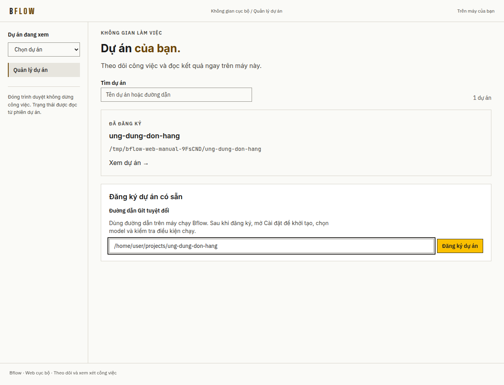
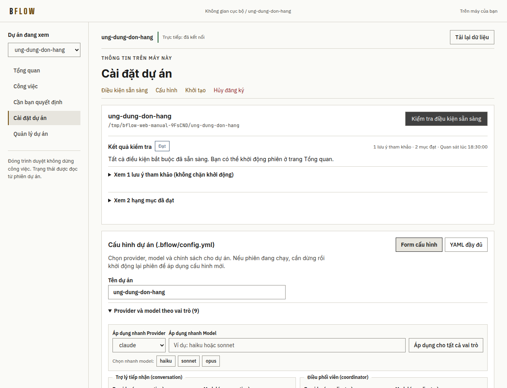
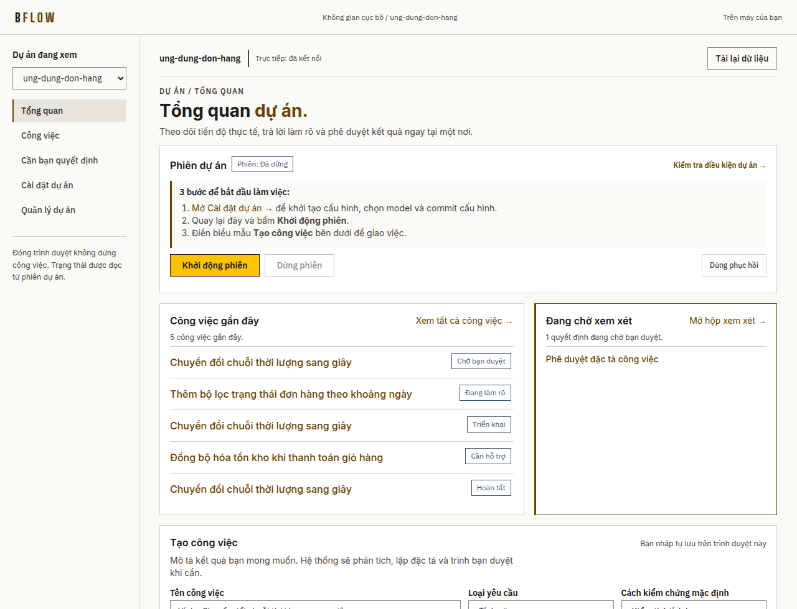
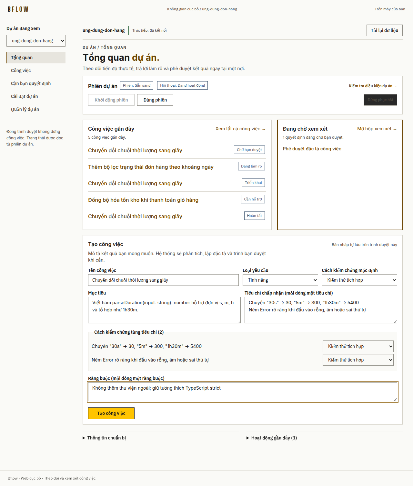
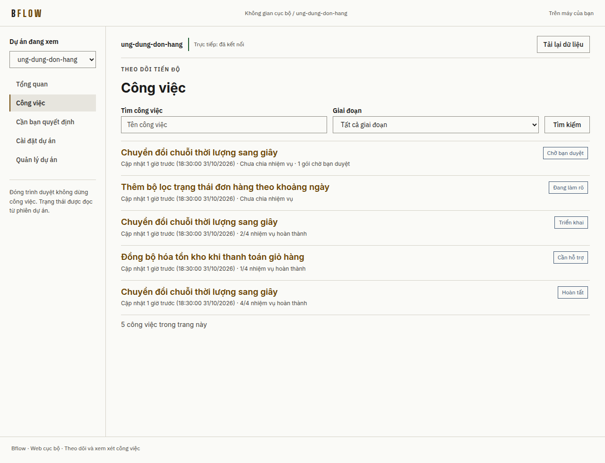
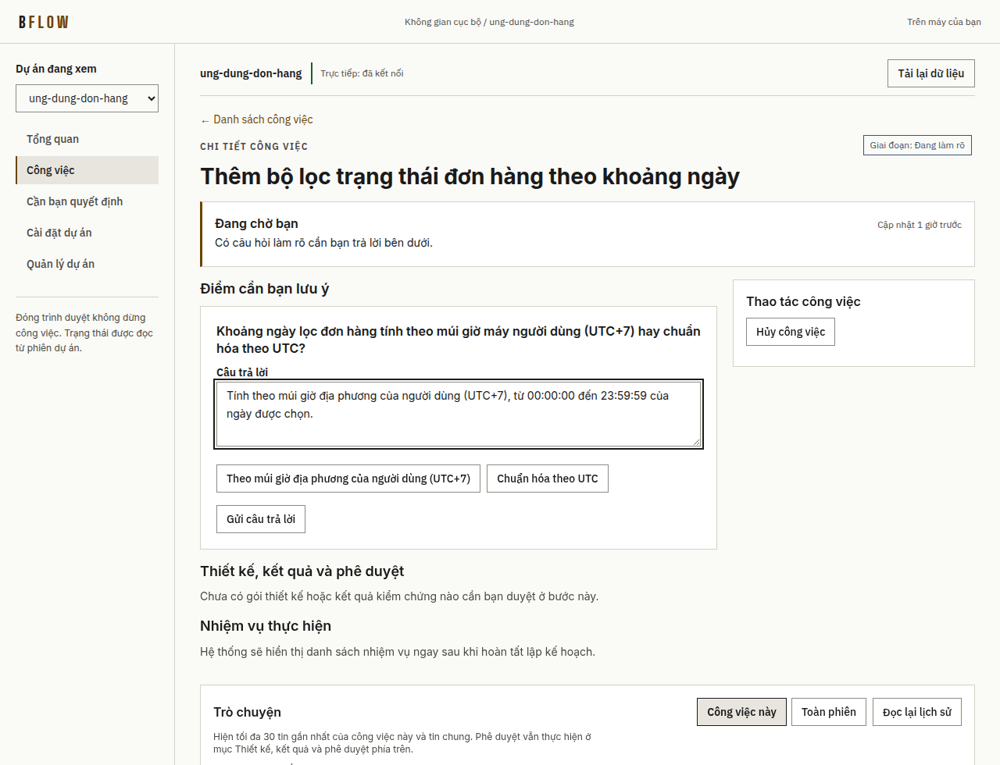
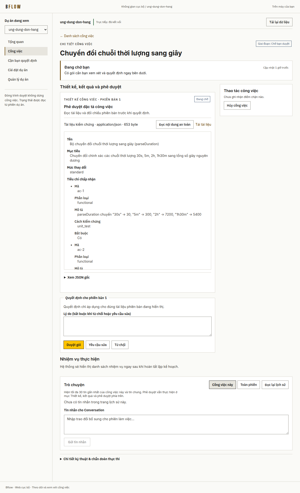
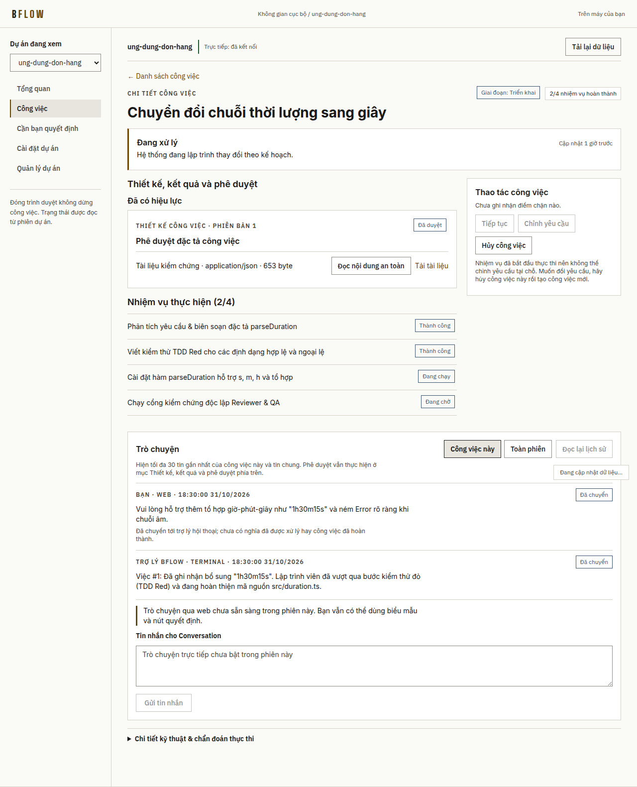
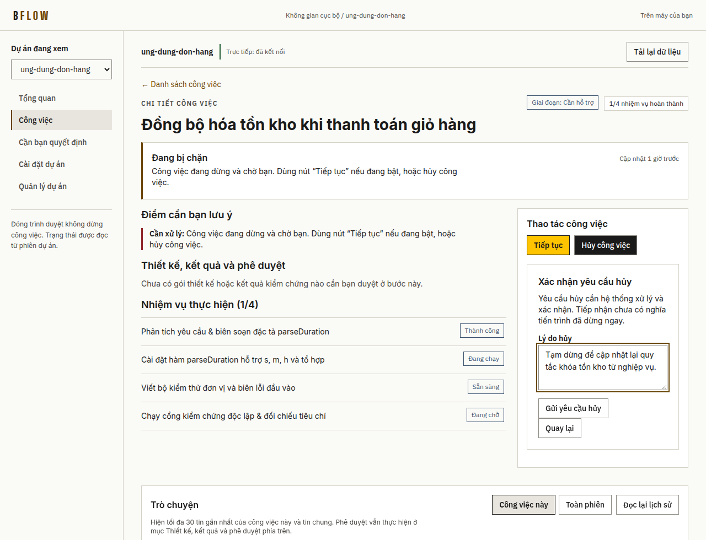
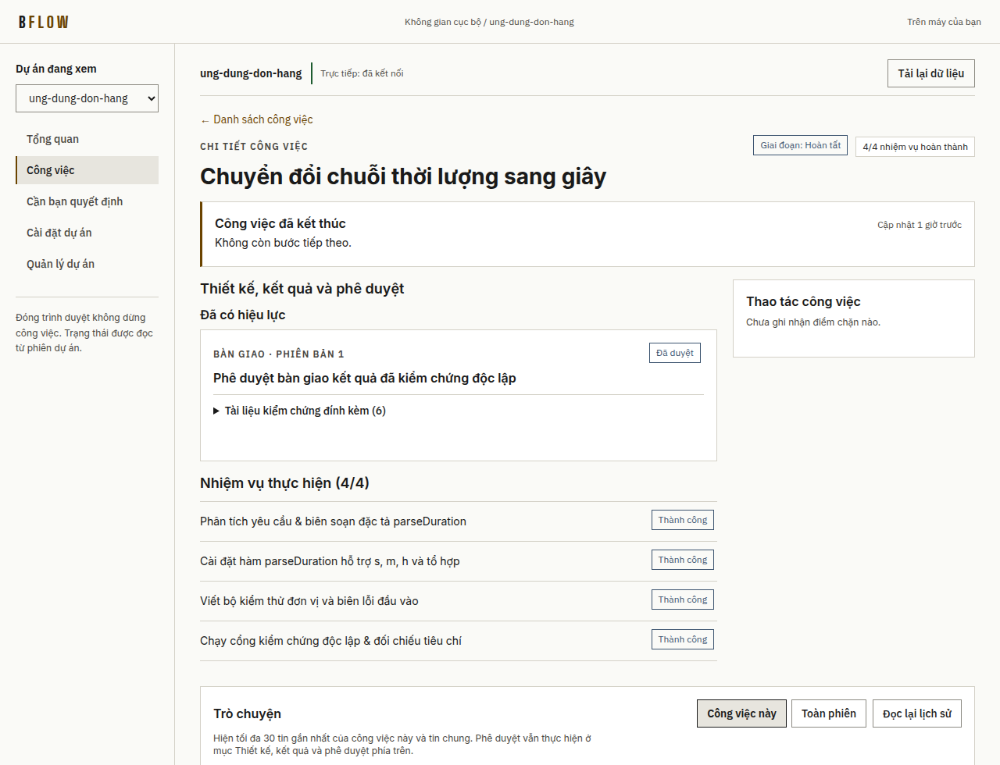

# Cẩm nang sử dụng Bflow Web cho người dùng

**Bflow Web** là giao diện tiếng Việt chạy ngay trên trình duyệt máy cá nhân của bạn (`http://127.0.0.1:4317`). Với Bflow Web, bạn có thể giao yêu cầu phần mềm, trả lời câu hỏi làm rõ, xem xét đặc tả, theo dõi tiến độ kiểm thử và phê duyệt bàn giao mà **không cần ghi nhớ lệnh dòng lệnh hay hiểu cấu trúc kỹ thuật bên dưới**.

> **3 nguyên tắc an tâm khi sử dụng:**
> 1. **Đóng tab trình duyệt không làm dừng công việc.** Mọi tiến trình chạy an toàn trong phiên dự án ở hậu trường; mở lại trang là thấy ngay trạng thái mới nhất.
> 2. **Bản nháp không bị mất khi chuyển trang hoặc tải lại.** Nội dung bạn đang gõ ở biểu mẫu tạo việc hoặc khung phê duyệt được giữ lại tự động trên trình duyệt.
> 3. **Hệ thống không tự ý vượt quyền phê duyệt của bạn.** Các mốc quan trọng (duyệt đặc tả thiết kế, duyệt bàn giao kết quả) luôn dừng lại chờ quyết định của bạn.

---

## Chuẩn bị trước khi bắt đầu

Trước khi mở Bflow Web lần đầu trên máy, bạn chỉ cần đảm bảo 3 điều kiện một lần:
1. Máy đã chạy cài đặt Bflow cấp máy (`bflow setup`) — xem [Hướng dẫn cài đặt](installation.md) nếu đây là máy mới hoàn toàn.
2. Đã đăng nhập công cụ AI bạn muốn sử dụng (ví dụ **Claude Code** hoặc **Codex**).
3. Dự án của bạn là một thư mục Git có sẵn trên máy tính (đã có ít nhất 1 commit đầu tiên).

---

## Bước 1: Mở Bflow Web và đăng ký dự án

Mở cửa sổ Terminal bất kỳ và gõ lệnh duy nhất:

```bash
bflow web
```

Trình duyệt mặc định sẽ tự động mở và ghép nối bảo mật với máy của bạn (mã ghép nối một lần trên thanh địa chỉ sẽ tự xóa ngay sau khi xác thực xong).

Tại màn hình **Quản lý dự án**:
1. Dán **Đường dẫn Git tuyệt đối** của thư mục dự án trên máy (ví dụ `/home/user/projects/ung-dung-don-hang`) vào ô nhập.
2. Bấm nút vàng **Đăng ký dự án**.
3. Sau khi thẻ dự án xuất hiện bên dưới, bấm **Xem dự án →** (hoặc chọn nhanh dự án ở hộp chọn góc trái trên cùng).



> **Lưu ý:** Thao tác *Đăng ký dự án* chỉ thêm dự án vào danh sách theo dõi của Bflow Web, hoàn toàn không tự ý sửa tệp nào trong thư mục mã nguồn của bạn.

---

## Bước 2: Cài đặt dự án lần đầu và kiểm tra điều kiện sẵn sàng

Ở lần đầu thêm một dự án mới, hãy bấm mục **Cài đặt dự án** ở thanh điều hướng bên trái và thực hiện theo thứ tự từ trên xuống:

1. **Chọn nhanh Nhà cung cấp & Mô hình AI (tuỳ chọn):**
   - Dùng thanh **Áp dụng nhanh Provider** và **Áp dụng nhanh Model** (có sẵn các nút gợi ý nhanh như `sonnet`, `haiku`, `opus`, `gpt-5.4`) rồi bấm **Áp dụng cho tất cả vai trò** để đồng bộ chỉ với 1 cú nhấp chuột, thay vì chỉnh từng ô.
   - Bấm **Lưu cấu hình** nếu bạn vừa thay đổi thiết lập.
2. **Khởi tạo cấu hình dự án (`Khởi tạo / sửa GitNexus`):**
   - Nếu dự án chưa có tệp `.bflow/config.yml`, bấm chạy mục khởi tạo. Bạn có thể đánh dấu **Commit cấu hình đã xem vào Git** để lưu gọn hai tệp cấu hình vào kho mã trước khi chạy phiên.
3. **Kiểm tra điều kiện sẵn sàng:**
   - Bấm nút **Kiểm tra điều kiện sẵn sàng** ở đầu trang.
   - Khi khung trạng thái báo xanh **"Tất cả điều kiện bắt buộc đã sẵn sàng để khởi động phiên làm việc"**, bạn đã sẵn sàng bắt đầu! (Nếu thiếu điều kiện nào, trang sẽ liệt kê rõ bằng tiếng Việt ngay tại chỗ).



---

## Bước 3: Khởi động phiên làm việc của dự án

Chuyển sang mục **Tổng quan** ở thanh bên trái:

- Khi dự án chưa bật phiên, bạn sẽ thấy bảng tóm tắt **3 bước để bắt đầu làm việc** cùng huy hiệu `Phiên: Đã dừng`.
- Bấm nút vàng **Khởi động phiên** và chờ khoảng 1–2 phút trong khi hệ thống chuẩn bị các trợ lý chuyên trách cho dự án. Trang tự động cập nhật trạng thái mà không cần bạn bấm tải lại.



Khi huy hiệu ở thẻ **Phiên dự án** chuyển sang **`Phiên: Sẵn sàng`** và **`Hội thoại: Đang hoạt động`**, biểu mẫu giao việc bên dưới sẽ mở khóa để bạn sử dụng.

---

## Bước 4: Tạo công việc mới bằng ngôn ngữ tự nhiên

Ngay tại trang **Tổng quan**, điền biểu mẫu **Tạo công việc**:

1. **Tên công việc:** Đặt tên ngắn gọn, dễ nhận biết (ví dụ: *Chuyển đổi chuỗi thời lượng sang giây*).
2. **Loại yêu cầu:** Chọn `Tính năng`, `Sửa lỗi`, `Cải tiến`, hoặc loại phù hợp.
3. **Cách kiểm chứng mặc định:** Giữ mặc định (`Kiểm thử tích hợp` hoặc `Kiểm thử đơn vị`) — hệ thống sẽ dùng phương pháp này cho các tiêu chí bên dưới trừ khi bạn đổi riêng từng dòng.
4. **Mục tiêu:** Mô tả rõ kết quả bạn mong muốn bằng tiếng Việt tự nhiên.
5. **Tiêu chí chấp nhận (mỗi dòng một tiêu chí):** Viết mỗi điều kiện nghiệm thu trên một dòng. Ngay khi bạn nhập, Bflow Web hiển thị danh sách tiêu chí tương ứng để bạn kiểm tra hoặc chọn cách kiểm chứng riêng cho từng tiêu chí.
6. **Ràng buộc (tuỳ chọn):** Ghi các giới hạn cần giữ (ví dụ: *Không thêm thư viện ngoài*, *Giữ nguyên giao diện hiện tại*).
7. Bấm nút vàng **Tạo công việc**.



> **Mẹo chống bấm nhầm:** Sau khi gửi, thẻ **Thao tác đã gửi** hiển thị rõ 3 mốc `✓ Đã gửi → ✓ Đã tiếp nhận → ✓ Đã áp dụng`. Nếu mạng chập chờn hoặc bạn lỡ bấm hai lần, trình duyệt sẽ tự đối chiếu đúng thao tác cũ chứ không tạo hai công việc trùng nhau.

---

## Bước 5: Tìm kiếm và theo dõi danh sách công việc

Chọn mục **Công việc** ở thanh điều hướng bên trái để xem toàn bộ các công việc của dự án:

- **Tìm công việc:** Gõ từ khóa theo tên hoặc mã công việc.
- **Lọc theo giai đoạn:** Lọc nhanh các việc đang `Chờ làm rõ`, `Chờ bạn duyệt`, `Đang lập trình`, `Đang kiểm chứng` hoặc đã `Hoàn tất`.
- Nhấp vào tên một công việc bất kỳ để mở trang **Chi tiết công việc**.



---

## Bước 6: Trả lời câu hỏi làm rõ (khi yêu cầu còn điểm mở)

Nếu yêu cầu ban đầu có chi tiết nghiệp vụ chưa rõ (ví dụ múi giờ, quy tắc làm tròn, quyền truy cập), hệ thống sẽ không đoán mò mà chuyển công việc sang trạng thái **`Giai đoạn: Chờ làm rõ`**:

1. Mở công việc đang chờ bạn (hoặc nhấp trực tiếp từ thẻ thông báo ở trang **Tổng quan**).
2. Đọc câu hỏi trong khung **Câu hỏi cần làm rõ** (nếu có các phương án gợi ý sẵn, bạn có thể tham khảo ngay trên thẻ).
3. Nhập câu trả lời của bạn vào ô trả lời và bấm **Gửi trả lời**.



---

## Bước 7: Xem xét đặc tả / thiết kế và phê duyệt

Trước khi viết mã nguồn hoặc trước khi chốt bàn giao, các gói cần bạn quyết định sẽ xuất hiện tại mục **Cần bạn quyết định** (trên thanh bên trái) và ngay trong mục **Thiết kế, kết quả và phê duyệt** của trang công việc:

1. Bấm **Đọc nội dung an toàn** trên tài liệu đính kèm để đọc ngay bản tóm tắt tiếng Việt rõ ràng (*Tên*, *Mục tiêu*, *Mức thay đổi*, *Tiêu chí chấp nhận*, *Cách kiểm chứng*). Nếu muốn xem dữ liệu kỹ thuật gốc, bạn mới cần mở dòng thu gọn `▸ Xem JSON gốc`.
2. Bấm nút vàng **Xem xét gói** để mở bảng quyết định cho đúng phiên bản tài liệu đang xem.
3. Chọn một trong ba quyết định:
   - **Duyệt gói:** Chấp thuận đặc tả để hệ thống bắt đầu lập trình và kiểm thử tự động.
   - **Yêu cầu sửa:** Nhập điều bạn muốn điều chỉnh vào ô **Lý do** rồi bấm *Yêu cầu sửa* để hệ thống cập nhật phiên bản mới.
   - **Từ chối:** Từ chối gói hiện tại (cần ghi rõ lý do).



> **Bảo vệ chống duyệt nhầm bản cũ:** Nếu tài liệu vừa được cập nhật sang phiên bản mới trong lúc bạn đang mở trang, Bflow Web sẽ tự động chặn gửi quyết định cũ và hiển thị thông báo mời bạn bấm đọc lại phiên bản mới nhất.

---

## Bước 8: Theo dõi tiến độ lập trình — kiểm chứng và trao đổi qua Trò chuyện

Sau khi bạn duyệt đặc tả, hệ thống tự động chia nhỏ nhiệm vụ, viết kiểm thử, lập trình trong không gian tách biệt và chạy vòng kiểm chứng độc lập:

- **Ô Bước hiện tại (đầu trang):** Cho biết bằng một câu tiếng Việt ngắn gọn hệ thống đang làm gì hoặc đang chờ ai, kèm tiến độ hoàn thành (ví dụ `2/4 nhiệm vụ hoàn thành`).
- **Nhiệm vụ thực hiện:** Liệt kê từng đầu việc con và trạng thái (`Thành công`, `Đang chạy`, `Sẵn sàng`, `Chờ đến lượt`).
- **Khung Trò chuyện:**
  - Hiển thị các bản tin cập nhật tiến độ ngắn gọn từ **Trợ lý Bflow** (mặc định lọc gọn trong phạm vi `Công việc này`; bấm `Toàn phiên` nếu muốn xem toàn bộ lịch sử phiên).
  - Bạn có thể nhập trao đổi bổ sung vào ô **Tin nhắn cho Conversation** và bấm **Gửi tin nhắn**. (Lưu ý: các quyết định phê duyệt chính thức vẫn thực hiện bằng nút **Duyệt gói** ở phía trên để đảm bảo tính xác thực).
- **Chi tiết kỹ thuật & chẩn đoán thực thi:** Mặc định được thu gọn ở cuối trang để không gây rối mắt; chỉ cần bấm mở khi bạn muốn tra mã định danh kỹ thuật.



---

## Bước 9: Xử lý khi công việc tạm dừng, hủy công việc hoặc phục hồi phiên

Khi có điểm bất thường, Bflow Web phân loại rõ thành **3 mức độ** trong mục **Điểm cần lưu ý** để bạn không phải lo lắng trước các thông báo hệ thống:

- **Cần xử lý** *(viền cảnh báo)*: Công việc đang dừng chờ bạn thao tác (ví dụ hết số lượt tự thử lại, cần bạn xem và bấm **Tiếp tục**).
- **Đang kiểm tra**: Hệ thống đã tự lên lịch thử lại an toàn ở hậu trường; **bạn chưa cần thao tác gì**.
- **Suy giảm tùy chọn**: Một tiện ích phụ (như khung chat trực tiếp trên một số cấu hình) chưa bật, nhưng biểu mẫu tạo việc và các nút phê duyệt vẫn hoạt động bình thường.

Trong khung **Thao tác công việc** bên phải:
- **Tiếp tục:** Cho phép công việc chạy tiếp khi đã sẵn sàng.
- **Chỉnh yêu cầu:** Cập nhật lại toàn bộ mục tiêu và tiêu chí khi công việc chưa bước vào giai đoạn lập trình mã nguồn. (Khi đã bắt đầu lập trình, nút này sẽ khóa kèm hướng dẫn rõ: hãy hủy công việc hiện tại rồi tạo công việc mới để đảm bảo an toàn mã nguồn).
- **Hủy công việc:** Mở khung xác nhận yêu cầu nhập **Lý do hủy** trước khi gửi yêu cầu dừng an toàn.



Tại trang **Tổng quan**, khi kết thúc ngày làm việc bạn có thể bấm:
- **Dừng phiên:** Lưu trạng thái an toàn và tắt phiên làm việc của dự án.
- **Dừng phục hồi** *(nút phụ góc phải)*: Chỉ dùng khi dừng phiên thông thường bị kẹt; hệ thống vẫn lưu điểm kiểm tra và giữ nguyên toàn bộ mã nguồn cùng lịch sử công việc.

---

## Bước 10: Phê duyệt bàn giao và hoàn tất công việc

Khi tất cả nhiệm vụ đã lập trình xong, vượt qua bộ kiểm thử tự động và được các vai trò phản biện độc lập (`Reviewer` & `QA`) xác nhận đạt tiêu chí:

1. Công việc chuyển sang bước chờ bạn duyệt gói **Bàn giao** (*Phê duyệt bàn giao kết quả đã kiểm chứng độc lập*).
2. Bạn có thể bấm **Đọc nội dung an toàn** để xem bản vá thay đổi mã nguồn (`text/x-patch`) hoặc các báo cáo kiểm thử đính kèm, sau đó bấm **Xem xét gói → Duyệt gói**.
3. Ngay sau khi gói bàn giao được áp dụng, công việc chuyển sang **`Giai đoạn: Hoàn tất`** với thông báo **"Công việc đã kết thúc — Không còn bước tiếp theo."** Toàn bộ hồ sơ phê duyệt và danh sách **Tài liệu kiểm chứng đính kèm** được thu gọn ngăn nắp để bạn mở lại tra cứu bất cứ lúc nào.



---

## Câu hỏi thường gặp (FAQ)

### 1. Tôi lỡ đóng trình duyệt hoặc tắt lệnh `bflow web` trong Terminal thì công việc đang chạy có mất không?
**Không.** `bflow web` chỉ là cửa sổ quan sát và điều khiển trên trình duyệt. Phiên dự án vẫn tiếp tục chạy độc lập ở hậu trường. Bạn chỉ cần gõ lại `bflow web` để mở lại giao diện và xem tiếp tiến độ.

### 2. Màn hình báo *"Phiên trình duyệt đã hết hạn"* thì tôi làm gì?
Vì lý do bảo mật trên máy cá nhân, mỗi phiên đăng nhập trình duyệt có hiệu lực tối đa 12 giờ (hoặc kết thúc khi bạn khởi động lại `bflow web`). Khi thấy thông báo này, hãy mở lại đường dẫn ghép nối do lệnh `bflow web` in ra trên Terminal.

### 3. Mất kết nối mạng nội bộ hoặc trang đang tự làm mới thì sao?
Khi đang đồng bộ ngầm, góc phải chỉ hiện một nhãn nhỏ **“Đang cập nhật dữ liệu…”** mà không làm giật trang hay xóa chữ bạn đang gõ. Nếu kết nối tới dịch vụ cục bộ tạm gián đoạn, thanh trạng thái hiển thị **“Đang kết nối lại…”** và tự động đồng bộ lại ngay khi kết nối phục hồi.

### 4. Tôi muốn xuất hồ sơ bàn giao để gửi cho đồng nghiệp xem ngoại tuyến (offline) được không?
**Được.** Sau khi công việc hoàn tất, bạn có thể xuất gói bàn giao HTML/Markdown kèm bảng kiểm tra mã băm toàn vẹn bằng lệnh `bflow handover export` — xem chi tiết tại [Tham chiếu lệnh CLI](../../apps/cli/COMMAND_REFERENCE.md).
