# Cẩm nang sử dụng Bflow Web cho người dùng

**Bflow Web** là giao diện tiếng Việt chạy ngay trên trình duyệt máy cá nhân của bạn (`http://127.0.0.1:4317`). Với Bflow Web, bạn có thể giao yêu cầu phần mềm, trả lời câu hỏi làm rõ, xem xét đặc tả, theo dõi tiến độ kiểm thử và phê duyệt bàn giao mà **không cần ghi nhớ lệnh dòng lệnh hay hiểu cấu trúc kỹ thuật bên dưới**.

> **3 nguyên tắc an tâm khi sử dụng:**
> 1. **Đóng tab trình duyệt không làm dừng công việc.** Mọi tiến trình chạy an toàn trong phiên dự án ở hậu trường; mở lại trang là thấy ngay trạng thái mới nhất.
> 2. **Bản nháp không bị mất khi chuyển trang hoặc tải lại.** Nội dung bạn đang gõ ở biểu mẫu tạo việc hoặc khung phê duyệt được giữ lại tự động trên trình duyệt.
> 3. **Hệ thống không tự ý vượt quyền phê duyệt của bạn.** Các mốc quan trọng (duyệt đặc tả thiết kế, duyệt bàn giao kết quả) luôn dừng lại chờ quyết định của bạn.

---

## Chuẩn bị trước khi bắt đầu

Trước khi mở Bflow Web lần đầu trên máy, bạn chỉ cần đảm bảo 3 điều kiện một lần:
1. Máy đã chạy cài đặt Bflow cấp máy (`bflow setup`) — xem [Hướng dẫn cài đặt](installation.md) nếu đây là máy mới hoàn toàn.
2. Đã đăng nhập công cụ AI bạn muốn sử dụng (ví dụ **Claude Code** hoặc **Codex**).
3. Dự án của bạn là một thư mục Git có sẵn trên máy tính (đã có ít nhất 1 commit đầu tiên).

---

## Bước 1: Mở Bflow Web và đăng ký dự án

Mở cửa sổ Terminal bất kỳ và gõ lệnh duy nhất:

```bash
bflow web
```

Trình duyệt mặc định sẽ tự động mở và ghép nối bảo mật với máy của bạn (mã ghép nối một lần trên thanh địa chỉ sẽ tự xóa ngay sau khi xác thực xong).

Tại màn hình **Quản lý dự án**:
1. Dán **Đường dẫn Git tuyệt đối** của thư mục dự án trên máy (ví dụ `/home/user/projects/ung-dung-don-hang`) vào ô nhập.
2. Bấm nút vàng **Đăng ký dự án**.
3. Sau khi thẻ dự án xuất hiện bên dưới, bấm **Xem dự án →** (hoặc chọn nhanh dự án ở hộp chọn góc trái trên cùng).

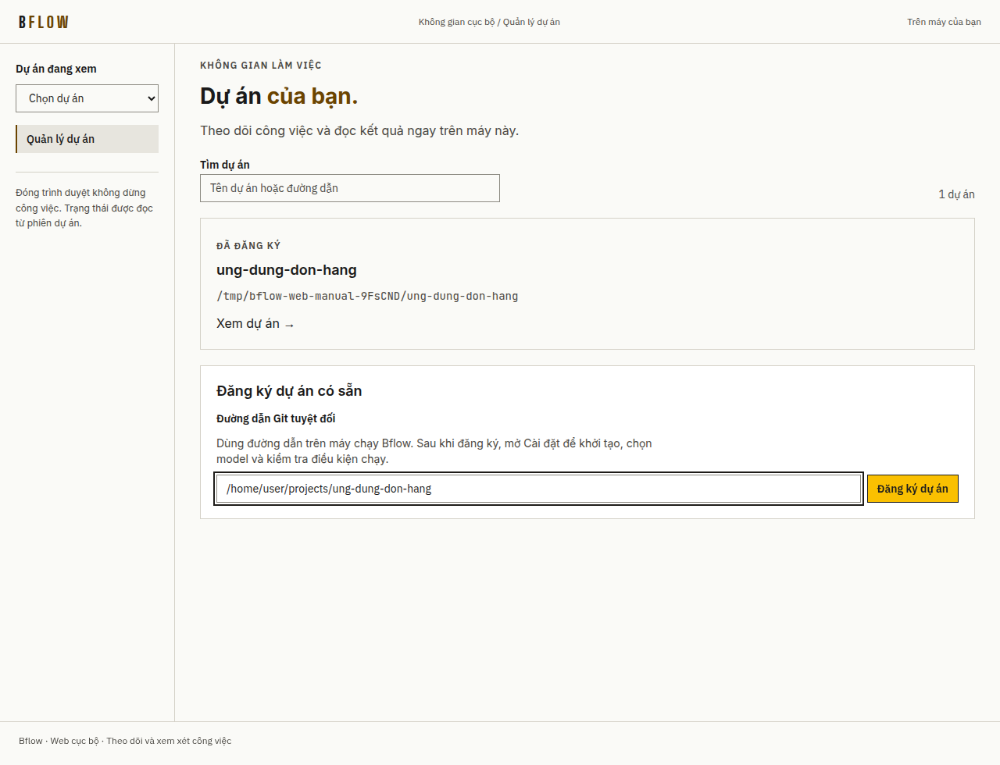

> **Lưu ý:** Thao tác *Đăng ký dự án* chỉ thêm dự án vào danh sách theo dõi của Bflow Web, hoàn toàn không tự ý sửa tệp nào trong thư mục mã nguồn của bạn.

---

## Bước 2: Cài đặt dự án lần đầu và kiểm tra điều kiện sẵn sàng

Ở lần đầu thêm một dự án mới, hãy bấm mục **Cài đặt dự án** ở thanh điều hướng bên trái và thực hiện theo thứ tự từ trên xuống:

1. **Chọn nhanh Nhà cung cấp & Mô hình AI (tuỳ chọn):**
   - Dùng thanh **Áp dụng nhanh Provider** và **Áp dụng nhanh Model** (có sẵn các nút gợi ý nhanh như `sonnet`, `haiku`, `opus`, `gpt-5.4`) rồi bấm **Áp dụng cho tất cả vai trò** để đồng bộ chỉ với 1 cú nhấp chuột, thay vì chỉnh từng ô.
   - Bấm **Lưu cấu hình** nếu bạn vừa thay đổi thiết lập.
2. **Khởi tạo cấu hình dự án (`Khởi tạo / sửa GitNexus`):**
   - Nếu dự án chưa có tệp `.bflow/config.yml`, bấm chạy mục khởi tạo. Bạn có thể đánh dấu **Commit cấu hình đã xem vào Git** để lưu gọn hai tệp cấu hình vào kho mã trước khi chạy phiên.
3. **Kiểm tra điều kiện sẵn sàng:**
   - Bấm nút **Kiểm tra điều kiện sẵn sàng** ở đầu trang.
   - Khi khung trạng thái báo xanh **"Tất cả điều kiện bắt buộc đã sẵn sàng để khởi động phiên làm việc"**, bạn đã sẵn sàng bắt đầu! (Nếu thiếu điều kiện nào, trang sẽ liệt kê rõ bằng tiếng Việt ngay tại chỗ).

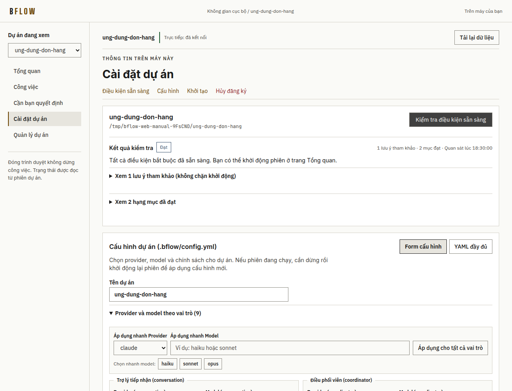

---

## Bước 3: Khởi động phiên làm việc của dự án

Chuyển sang mục **Tổng quan** ở thanh bên trái:

- Khi dự án chưa bật phiên, bạn sẽ thấy bảng tóm tắt **3 bước để bắt đầu làm việc** cùng huy hiệu `Phiên: Đã dừng`.
- Bấm nút vàng **Khởi động phiên** và chờ khoảng 1–2 phút trong khi hệ thống chuẩn bị các trợ lý chuyên trách cho dự án. Trang tự động cập nhật trạng thái mà không cần bạn bấm tải lại.

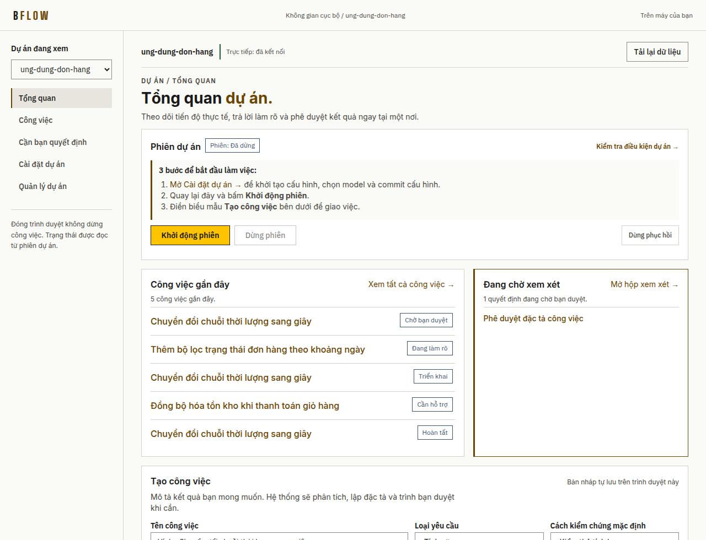

Khi huy hiệu ở thẻ **Phiên dự án** chuyển sang **`Phiên: Sẵn sàng`** và **`Hội thoại: Đang hoạt động`**, biểu mẫu giao việc bên dưới sẽ mở khóa để bạn sử dụng.

---

## Bước 4: Tạo công việc mới bằng ngôn ngữ tự nhiên

Ngay tại trang **Tổng quan**, điền biểu mẫu **Tạo công việc**:

1. **Tên công việc:** Đặt tên ngắn gọn, dễ nhận biết (ví dụ: *Chuyển đổi chuỗi thời lượng sang giây*).
2. **Loại yêu cầu:** Chọn `Tính năng`, `Sửa lỗi`, `Cải tiến`, hoặc loại phù hợp.
3. **Cách kiểm chứng mặc định:** Giữ mặc định (`Kiểm thử tích hợp` hoặc `Kiểm thử đơn vị`) — hệ thống sẽ dùng phương pháp này cho các tiêu chí bên dưới trừ khi bạn đổi riêng từng dòng.
4. **Mục tiêu:** Mô tả rõ kết quả bạn mong muốn bằng tiếng Việt tự nhiên.
5. **Tiêu chí chấp nhận (mỗi dòng một tiêu chí):** Viết mỗi điều kiện nghiệm thu trên một dòng. Ngay khi bạn nhập, Bflow Web hiển thị danh sách tiêu chí tương ứng để bạn kiểm tra hoặc chọn cách kiểm chứng riêng cho từng tiêu chí.
6. **Ràng buộc (tuỳ chọn):** Ghi các giới hạn cần giữ (ví dụ: *Không thêm thư viện ngoài*, *Giữ nguyên giao diện hiện tại*).
7. Bấm nút vàng **Tạo công việc**.

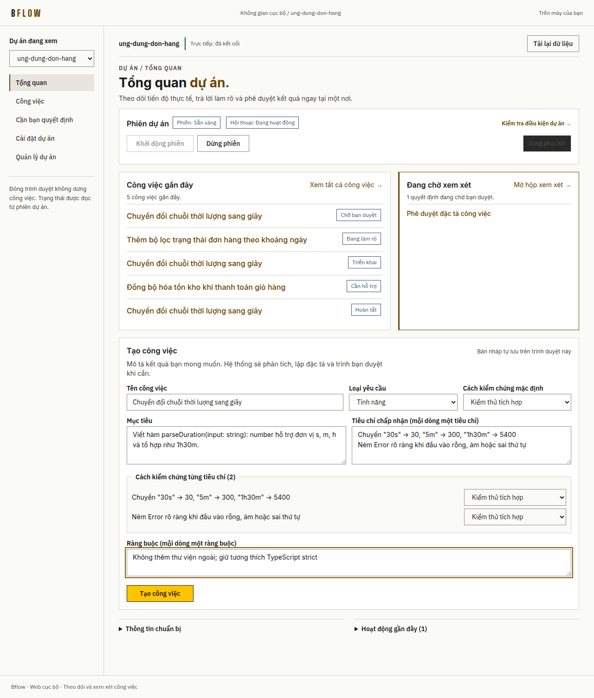

> **Mẹo chống bấm nhầm:** Sau khi gửi, thẻ **Thao tác đã gửi** hiển thị rõ 3 mốc `✓ Đã gửi → ✓ Đã tiếp nhận → ✓ Đã áp dụng`. Nếu mạng chập chờn hoặc bạn lỡ bấm hai lần, trình duyệt sẽ tự đối chiếu đúng thao tác cũ chứ không tạo hai công việc trùng nhau.

---

## Bước 5: Tìm kiếm và theo dõi danh sách công việc

Chọn mục **Công việc** ở thanh điều hướng bên trái để xem toàn bộ các công việc của dự án:

- **Tìm công việc:** Gõ từ khóa theo tên hoặc mã công việc.
- **Lọc theo giai đoạn:** Lọc nhanh các việc đang `Chờ làm rõ`, `Chờ bạn duyệt`, `Đang lập trình`, `Đang kiểm chứng` hoặc đã `Hoàn tất`.
- Nhấp vào tên một công việc bất kỳ để mở trang **Chi tiết công việc**.

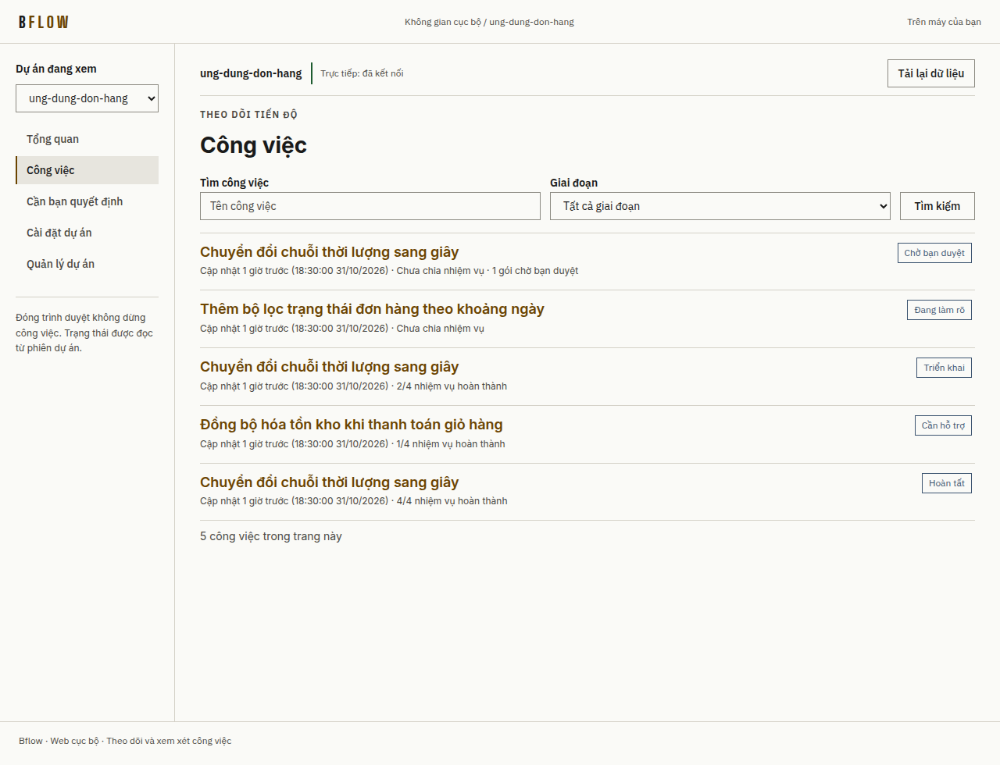

---

## Bước 6: Trả lời câu hỏi làm rõ (khi yêu cầu còn điểm mở)

Nếu yêu cầu ban đầu có chi tiết nghiệp vụ chưa rõ (ví dụ múi giờ, quy tắc làm tròn, quyền truy cập), hệ thống sẽ không đoán mò mà chuyển công việc sang trạng thái **`Giai đoạn: Chờ làm rõ`**:

1. Mở công việc đang chờ bạn (hoặc nhấp trực tiếp từ thẻ thông báo ở trang **Tổng quan**).
2. Đọc câu hỏi trong khung **Câu hỏi cần làm rõ** (nếu có các phương án gợi ý sẵn, bạn có thể tham khảo ngay trên thẻ).
3. Nhập câu trả lời của bạn vào ô trả lời và bấm **Gửi trả lời**.

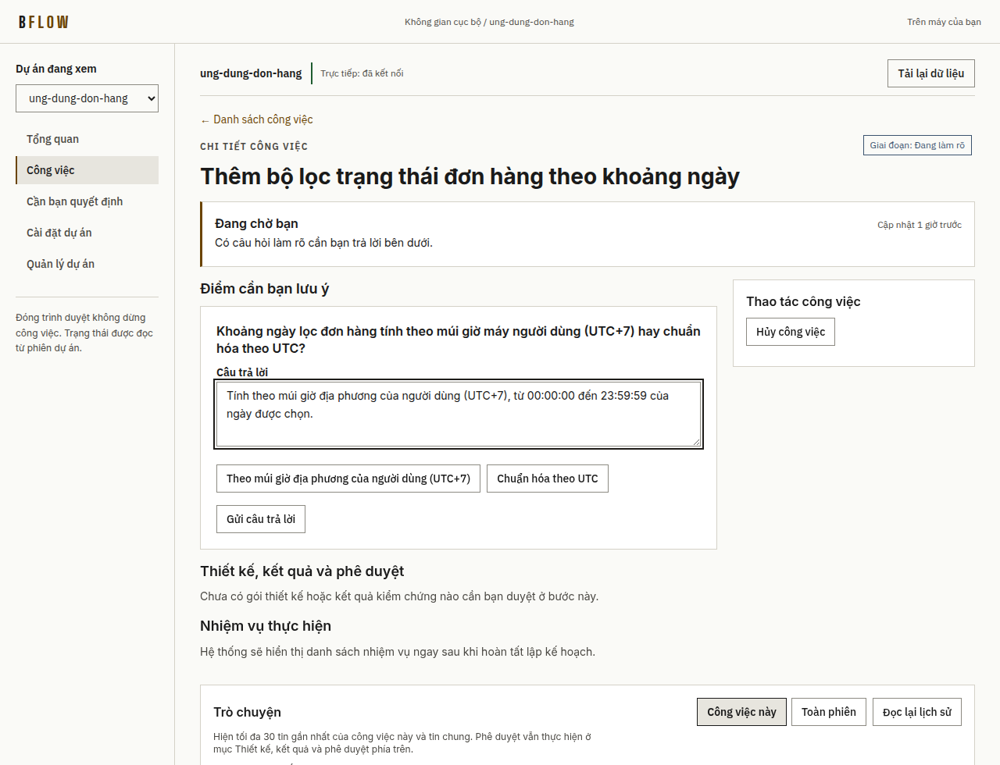

---

## Bước 7: Xem xét đặc tả / thiết kế và phê duyệt

Trước khi viết mã nguồn hoặc trước khi chốt bàn giao, các gói cần bạn quyết định sẽ xuất hiện tại mục **Cần bạn quyết định** (trên thanh bên trái) và ngay trong mục **Thiết kế, kết quả và phê duyệt** của trang công việc:

1. Bấm **Đọc nội dung an toàn** trên tài liệu đính kèm để đọc ngay bản tóm tắt tiếng Việt rõ ràng (*Tên*, *Mục tiêu*, *Mức thay đổi*, *Tiêu chí chấp nhận*, *Cách kiểm chứng*). Nếu muốn xem dữ liệu kỹ thuật gốc, bạn mới cần mở dòng thu gọn `▸ Xem JSON gốc`.
2. Bấm nút vàng **Xem xét gói** để mở bảng quyết định cho đúng phiên bản tài liệu đang xem.
3. Chọn một trong ba quyết định:
   - **Duyệt gói:** Chấp thuận đặc tả để hệ thống bắt đầu lập trình và kiểm thử tự động.
   - **Yêu cầu sửa:** Nhập điều bạn muốn điều chỉnh vào ô **Lý do** rồi bấm *Yêu cầu sửa* để hệ thống cập nhật phiên bản mới.
   - **Từ chối:** Từ chối gói hiện tại (cần ghi rõ lý do).

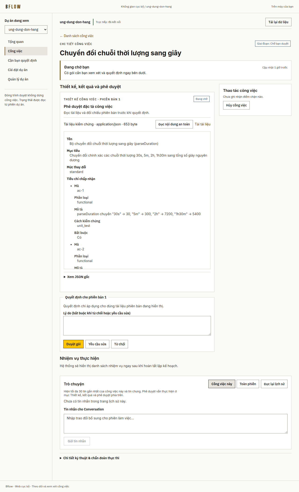

> **Bảo vệ chống duyệt nhầm bản cũ:** Nếu tài liệu vừa được cập nhật sang phiên bản mới trong lúc bạn đang mở trang, Bflow Web sẽ tự động chặn gửi quyết định cũ và hiển thị thông báo mời bạn bấm đọc lại phiên bản mới nhất.

---

## Bước 8: Theo dõi tiến độ lập trình — kiểm chứng và trao đổi qua Trò chuyện

Sau khi bạn duyệt đặc tả, hệ thống tự động chia nhỏ nhiệm vụ, viết kiểm thử, lập trình trong không gian tách biệt và chạy vòng kiểm chứng độc lập:

- **Ô Bước hiện tại (đầu trang):** Cho biết bằng một câu tiếng Việt ngắn gọn hệ thống đang làm gì hoặc đang chờ ai, kèm tiến độ hoàn thành (ví dụ `2/4 nhiệm vụ hoàn thành`).
- **Nhiệm vụ thực hiện:** Liệt kê từng đầu việc con và trạng thái (`Thành công`, `Đang chạy`, `Sẵn sàng`, `Chờ đến lượt`).
- **Khung Trò chuyện:**
  - Hiển thị các bản tin cập nhật tiến độ ngắn gọn từ **Trợ lý Bflow** (mặc định lọc gọn trong phạm vi `Công việc này`; bấm `Toàn phiên` nếu muốn xem toàn bộ lịch sử phiên).
  - Bạn có thể nhập trao đổi bổ sung vào ô **Tin nhắn cho Conversation** và bấm **Gửi tin nhắn**. (Lưu ý: các quyết định phê duyệt chính thức vẫn thực hiện bằng nút **Duyệt gói** ở phía trên để đảm bảo tính xác thực).
- **Chi tiết kỹ thuật & chẩn đoán thực thi:** Mặc định được thu gọn ở cuối trang để không gây rối mắt; chỉ cần bấm mở khi bạn muốn tra mã định danh kỹ thuật.

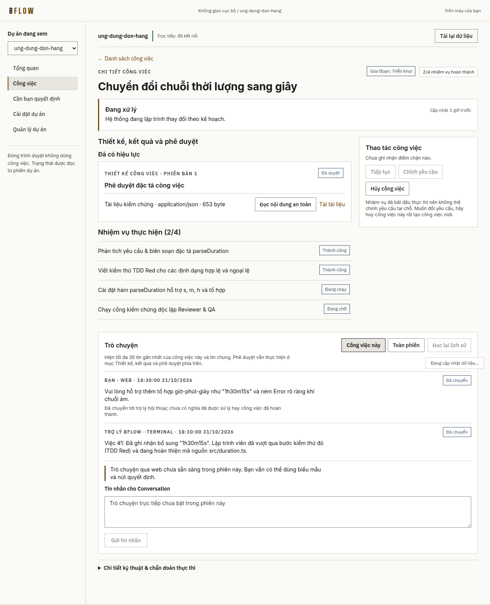

---

## Bước 9: Xử lý khi công việc tạm dừng, hủy công việc hoặc phục hồi phiên

Khi có điểm bất thường, Bflow Web phân loại rõ thành **3 mức độ** trong mục **Điểm cần lưu ý** để bạn không phải lo lắng trước các thông báo hệ thống:

- **Cần xử lý** *(viền cảnh báo)*: Công việc đang dừng chờ bạn thao tác (ví dụ hết số lượt tự thử lại, cần bạn xem và bấm **Tiếp tục**).
- **Đang kiểm tra**: Hệ thống đã tự lên lịch thử lại an toàn ở hậu trường; **bạn chưa cần thao tác gì**.
- **Suy giảm tùy chọn**: Một tiện ích phụ (như khung chat trực tiếp trên một số cấu hình) chưa bật, nhưng biểu mẫu tạo việc và các nút phê duyệt vẫn hoạt động bình thường.

Trong khung **Thao tác công việc** bên phải:
- **Tiếp tục:** Cho phép công việc chạy tiếp khi đã sẵn sàng.
- **Chỉnh yêu cầu:** Cập nhật lại toàn bộ mục tiêu và tiêu chí khi công việc chưa bước vào giai đoạn lập trình mã nguồn. (Khi đã bắt đầu lập trình, nút này sẽ khóa kèm hướng dẫn rõ: hãy hủy công việc hiện tại rồi tạo công việc mới để đảm bảo an toàn mã nguồn).
- **Hủy công việc:** Mở khung xác nhận yêu cầu nhập **Lý do hủy** trước khi gửi yêu cầu dừng an toàn.

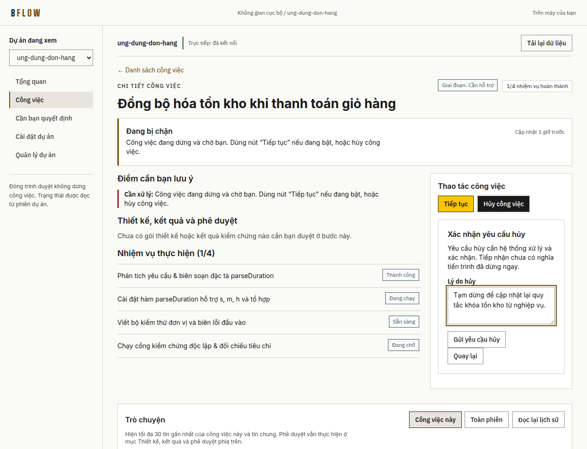

Tại trang **Tổng quan**, khi kết thúc ngày làm việc bạn có thể bấm:
- **Dừng phiên:** Lưu trạng thái an toàn và tắt phiên làm việc của dự án.
- **Dừng phục hồi** *(nút phụ góc phải)*: Chỉ dùng khi dừng phiên thông thường bị kẹt; hệ thống vẫn lưu điểm kiểm tra và giữ nguyên toàn bộ mã nguồn cùng lịch sử công việc.

---

## Bước 10: Phê duyệt bàn giao và hoàn tất công việc

Khi tất cả nhiệm vụ đã lập trình xong, vượt qua bộ kiểm thử tự động và được các vai trò phản biện độc lập (`Reviewer` & `QA`) xác nhận đạt tiêu chí:

1. Công việc chuyển sang bước chờ bạn duyệt gói **Bàn giao** (*Phê duyệt bàn giao kết quả đã kiểm chứng độc lập*).
2. Bạn có thể bấm **Đọc nội dung an toàn** để xem bản vá thay đổi mã nguồn (`text/x-patch`) hoặc các báo cáo kiểm thử đính kèm, sau đó bấm **Xem xét gói → Duyệt gói**.
3. Ngay sau khi gói bàn giao được áp dụng, công việc chuyển sang **`Giai đoạn: Hoàn tất`** với thông báo **"Công việc đã kết thúc — Không còn bước tiếp theo."** Toàn bộ hồ sơ phê duyệt và danh sách **Tài liệu kiểm chứng đính kèm** được thu gọn ngăn nắp để bạn mở lại tra cứu bất cứ lúc nào.

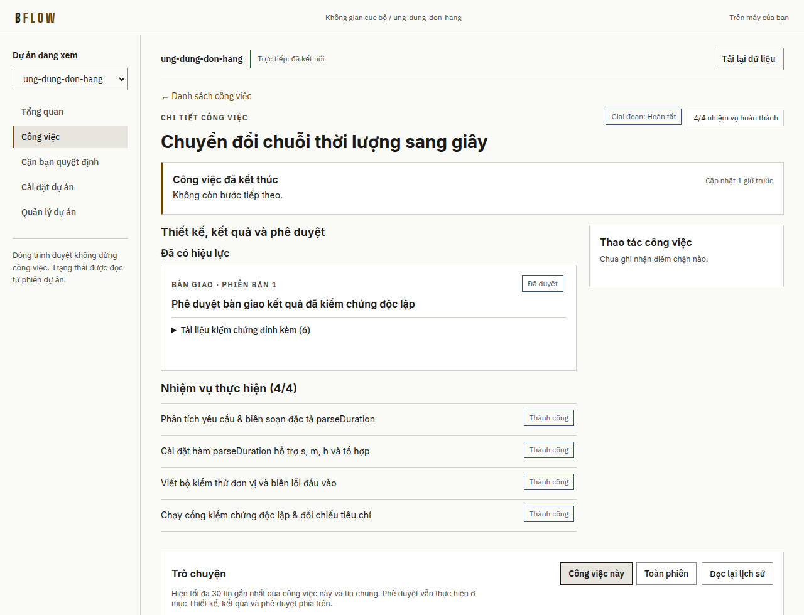

---

## Không gian Văn phòng 3D & Làm việc trực tiếp cùng Director

Từ phiên bản giao diện **Văn phòng 3D (Office 3D HUD)** và chế độ **Director (`bflow director start`)**, Bflow Web mang toàn bộ đội ngũ trợ lý AI (`Director`, `Planner`, `Specifier`, `Architect`, các nhánh `Developer` song song, `Reviewer`, `QA`) vào một không gian mô phỏng văn phòng 3D sống động như một tựa game quản lý chiến thuật ngay trên trình duyệt.

### 1. Toàn cảnh Văn phòng 3D và Thanh tác vụ thông minh

Ngay khi mở `http://127.0.0.1:4317`, bạn quan sát thấy toàn bộ không gian làm việc mô phỏng 3D đối xứng hài hòa cùng hệ thống HUD điều khiển nổi đồng bộ phong cách game retro (viền đậm sắc nét, bóng đổ khối nổi, bảng màu giấy kem ấm áp):
- **Bố cục các phòng ban chuyên trách:**
  - **Phòng Giám đốc (Director Office) & Director Team:** Nơi Director và nhóm điều phối làm việc với bàn gỗ lớn, giá sách, sofa tiếp khách và ghế da giám đốc màu đen sang trọng.
  - **Khu Lập trình (Developer Zone):** Dãy bàn làm việc với máy tính PC, bình nước và ghế nhựa đỏ không tựa đặc trưng.
  - **Khu Kiểm chứng (QA / Reviewer):** Bàn làm việc của Reviewer (tóc đỏ crimson dài, kính tròn) và QA (tóc dựng đen, áo phông đội ngũ màu đen).
  - **Khu Sáng tạo & Thư giãn (Creative Space):** Trung tâm văn phòng gồm **4 bàn bi-a**, 2 máy chơi game arcade cổ điển, quầy bar uốn cong phía trước tủ rượu lớn và một **Bartender** làm việc thường trực (sơ mi trắng, gile đen) di chuyển phục vụ giữa các vị trí.
  - **Hồ bơi ngoài trời (Swimming Pool):** Nằm ngay dưới khu QA/Reviewer với bể bơi dài và cầu nhảy ở hai đầu.
- **Hành vi nhân vật sống động (Random leisure):** Khi có nhiệm vụ, các Developer gõ phím nhanh/chậm trên bàn làm việc trong worktree riêng. Khi rảnh rỗi (`idle`), các nhân vật sẽ tự động tản bộ sang khu Creative Space để chơi bi-a, chơi arcade, uống nước ở quầy bar hoặc lội nước bơi lội tại hồ bơi; ngay khi có tác vụ mới, nhân vật sẽ tự động đi bộ trở về đúng bàn làm việc của mình!
- **Góc trái trên (`Bflow Office`):** Chọn nhanh dự án đang mở (tự động ưu tiên các dự án thực tế trên máy trước các thư mục thử nghiệm tạm thời `/tmp/`), xem trạng thái công việc đang chạy và tình trạng kết nối trực tiếp.
- **Thanh lối tắt gọn phía dưới:** Các nút bấm nổi **Tổng quan**, **Công việc**, **Quyết định**, **Trò chuyện**, **Sự cố**, **Nhân viên**, **Tài liệu**, **Cài đặt** và **Thao tác đã gửi** được gom gọn, không che khuất tầm nhìn 3D và không bao giờ bị các cửa sổ nổi đè lên.
- **Thanh tác vụ đáy màn hình:** Chứa nút menu `◆ Bflow`, danh sách cửa sổ đang mở, ô nhập nhanh **Trò chuyện với Director…** và nút chuyển đổi tức thì giữa chế độ **Web** (2D cổ điển) và **3D** với hiệu ứng View Transitions mượt mà.

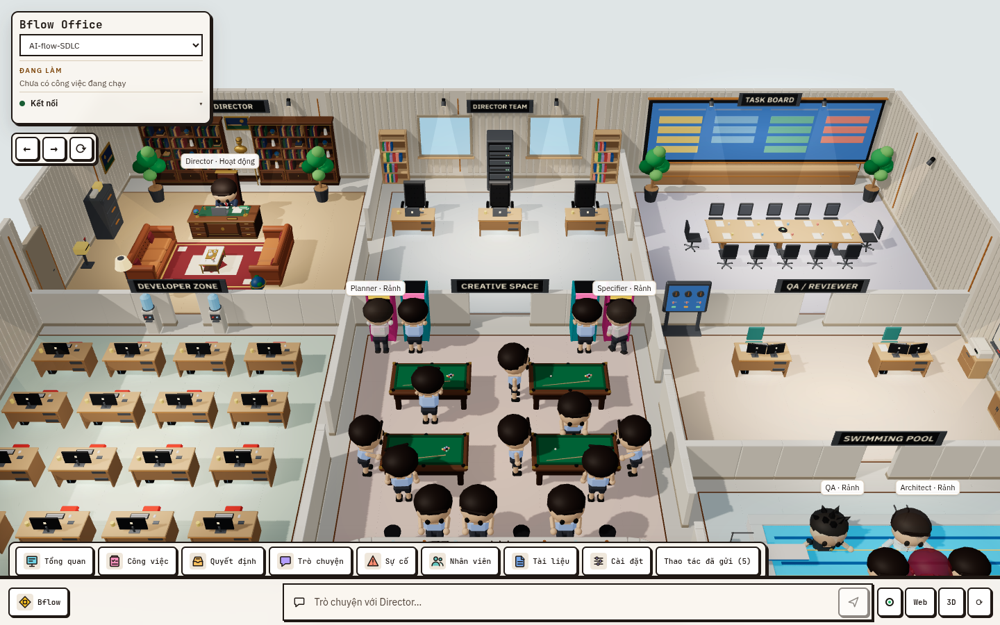

### 2. Trò chuyện và điều phối trực tiếp cùng Director (`bflow director start`)

Khi bạn khởi động phiên Director bằng lệnh:

```bash
bflow director start
```

Bạn có thể nhấp trực tiếp vào bàn **Director** trong phòng 3D hoặc bấm nút **Trò chuyện** ở thanh lối tắt để mở cửa sổ **Trò chuyện** mang phong cách hộp thoại nhân vật (RPG Dialogue Card):
- Huy hiệu **`● Director đang hoạt động`** xác nhận phiên điều phối đang kết nối trực tiếp với mô hình đã cấu hình (ví dụ `agy`).
- Các tin nhắn của bạn và phản hồi từ Director được trình bày dưới dạng thẻ hội thoại nổi trên nền giấy chấm bi (dot-grid parchment), giúp theo dõi báo cáo tiến độ và kết quả nghiệm thu trực quan, dễ đọc.

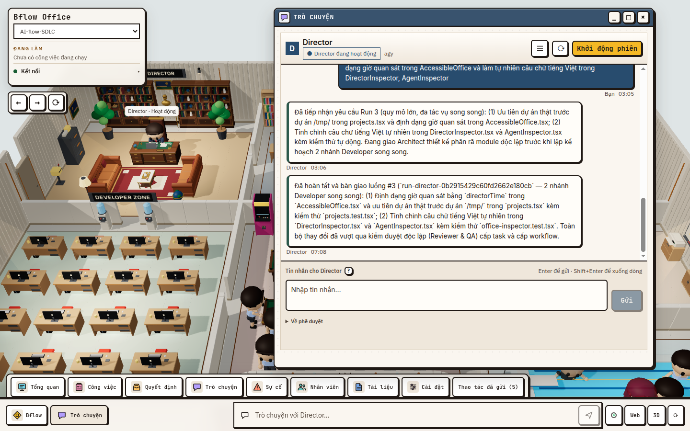

### 3. Bảng nhiệm vụ (Quest Board) và thanh tiến độ trực quan

Bấm nút **Công việc** trên thanh lối tắt (hoặc nhấp vào **Bảng nhiệm vụ — Task Board** trong phòng 3D) để mở cửa sổ quản lý toàn bộ luồng công việc như một bảng nhiệm vụ trong game:
- Tìm kiếm theo tên công việc hoặc lọc theo giai đoạn (`Chờ làm rõ`, `Chờ bạn duyệt`, `Đang lập trình`, `Đang kiểm chứng`, `Hoàn tất`).
- Mỗi luồng công việc được hiển thị dưới dạng **thẻ nhiệm vụ nổi (Quest Card)** kèm huy hiệu trạng thái (`HOÀN TẤT`, `ĐANG CHẠY`, `CHỜ BẠN`) và **thanh tiến độ kẻ sọc xanh lá (XP/Quest Progress Bar)** phản ánh số nhiệm vụ con đã hoàn thành (ví dụ `2/2 nhiệm vụ hoàn thành`).
- Với các công việc lớn được phân rã thành nhiều nhánh độc lập (DAG), Bflow cấp phát tự động mỗi `Developer` một Git worktree riêng biệt để lập trình song song.
- **Lập trình song song và bóng thoại tiến độ:** Mỗi Developer nhận nhiệm vụ sẽ ngồi vào bàn làm việc riêng trong khu Developer Zone. Phía trên đầu nhân vật hiển thị bóng thoại terminal trực tiếp (*terminal snapshot*) thể hiện suy nghĩ và công cụ AI đang gọi theo thời gian thực.

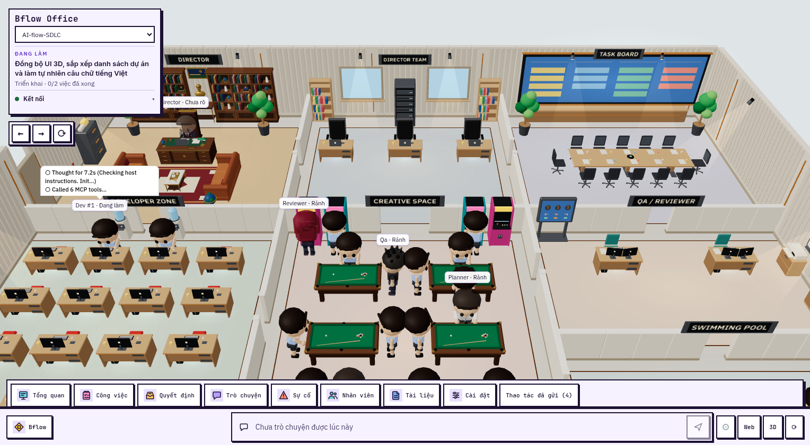

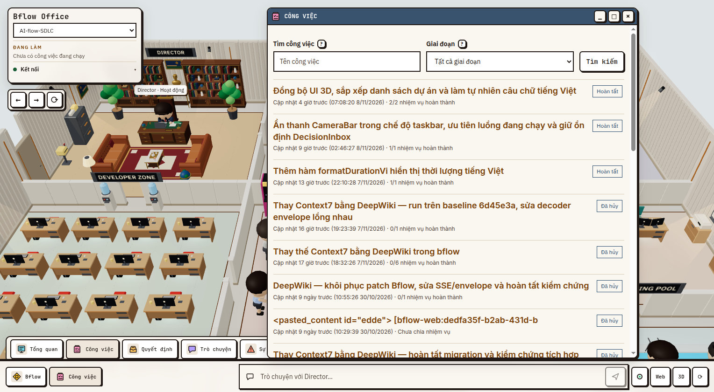

### 4. Đội ngũ Nhân viên (Squad Roster) và Màn hình CRT Terminal an toàn

Bấm nút **Nhân viên** trên thanh lối tắt (hoặc nhấp vào từng nhân vật trong phòng 3D) để mở cửa sổ **Nhân viên**:
- **Danh sách đội hình (Squad Roster):** Hiển thị thẻ nhân vật của các vai trò chuyên trách (`Planner`, `Architect`, `Specifier`, `Reviewer`, `QA`, cùng các `Developer` đang mở) kèm đèn LED báo trạng thái hoạt động trực tiếp.
- **Màn hình CRT Terminal (`TERMINAL SNAPSHOT · READ-ONLY`):** Hiển thị bản chụp màn hình terminal thực tế của từng vai trò trong khung màn hình phosphor xanh lá cổ điển kèm hiệu ứng dòng quét (scanlines), đã tự động ẩn thông tin nhạy cảm (`[redacted]`), giúp bạn nắm rõ hoạt động bên dưới mà không cần mở cửa sổ dòng lệnh.

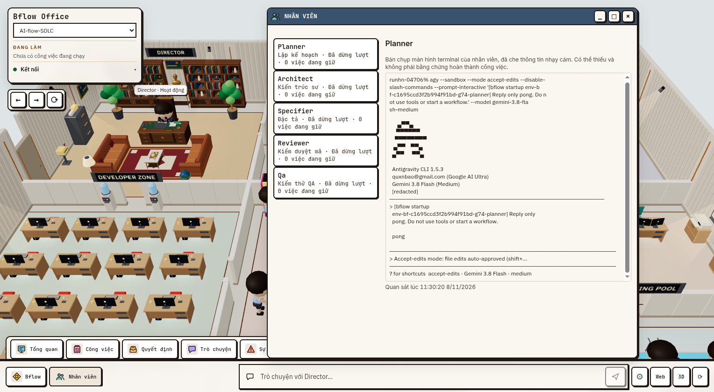

### 5. Tham khảo thời gian thực thi & lượng Token theo quy mô công việc (với mô hình `agy`)

Bảng dưới đây tổng hợp số liệu đo đạc thực tế trên Bflow 3D + Director khi tất cả các vai trò đều sử dụng `agy`:

| Quy mô công việc | Ví dụ thực tế | Số nhánh `Developer` | Thời gian thực thi thuần (Active) | Token trực tiếp (Prompt + Output + Tool) | Tổng ngữ cảnh tích lũy qua các lượt gọi API |
| --- | --- | :---: | :---: | :---: | :---: |
| **Nhỏ (Small)** | Thêm 1 hàm tiện ích (`formatDurationVi`) + unit test | `1` | **~30 – 35 phút** | **~148K tokens** *(~87K Director + ~61K Specialist)* | **~0.85M – 1.1M tokens** |
| **Trung bình (Medium)** | Cập nhật logic trạng thái & UI trên 3–4 tệp (`OfficeHud`, `currentRun`, `DecisionInbox`) + bộ test | `1` *(có Specifier & 1 vòng rework)* | **~75 – 85 phút** | **~681K tokens** *(~392K Director + ~289K Specialist)* | **~3.2M – 3.8M tokens** |
| **Lớn (Large)** | Đồng bộ giao diện 3D, sắp xếp dự án, định dạng giờ & tự nhiên hóa câu chữ trên nhiều module + tích hợp Git | `2` nhánh song song (2 worktrees) | **~3.5 – 4 giờ** *(~232 phút)* | **~815K tokens** *(~406K Director + ~409K Specialist)* | **~4.5M – 5.4M tokens** |

---

## Câu hỏi thường gặp (FAQ)

### 1. Tôi lỡ đóng trình duyệt hoặc tắt lệnh `bflow web` trong Terminal thì công việc đang chạy có mất không?
**Không.** `bflow web` chỉ là cửa sổ quan sát và điều khiển trên trình duyệt. Phiên dự án vẫn tiếp tục chạy độc lập ở hậu trường. Bạn chỉ cần gõ lại `bflow web` để mở lại giao diện và xem tiếp tiến độ.

### 2. Màn hình báo *"Phiên trình duyệt đã hết hạn"* thì tôi làm gì?
Vì lý do bảo mật trên máy cá nhân, mỗi phiên đăng nhập trình duyệt có hiệu lực tối đa 12 giờ (hoặc kết thúc khi bạn khởi động lại `bflow web`). Khi thấy thông báo này, hãy mở lại đường dẫn ghép nối do lệnh `bflow web` in ra trên Terminal.

### 3. Mất kết nối mạng nội bộ hoặc trang đang tự làm mới thì sao?
Khi đang đồng bộ ngầm, góc phải chỉ hiện một nhãn nhỏ **“Đang cập nhật dữ liệu…”** mà không làm giật trang hay xóa chữ bạn đang gõ. Nếu kết nối tới dịch vụ cục bộ tạm gián đoạn, thanh trạng thái hiển thị **“Đang kết nối lại…”** và tự động đồng bộ lại ngay khi kết nối phục hồi.

### 4. Tôi muốn xuất hồ sơ bàn giao để gửi cho đồng nghiệp xem ngoại tuyến (offline) được không?
**Được.** Sau khi công việc hoàn tất, bạn có thể xuất gói bàn giao HTML/Markdown kèm bảng kiểm tra mã băm toàn vẹn bằng lệnh `bflow handover export` — xem chi tiết tại [Tham chiếu lệnh CLI](../../apps/cli/COMMAND_REFERENCE.md).
