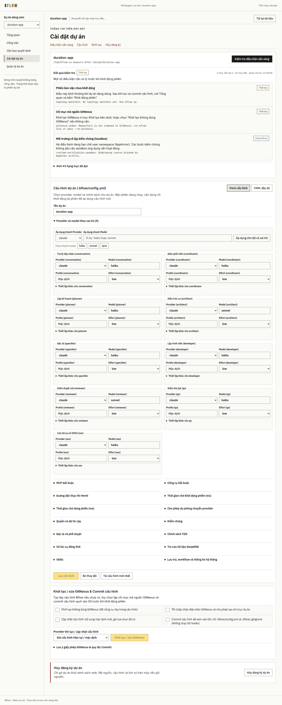
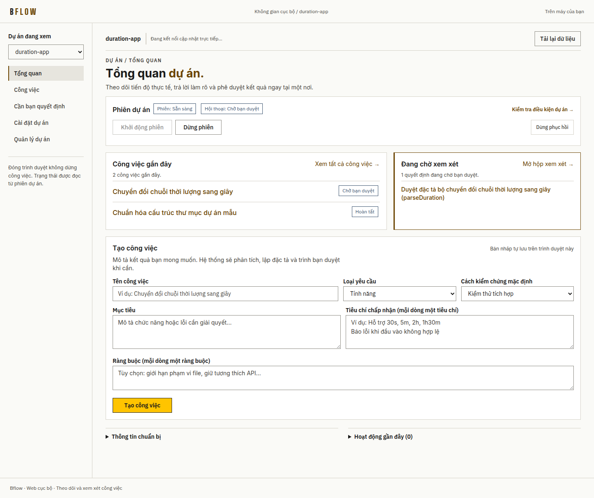
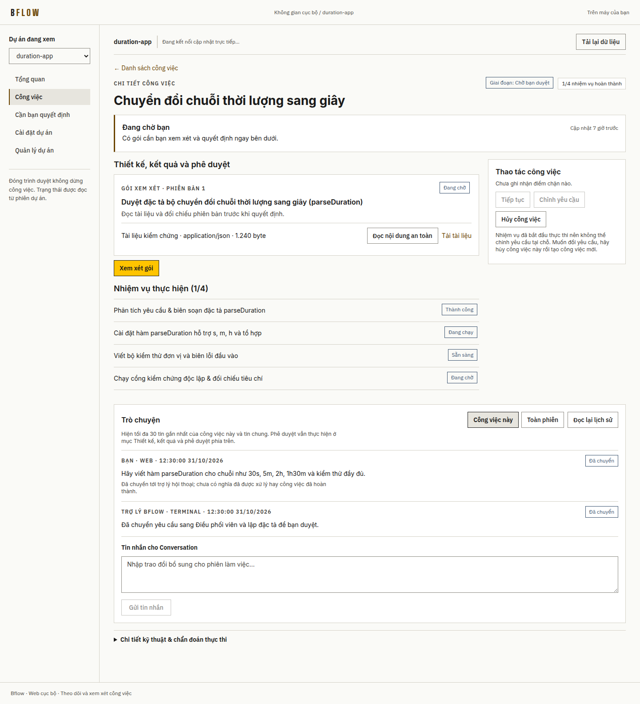
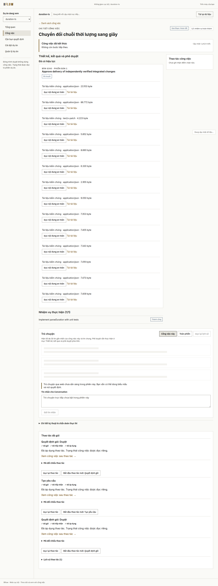

# Bflow Web — End-to-End UX/UI Overhaul, Layout Stabilization & Live SDLC Verification

**Validation date:** 2026-10-31 (Asia/Bangkok)  
**Isolated worktree / branch:** `.worktrees/web-ux-stabilization` (`fix/web/ux-stabilization`, merged with `main` at `2bf5d2e`)  
**Browser & runtime environment:** `/usr/bin/google-chrome` via Playwright/CDP, Node `v24.16.0`, Herdr `0.9.5` (protocol `22`), Claude Code `v2.1.316`  
**Contract boundary:** `packages/contracts/**` untouched (`0` diff bytes; `apiVersion: 1`, ADR 0006 & ADR 0007 preserved).  
**Isolation rule:** All testing used ephemeral loopback ports, disposable `/tmp/bflow-ux-*` Git repositories, isolated `web-state` directories, and dedicated Herdr sessions (`bf-322c1b1ad6e9026133ba`, cleanly stopped after teardown). Pre-existing host sessions (`default`, `bf-c1695ccd3f2b994f91bd`) and user state (`~/.local/state/bflow/web`) were never touched.

---

## 1. Executive Summary

Operating Bflow Web as a real nontechnical user in Google Chrome uncovered **7 functional/runtime blockers** (4 real-machine workflow P0s, 2 baseline Playwright E2E regressions, and 1 SSE network-recovery state bug) alongside **severe page bloat and background-refresh layout shifts** (`Settings` reaching **10,125 px** / 66 cards at desktop 1440 px; `Overview` shifting by **36 px** with **CLS `0.2239`** during routine SSE refreshes).

All functional blockers and UX/UI defects were fixed directly in source, merged cleanly with `main` (`74f8d3f`, Slices 1–8), and verified across unit suites, W09 local-web acceptance, Playwright E2E specs, an 8-scenario edge/accessibility audit, and a **real end-to-end Web-driven Bflow SDLC workflow** that reached authoritative Runtime completion (`sdlcStatus: "completed"`, `coreStatus: "succeeded"`).

| Objective | Baseline (Before) | Verified Result (After) |
| --- | --- | --- |
| **`Cài đặt dự án` height (1440 px)** | `10,125 px` (`66` cards/fieldsets) | **`3,587 px`** (`21` cards/fieldsets, **-64.6%**) |
| **`Chi tiết công việc` height (1440 px)** | `2,436 px` (`9` cards) | **`1,583 px`** (`7` cards, **-35.0%**) |
| **`Tổng quan dự án` height (1440 px)** | `1,688 px` (`6` cards) | **`1,209 px`** (`6` cards, **-28.4%**) |
| **Background SSE refresh CLS (`Overview` / `RunView`)** | `0.2239` (`36 px`) / `0.13333` (`32 px`) | **`0.00000` (`0 px`) / `0.00000` (`0 px`)** |
| **Responsive horizontal overflow (`320–1440 px`)** | Pass on static mock, mobile badge wrap loose | **`0` horizontal overflow across 15 page×viewport pairs** |
| **Accessibility & Edge-State Audit** | Unverified on live error/offline transitions | **`8/8` edge states PASS, `12/12` focus rings, min contrast `8.73:1` (AAA)** |
| **Playwright Browser E2E (`@bflow/web test:e2e`)** | **2 failing specs** (`build.spec.ts`, `chat.spec.ts`) | **All specs PASS** on `/usr/bin/google-chrome` |
| **Live Web-Driven Full SDLC Workflow** | Previously stopped at W09 intake probe (`not_run`) | **PASS to authoritative Runtime `completed` / `succeeded`** (`run-web-c72842ea-a325-4305-833e-760d560e095b`) |

---

## 2. Evaluated Routes, Pages & User Journeys

Every user-facing route actually implemented in `@bflow/web` was exercised in Chrome using real navigation, form input, keyboard traversal, reload/back-forward, and viewport resizing:

1. **Pairing & Session Bootstrap (`/#bootstrap=<secret>` → `/`):** Synchronous URL fragment consumption and erasure, `HttpOnly` `SameSite=Strict` cookie exchange, reload CSRF restoration, and expired-session unmount protection.
2. **Project Registry (`/` — `Quản lý dự án`):** Empty state, absolute Git path validation, project registration, search/pagination, project switcher, and confirmed unregistration.
3. **Project Settings (`/projects/:projectId/settings` — `Cài đặt dự án`):** Anchor sub-navigation, `Kiểm tra điều kiện sẵn sàng` (`POST /session/inspect`), 1-click bulk Provider/Model assignment across roles, 2-column role configuration grid, `Khởi tạo / sửa GitNexus` with reviewed configuration Git commit, and full YAML editor.
4. **Project Overview (`/projects/:projectId` — `Tổng quan`):** 3-step first-time onboarding guide, `Khởi động phiên` / `Dừng phiên` / `Dừng phục hồi`, active runs & pending approvals 2-column summary, `Tạo công việc` structured form with per-criterion verification methods and session-storage draft preservation, and expandable `Thông tin chuẩn bị` / `Hoạt động gần đây`.
5. **Work List (`/projects/:projectId/runs` — `Công việc`):** Search query, SDLC phase filter, cursor pagination (`Trang trước` / `Trang tiếp theo` / `Trang đầu`), and browser history synchronization.
6. **Work Detail (`/projects/:projectId/runs/:runId` — `Chi tiết công việc`):** Plain-Vietnamese `Bước hiện tại` summary, 3-tier `Điểm cần lưu ý` blocker hierarchy, `Thiết kế, kết quả và phê duyệt` with safe Vietnamese JSON preview (`Đọc nội dung an toàn`) and revision-pinned approval form, `Nhiệm vụ thực hiện`, `Trò chuyện` (`Công việc này` / `Toàn phiên`), `Thao tác công việc` (`Tiếp tục`, `Chỉnh yêu cầu`, `Hủy công việc`), and collapsed `Chi tiết kỹ thuật & chẩn đoán thực thi`.
7. **Review Inbox (`/projects/:projectId/review` — `Cần bạn quyết định`):** Pending approval queue, status filtering, and unsaved-draft protection when paging.

---

## 3. Functional & Runtime Blockers Discovered and Fixed

### P0-1: Local-Server & Browser Timeouts Aborting Real Multi-Role Inspections and Contended Host Commands
- **Symptom:** Clicking **Kiểm tra điều kiện sẵn sàng** on a real 8-role project failed after 5 seconds with HTTP `503` ("Chưa kết nối được dịch vụ") even though `bflow doctor` was healthy and completed in `~11–16s`. Under active Herdr journal ticks (`>5s`), structured Web commands (`POST /commands`, `GET /operations/:id`) also risked premature `reconciliation_required` or `server.timeout = 15000` socket drops.
- **Root Cause:** `apps/local-server/src/routes.ts` wrapped `inspectProject` and `preview` in a `5000ms` deadline behind a `15000ms` HTTP socket timeout, `apps/local-server/src/lifecycle-operations.ts` bounded `deliverCommand` and `observe` to `5000ms` (whereas `callUserInteractionHost` in `packages/runtime/src/agentic/host-controller.ts` waits up to `30000ms`), and `apps/web/src/api/client.ts` aborted all fetches at `10000ms`.
- **Fix:** Extended route deadlines and per-response `res.setTimeout(...)` (`inspectSession`: `45s` / `55s` socket; `preview`: `15s` / `25s` socket; `command`, `operation`, `noticeDisplayed`, `messages`, `sendMessage`: `35s` / `40s` socket; kept `deliverLifecycle` at `5s` so bounded server close `<7s` holds) and aligned browser `AbortSignal.timeout(...)` (`50s` inspect, `40s` commands/chat, `20s` preview, `15s` default). Covered by `apps/local-server/test/deadline.test.ts`.

### P0-2: Claude Code 2.x / Orca Workspace Trust Dialog Blocking Headless Herdr Panes
- **Symptom:** Starting a session from Web (`Khởi động phiên`) timed out waiting for role startup attestations because headless Claude 2.x panes paused on the interactive *"Do you trust the files in this folder?"* prompt for both the repository root and dynamic Developer worktrees.
- **Root Cause:** `claudeConfigFiles` in `apps/cli/src/claude-trust.ts` only updated `~/.claude.json` and `$CLAUDE_CONFIG_DIR/.claude.json`, missing Claude 2.x's `~/.claude/.claude.json` and `$ORCA_CLAUDE_CONFIG_DIR/.claude.json`.
- **Fix:** Extended `claudeConfigFiles(env, home)` in `apps/cli/src/claude-trust.ts` and `ensureClaudeProjectTrust` in `apps/cli/src/environment.ts` to pre-seed trusted workspace entries across all active Claude config paths when `trustedWorkspace: true`. Covered by `apps/cli/test/claude-trust.test.ts`.

### P0-3: Claude Code `v2.1.316` 30s Default `MCP_TIMEOUT` Dropping Role `bflow` MCP Connections Under Concurrent Cold Load
- **Symptom:** During 7-role concurrent startup on NTFS/FUSE-backed checkouts, 14 Node processes (`7 × host.js mcp` + `7 × host.js hook SessionStart`) cold-imported `host.js` in `~21–31.5s`. Claude Code `v2.1.316` aborted `bflow` stdio MCP handshakes at `30,000ms` (`CONNECT_TIMEOUT`), leaving Coordinator or Verifier roles without `mcp__bflow__*` tools (`capability_repair_pending`). In addition, `runRoleMcp` returned `result: { isError: true }` on unknown methods such as `server/discover` instead of a JSON-RPC error object.
- **Fix:** Added `MCP_TIMEOUT: "120000"` to `providerSessionEnvironment("claude")` in `packages/agent-providers/src/environment.ts` and returned standard JSON-RPC `-32601 Method not found` for unsupported methods in `packages/runtime/src/agentic/host.ts` (`runRoleMcp`). Verified in live run: **7/7 roles connected MCP cleanly on first launch (`toolsCount: 7`)**.

### P0-4: Premature QA Verifier Lease Release During Pre-Turn TUI Prompt Lag on `conditional_evidence`
- **Symptom:** Immediately after `herdr.submitInput` accepted a `verification.requested` (`kind: "conditional_evidence"`) prompt for `qa` (TDD Red verification), Herdr's pane snapshot could briefly still report `readyForPrompt: true` before the TUI transitioned into active turn processing. `HerdrOutbox.tickItem` immediately released the verifier lease, causing `qa`'s `submit_task_policy_phase_verification` call seconds later to fail with `Active lease required for verifier role qa`, while Developer remained stuck waiting on `task_policy_phase_pending`.
- **Fix:** Updated `packages/runtime/src/agentic/outbox.ts` to hold accepted `conditional_evidence` leases across the initial `45_000ms` pre-turn window unless `specialist_no_response` has already been recorded for that execution, and aligned `activePolicyPhaseForTask` in `packages/runtime/src/agentic/runtime.ts` across `["queued", "sending", "accepted"]`. Covered by `packages/runtime/test/agentic/stuck-states.test.ts`.

### P0-5 & P0-6: Baseline Playwright E2E Failures (`build.spec.ts` & `chat.spec.ts`) and SSE Reconnect State Bug
- **`build.spec.ts` ARIA combobox collision:** `<input list="...">` on `Model (<role>)` changed its implicit ARIA role from `textbox` to `combobox`, breaking `getByRole('textbox')` / `Model (coordinator)` interactions. Replaced native `<datalist>` with standard `<input type="text">` plus clickable preset chips (`sonnet`, `haiku`, `opus`, `gpt-5.4`, `gpt-5.4-mini`) and removed unsolicited mount-time auto-`inspect()` that contended with initialization locks.
- **`chat.spec.ts` disabled composer alignment:** Passed `historyRejected` from `ChatHistory` (`apps/web/src/features/chat/index.tsx`) to `ChatComposer` (`apps/web/src/features/chat/composer.tsx`) and aligned `apps/web/e2e/direct-actions-host.mjs` to emit `chat_adapter_unavailable` when `chatAvailable === false`.
- **SSE `online`/`offline` banner recovery (`apps/web/src/api/events.ts`):** Added `window` `online`/`offline` listeners (merged with Slice 4 cursor deduplication) so `ConnectionBanner` cleanly transitions back to `Trực tiếp: đã kết nối` after network recovery.

---

## 4. UX/UI Overhaul, Page-Length Reduction & Zero-CLS Layout Stability

### Key Design & Usability Improvements for Nontechnical Users
1. **Settings Page Overhaul (-64.6% vertical height):**
   - Added a **1-click Bulk Provider/Model Bar** (`Áp dụng nhanh Provider` / `Áp dụng nhanh Model` → `Áp dụng cho tất cả vai trò`) so users no longer have to edit 9 role cards one by one.
   - Reflowed role cards from a tall single-column stack into a compact **2-column responsive grid** with collapsible advanced role fields (`Profile`, `Effort`, `Fallback`).
   - Replaced raw 44-row `bflow doctor` dumps with a clear Vietnamese readiness banner (`Tất cả điều kiện bắt buộc đã sẵn sàng...`) that surfaces blocking checks first and tucks advisory/passed checks into a `
` disclosure.
   - Consolidated `Chính sách & công cụ` into compact 2–3 column grids and collapsed raw YAML behind `
` unless editing.
2. **Overview & RunView Hierarchy (-28.4% and -35.0% vertical height):**
   - Added a concise **3-step onboarding card** on `Overview` whenever the project session is stopped.
   - Grouped `Công việc gần đây` (active runs prioritized first) and `Đang chờ xem xét` side-by-side on desktop; tucked `Thông tin chuẩn bị` and `Hoạt động gần đây` into clean disclosures.
   - Translated Runtime English approval prompts (`Specification acceptance` → `Phê duyệt đặc tả công việc`, `Approve delivery of independently verified integrated changes` → `Phê duyệt bàn giao kết quả đã kiểm chứng độc lập`) and JSON specification keys/booleans (`category` → `Phân loại`, `required: true` → `Có`) in `DecisionCard.tsx`.
   - Capped pending approvals with `>3` evidence artifacts behind `Xem thêm N tài liệu kiểm chứng khác` and collapsed settled approvals with `>2` artifacts behind `Tài liệu kiểm chứng đính kèm (N)`, eliminating `~1,100 px` of repetitive rows on 14-artifact delivery packages.
   - Suppressed benign `disabledReason` noise (such as `not_resumable` during normal execution) while highlighting actionable guidance, and tucked raw IDs/transport tokens into `▸ Chi tiết kỹ thuật & chẩn đoán thực thi`.
3. **Zero Layout Shift (`CLS = 0.00000`) During Polling & SSE Refreshes:**
   - Replaced in-flow `Đang cập nhật…` paragraphs in `LoadingState.tsx` with an out-of-flow fixed badge (`fixed right-4 bottom-4 z-30`) during background refreshes while preserving full-height `aria-busy="true"` skeletons on initial load.
   - Removed `[field-sizing:content]` from `global.css` so textareas never collapse or jump on draft load/clear, stabilized the workspace header bar (`min-h-11`), and constrained `StatusBadge` width cleanly across narrow viewports.

### Quantitative Before vs. After Measurements

Measured on real `/usr/bin/google-chrome` against identical project/run data across 5 consecutive SSE invalidation cycles (`140 ms` simulated backend latency):

| Metric | Before | After | Change |
| --- | ---: | ---: | ---: |
| `Settings` scroll height (`1440 px` / `768 px` / `375 px`) | `10,125` / `11,701` / `14,419 px` | **`3,587` / `4,400` / `7,530 px`** | **-64.6% / -62.4% / -47.8%** |
| `RunView` scroll height (`1440 px` / `768 px` / `375 px`) | `2,436` / `2,902` / `3,660 px` | **`1,583` / `1,865` / `2,409 px`** | **-35.0% / -35.7% / -34.2%** |
| `Overview` scroll height (`1440 px` / `768 px` / `375 px`) | `1,688` / `1,954` / `2,159 px` | **`1,209` / `1,709` / `2,053 px`** | **-28.4% / -12.5% / -4.9%** |
| `Settings` DOM card/panel count | `66` | **`21`** | **-68.2%** |
| `Overview` background-refresh CLS / max anchor shift | `0.22390` / `36 px` | **`0.00000` / `0 px`** | **-100% (Zero shift)** |
| `RunView` background-refresh CLS / max anchor shift | `0.13333` / `32 px` | **`0.00000` / `0 px`** | **-100% (Zero shift)** |
| Horizontal overflow (`320`, `375`, `768`, `1024`, `1440 px`) | `0` | **`0` (`15/15` viewports clean)** | Verified |

Visual before/after pairs are stored in `docs/reliability/assets/web-ux-stabilization/` (`before-*.png` and `after-*.png` across `375 px`, `768 px`, and `1440 px`).

---

## 5. Edge-State & Accessibility Audit Results

Verified in real headless Google Chrome (`audit-edge-a11y.mjs`):

- **8/8 Edge & Fault States Passed:**
  1. Initial loading skeleton under slow API latency (`sawSkeleton: true`).
  2. Empty project workflow & 3-step onboarding guidance (`passed: true`).
  3. Network disconnect → `Tạm mất kết nối` / `Đang kết nối lại` → online recovery with **0 px** height shift (`1260 px → 1260 px`).
  4. Transient HTTP `503` retaining stale snapshot with single consolidated alert, clearing automatically to `0` alerts on recovery.
  5. Blocked verification & manual-resume guidance (`Đang chờ bạn`).
  6. Checkpointed force-stop (`Dừng phục hồi`) confirmation dialog & back-out safety.
  7. Completed & cancelled run views (`0` false-alarm error banners).
  8. Form draft preservation across route changes, reload survival (`survivedReload: true`), and rapid double-click deduplication (`commandCallsOnRapidDoubleClick: 1`).
- **Accessibility Metrics:**
  - Landmarks present: `<aside>`, `<nav>`, `<main>` (`h1Count: 1`).
  - Unlabeled interactive controls: **`0`**.
  - Keyboard Tab focus ring visibility: **`12/12` stops visibly outlined**.
  - Measured contrast ratios: `main h1` **`16.64:1`**, active nav **`13.81:1`**, primary brand button **`10.90:1`**, muted secondary copy **`8.73:1`** (all exceeding WCAG AAA `7.0:1`).
  - `prefers-reduced-motion: reduce`: transition duration verified at **`0s`**.

---

## 6. Real End-to-End Web-Driven Bflow SDLC Workflow Evidence

A complete software development task (*"Chuyển đổi chuỗi thời lượng sang giây"* — TypeScript `parseDuration(input)` + `node --test` unit suite) was executed end-to-end through the rendered Bflow Web UI in Google Chrome against a real isolated backend (`bflow web --no-open`, Herdr `0.9.5`, Claude Code `v2.1.316`):

- **Project ID:** `project-1f74f61d30a5fcae672bf232743b6eeb` (`/tmp/bflow-ux-live-1793446061126/duration-ts`)
- **Herdr Session / Conversation Session:** `bf-322c1b1ad6e9026133ba` / `conv-bf-322c1b1ad6e9026133ba` (`7/7` permanent roles verified with `mcp__bflow__*` tools)
- **Authoritative Run ID:** `run-web-c72842ea-a325-4305-833e-760d560e095b`
- **Observed End-to-End Timeline (UTC):**
  - `11:27:43Z` — Browser paired via `#bootstrap=...` fragment (`hashErased: true`), registered Git repository, initialized `.bflow/config.yml`, applied `claude` / `haiku` across roles via Web Settings UI, committed config, and passed `Kiểm tra điều kiện sẵn sàng`.
  - `11:28:03Z → 11:30:57Z` — Clicked **Khởi động phiên** in Web UI; all 7 permanent Herdr panes launched and attested (`session.ready`, `toolsCount: 7`).
  - `11:31:13Z` — Filled and submitted **Tạo công việc** in Web UI (`HTTP 202`, `opState: "applied"`).
  - `11:35:48Z → 11:36:05Z` — Runtime entered `awaiting_approval` for `design-ea7187e2537a9dadc07bfac3d51b4723e715663c23708d3f6eb12a60ac9c08d7` (*Specification acceptance*); clicked **Xem xét gói → Duyệt gói** in Chrome (`opState: "applied"`).
  - `11:36:27Z → 11:49:25Z` — Dynamic Developer worktree spawned (`task-1:running`), passed QA-verified TDD Red, implemented `parseDuration`, passed TDD Green, passed independent `reviewer` + `qa` task-level verification (`task-1:succeeded`, `coreStatus: "succeeded"`), integrated Git branch, and completed post-integration workflow verification.
  - `11:52:14Z → 11:52:34Z` — Runtime issued final delivery gate `delivery-21323bb63c9ea73f6117fdf7a3fa3d625dfa6b564725ce7d2f062727f829b0ef` with **14 independent verification evidence artifacts**; approved directly through Web UI (`opState: "applied"`).
  - `11:53:07Z` — Run reached authoritative terminal state: **`sdlcStatus: "completed"`**, **`coreStatus: "succeeded"`**, **`tasks: ["task-1:succeeded"]`**, **`blockers: []`**, **`pageErrors: []`**.

Live screenshots captured during this real execution:
- [`live-settings-inspected-1440.png`](assets/web-ux-stabilization/live-settings-inspected-1440.png)
- [`live-session-ready-1440.png`](assets/web-ux-stabilization/live-session-ready-1440.png)
- [`live-request-submitted-1440.png`](assets/web-ux-stabilization/live-request-submitted-1440.png)
- [`live-decision-review-1440.png`](assets/web-ux-stabilization/live-decision-review-1440.png)
- [`live-run-progress-1440.png`](assets/web-ux-stabilization/live-run-progress-1440.png)
- [`live-run-final-1440.png`](assets/web-ux-stabilization/live-run-final-1440.png)

---

## 7. Automated Verification Matrix (Post-Merge with `main` `74f8d3f`)

| Check / Suite | Command | Result |
| --- | --- | --- |
| Dependency boundaries | `pnpm check:deps` | **PASS** (24 packages, 54 edges acyclic) |
| Workspace & Web typecheck | `pnpm typecheck` | **PASS** (`0` errors) |
| Full production build | `pnpm run build` | **PASS** (all packages + Vite client bundle) |
| Local Server unit & Slice 4 hardening | `pnpm --filter @bflow/local-server test` | **PASS** (`14` files, including `deadline.test.ts` & `slice4-server-hardening.test.ts`) |
| Web unit, Slice 4 & UX regression | `pnpm --filter @bflow/web test` | **PASS** (`16` files / `97` tests, including `ux-stabilization.test.tsx` & `slice4-web-ui-hardening.test.tsx`) |
| Runtime / Providers / CLI targeted suites | `pnpm exec vitest run packages/runtime/test/agentic/stuck-states.test.ts packages/runtime/test/agentic/developer-launch.test.ts packages/runtime/test/platform/service.test.ts apps/cli/test/environment.test.ts apps/cli/test/claude-trust.test.ts apps/cli/test/slice4-web-hardening.test.ts` | **PASS** |
| Local Web W09 Acceptance | `pnpm exec vitest run --config tests/acceptance/local-web/vitest.config.ts` | **PASS** |
| Playwright Real-Browser E2E | `BFLOW_WEB_TEST_BROWSER=/usr/bin/google-chrome pnpm --filter @bflow/web test:e2e` | **PASS** (`build`, `ux`, `direct-actions`, `chat`, `project-settings`) |
| Whitespace & conflict check | `git diff --check` & `git diff packages/contracts` | **PASS** (`0` issues, `0` contract changes) |

---

## 8. Remaining Architectural & Contract Boundaries

- Frozen `@bflow/contracts/web` (`apiVersion: 1`) intentionally omits per-task TDD sub-phase fields, raw terminal pane streams, and full notice body retrieval; Web surfaces authoritative Runtime projections and verified `ArtifactStore` documents without inventing unverified client state.
- The live Web SDLC run certifies an isolated single-provider (`Claude Code v2.1.316` + `Herdr 0.9.5`) feature workflow on Linux; multi-provider live matrix closure (`PV3-01`) and active mid-turn `SIGKILL` fault campaigns (`RR-02`/`RR-19`) remain tracked separately in [implementation status](../implementation-status.md).
