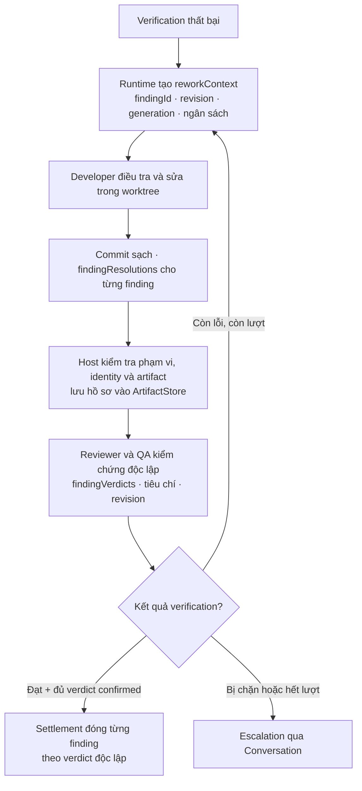

# Giải trình nguyên nhân gốc trong vòng rework

Runtime đã bổ sung hồ sơ giải trình cho implementation được giao lại sau verification thất bại (`56096b8`). Mục tiêu là buộc bản sửa liên kết từng finding với nguyên nhân, vị trí source, phép kiểm tra phân biệt trước/sau và bằng chứng đúng revision; Developer nói “đã sửa” không tự đóng finding.

## Luồng thực thi

Luồng vẫn nằm trong SDD, Conditional TDD, lease/fence, cancellation, approval và bounded verification đã có. Hồ sơ không cấp thêm lượt sửa hay quyền ghi, và verification sau tích hợp vẫn phải chạy trên commit tích hợp.

## Assignment và hồ sơ bản sửa

`assignment_context`/`workspace_status` của Developer có thể trả `reworkContext`: task/attempt, `reworkGeneration`, Core generation, cycle, failed revision và `remainingIterations`/`maxIterations`. Mỗi finding có `findingId` xác định riêng; hai finding cùng `code` vẫn là hai finding cần xử lý. `reworkGeneration` của cycle và generation của Core là các trường riêng.

Khi có context này, `submit_implementation` cần `findingResolutions` khớp **1–1** với toàn bộ finding được giao. Báo blocked có thể đi qua submission hoặc `task.status` được xác thực; model không tự tạo authority của task hay worktree.

| Trường | Nội dung |
| --- | --- |
| `findingId` | ID chính xác của finding trong assignment hiện hành; không gộp theo `code` |
| `disposition` | `addressed`, `disputed` hoặc `blocked` |
| `rootCause` | Nguyên nhân cụ thể hoặc giả thuyết có bằng chứng; ghi rõ phần chưa xác nhận |
| `sourceLocations` | Path source được kiểm tra, cùng dòng/symbol nếu cần; giữ đúng scope và forbidden paths |
| `repairSummary` | Đã đổi gì và vì sao thay đổi đó xử lý nguyên nhân |
| `discriminatingCheck` | Command/target và `beforeOutcome`/`afterOutcome` đủ phân biệt lỗi với hành vi sau sửa |
| `evidence` | `sourceRevision`, `reworkGeneration`, summary; artifact reference nếu được cung cấp phải đến từ store tin cậy |

Với `disputed`, cung cấp lý do tranh chấp và bằng chứng/tình huống tái hiện; với `blocked`, nêu trở ngại. Tranh chấp vẫn cần kiểm chứng độc lập. Bản nộp `succeeded` không được chứa disposition `blocked`; báo blocked phải có finding `blocked` hoặc `disputed`.

Không chép một payload mẫu có ID/hash giả vào Runtime. Lấy identity, revision và finding từ context hiện hành, lấy artifact reference từ kết quả host/ArtifactStore thật. Một tên command trong hồ sơ không cấp quyền chạy arbitrary shell.

## Những gì host kiểm tra

- Finding không thiếu, trùng, lạ hoặc thuộc generation cũ; identity của run/task/attempt phải khớp assignment.
- Worktree sạch. Với `addressed`, cần HEAD mới sau failed revision, evidence trỏ đúng HEAD hiện tại và source location giao với các file đã đổi trong phạm vi được cấp.
- Kết quả trước/sau của finding `addressed` không được giống nhau; exit code được khai báo khác 0 không đủ cho một bản sửa tự báo addressed.
- Artifact được cung cấp phải resolve trong store, đúng run/task khi có task binding, đúng checksum/size. Nếu JSON artifact khai revision/generation, các giá trị đó cũng phải khớp.
- Host lưu report cho từng finding và dossier qua ArtifactStore; ingestion tạo trusted reference, không chấp nhận URI do agent tự đặt.

Các kiểm tra này xác minh cấu trúc, provenance, scope và ràng buộc revision. Chúng không tự chứng minh một lời giải thích là đúng về mặt nhân quả hoặc phép đo đã được chạy. Report chứa claim của Developer vẫn cần đối chiếu code, phép kiểm tra và evidence độc lập.

## Reviewer/QA và đóng finding

`inspect_review` đưa dossier hiện hành cho reviewer/QA và ghim `hostReworkVerification` (dossier, task, attempt, `reworkGeneration`, Core generation, submitted revision, danh sách finding bắt buộc, fingerprint dossier) vào observation. Với attempt rework, `complete_review` **bắt buộc** `findingVerdicts` phủ đúng và đủ mọi finding trong `reworkContext.findings` của generation hiện hành (`confirmed` hoặc `rejected` kèm summary); thiếu, partial, ID lạ, ID trùng hoặc verdict không hợp lệ đều bị từ chối trước khi phát receipt. Reviewer không được là Developer đã nộp bản sửa. Review ban đầu không có dossier không nhận verdict rework.

Runtime kiểm tra lại mỗi gate `manual_review` (reviewer/QA) trước khi nhận kết quả và khi hoàn tất verification, kể cả outcome bền vững do host cũ tạo: binding/verdict thiếu hoặc lệch được xếp `inconclusive` (escalate để retry), không phải lỗi implementation và không tự tạo rework. Gate pass mà có verdict `rejected` bị coi là mâu thuẫn. Attempt được coi là rework khi assignment của nó mang `reworkContext`; giao lại việc thông thường chỉ chuyển tiếp finding cũ (ví dụ warning, cycle đã escalate) không đòi dossier.

Reviewer/QA kiểm tra nguyên nhân, diff/source location, reproduction hoặc tranh chấp, evidence và tiêu chí trên đúng revision. Verdict bác bỏ tạo finding lỗi theo bounded rework; deterministic check thất bại không được che bởi nhận xét tốt. Settlement chỉ đóng finding có verdict `confirmed` độc lập; cycle pass không tự bù verdict còn thiếu (finding đó giữ `unverified`, dossier `escalated_blocked`).

| Trạng thái dossier | Ý nghĩa |
| --- | --- |
| `pending_independent_verification` | Submission đã được lưu, finding chưa tự đóng |
| `verified_closed` | Verification độc lập đã pass; có thể tiếp tục gate phía sau |
| `rework_required` | Còn finding chưa được chấp nhận; giữ verdict và phần đã xác minh, dùng ngân sách còn lại |
| `exhausted_failed` | Không đạt trong ngân sách cycle |
| `escalated_blocked` | Cần xử lý blocker hoặc quyết định ngoài quyền tự động |

## Recovery và tương thích

Dossier/history nằm trong journal/checkpoint riêng của Runtime và artifact store; replay giữ identity/generation/revision và kết quả verification. Không tự chạy lại một mutation chưa rõ delivery, không sửa JSON/SQLite để đánh dấu đã đóng finding. Binary đang chạy cần nạp source/prompt mới qua lifecycle hiện có để nhận hành vi này.

Đây là các codec Runtime-private có `schemaVersion: 1`, không phải thay đổi phiên bản của `@bflow/contracts`. `TaskRecord.reworkResolutions` là optional để đọc journal/checkpoint cũ chưa có trường đó; vắng hồ sơ không được diễn giải thành bằng chứng nhân quả đã xác nhận. Public RoleMessage/SessionManifest, Core codecs và schema SQLite không được sửa bởi tính năng này. Không suy hỗ trợ downgrade an toàn chỉ từ việc reader mới đọc được record cũ.

Nguồn: [rework codecs và validators](../packages/runtime/src/agentic/rework-causality.ts), [Runtime admission/recovery](../packages/runtime/src/agentic/runtime.ts), [Developer host](../packages/runtime/src/agentic/host-development.ts), [independent review](../packages/runtime/src/agentic/host-verification.ts), [journal](../packages/runtime/src/agentic/journal.ts), [regression tests](../packages/runtime/test/agentic/rework-causality.test.ts). Có source và integration tests cục bộ; chưa đóng full provider/Herdr live acceptance.
