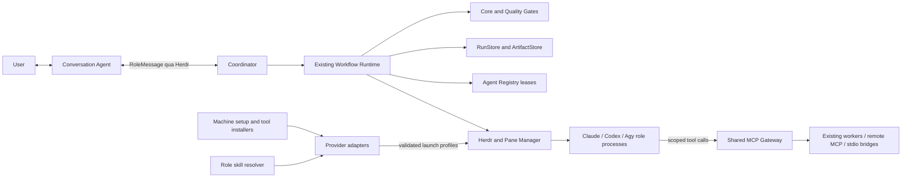

# Bflow Runtime Architecture v3 — P24 contract baseline

Ngày kiểm toán: 2026-10-16. Source đầu vào: `9235415704d92f4612497b099925f6d23d6d8ca4`.
P24 chỉ bổ sung thiết kế, schemas, public ports và contract tests. Các module P25–P31
chưa được triển khai bởi thay đổi này. Đây là baseline kiến trúc, không phải chứng nhận
full Agentic SDLC hay production readiness.

## Trạng thái triển khai (cập nhật 2026-10-18)

Phần này ghi lại source đã có sau baseline P24; các quyết định thiết kế đóng băng bên dưới
không đổi. Mức bằng chứng được tách riêng: **source** (có code trong repo), **local test**
(fake runner/mock/fixture), **live probe** (binary/Herdr/provider thật) và **full SDLC
acceptance**. Chưa có hồ sơ nghiệm thu live hoặc full SDLC cho bất kỳ phase P25–P30.

| Phase | Package / đường dẫn | Source | Còn thiếu / giới hạn |
| --- | --- | --- | --- |
| P25 | `packages/agent-providers` | Có: adapter Claude/Codex/Agy, `checkHealth` preflight/activated, permission profile compile, launch profile, Ed25519 launch attestation, `buildHerdrAgentStartCommand`, registry mặc định | Runtime host gọi preflight/`prepareLaunch`/activated health (P30); adapter render host MCP, Gateway HTTP và 4 native hook. Agy báo `unsupported` cho unattended và chưa certify native attestation. Chưa có bằng chứng login/launch provider thật trong hồ sơ nghiệm thu |
| P26 | `packages/machine-setup`, `packages/tool-installer` | Có: state store/journal/receipt, plan/preview/apply/reconcile, PATH manager, MCP registry, service manager, doctor, `ManagedToolInstaller` (RTK, Claude-Mem, GitNexus, Chrome DevTools MCP, Superpowers), `FileToolCapabilityRegistry` | Test dùng fake installer/command runner; Windows chỉ `designed_unverified`; npm transitive deps chưa lock đầy đủ; native plugin rollback thủ công; chưa kiểm license GitNexus thương mại |
| P27 | `packages/mcp-gateway`, `packages/mcp-services` | Có: loopback Streamable HTTP gateway, stdio bridge, client revoke, sharing policy, lease + fencing, unknown-call quarantine, chặn elicitation; OS service manager, resource pool, dedicated Chrome profile runtime | Test deterministic với driver/launcher giả hoặc cục bộ; Runtime đăng ký client Gateway theo role qua control endpoint (P30); chưa có live Chrome/OS-service E2E trong hồ sơ nghiệm thu |
| P28 | `packages/skills`, `skills/**` | Có: catalog 20 shared skill + 12 role skill, bundle store bất biến, pin/dependency, role manifest, provider rendering, `SkillsSetupSynchronizer`, `recover(exactDigest)` | Runtime resolve/persist manifest theo session generation (P30); chưa có live native skill discovery |
| P29 | `apps/cli` | Có: `setup`, `repo inspect`, `task plan`, `task implement`, `verify`, `git prepare`, `mcp status`, `tool status`/`tools status`, `skills sync|list`, `agent check`; `up`/`doctor` mở rộng với các bước validate provider/binary/auth/permission/MCP/skills; lệnh cấp cao có receipt, serialization và envelope JSON | CLI chỉ là command UX: không có scheduler/gate riêng. Các engine P25–P28 được nạp động từ `dist/` hoặc inject; `up` dựa preflight report của Runtime host (P30), không gate theo tên provider |
| P30 | `packages/runtime`, `packages/pane-manager`, `packages/conversation`, `agents/**` (+ control endpoint trong `apps/cli`) | Có (source + local test): `runtime/src/platform/**` (environment, session skills, Gateway registrations + control client, provider readiness, launch journal, attestation signer, `PlatformReadinessService`, wire contract CLI↔host); host `prepare`/`activate`/`platform_status`, Developer launch, revoke khi quiesce/shutdown; activation chấp nhận `herdr:<provider>`; Pane Manager launch từ launch material; `request_user_decision` + chặn `AskUserQuestion` | Chưa live provider/Herdr; `platform-launches.json` chưa đọc lại sau restart; launch Developer và sweep hết hạn quyết định chưa test end-to-end; bản sao `PLATFORM_SUPPORTED_COMMANDS` |
| P31 | `tests/platform-v3/**`, `tests/acceptance/platform-v3/**` | **Chưa triển khai**: hai thư mục không tồn tại | Cross-provider conformance, fault/security/live evidence, báo cáo nghiệm thu cuối |

Xem [known limitations](known-limitations.md), [roadmap](next-roadmap.md) và
[hồ sơ trạng thái P25–P29](acceptance/2026-10-17-p25-p29.md). Command acceptance của P29
không phải workflow acceptance; kết luận sản phẩm vẫn **Not ready** cho Agentic SDLC MVP v2/v3.

## 1. Kiểm toán P00–P23 và quyết định tái sử dụng

Đã đối chiếu HEAD/index/worktrees, local/remote-tracking refs, ancestry, lịch sử commit,
README, contracts, source và các báo cáo nghiệm thu. Lúc chọn baseline, `main` và cached
`origin/main` cùng commit đầu vào, working tree sạch, không có predecessor patch khác biệt.
Không fetch, push, publish hoặc suy ra trạng thái remote hiện tại từ cached refs.

| Phạm vi | Hiện vật thực trong source | Quyết định v3 / giới hạn bằng chứng |
| --- | --- | --- |
| P00 | `packages/contracts/src/{ports,transitions,versioning}.ts`, ADR 0001–0003 | Giữ validators, errors, ingress parsing và compatibility |
| P01 | `packages/core/src/**` | Giữ DAG, transitions, retry/rework, aggregate recovery; không viết engine mới |
| P02 | `packages/herdr-adapter/src/**`, `packages/agent-registry/src/**` | Giữ Herdr transport, unknown delivery, leases/fencing; không thay bằng Gateway |
| P03 | `packages/persistence/src/**`, `packages/artifact-store/src/**` | Giữ atomic event/receipt/projection, checksums, catalog, tombstones |
| P04–P07 | MVP roles/prompts/workflows trong Registry, `quality-gates`, `runtime`, `apps/cli`, examples và guide | Các chức năng đã có source; lịch sử không gắn nhãn phase cho mọi commit. Không dùng số prompt để khẳng định mức nghiệm thu |
| P08 | `tests/e2e/{helpers,scenarios}/**` | Crash/fault/cancellation integration có fixture transport; không phải full model E2E |
| P09–P10 | Runtime `resilience`, `context`, `observability`, `session-recovery`; `.github/workflows/{ci,cd}.yml`, docs/examples | Có implementation/helpers và distribution config; chưa compose observability toàn tuyến, hosted governance chưa xác minh. Không suy diễn completion theo phase label |
| P11 | `session.ts`, `sdlc.ts`, architecture v2, communication protocol, SDLC policies | Giữ RoleMessage v2 và bốn miền trạng thái |
| P12 | `apps/cli/src/environment*.ts`, lifecycle lock, parser | Giữ init/up/down/attach/status/doctor/recover, repo identity và startup reconciliation |
| P13 | `packages/pane-manager/src/{role-pane-manager,provider-launch,role-prompts}.ts` | Giữ topology, named roles, balanced layout, prompt files, dynamic Developer và launch intents |
| P14 | `packages/conversation/**`, `agents/chat/**` | Giữ ConversationGateway, clarification, delegation, human decision routing |
| P15 | `packages/specification/**`, analyst/architect assets | Giữ accepted immutable spec, acceptance criteria, traceability và approval policy |
| P16 | `packages/test-strategy/**` | Giữ conditional TDD và alternative evidence |
| P17 | `packages/verification/**`, verifier assets | Giữ independent verification, exact revision và bounded rework |
| P18 | `packages/git-orchestrator/**` | Giữ task worktrees, safe Git integration, conflict preservation, post-integration verification |
| P19 | `packages/runtime/src/agentic/**`, `agents/coordinator/**` | Giữ host, scheduler, authenticated ingress/outbox/native receipts và independent behavioral runner |
| P20 | Portable templates/guides và lifecycle/runtime hardening tồn tại; xem `templates/`, `docs/guide/`, Runtime helpers | Không có commit gắn nhãn P20 trong refs đã đọc; xác nhận từng hiện vật, không phát minh phase closure |
| P21 | `docs/acceptance/2026-10-16-p11-p21.md`, native/fault tests | Báo cáo thật có NO-GO và findings; nhiều findings đã được các fix sau sửa, không dùng báo cáo cũ làm trạng thái hiện tại |
| P22 | `docs/release-readiness.md`, `known-limitations.md`, `security-review.md` | Đã sửa host/lifecycle/TDD/sandbox/receipts; kết luận sản phẩm vẫn Not ready vì thiếu full live SDLC acceptance |
| P23 / follow-up sau P22 | `docs/acceptance/2026-10-16-lifecycle-startup-ux.md`; source tới `c2e47b3`, docs `9235415` | Có interrupted startup recovery, named role/layout, prompt-file và receipt fixes. Không tìm thấy nhãn P23 riêng; không tự chứng nhận một phase chưa có hồ sơ nghiệm thu |

Các giới hạn [release readiness](release-readiness.md), [known limitations](known-limitations.md)
và [lifecycle evidence](acceptance/2026-10-16-lifecycle-startup-ux.md) vẫn áp dụng.
P02-RA01 và P03-RA01 vẫn mở ở owner cũ. Provider processes cùng UID chưa có sandbox
toàn tiến trình; Bubblewrap hiện có chỉ bảo vệ behavioral commands. Checkout fuseblk
không đáp ứng private state permissions; P24 không âm thầm chuyển state hoặc bỏ guard.

## 2. Compatibility đã quan sát

| Thành phần | Quan sát P24 | Mức hỗ trợ thực tế |
| --- | --- | --- |
| Node / pnpm | `v24.16.0` / `12.5.1` | Yêu cầu storage vẫn Node >=22.13; package manager theo root manifest |
| Bflow CLI | package `@bflow/cli` `0.1.0`; compiled `--help` | init/up/down/attach/doctor/recover/run/status/approve/resume/cancel đã có. Các command v3 bên dưới chưa có parser/handler tại thời điểm P24; P29 sau đó đã thêm (xem trạng thái triển khai) |
| Herdr | `herdr --version`: `0.9.5`; `herdr api schema --json`: protocol 22, schema 1 | Live test P24 tạo hai named sessions riêng, xác minh compatibility/selective stop, không start model. Release label chỉ diagnostics |
| Claude Code | `claude --version`: `2.1.301`; `--help` có MCP/settings/permission controls | Default P19 host hiện chỉ nhận Claude native hooks đã xác minh; có prior lifecycle/native-hook evidence, chưa full live delivery |
| Codex | `codex --version`: `0.162.0`; `--help` có workspace sandbox, approval never, MCP, prompt-file config được kiểm tra ở follow-up trước | P13 launch helpers tồn tại. Default P19 từ chối unverified Codex native host; không đổi provider của repo để né lỗi |
| Agy | `agy --version`: `1.4.0`; `--help`, `mcp add --help` có stdio/http và sandbox/print flags | Chưa có Bflow adapter/Herdr native-role receipt integration được nghiệm thu. Không giả auth/ready từ help hoặc binary hiện diện |

Không chạy generation, login/logout, sửa global provider config hoặc đọc credential bytes
để kiểm toán P24. Auth, account/model availability và permission enforcement phải được
probe trong adapter P25 theo đúng user/machine/session khi triển khai. CLI cùng version
không tự chứng minh tương thích; phiên bản khác không tự chứng minh bất tương thích.

## 3. Thành phần và luồng authority

Herdr tiếp tục sở hữu agent OS process, pane/session và inter-role message delivery.
ProviderAdapter chỉ probe và compile launch data. Bflow Gateway sở hữu tool connections,
client registration, authorization và resource leases; không có mailbox hoặc dispatch API.
Tool completion không chứng minh task completion. Runtime và các acceptance gates cũ vẫn
là nơi duy nhất quyết định business outcome.

Core không biết Herdr, CLI không nhận concrete adapter. Leaf packages chỉ phụ thuộc
contracts; Runtime compose qua public ports. Chỉ integration owner sửa cross-package
wiring và build graph. Không dùng ArtifactStore để poll message hoặc readiness.

Các trạng thái health/setup/MCP là operational observations; không thêm chúng vào
`AgentTransportState`, `SdlcWorkStatus`, `ConversationSessionStatus`, `ApprovalStatus`.
Giữ TaskStatus/RunStatus, event ordering, command receipts và aggregate recovery hiện có.

## 4. Ba tầng cấu hình và global setup

| Tầng | Nội dung | Authority / vòng đời |
| --- | --- | --- |
| Machine | Tool inventory/verified binary, provider discovery, approved service definitions, shared skill catalog, secret references | Operator-owned, private XDG config/data/state; machine lock. Không có wildcard repo trust hoặc global permission bypass |
| Repository | Provider/role selection, optional model/effort, required tools/MCP/skills, verification policy, acceptance/approval requirements | Canonical `.bflow/config.yml`; `bflow config-migrate` explicitly converts legacy `.yaml`/`.json` with a byte-exact backup while preserving bound repository identity. Omitted model/effort keep provider defaults. This is an application config change with no `@bflow/contracts` shape or schema-version change. |
| Session/runtime | Resolved environment, permission profile, generated MCP config, scoped tokens, launch files/receipts, leases, expiry | Private POSIX state, session identity và launch generation; revoke khi down hoặc configuration drift |

Vị trí future: `$XDG_CONFIG_HOME/bflow/` cho machine desired config,
`$XDG_DATA_HOME/bflow/` cho pinned managed installs/skill content,
`$XDG_STATE_HOME/bflow/` cho setup receipts/gateway ledger. Dùng XDG defaults khi unset.
Private runtime sockets có thể dùng `$XDG_RUNTIME_DIR/bflow/` nếu ownership/permissions
và path length phù hợp. Các đường dẫn này là thiết kế, không phải layout đã triển khai.
P26 phải test permissions, canonical roots, symlinks, concurrent writers và restart.

Resolve theo quyền: machine policy đặt trần; repo được thu hẹp hoặc chọn tài nguyên
đã được phép; session chỉ lấy quyền giao nhau. Không dùng precedence last-writer-wins
để tăng quyền. Operator chọn machine default không làm mọi repo trusted. Credential
chỉ truyền qua secret bindings; serialized plan/config/log không chứa token trực tiếp.

Setup có hai pha: plan/dry-run tạo DAG topological `SetupStep`, diff và pinned digests;
apply kiểm tra đúng plan digest/revision/approval, lock và expected observed state trước
mỗi bước. Receipt chỉ thành công sau read-back kiểm chứng desired state. Không chạy
install trong `bflow up`, không tự update binary lúc agent đang chạy. Download phải
pin source/version/checksum, kiểm chứng trước unpack/execute, chống traversal và symlink.
Installer/config writer chỉ thay phần mình sở hữu; không ghi đè user hooks/settings.

Setup timeout sau possible mutation ghi `unknown`, reconcile từ observed state trước
retry. Dependency failed/blocked/unknown chặn dependents. Rollback chỉ restore owned
config hoặc remove owned install khi không còn reference; irreversible steps báo manual.
Không tuyên bố machine filesystem + process + SQLite là một transaction. Approval setup
là receipt operator gắn exact plan/scope/digest; không tái dùng nó làm workflow approval.

## 5. Strict readiness trước `bflow up`

1. Resolve identity và lock lifecycle bằng cơ chế hiện có; đọc machine/repo policy,
   validate schemas, provider selection và required role matrix (cả Developer template).
2. Compile environment/permissions/skill manifest; probe binary identity/version/flags,
   auth account validity, filesystem/process environment và tool prerequisites với deadline.
3. Require preflight health `ready` cho mọi required role/provider và profile sẽ dùng.
   MCP phải initialize/negotiate/discover đúng tools, credentials còn hiệu lực; kiểm tra
   native hook support trước launch. Unsupported/unknown/auth prompt đều fail-closed.
4. Chỉ sau preflight mới start/reconcile Herdr và trusted host theo lifecycle cũ.
   Acquire Gateway registrations; ensure chỉ owned shared services nếu đã cấu hình,
   không install/reconfigure toàn máy. Persist launch intent trước mọi process side effect.
5. Herdr/Pane Manager launch bằng `AgentLaunchProfile`; require native startup attestation
   khớp launch fingerprint/session/pane/native session và trusted issuer. Kiểm tra host
   activation, role prompt/skills và tool reachability trong chính process đã khởi chạy.
6. Chỉ publish manifest `up`/CLI success sau activated health của mọi required role và
   host activation. Health TTL tối đa 5 phút; recheck identity/config/expiry ngay trước
   launch/dispatch, không tin cache khi binary/auth/tool/skill/policy/session thay đổi.

`up` được gọi để đưa hệ thống vào readiness; mọi preflight prerequisite phải đạt trước
startup side effects và readiness sau launch phải đạt trước khi `up` trả success.
Không thể thay native launch proof bằng một preflight trước khi process tồn tại.
Nếu role optional thiếu capability, chỉ disable qua policy đã chấp nhận và báo degraded;
không hạ required role thành optional tự động. Dynamic Developer phải kiểm tra lại exact
worktree/environment, current Registry lease/fence và resource capacity trước dispatch.

Failure trước launch không để lại panes. Failure giữa startup giữ operation/receipts để
reconcile, cleanup riêng tài nguyên vừa tạo có ownership proof; không kill existing
worker/session, không xóa journal để retry. `down` giữ quiesce/checkpoint/drain barriers,
release scoped registrations/resources; shared external services tiếp tục sống.

## 6. Unattended và quyết định người dùng

`restricted` chỉ đọc; `workspace_auto` tự thực thi thao tác đã được cấp trong workspace;
`unattended_isolated` yêu cầu session-scoped OS sandbox/container cho toàn provider process,
bounded filesystem/network/resources và credentials tối thiểu. Git worktree không phải
security sandbox. Native hooks/dontAsk/never chỉ là provider controls, không thay OS boundary.
P24 không tuyên bố mức cuối đã được cài đặt; P25/P30 phải chứng minh hoặc trả unsupported.

Không có mode cấp machine-wide bypass. Nếu một CLI chỉ có bypass quá rộng và adapter
không enforce được profile, trả blocked/unsupported; không ánh xạ sang unrestricted.
Machine trust, tool policy, task authorization và human approval là các authority riêng.

Specialist/Coordinator không được mở AskUserQuestion, MCP elicitation hoặc terminal
approval dialog cho người dùng. Khi cần quyết định: pause đúng workflow/operation,
persist exact request → Runtime enqueue RoleMessage qua Herdr → Conversation hỏi user →
authenticated human receipt → Runtime áp dụng đúng target/revision/generation. Giữ
correlation/causation, expiry, rejection/cancellation và bounded waits. Không có người
dùng thì trạng thái waiting/blocked; unattended không có nghĩa autoapprove human gates.
Setup/login không có session thì operator chạy command setup có tương tác trước `up`;
agent runtime không âm thầm tự login hoặc chấp nhận trust/update prompt.

## 7. Unified commands và reuse

| Command v3 dự kiến | BflowCommand operation | Tuyến thực thi |
| --- | --- | --- |
| `bflow setup --plan`, `bflow setup --apply <plan>` | `setup.plan`, `setup.apply` | P26 plan/receipt orchestration; explicit machine/repo/session scope |
| `bflow tools status`, `bflow mcp status`, `bflow skills list` | `tools.inspect`, `mcp.inspect`, `skills.inspect` | Read-only inventory/health; không tạo workflow |
| `bflow up/down/attach/status/doctor` | `environment.*` | Mở rộng lifecycle hiện có; attach vẫn chỉ Conversation |
| `bflow feature/bugfix/refactor/review/verify <objective>` | `workflow.request` | User intent vào ConversationGateway → DelegationRequest → Coordinator → Runtime; accepted spec/criteria, TDD, independent Quality Gates và approvals cũ |
| Existing `run/approve/resume/cancel` | `workflow.legacy` + existing RuntimeCommand | Giữ legacy RuntimeService/storage; không giả đây là P19 session recovery |

**Trạng thái P29 (source + local test):** đã có `bflow setup` (`--check|--dry-run|--plan|--apply|--repair`),
`mcp status`, `tool(s) status`, `skills list|sync`, `agent check`, cùng các lệnh cấp cao
`repo inspect`, `task plan`, `task implement`, `verify`, `git prepare`. Các lệnh
`bflow feature/bugfix/refactor/review` và `workflow.request` qua ConversationGateway **chưa
có parser/handler**. Tên `bflow tools status`/`skills list` ở bảng trên là thiết kế; syntax
đã triển khai ghi ở [CLI README](../apps/cli/README.md). Gateway, skill manager và gate
runner được inject; Gateway và skill manager được Runtime host compose (P30).

P29 tái sử dụng parser/JSON envelope
và lifecycle hiện có, giữ syntax legacy; không thêm scheduler/gates trong CLI. `accepted`
chỉ là command accepted; `succeeded` chỉ hoàn tất command, không tự hoàn tất run. Workflow
success phải đọc outcome do Runtime/gates xác thực. Agent không tự gọi CLI để vượt quyền.

## 8. Quyết định contract D24-01 và migration

Motivation: cần chuẩn hóa provider readiness, scoped setup/tools/MCP/skills/commands
trước các implementation độc lập. Project owner đã yêu cầu trực tiếp P24 public contracts,
shared docs/AGENTS và local baseline commit trong phiên này; phạm vi đó là authorization
cho thay đổi additive này, không phải chứng nhận module P25–P31 hoặc remote release.

Affected owners: Provider P25, Setup P26, MCP P27, Skills P28, CLI P29, Runtime P30 và QA
P31. Contracts mới ở `platform.ts`, `provider.ts`, `setup.ts`, `mcp.ts`, `skills.ts`,
`commands.ts`, export từ barrel. `AgentCapability` trong `session.ts` tái sử dụng nguyên
shape; `AgentProviderDescriptor` version catalog bằng envelope. Mọi root document mới
có `schemaVersion: 3`, strict parsing; nested value objects thừa hưởng envelope version.

Không đổi signature port cũ, RoleMessage v2, event/checkpoint codec, DB schema, registry
file hoặc SessionManifest v2. Không cần upcaster/migration cho dữ liệu cũ ở P24. Consumer
cũ không cần gửi field mới. Consumer mới chỉ chấp nhận version 3 tại boundary mới;
unknown version phải trả `unsupported_version` bằng ContractError hiện có, malformed
v3 trả `validation`. Không mặc định thiếu version thành v3, không regenerate proof cũ.
P30 viết explicit adapter cho package-local ports, không cast v2 config thành v3.
Mọi schema migration/storage change thực sự cần integration decision riêng trước sửa.

## 9. Ownership P25–P31 và integration gates

Mọi agent sau P24 phải tạo branch/worktree từ **baseline commit P24 được xuất trong
handoff**, giữ commit đó trong ancestry. Hash nằm trong Git/handoff, không tự ghi hash
của chính file vào file. Sau mỗi integration gate, wave tiếp theo dùng descendant đã
kiểm chứng của cùng P24 baseline. Không xuất phát từ P11 hoặc refs feature cũ.

| Phase | Owned paths | Trách nhiệm / phụ thuộc |
| --- | --- | --- |
| P25 — Provider adapters | `packages/agent-providers/**` | Claude/Codex/Agy probes, scoped permission mapping, launch profiles/native startup attestation; không launch thay Herdr |
| P26 — Machine setup & tools | `packages/machine-setup/**`, `packages/tool-installer/**` | Three-level config, dry-run/apply/reconcile, pinned installers, owned receipts; không thêm CLI parser |
| P27 — Shared MCP | `packages/mcp-gateway/**`, `packages/mcp-services/**` | Shared connections, bridge/shim, authorization, reference counts và exclusive resource leases; không agent messaging |
| P28 — Role skills | `packages/skills/**`, `skills/**` | Catalog, pin/digest/dependencies, role manifests và provider rendering; không thay role personality/host policy |
| P29 — Unified CLI | `apps/cli/**` | Command UX/serialization và existing lifecycle wrappers qua Runtime facade; không sửa Runtime hoặc contracts |
| P30 — Runtime integration | `packages/runtime/**`, `packages/pane-manager/**`, `packages/conversation/**`, `agents/**` | Integration-only bridge/wiring: strict readiness, launch lifecycle, Conversation escalation, skills và Gateway vào host hiện có; không viết lại Core/Quality Gates |
| P31 — Verification & acceptance | `tests/platform-v3/**`, `tests/acceptance/platform-v3/**` | Cross-provider conformance, isolated live/fault/security evidence và final acceptance report trong owned test paths; không sửa production để che test |

Wave A: P24 freeze. Wave B: P25–P28 song song trên worktrees riêng từ P24. Integration
owner tuần tự hợp nhất, cập nhật root manifests/tsconfig/lockfile nếu cần, chạy full
checks. Wave C: P30 sau gate B; P29 có thể làm command UX với contracts nhưng chỉ đóng
sau Runtime facade integration và compatibility gate. Wave D: P31 sau P29/P30 merge.
P31 không làm implementation thay owners; findings quay đúng owner rồi chạy lại.

Shared review-gated paths vẫn là contracts, root config/lockfile, AGENTS, README, docs.
Integrator duy nhất xử lý wiring/shared changes; implementation owners không mở rộng
contracts hoặc sửa shared files để làm tests qua. P24 không tạo package scaffold P25–P31.

Acceptance tối thiểu: three-provider conformance (unsupported phải báo thật), auth/trust/
missing binary/MCP/skills failures trước up, denied privilege escalation, actual full-process
isolation cho unattended, same-machine concurrent repositories, stdio crash/unknown calls,
external worker survival, Chrome lease/fence races, config drift và interrupted startup;
full workflow vẫn qua spec/TDD/independent gates/human delivery và crash recovery hiện có.
Không dùng fake-runner tests làm live provider hoặc security certification.
