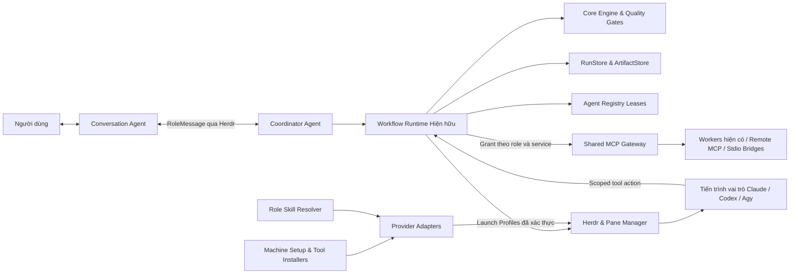

# Kiến trúc Runtime Bflow v3 — Baseline Hợp đồng P24

Thời điểm kiểm toán: 16/10/2026. Mã nguồn đầu vào: `9235415704d92f4612497b099925f6d23d6d8ca4`.
Giai đoạn P24 bổ sung thiết kế kiến trúc, các lược đồ schema, cổng giao tiếp công khai (public ports) và các bài kiểm thử hợp đồng. Các phân hệ từ P25–P31 chưa được triển khai bởi thay đổi này. Đây là đường cơ sở (baseline) kiến trúc, không phải chứng nhận toàn diện về Agentic SDLC hay khả năng sẵn sàng vận hành trên môi trường production.

---

## 1. Trạng thái triển khai (đối chiếu 2026-10-25)

P24 là baseline contracts/design; các quyết định D24-01 và phần audit lịch sử bên dưới giữ nguyên. Hiện đã có P25–P30, D-TOOLS-01 và các bản sửa tích hợp tiếp theo. [Implementation status](implementation-status.md) là bản đồ source/evidence hiện tại; báo cáo P25–P29 ngày 2026-10-17 không mô tả HEAD.

| Phạm vi | Source hiện tại | Giới hạn bằng chứng |
| --- | --- | --- |
| P25 | Claude/Codex/Agy discovery/auth/capability, launch profiles, native hooks và attestations | Agy Conversation/unattended unsupported; native specialist binding có source/local tests; không suy full SDLC từ probe |
| P26 | Setup plan/apply/repair/receipts, managed launcher/PATH, pinned installers, MemPalace venv | Dependency transitive và native-plugin rollback còn giới hạn; Windows mutation blocked |
| P27 | Gateway/control/stdio/remote services, exact grants/schemas, ledger, leases/fencing và structured output | Runtime đã nối GitNexus resource lease; browser task actions còn unsupported |
| P28 | Canonical catalog, approved role bindings, exact bundle pins, session manifests | Tool skill phụ thuộc grant; load instruction không chứng minh tuân thủ |
| P29/P30 | Persistent host prepare/activate, platform preflight, dynamic Developer, Gateway registration/revocation, user-decision routing | Có package/local integration tests và hồ sơ probe riêng; full provider SDLC/active crash acceptance còn mở |
| Sau P30 | Optional integrated tool defaults, `init --update`, polyglot detection, macOS helper/Seatbelt, bounded repository survey, actionable blockers | Xem từng source/test/report, không gộp các mức bằng chứng |
| P31 | Coverage platform nằm trong E2E e11–e16 và package tests; chưa có cây `tests/platform-v3/**` riêng | Chưa đóng conformance/fault/live acceptance campaign |

SDD/TDD/verification/concurrency của repository đã được CLI truyền vào persistent host. `up` mặc định không inference ping; activated health vẫn bắt buộc. [Compatibility matrix](compatibility-matrix.md), [limitations](known-limitations-v3.md), [roadmap](next-roadmap.md) ghi các điều kiện còn mở.

## 2. Kiểm toán P00–P23 và Quyết định Tái sử dụng

Quá trình kiểm toán đã đối chiếu chặt chẽ HEAD, chỉ mục Git, các worktree, nhánh cục bộ và theo dõi từ xa, lịch sử commit, tệp README, các hợp đồng giao tiếp, mã nguồn và toàn bộ biên bản nghiệm thu trước đó:

| Phân hệ | Hiện vật thực tế trong mã nguồn | Quyết định thiết kế v3 / Ranh giới bằng chứng |
| :--- | :--- | :--- |
| **P00** | `packages/contracts/src/{ports,transitions,versioning}.ts`, ADR 0001–0003 | Bảo lưu toàn bộ các bộ xác thực, mã lỗi, phân tích cú pháp tiếp nhận (ingress parsing) và tính tương thích ngược. |
| **P01** | `packages/core/src/**` | Bảo lưu đồ thị DAG, kiểm soát chuyển trạng thái, cơ chế retry/rework, khôi phục aggregate checkpoint; không viết lại workflow engine mới. |
| **P02** | `packages/herdr-adapter/src/**`, `packages/agent-registry/src/**` | Bảo lưu tầng truyền tải Herdr, cơ chế truyền tin bất định, cấp phát lease và fencing token; không thay thế bằng Gateway. |
| **P03** | `packages/persistence/src/**`, `packages/artifact-store/src/**` | Bảo lưu lưu trữ sự kiện/biên nhận nguyên tử trên SQLite, mã băm checksum, danh mục catalog và cơ chế tombstone. |
| **P04–P07** | MVP roles/prompts/workflows trong Registry, `quality-gates`, `runtime`, `apps/cli`, thư mục examples và guide | Toàn bộ chức năng đã có mã nguồn cụ thể; không dùng số lượng prompt đơn thuần để khẳng định mức độ hoàn thiện nghiệm thu. |
| **P08** | `tests/e2e/{helpers,scenarios}/**` | Các bài kiểm thử tích hợp sự cố/sập nguồn/hủy bỏ sử dụng fixture transport; không phải là kiểm thử mô hình thực tế đầu-cuối. |
| **P09–P10** | Runtime `resilience`, `context`, `observability`, `session-recovery`; `.github/workflows/{ci,cd}.yml`, tài liệu và ví dụ | Đã có mã nguồn và cấu hình phân phối; chưa tích hợp khả năng quan sát toàn tuyến, cơ chế quản trị trên GitHub từ xa chưa được kiểm chứng. |
| **P11** | `session.ts`, `sdlc.ts`, kiến trúc v2, giao thức giao tiếp, chính sách SDLC | Bảo lưu phong bì `RoleMessage` v2 và mô hình 4 miền trạng thái trực giao. |
| **P12** | `apps/cli/src/environment*.ts`, cơ chế khóa vòng đời, bộ phân tích cú pháp | Bảo lưu các lệnh vòng đời (`init`/`up`/`down`/`attach`/`status`/`doctor`/`recover`), định danh repository và đối soát khởi động. |
| **P13** | `packages/pane-manager/src/{role-pane-manager,provider-launch,role-prompts}.ts` | Bảo lưu phân vùng topo, đặt tên vai trò, bố cục lưới cân bằng, tệp prompt, cấp phát Developer động và theo dõi ý định khởi chạy. |
| **P14** | `packages/conversation/**`, `agents/chat/**` | Bảo lưu ConversationGateway, quy trình làm rõ yêu cầu, ủy quyền nghiệp vụ và điều phối quyết định của con người. |
| **P15** | `packages/specification/**`, tài nguyên của analyst/architect | Bảo lưu đặc tả bất biến đã duyệt, danh sách tiêu chí nghiệm thu, khả năng truy vết và chính sách phê duyệt. |
| **P16** | `packages/test-strategy/**` | Bảo lưu chính sách TDD có điều kiện và cơ chế xác thực bằng chứng kiểm thử thay thế. |
| **P17** | `packages/verification/**`, tài nguyên của verifier | Bảo lưu động cơ xác minh độc lập, kiểm tra đúng phiên bản mã nguồn và vòng lặp sửa đổi có giới hạn. |
| **P18** | `packages/git-orchestrator/**` | Bảo lưu worktree riêng cho từng tác vụ, tích hợp Git an toàn, bảo tồn xung đột và kiểm tra xác minh sau tích hợp. |
| **P19** | `packages/runtime/src/agentic/**`, `agents/coordinator/**` | Bảo lưu máy chủ host, bộ lập lịch, tiếp nhận/gửi thông điệp có xác thực, biên nhận bản địa và bộ chạy kiểm thử hành vi độc lập. |
| **P21** | `docs/acceptance/2026-10-16-p11-p21.md`, các bài kiểm thử native/fault | Báo cáo ghi nhận các điểm NO-GO và phát hiện lỗi; các lỗi này đã được xử lý trong các bản vá kế tiếp. |
| **P22** | `docs/release-readiness.md`, `known-limitations.md`, `security-review.md` | Đã khắc phục các vấn đề về host, vòng đời, TDD, sandbox và biên nhận; duy trì đánh giá chưa sẵn sàng phát hành do thiếu nghiệm thu live SDLC. |
| **P23** | `docs/acceptance/2026-10-16-lifecycle-startup-ux.md` | Đã bổ sung khôi phục khi khởi động gián đoạn, đặt tên pane/layout chuẩn xác, sửa tệp prompt và cơ chế biên nhận. |

---

## 3. Thành phần Kiến trúc và Phân luồng Quyền hạn

- **Herdr**: Tiếp tục nắm giữ quyền sở hữu các tiến trình hệ điều hành của agent, quản lý pane/session và chuyển phát thông điệp giữa các vai trò.
- **ProviderAdapter**: Đảm nhiệm việc thăm dò điều kiện tiên quyết và biên dịch thông tin khởi chạy.
- **Shared MCP Gateway**: Quản lý các kết nối công cụ, đăng ký client, phân quyền và cấp phát lease tài nguyên; Gateway hoàn toàn không có hộp thư hay API điều phối tác vụ. Việc một công cụ hoàn tất thực thi không đồng nghĩa với việc tác vụ đã hoàn thành.
- **Workflow Runtime & Quality Gates**: Vẫn là cơ quan duy nhất có thẩm quyền đưa ra phán quyết về kết quả nghiệp vụ của quy trình.

---

## 4. Ba tầng Cấu hình và Thiết lập Toàn cục

| Tầng cấu hình | Nội dung dữ liệu | Thẩm quyền & Vòng đời |
| :--- | :--- | :--- |
| **Cấp máy (Machine)** | Danh mục công cụ, tệp nhị phân đã kiểm chứng, phát hiện provider, định nghĩa dịch vụ được phê duyệt, danh mục kỹ năng dùng chung, tham chiếu bí mật. | Thuộc quyền sở hữu của người vận hành, lưu tại các thư mục riêng tư XDG; áp dụng khóa cấp máy. Tuyệt đối không cho phép tin cậy repository bằng ký tự đại diện (wildcard) hoặc bỏ qua phân quyền toàn cục. |
| **Cấp dự án (Repository)** | Lựa chọn provider/role, cấu hình tùy chọn model/effort, các công cụ/MCP/kỹ năng bắt buộc, chính sách kiểm tra xác minh, yêu cầu nghiệm thu và phê duyệt. | Tệp `.bflow/config.yml` chuẩn mực; lệnh `bflow config-migrate` hỗ trợ chuyển đổi tệp cũ có sao lưu khớp từng byte và giữ nguyên định danh repository. |
| **Cấp phiên (Session / Runtime)** | Môi trường đã giải quyết, hồ sơ phân quyền, cấu hình MCP đã sinh, token có phạm vi hẹp, tệp/biên nhận khởi chạy, lease tài nguyên, thời hạn hiệu lực. | Trạng thái POSIX riêng tư, định danh phiên và thế hệ khởi chạy; tự động thu hồi khi hạ dịch vụ hoặc phát hiện sai lệch cấu hình (drift). |

Quy tắc phân giải quyền hạn: Chính sách cấp máy thiết lập trần tối đa; cấu hình dự án chỉ được phép thu hẹp hoặc lựa chọn trong phạm vi tài nguyên đã cho phép; phiên làm việc chỉ nhận giao điểm quyền hợp lệ. Tuyệt đối không áp dụng nguyên tắc người ghi sau cùng thắng (last-writer-wins) để leo thang đặc quyền.

---

## 5. Quy trình Kiểm tra Sẵn sàng Nghiêm ngặt trước khi `bflow up`

1. **Xác thực định danh**: Phân giải định danh repository và chiếm khóa vòng đời bằng cơ chế hiện hữu; đọc chính sách cấp máy/dự án, kiểm tra tính hợp lệ của schema, lựa chọn provider và ma trận vai trò bắt buộc.
2. **Biên dịch môi trường**: Tổng hợp hồ sơ phân quyền và manifest kỹ năng; thăm dò định danh tệp nhị phân, phiên bản, tính hợp lệ của tài khoản xác thực, môi trường hệ thống tệp và công cụ với thời hạn chờ (deadline).
3. **Tiền kiểm tra (Preflight Check)**: Yêu cầu trạng thái sức khỏe preflight phải đạt `ready` đối với mọi vai trò và nhà cung cấp bắt buộc; MCP phải đàm phán thành công và xác thực các công cụ hợp lệ.
4. **Khởi động có kiểm soát**: Chỉ sau khi hoàn tất preflight mới khởi động Herdr và máy chủ tin cậy; thực hiện đăng ký Gateway cho các dịch vụ dùng chung được cấu hình; ghi nhận ý định khởi chạy trước khi tạo tác dụng phụ lên tiến trình.
5. **Chứng thực khởi động**: Pane Manager khởi chạy tiến trình bằng `AgentLaunchProfile`; yêu cầu chứng thư khởi động bản địa (native startup attestation) khớp với dấu vân tay khởi chạy, phiên, pane và bên phát hành tin cậy; kiểm tra khả năng gọi công cụ trực tiếp từ chính tiến trình đã chạy.
6. **Công bố trạng thái sẵn sàng**: Chỉ công bố manifest `up` và trả về kết quả CLI thành công sau khi toàn bộ các vai trò bắt buộc và máy chủ host đã kích hoạt thành công. Trạng thái sức khỏe có thời gian sống (TTL) tối đa 5 phút; hệ thống sẽ kiểm tra lại định danh và thời hạn ngay trước khi phân phối tác vụ.

---

## 6. Chế độ Chạy Không Giám sát (Unattended) và Quyết định Người dùng

- **`restricted`**: Chế độ chỉ đọc hoàn toàn.
- **`workspace_auto`**: Tự động thực thi các thao tác đã được cấp phép trong phạm vi workspace.
- **`unattended_isolated`**: Đòi hỏi môi trường sandbox/container cấp hệ điều hành cho toàn bộ tiến trình provider, giới hạn hệ thống tệp, mạng và tài nguyên, đồng thời chỉ cấp thông tin xác thực tối thiểu. Cần lưu ý rằng Git worktree không phải là sandbox an toàn.

Tuyệt đối không cấp chế độ bỏ qua bảo mật trên toàn máy (machine-wide bypass). Khi cần đưa ra quyết định quan trọng, hệ thống sẽ tạm dừng quy trình, lưu lại yêu cầu chính xác, chuyển tiếp qua Conversation Agent để hỏi ý kiến người dùng và chỉ tiếp tục khi nhận được biên nhận phê duyệt hợp lệ từ con người. Chế độ chạy không giám sát tuyệt đối không đồng nghĩa với việc tự động phê duyệt các cổng kiểm soát của con người.
