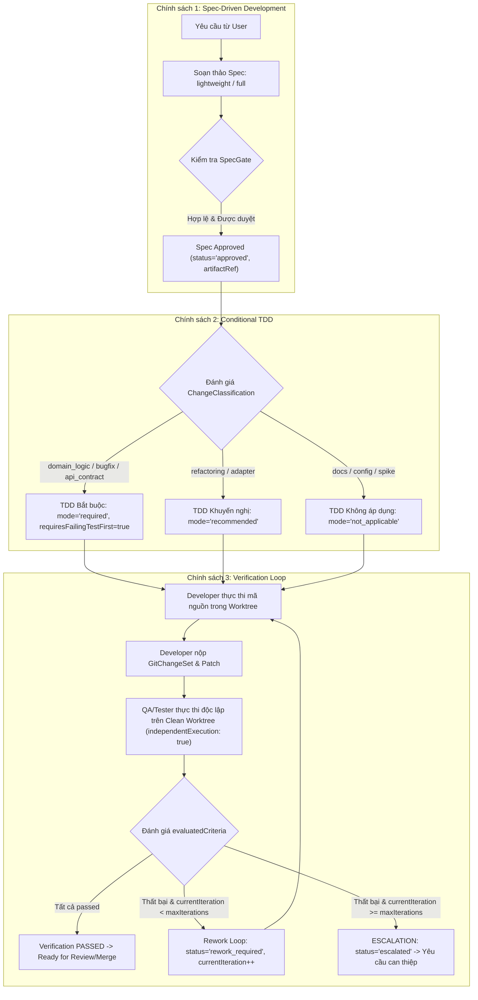
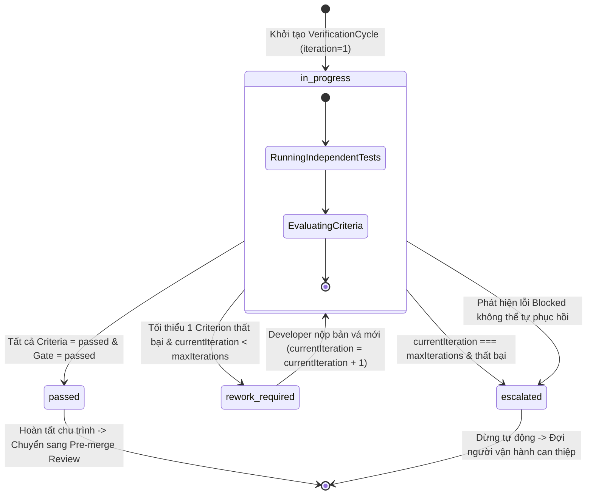

# Chính sách Vòng đời Phát triển Phần mềm Bflow v2 (SDLC Policies)

## 1. Giới thiệu và Tôn chỉ hoạt động

Tài liệu này quy chuẩn hóa các chính sách phát triển phần mềm (**SDLC Policies**) áp dụng cho toàn bộ hệ thống Bflow v2. Tài liệu đồng bộ trực tiếp với hợp đồng dữ liệu chính quy `@bflow/contracts` (mô-đun `packages/contracts/src/sdlc.ts`).

Hệ thống thiết lập ba trụ cột chính sách không thể tách rời:
1. **Spec-Driven Development (SDD)**: Không bao giờ viết mã nguồn khi chưa có bản đặc tả kỹ thuật được phê duyệt với các tiêu chí nghiệm thu rõ ràng.
2. **Conditional Test-Driven Development (Conditional TDD)**: Tiếp cận thực tế, chống giáo điều nhưng bắt buộc kiểm chứng khách quan; bắt buộc TDD đối với logic nghiệp vụ cốt lõi và sửa lỗi.
3. **Verification Loop & Objective Evidence**: Tuyệt đối không tin tưởng báo cáo tự xưng của Developer hay tín hiệu tiến trình của Herdr; mọi nghiệm thu phải dựa trên việc thực thi độc lập và bằng chứng lưu trữ bất biến.



---

## 2. Trạng thái Vòng đời Công việc SDLC (`SdlcWorkStatus`)

Mọi luồng công việc SDLC trong Bflow v2 di chuyển qua các trạng thái có thứ tự chặt chẽ được định nghĩa trong `SdlcWorkStatusSchema`:

| Trạng thái (`SdlcWorkStatus`) | Mô tả nghiệp vụ | Tác nhân chính |
| :--- | :--- | :--- |
| `intake` | Tiếp nhận yêu cầu ban đầu từ người dùng. | Conversation Agent |
| `clarifying` | Đặt câu hỏi làm rõ các điểm mơ hồ hoặc thiếu sót. | Conversation Agent |
| `specifying` | Soạn thảo bản đặc tả kỹ thuật (`Specification`). | Architect / Specifier / Planner |
| `planning` | Phân rã spec thành DAG các task thực thi. | Planner / Coordinator |
| `tdd_deciding` | Đưa ra quyết định áp dụng TDD (`TddDecision`). | Architect / Coordinator |
| `implementing` | Lập trình và nộp bản vá trong Git worktree riêng. | Developer |
| `verifying` | Thực thi kiểm thử độc lập trong clean worktree. | Tester / QA / Quality Gate |
| `reviewing` | Đánh giá chất lượng mã và bảo mật tĩnh. | Reviewer / Security |
| `awaiting_approval` | Chờ quyết định phê duyệt cuối cùng từ người dùng. | Human Operator / Conversation |
| `completed` | Toàn bộ tiêu chí đạt, sẵn sàng hợp nhất mã. | Workflow Runtime |
| `escalated` | Vượt ngưỡng vòng lặp hoặc gặp lỗi chặn không tự sửa được. | Coordinator / Human Operator |
| `failed` | Thất bại không thể phục hồi hoặc bị hủy bỏ. | Workflow Runtime |
| `cancelled` | Người dùng hoặc hệ thống chủ động hủy bỏ luồng. | User / Coordinator |

---

## 3. Chính sách 1: Spec-Driven Development (SDD)

### 3.1. Triết lý nền tảng
Bản đặc tả kỹ thuật (**Specification**) là hợp đồng đơn nguồn chân lý (**Single Source of Truth**) giữa người dùng, kiến trúc sư và các tác nhân lập trình. Mọi thay đổi mã nguồn trong hệ thống Bflow v2 bắt buộc phải bắt nguồn từ một bản Spec đã được phê duyệt.

Coordinator Agent bị **nghiêm cấm** phân công tác vụ (`task.assignment`) cho Developer nếu tác vụ đó chưa được liên kết với một `Specification` hợp lệ mang trạng thái `status: "approved"` và đã có `artifactRef` lưu trữ trong `ArtifactStore`.

### 3.2. Hai cấp độ đặc tả bắt buộc (`SddPolicyLevelSchema`)

Hệ thống quy chuẩn hai cấp độ đặc tả (`SddPolicyLevel`):

#### A. Cấp độ `lightweight` (Đặc tả rút gọn)
- **Đối tượng áp dụng**:
  - Sửa lỗi nhỏ cục bộ (`bugfix`), vá ngoại lệ.
  - Cập nhật cấu hình, biến môi trường.
  - Refactoring phạm vi hẹp trong 1 mô-đun hoặc 1 tệp, không thay đổi giao diện công khai (`contracts`).
  - Điều chỉnh tài liệu, ví dụ mẫu.
- **Yêu cầu dữ liệu bắt buộc**:
  1. `title`: Tiêu đề súc tích, phản ánh đúng phạm vi.
  2. `summary`: Tóm tắt nội dung thay đổi.
  3. `problemStatement`: Mô tả vấn đề hiện tại hoặc lỗi phát sinh.
  4. `scope`: Định rõ ranh giới gồm `inScope` (danh sách công việc bắt buộc) và `outOfScope` (danh sách nội dung không được phép đụng đến).
  5. `acceptanceCriteria`: Tối thiểu **1** tiêu chí nghiệm thu cụ thể tuân thủ `AcceptanceCriterionSchema`. Mỗi tiêu chí phải có `verificationMethod` độc lập và `evidenceArtifactIds`.
  6. `affectedPaths`: Danh sách đường dẫn tệp hoặc mẫu glob dự kiến bị tác động (tối thiểu 1 đường dẫn).

#### B. Cấp độ `full` (Đặc tả toàn diện)
- **Đối tượng áp dụng**:
  - Bổ sung tính năng mới (`feature`).
  - Thay đổi kiến trúc hệ thống hoặc chuyển đổi công nghệ.
  - Thay đổi hợp đồng công khai (`packages/contracts/**`), giao diện API, hoặc cấu trúc dữ liệu lưu trữ (schema migration).
  - Các thay đổi liên quan đến bảo mật, phân quyền, mật mã hoặc xác thực.
- **Yêu cầu dữ liệu bắt buộc**:
  Toàn bộ các trường của cấp độ `lightweight`, cộng thêm 5 trường bắt buộc sau:
  1. `architectureNotes`: Phân tích tác động kiến trúc, cấu trúc phụ thuộc và ràng buộc tương thích ngược.
  2. `securityConsiderations`: Đánh giá rủi ro an toàn thông tin, kiểm tra đầu vào, nguy cơ injection, lộ lọt dữ liệu hoặc leo thang đặc quyền.
  3. `rollbackPlan`: Kế hoạch và quy trình hoàn nguyên nếu tính năng gây lỗi.
  4. `testStrategy`: Chiến lược kiểm thử nhiều tầng tuân thủ `TestStrategySchema`.
  5. `tddDecision`: Quyết định áp dụng TDD chính thức tuân thủ `TddDecisionSchema`.

### 3.3. Đặc tả Tiêu chí Chấp nhận (`AcceptanceCriterionSchema`)

Mỗi tiêu chí nghiệm thu được quy định chặt chẽ:
```typescript
export const AcceptanceCriterionSchema = z
  .object({
    id: IdentifierSchema,
    description: z.string().trim().min(1),
    category: z.enum([
      "functional",
      "non_functional",
      "security",
      "performance",
      "edge_case",
      "regression"
    ]),
    verificationMethod: z.enum([
      "unit_test",
      "integration_test",
      "e2e_test",
      "typecheck",
      "lint",
      "static_analysis",
      "manual_review"
    ]),
    required: z.boolean(),
    status: z.enum(["pending", "satisfied", "failed", "waived"]),
    evidenceArtifactIds: z.array(ArtifactIdSchema),
    waiverReason: z.string().min(1).optional()
  })
  .strict();
```

> [!IMPORTANT]
> **Ràng buộc tiêu chí**:
> - Tiêu chí có `status: "satisfied"` bắt buộc phải có ít nhất **1** `evidenceArtifactIds` (trừ trường hợp duy nhất là `verificationMethod: "manual_review"`).
> - Tiêu chí có `status: "waived"` (miễn trừ) bắt buộc phải có `waiverReason` giải trình lý do rõ ràng.

### 3.4. Đặc tả Toàn bộ Specification (`SpecificationSchema`)

```typescript
export const SpecificationSchema = z
  .object({
    schemaVersion: z.literal(2),
    specId: IdentifierSchema,
    runId: IdentifierSchema.optional(),
    sessionId: IdentifierSchema,
    level: z.enum(["lightweight", "full"]),
    title: z.string().trim().min(1),
    summary: z.string().trim().min(1),
    problemStatement: z.string().trim().min(1),
    scope: z
      .object({
        inScope: z.array(z.string().min(1)).min(1),
        outOfScope: z.array(z.string().min(1))
      })
      .strict(),
    acceptanceCriteria: z.array(AcceptanceCriterionSchema).min(1),
    affectedPaths: z.array(z.string().trim().min(1)).min(1),
    architectureNotes: z.string().trim().min(1).optional(),
    dataModelChanges: z.string().trim().min(1).optional(),
    securityConsiderations: z.string().trim().min(1).optional(),
    rollbackPlan: z.string().trim().min(1).optional(),
    testStrategy: TestStrategySchema.optional(),
    tddDecision: TddDecisionSchema.optional(),
    status: z.enum(["draft", "review_pending", "approved", "superseded", "rejected"]),
    artifactRef: ArtifactReferenceSchema.optional(),
    createdBy: z.string().min(1),
    approvedBy: z.string().min(1).optional(),
    createdAt: IsoDateTimeSchema,
    updatedAt: IsoDateTimeSchema,
    metadata: MetadataSchema.optional()
  })
  .strict();
```

### 3.5. Quy tắc chọn mức SDD và Cổng kiểm soát (Spec Gate)

| Tiêu chí phân loại | Bắt buộc chọn `full` | Được phép chọn `lightweight` |
| :--- | :--- | :--- |
| **Phân loại thay đổi** | `feature`, `architecture`, `security` | `bugfix`, `documentation`, `configuration` |
| **Tác động Contracts** | Có thay đổi trong `packages/contracts/**` | Tuyệt đối không đổi `packages/contracts/**` |
| **Số lượng file đổi** | Tác động $\ge 5$ files | Dưới 5 files và trong cùng một package |
| **Rủi ro vận hành** | Có migration DB hoặc ảnh hưởng state phục hồi | Không thay đổi schema DB hay định dạng checkpoint |

---

## 4. Chính sách 2: Conditional Test-Driven Development (Conditional TDD)

### 4.1. Triết lý chống giáo điều nhưng có kiểm chứng khách quan
Bflow v2 bác bỏ quan điểm ép buộc TDD máy móc cho tất cả các loại tác vụ. Việc bắt buộc viết unit test trước cho một cấu hình màu sắc CSS, một tài liệu markdown, hay một thử nghiệm công nghệ thăm dò (spike) là lãng phí và phản tác dụng.

Tuy nhiên, đối với logic nghiệp vụ cốt lõi, hợp đồng dữ liệu và khắc phục lỗi phần mềm, **TDD là yêu cầu bắt buộc và không thể thương lượng**.

### 4.2. Ba chế độ TDD chuẩn (`TddModeSchema`)

```typescript
export const TddModeSchema = z.enum(["required", "recommended", "not_applicable"]);
```

#### 1. Chế độ `required` (Bắt buộc TDD)
- **Quy tắc bắt buộc**:
  - `requiresFailingTestFirst: true`.
  - Phải có danh sách `requiredTestLevels` (ít nhất 1 tầng kiểm thử: `unit`, `integration`, `e2e`, `property`, `regression`, `smoke`).
  - Danh sách `targetCommands` không được rỗng (ví dụ: `["pnpm --filter @bflow/core test"]`).
- **Phạm vi bắt buộc áp dụng**:
  - `domain_logic`: Logic tính toán, chuyển đổi trạng thái, thuật toán concurrency, điều phối.
  - `bugfix`: Mọi bản vá lỗi bắt buộc phải có bài test tái hiện lỗi trước (Red Phase) và thất bại trên mã nguồn cũ, sau đó vượt qua (Green Phase) trên mã nguồn mới.
  - `api_contract`: Các schema hợp đồng, serialization/deserialization, parser và giao thức.
- **Bằng chứng khách quan**: Developer phải cung cấp `evidenceArtifacts` chứng minh bài test đã thất bại với mã lỗi mong đợi trước khi commit mã sửa lỗi.

#### 2. Chế độ `recommended` (Khuyến nghị TDD)
- **Quy tắc**:
  - Khuyến khích viết test trước hoặc viết song song với mã nguồn (`requiresFailingTestFirst: false`).
  - Bắt buộc phải có bộ kiểm thử tự động độc lập và đạt nghiệm thu tại Verification Loop.
- **Phạm vi áp dụng**:
  - `refactoring`: Tái cấu trúc mã nguồn nội bộ mà không làm thay đổi hành vi bên ngoài (đã có sẵn bộ test hồi quy bảo vệ).
  - Tích hợp adapter hệ thống ngoại vi (cần mock/stub phức tạp).
  - Tối ưu hóa hiệu năng, giảm độ phức tạp thuật toán.

#### 3. Chế độ `not_applicable` (Không áp dụng TDD)
- **Quy tắc**:
  - `requiresFailingTestFirst: false`.
  - Không yêu cầu viết bài kiểm thử trước.
- **Phạm vi áp dụng giới hạn**:
  - `documentation`: Cập nhật tài liệu, hướng dẫn, ghi chú phát hành.
  - `configuration`: Tinh chỉnh tệp cấu hình JSON/YAML tĩnh, biến môi trường mẫu.
  - `ui_layout`: Tinh chỉnh giao diện hiển thị tĩnh, style CSS đơn thuần.
  - `exploratory_spike`: Tác vụ nghiên cứu, thăm dò công nghệ (phải được đánh dấu rõ ràng là thử nghiệm và không được merge vào production).

### 4.3. Rào chắn kiểm soát và Ngăn ngừa lạm dụng (Invariants & Guardrails)

> [!IMPORTANT]
> **Rào chắn chống lạm dụng TDD**:
> 1. Mọi `TddDecision` bắt buộc phải có `rationale` giải trình lý do với độ dài tối thiểu **10 ký tự**.
> 2. Mọi `TddDecision` bắt buộc phải chứa ít nhất **1** điều kiện kiểm chứng khách quan trong `verifiableConditions`.
> 3. **CẤM TUYỆT ĐỐI**: Các tác vụ thuộc phạm vi `domain_logic` và `bugfix` **không bao giờ được phép** chọn chế độ `not_applicable`.
> 4. **Trường hợp ngoại lệ duy nhất**: Chỉ khi có sự phê duyệt tường minh trong metadata: `metadata.humanOverrideApproved === true`, tác vụ `domain_logic` hoặc `bugfix` mới được miễn trừ TDD.

### 4.4. Đặc tả Schemas cho TDD & Test Strategy

```typescript
export const ChangeClassificationSchema = z.enum([
  "domain_logic",
  "bugfix",
  "api_contract",
  "refactoring",
  "ui_layout",
  "documentation",
  "configuration",
  "exploratory_spike"
]);

export const TddDecisionSchema = z
  .object({
    schemaVersion: z.literal(2),
    decisionId: IdentifierSchema,
    runId: IdentifierSchema,
    taskId: IdentifierSchema.optional(),
    specId: IdentifierSchema,
    mode: TddModeSchema,
    rationale: z.string().trim().min(10),
    verifiableConditions: z.array(z.string().trim().min(1)).min(1),
    changeClassification: ChangeClassificationSchema,
    requiresFailingTestFirst: z.boolean(),
    decidedBy: z.enum(["coordinator", "planner", "architect", "human_operator"]),
    decidedAt: IsoDateTimeSchema,
    verifiedByGateId: IdentifierSchema.optional(),
    metadata: MetadataSchema.optional()
  })
  .strict();

export const TestStrategySchema = z
  .object({
    schemaVersion: z.literal(2),
    strategyId: IdentifierSchema,
    specId: IdentifierSchema,
    tddDecision: TddDecisionSchema,
    requiredTestLevels: z.array(z.enum(["unit", "integration", "e2e", "property", "regression", "smoke"])),
    targetCommands: z.array(z.string().trim().min(1)),
    coverageThresholdPercent: z.number().min(0).max(100).optional(),
    independentVerificationRequired: z.literal(true),
    criterionMappings: z.array(
      z
        .object({
          criterionId: IdentifierSchema,
          testNames: z.array(z.string().min(1)).min(1)
        })
        .strict()
    ),
    createdAt: IsoDateTimeSchema,
    metadata: MetadataSchema.optional()
  })
  .strict();
```

---

## 5. Chính sách 3: Verification Loop & Chu trình Nghiệm thu Khách quan

### 5.1. Nguyên tắc Không Tin Tưởng (Zero Trust on Self-Reporting)
Trong mô hình cộng tác đa tác nhân, Developer Agent có xu hướng báo cáo "mọi thứ đã hoàn tất thành công" hoặc báo cáo các chỉ số kiểm thử không chính xác. Đồng thời, trạng thái `done` của terminal Herdr chỉ biểu thị việc tiến trình dòng lệnh đã thoát (exit), không phản ánh tính chính xác của nghiệp vụ.

Do đó, Bflow v2 thiết lập chu trình **Verification Loop** khép kín, hoạt động theo các quy tắc nghiệm thu bất biến:
1. **Thực thi hoàn toàn độc lập (`independentExecution: true`)**: Bài test phải được kích hoạt bởi Tester/QA Agent hoặc Quality Gate tự động, chạy trong một **Clean Worktree** hoặc môi trường cách ly, tách rời hoàn toàn khỏi thư mục làm việc của Developer.
2. **Kiểm tra từng tiêu chí nghiệm thu (`evaluatedCriteria`)**: Không đánh giá chung chung; từng tiêu chí trong Spec phải được gán kết quả `passed: boolean` kèm theo mã thoát (`exitCode`), lệnh đã chạy (`command`) và mã định danh tệp log bằng chứng (`evidenceArtifactId`).
3. **Bằng chứng tạo phẩm bắt buộc (`evidenceArtifacts`)**: Mọi kết quả kiểm thử, log máy đo (coverage), kết quả phân tích tĩnh phải được đóng gói vào `ArtifactStore` với mã băm SHA-256/SHA-512 và trạng thái `trust: "stored"`.
4. **Không có lỗi nghiêm trọng**: Mọi `findings` không được chứa lỗi có `severity: "error"`. Tất cả Quality Gate bắt buộc phải có trạng thái `passed`.

### 5.2. Giới hạn vòng lặp (`maxIterations`) và Ngăn ngừa Vòng lặp Vô tận
Mỗi tác vụ khi nộp mã sẽ bước vào một chu trình nghiệm thu (`VerificationCycle`).
- Trường `maxIterations`: Quy định số lần tối đa Developer được phép sửa mã và nộp lại (mặc định: **3**, tối đa cho phép: **10**).
- Trường `currentIteration`: Đếm số lần kiểm chứng hiện tại (bắt đầu từ 1, tăng dần 1 đơn vị sau mỗi chu kỳ rework).
- **Phối hợp với `ReworkPolicy.maxReworks` của Core Engine**:
  - `VerificationCycle` theo dõi số vòng lặp vi mô (micro-loop) giữa Developer và QA.
  - Khi Developer cần sửa lại, Core Workflow Engine kích hoạt bước chuyển đổi trạng thái hợp lệ: `succeeded -> ready` với `generation = generation + 1`.
  - Tổng số lần rework không bao giờ được vượt quá `ReworkPolicy.maxReworks` của workflow.



### 5.3. Cơ chế Escalation (Leo thang can thiệp)

> [!CAUTION]
> Khi xảy ra một trong hai điều kiện sau:
> 1. `currentIteration === maxIterations` mà kết quả nghiệm thu lần cuối vẫn là `failed`.
> 2. Phát hiện lỗi hệ thống nghiêm trọng thuộc dạng `blocked` (ví dụ: lỗi hạ tầng, xung đột hợp đồng dữ liệu, vi phạm an ninh nghiêm trọng).

**Hành vi bắt buộc của hệ thống**:
- **CẤM TUYỆT ĐỐI** chuyển trạng thái chu kỳ sang `rework_required` (ngăn chặn tình trạng loop vô hạn).
- **BẮT BUỘC** chuyển trạng thái `VerificationCycle` sang `escalated`.
- Tạo ngay lập tức khối `escalation` bên trong `VerificationCycle`, đính kèm toàn bộ:
  - `escalatedAt`: Thời điểm kích hoạt leo thang.
  - `reason`: Lý do chi tiết.
  - `target`: Đối tượng cần can thiệp (`"coordinator"` hoặc `"human_operator"`).
  - `evidenceArtifacts`: Mảng các `ArtifactReference` chứa toàn bộ log và bằng chứng khách quan.
- Gửi thông điệp `verification.escalation` tới **Coordinator Agent** và chuyển tiếp tới **Conversation Agent** để thông báo cho người vận hành (Human Operator).
- Workflow run bị đưa vào trạng thái tạm dừng (`blocked`), không tiêu tốn tài nguyên cho đến khi có chỉ thị giải quyết của con người.

### 5.4. Đặc tả Schemas cho GitChangeSet và Verification

```typescript
export const GitChangedFileSchema = z
  .object({
    path: z.string().min(1),
    changeType: z.enum(["added", "modified", "deleted", "renamed"]),
    previousPath: z.string().min(1).optional(),
    additions: z.number().int().nonnegative(),
    deletions: z.number().int().nonnegative()
  })
  .strict();

export const GitChangeSetSchema = z
  .object({
    schemaVersion: z.literal(2),
    changeSetId: IdentifierSchema,
    runId: IdentifierSchema,
    taskId: IdentifierSchema,
    attemptId: IdentifierSchema,
    worktreePath: z.string().min(1),
    branchName: z.string().min(1),
    baseCommitHash: z.string().regex(/^[a-f0-9]{7,40}$/i),
    headCommitHash: z.string().regex(/^[a-f0-9]{7,40}$/i),
    dirtyWorkingTree: z.boolean(),
    filesChanged: z.array(GitChangedFileSchema).min(1),
    patchArtifact: ArtifactReferenceSchema,
    createdAt: IsoDateTimeSchema,
    metadata: MetadataSchema.optional()
  })
  .strict();

export const VerificationResultSchema = z
  .object({
    schemaVersion: z.literal(2),
    verificationId: IdentifierSchema,
    runId: IdentifierSchema,
    taskId: IdentifierSchema,
    cycleNumber: z.number().int().positive(),
    attemptId: IdentifierSchema,
    status: z.enum(["passed", "failed", "blocked", "escalated"]),
    independentExecution: z.literal(true),
    evaluatedCriteria: z
      .array(
        z
          .object({
            criterionId: IdentifierSchema,
            passed: z.boolean(),
            command: z.string().min(1).optional(),
            exitCode: z.number().int().optional(),
            evidenceArtifactId: ArtifactIdSchema,
            summary: z.string().min(1)
          })
          .strict()
      )
      .min(1),
    qualityGateResults: z.array(QualityGateResultSchema),
    evidenceArtifacts: z.array(ArtifactReferenceSchema).min(1),
    findings: z.array(QualityFindingSchema),
    changeSet: GitChangeSetSchema.optional(),
    verifiedBy: z.enum(["quality_gate", "qa", "reviewer", "tester"]),
    startedAt: IsoDateTimeSchema,
    completedAt: IsoDateTimeSchema,
    metadata: MetadataSchema.optional()
  })
  .strict();

export const VerificationCycleSchema = z
  .object({
    schemaVersion: z.literal(2),
    cycleId: IdentifierSchema,
    runId: IdentifierSchema,
    taskId: IdentifierSchema,
    specId: IdentifierSchema,
    currentIteration: z.number().int().positive(),
    maxIterations: z.number().int().min(1).max(10),
    status: z.enum(["in_progress", "passed", "rework_required", "escalated", "aborted"]),
    tddDecision: TddDecisionSchema,
    history: z.array(VerificationResultSchema),
    escalation: z
      .object({
        escalatedAt: IsoDateTimeSchema,
        reason: z.string().min(1),
        target: z.enum(["coordinator", "human_operator"]),
        approvalRequestId: IdentifierSchema.optional(),
        evidenceArtifacts: z.array(ArtifactReferenceSchema).min(1)
      })
      .strict()
      .optional(),
    startedAt: IsoDateTimeSchema,
    updatedAt: IsoDateTimeSchema,
    metadata: MetadataSchema.optional()
  })
  .strict();
```

---

## 6. Ma trận tích hợp các Cổng chất lượng (Quality Gate Integration)

Để đảm bảo việc thực thi các chính sách trên được tự động hóa hoàn toàn, hệ thống liên kết chặt chẽ ba chính sách vào hệ thống cổng chất lượng (`QualityGate`):

| Tên Cổng (Gate Name) | Giai đoạn (Phase) | Đầu vào kiểm tra | Điều kiện Đạt (`passed`) |
| :--- | :--- | :--- | :--- |
| **SDD Conformity Gate** | Pre-Dispatch | `Specification` | Đủ các trường theo cấp độ (`lightweight` hoặc `full`), tối thiểu 1 tiêu chí có phương pháp kiểm thử, `status: "approved"`, và có `artifactRef`. |
| **TDD Compliance Gate** | Pre-Implementation | `TddDecision` & `FailingTestProposal` | Nếu chế độ `required`: Bắt buộc có kết quả chạy test thất bại ban đầu (Red Phase) với exitCode $\ne 0$. Nếu `not_applicable`: Phải có giải trình hợp lệ và không thuộc `domain_logic`/`bugfix` (trừ khi có human override). |
| **Verification Loop Gate** | Post-Implementation | `VerificationResult` | `independentExecution: true`, 100% `AcceptanceCriteria` đạt `passed: true`, mã thoát của các lệnh test là 0, không có finding lỗi (`severity: "error"`), tạo phẩm patch khớp với Git diff. |
| **Governance Gate** | Pre-Merge | Toàn bộ Run Events & Artifacts | Mọi Quality Gate tự động đều `passed` VÀ có sự phê duyệt rõ ràng từ con người (`human_approver`). |

---

## 7. Tổng kết

Việc tuân thủ ba chính sách **SDD**, **Conditional TDD** và **Verification Loop** là điều kiện tiên quyết giúp Bflow v2 đạt được sự tin cậy cao nhất trong phát triển phần mềm tự trị. Không có lối đi tắt hay thỏa hiệp đối với chất lượng: mọi dòng mã được sinh ra đều phải có nguồn gốc từ đặc tả, được kiểm thử có phương pháp, và được nghiệm thu bằng các bằng chứng khách quan, bất biến.
