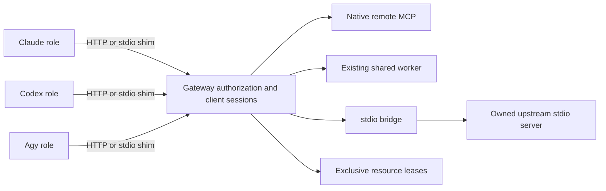

# Shared MCP architecture v3

Thiết kế chuẩn tắc P24; P27 sở hữu phần triển khai. Định nghĩa công khai và port nằm trong
`packages/contracts/src/{setup,mcp}.ts`. P24 không triển khai module Gateway/service nào.

## Implementation status (2026-10-25)

Gateway/services và control endpoint đã được nối vào Runtime theo role/session/generation. D-TOOLS-01 bổ sung policy/grant/usage schemas; registration tách service và exact operations, kiểm tra negotiated input/output schema, ledger giữ unknown và response có `structuredContent`. Runtime đã nối resource acquire/renew/release cho GitNexus; browser task actions còn degraded/blocked vì task lease chưa được hỗ trợ.

DeepWiki hosted dùng chung giữa repository/worktree có registration hợp lệ; local backend giữ workspace partition. Agent gọi tool được policy-mediated qua Runtime, không nhận raw Gateway bearer token cho đường đó. Inter-role messages vẫn qua Herdr.

[Tool integration](tools-sdlc-integration.md), [Gateway README](../packages/mcp-gateway/README.md) và [implementation status](implementation-status.md) phân biệt source/local tests với các hồ sơ probe thật. Chưa đóng full live SDLC hoặc active multi-repo fault campaign; same-UID/multi-host isolation vẫn chưa được chứng nhận. Câu P24 chưa có module chỉ mô tả baseline thiết kế.

## Tách biệt tool, service và giao tiếp giữa các agent

Herdr vẫn là transport liên-role duy nhất. RoleMessage, receipt có tương quan, tiến độ,
làm rõ, delegation, verification và approval đi theo các đường Runtime → Herdr hiện có.
Shared MCP Gateway quản lý kết nối tool và ủy quyền. API của nó không thể gửi tới một
role/pane tùy ý, khởi chạy task hay thay thế scheduler của Runtime. Các native host tool hiện
có vẫn là endpoint của Runtime: role gọi một tool là yêu cầu Runtime thực thi chính sách, và
mọi message liên-role phát sinh vẫn đi qua Herdr. Gateway không bao giờ được biến một lời gọi
tool thành hộp thư agent trực tiếp thay thế.

| Loại tool | Biểu diễn trong contract | Kết nối/vòng đời |
| --- | --- | --- |
| Tool chỉ có CLI (git/node/compiler) | `ToolCapability.kind = cli_only` | ToolInstaller/inventory + runner có ràng buộc hiện có; không có MCP service, port hay tools/list hư cấu |
| Shared worker hiện có | `existing_shared_worker`, workerId, endpoint, external ownership | Adopt/health-check endpoint đã duyệt; worker phải nói MCP hoặc dùng adapter được triển khai tường minh. Không bao giờ spawn bản trùng chỉ vì Bflow khởi động |
| MCP server remote native | `native_remote_mcp`, endpoint HTTPS, ownership bên ngoài | Negotiate protocol/auth trực tiếp; chia sẻ connection pool đã ủy quyền mà không sao chép token cho role |
| stdio MCP | `stdio_mcp`, executable/argv/secret binding đã pin, ownership của Bflow, bridgeRequired | Gateway sở hữu một upstream process đủ điều kiện cho mỗi service/config/security partition; bridge cung cấp các session đa client có phạm vi |
| Tài nguyên tool độc quyền (Chrome) | Bất kỳ MCP kind nào + `tool.resource.sharing = exclusive`, resourceKey ổn định | Chia sẻ kết nối không cho phép thao tác browser đồng thời; resource lease/fence của Gateway tuần tự hóa truy cập |

Chia sẻ tài nguyên trực giao với transport. Một server có thể nhận nhiều client trong khi
mọi thao tác thay đổi một browser vẫn độc quyền. Tool chỉ có CLI bị `MCPServiceDefinitionSchema`
từ chối; P27 không được giả vờ một lệnh trở thành MCP bằng cách gọi nó là service. Việc
acquire worker hiện có kiểm tra protocol thực tế, không chỉ PID/port.

## Public contract

| Contract | Field / ngữ nghĩa port |
| --- | --- |
| `ToolCapability` | Inventory tool có version: kind/version/operation, cờ required, dung lượng đồng thời hoặc resource key độc quyền |
| `ToolInstaller` | `plan(ToolInstallRequest) → SetupStep`, `apply(SetupApplyRequest) → SetupReceipt`, `reconcile(SetupApplyRequest) → SetupReceipt`; chỉ các bước cài đặt owned đã pin, không phải shell tùy ý |
| `MCPServiceDefinition` | Service ID/revision/scope có version, tool, connection union, auth reference, timeout health/idle và giới hạn restart có bound |
| `MCPServiceManager` | `ensure(service, ScopedOperation)`, `inspect(serviceId, ScopedOperation)`, `release(serviceId, ScopedOperation)` trả về `OperationResult<MCPServiceObservation>` |
| `MCPClientRegistration` | Environment/provider/role/session có version, tập service/tool được phép, cấu hình client transport, secret token reference, digest/hết hạn/idempotency |
| `SharedMCPGateway` | `register`, `revoke`, `acquireResource`, `renewResource`, `releaseResource`, `call`, `reconcileCall`, tất cả dùng request có kiểu và OperationResult |
| `MCPResourceLease` | Resource lease ID chuyên dụng, định danh client/service/resource, fence đơn điệu và thời điểm acquire/hết hạn; tách biệt với task lease của Registry |
| `MCPToolCall` / `MCPToolCallResult` | Tương quan lệnh có bound, client/service/tool/input, resource proof tùy chọn, idempotency; outcome completed/failed/unknown |

Schema ở mức strict và version 3 tại ranh giới document. Input/output tool động dùng
JsonValue tại ranh giới này; Gateway cũng phải validate theo schema input/output của MCP tool
đã negotiate. MCP protocolVersion được negotiate riêng và không bao giờ suy ra từ schemaVersion
của Bflow. `MCPServiceObservation.ready` đòi hỏi protocol và tool đã discover; chỉ truy cập được
service là chưa đủ cho agent readiness.

Protocol upstream/client theo mô hình transport stdio và Streamable HTTP của MCP.
stdio là kênh subprocess; Streamable HTTP hỗ trợ server độc lập với nhiều kết nối client.
Thiết kế bridge phải triển khai session protocol và request mapping thực sự, không broadcast
byte stream tới mọi client.
[Đặc tả transport MCP](https://modelcontextprotocol.io/specification/2025-11-25/basic/transports).

## Topology kết nối và ủy quyền

Một machine service manager có thể phục vụ nhiều repository đồng thời, nhưng kết nối và
process được phân vùng theo digest service definition canonical, credential/audience, machine
principal, repo trust, runtime isolation và tính stateful của upstream. Không bao giờ tái sử
dụng process có thể làm lộ cwd, file, browser profile, secret hay state hội thoại của repo
khác. Phân vùng mặc định là theo repo/ranh giới bảo mật; chia sẻ toàn machine đòi hỏi operator
duyệt capability tường minh và upstream stateless hoặc được phân vùng thực sự.

Mỗi role có một client registration riêng và token ngắn hạn. Gateway resolve principal từ
xác thực do host cấp, không dựa vào `role`, registrationId hay tool input do model tự khai.
Ràng buộc token với machine/repository/session/environment/role và tập service/tool được
phép; yêu cầu registration chưa hết hạn cho mọi tools/list và call. Áp dụng giao của chính
sách machine, lựa chọn repo, capability của role, permission profile và task grant. Ẩn tool
không được ủy quyền và từ chối tên đoán mò kể cả khi bộ lọc phía provider thất bại. Không chia
sẻ upstream auth token, admin API, signing key hay registration của role khác với model. Secret
reference không bao giờ chứa giá trị bearer token.

Client HTTP endpoint mặc định là loopback, private realm, có xác thực và validate
Origin/Host. Không phải loopback thì đòi hỏi TLS và chính sách triển khai remote đã được review.
Client stdio dùng một shim nhỏ đã pin kết nối tới cùng gateway; shim không bao giờ khởi chạy một
upstream worker đắt đỏ cho mỗi role. Credential trong userinfo/query/fragment của URL bị từ chối;
kiểm tra DNS/redirect/SSRF/egress do manager thực thi, không chỉ dựa vào URL schema. Credential
OAuth remote bị ràng buộc audience, được xoay vòng qua luồng của operator và không bao giờ
chuyển tiếp tới origin khác. Không chấp nhận endpoint remote tùy ý từ văn bản của repository/model.

Cấu hình repository/service chỉ tham chiếu service ID và capability đã duyệt trước. Thêm
executable/URL/credential binding mới là thay đổi setup plan, không phải discovery của `up`
âm thầm tin tưởng code mới. Provider adapter chỉ render cấu hình MCP cục bộ của launch; settings
global của Claude/Codex/Agy không đổi trừ khi một bước setup tường minh sở hữu chúng.

## Vòng đời, adoption và crash recovery

1. Setup validate catalog mong muốn; chỉ cài đặt qua P26 plan/apply tường minh. `up` resolve
   các yêu cầu và acquire một reference cho đúng scope/environment của nó.
2. `ensure` chạy single-flight dưới machine lock, dùng service revision/config digest và
   ownership đã ghi. Worker hiện có được probe/adopt; stdio process owned chỉ khởi động sau khi
   có intent bền vững. Negotiate initialize, protocol, tool và credential.
3. Đăng ký một client provider/role riêng. Thiếu/bị từ chối tool bắt buộc hoặc trạng thái
   upstream không rõ sẽ chặn readiness; không có service thành công giả.
4. Khi restart, dựng lại ledger process/client/call owned và xác minh định danh process,
   digest executable và start generation. PID tái sử dụng không phải ownership. Không bao giờ
   kill worker bên ngoài hay process mà ownership không chứng minh được.
5. Revoke client của session đã hết hạn/down, release reference/resource grant chính xác. Chỉ
   dừng service do Bflow sở hữu khi reference count bằng 0 + idle policy + không còn call không
   chắc chắn. Worker bên ngoài và native remote server luôn sống sót qua repo shutdown.

Persist idempotency key và request fingerprint. Payload khác nhau cùng key là conflict.
Timeout trước khi ghi an toàn là not_started; timeout sau khi có thể đã có tác động mutating
của tool là `unknown`, được giữ qua restart. `reconcileCall` có thể chứng minh hoàn tất,
non-delivery/failure hoặc vẫn unknown; không tự động replay call mutating không chắc chắn.
Request ID MCP/HTTP bên dưới là correlation, không phải đảm bảo side effect exactly-once. Retry
quan sát read-only được phép riêng với budget có bound. Phân biệt phản hồi tool lỗi (`isError`)
với output thành công và với sự không chắc chắn của transport.

Giới hạn restart của session/server bị chặn bởi `restartLimit`; backoff/output/memory/call
timeout do host thực thi. Nỗ lực cancel không chứng minh các mutation upstream đã dừng.
Reconcile hoặc quarantine tài nguyên bị ảnh hưởng trước khi gán lại. Không restart browser
giữa chừng một call rồi nói với client kế tiếp rằng hành động cũ chắc chắn đã thất bại.

## Ví dụ upstream remote: DeepWiki hosted

Một service `native_remote_mcp` không có process do Bflow sở hữu: mọi agent chia sẻ một upstream, và Gateway là HTTP client
duy nhất của nó. Được triển khai trong `packages/mcp-gateway/src/http-upstream.ts`; cấu hình bởi `bflow setup`
(`createDeepWikiRemoteService`) cho `https://mcp.deepwiki.com/mcp`, endpoint cố định, không xác thực, ba tool `ask_wiki_question`,
`read_wiki_contents`, `read_wiki_structure` (service này thay Context7 trước đây; cấu hình cũ được migrate có backup).

- **Protocol.** `Accept` liệt kê `application/json` và `text/event-stream` (server hosted trả HTTP 406 nếu không và
  phản hồi bằng SSE kể cả với một message đơn). `MCP-Protocol-Version` đã negotiate được echo lại, `notifications/initialized`
  được gửi, và `Mcp-Session-Id` do server cấp được giữ và phát lại. Server không cấp (DeepWiki không cấp) là
  stateless. Session bị rớt (HTTP 404) được thiết lập lại một lần và request được replay, vì server đã
  từ chối nó trước khi xử lý. Các caller đồng thời chia sẻ một handshake.
- **Sharing.** Một upstream session phục vụ mọi agent; điều này chỉ hợp lệ vì service stateless và các tool của nó
  đọc tài liệu. Ủy quyền theo từng agent nằm ở Gateway: một registration cần service id *và* tên tool,
  và role Conversation không bao giờ được đăng ký. Upstream stateful có state theo từng client sẽ cần session
  riêng cho từng client và không được dùng lại chính sách này.
- **Retry.** Exponential backoff với jitter (base 250 ms, cap 4 s, 3 lần thử), tôn trọng `Retry-After` tối đa 10 s;
  thời gian chờ lâu hơn được báo là `rate_limited` kèm `retryAfterMs` thay vì ngủ qua. Chỉ handshake,
  discovery và các tool mà chính sách của **host** liệt kê là read-only mới được replay. `readOnlyHint` của chính server là
  lời khuyên từ bên bị gọi và không bao giờ được tin cho việc này. Mọi thứ khác chạy một lần; lỗi mơ hồ được báo là
  `unknown`, không bao giờ replay. Host khai báo ba tool của DeepWiki là read-only theo endpoint chính xác (`trustedGatewayPolicy`).
  Không có khai báo đó, Gateway coi mọi tool là có thể ghi và bỏ nguyên nhân lỗi.
- **Errors** có cấu trúc trong `ContractError.details` (`kind`: `auth_missing`, `auth_rejected`, `rate_limited`, `network`,
  `timeout`, `protocol`, `upstream_http`, `session_lost`, `cancelled`; cộng `status`, `retryAfterMs`, `attempts`). Lỗi ở mức
  tool (`isError`, HTTP 200) được trả về như output của tool; lớp documentation phân loại nó từ văn bản
  (`library_not_found`, `invalid_arguments`, `rate_limited`).
- **Metrics** (`perService[id].upstreamHttp`): `request`, `retry`, `rate_limited`, `auth_failure`, `network_error`, `timeout`,
  `protocol_error`, `upstream_error`, `session_started`, `session_reinitialized`. Không ghi payload hay credential.
- **Credentials.** DeepWiki không cần credential: định nghĩa dịch vụ luôn là `authentication.mode: "none"`, một khóa legacy của Context7
  không bao giờ được đọc, chuyển tiếp hay ghi log. Driver vẫn hỗ trợ `bearer` + `secret://` reference cho upstream khác; credential đã
  cấu hình nhưng không khả dụng sẽ làm request fail trước khi gửi (`auth_missing`).
- **Tool schema.** Validator của Gateway hỗ trợ `anyOf` có chặn (tối đa 16 nhánh, lồng tối đa 4 cấp): mọi ràng buộc cùng cấp
  và ít nhất một nhánh phải thỏa. Schema thật của `ask_wiki_question` (`repoName` là string hoặc array<string>) được nhận nguyên vẹn;
  keyword không được hỗ trợ ở bất kỳ mức lồng nào làm cả danh sách bị từ chối (fail-closed), không bao giờ bị lược bỏ. Ngoại lệ duy nhất là
  annotation boolean `x-fastmcp-wrap-result` của FastMCP, không mang ràng buộc nào.
- **Health.** `ready` nghĩa là Gateway đã hoàn tất initialize và `tools/list`. `bflow docs status` / `doctor` còn thực hiện thêm
  một lời gọi `read_wiki_structure` thật dưới một registration thật, vì HTTP 200 không chứng minh tool hoạt động.

## Ví dụ tài nguyên độc quyền: Chrome

Dùng resourceKey ổn định định danh instance/profile Chrome thực tế, không phải task ID ngẫu
nhiên. Client acquire một lease có TTL, nhận fencing token đơn điệu, rồi đưa đúng lease đó
kèm mỗi call. Gateway kiểm tra lại registration, owner, service, resource, fence và hết hạn
hiện tại ngay trước tác động upstream. Renew dùng đúng lease hiện tại; release/renew cũ không
thể ảnh hưởng owner mới hơn. Task lease của Agent Registry vẫn được yêu cầu độc lập cho Runtime
dispatch.

Một transaction browser có thể cần nhiều call. Giữ lease trong suốt transaction đó; không
đan xen navigation/click/screenshot của các role không liên quan. Thời gian chờ queue có bound,
chẩn đoán busy tường minh và giới hạn session theo role ngăn việc độc chiếm. Khi timeout, crash
hoặc lease hết hạn, fence các holder cũ và reconcile các tác động upstream đang bay trước khi cấp
holder mới; riêng TTL hết hạn không thể dừng một lệnh Chrome đến muộn. Nếu upstream không thể
thực thi fence, Gateway tuần tự hóa tác động và quarantine sự không chắc chắn. Profile/context
browser cô lập chỉ được chạy đồng thời sau khi chứng minh tách biệt tài nguyên thực sự, không
chia sẻ cookie/tab/debugging port hay khả năng nhìn thấy giữa các project.

## Quyết định của người dùng và bằng chứng

Chặn MCP elicitation, request OAuth tương tác, dialog permission của browser và nhu cầu
approval của operator. Specialist không thể chuyển tiếp chúng trực tiếp tới terminal của người
dùng. Trả chẩn đoán blocked cho Runtime, giữ correlation, định tuyến câu hỏi tới Conversation
qua Herdr và chỉ resume với thẩm quyền đã xác thực, chưa hết hạn. Bản thân Gateway không
approve, không sửa spec và không ghi ApprovalDecision của con người.

Audit của Gateway ghi định danh client, digest service/config, call/lease/fence ID, timestamp
và outcome đã scrub. Báo cáo/screenshot lớn đi vào ArtifactStore qua ArtifactProposal ingestion;
chỉ ArtifactStore trả về reference tin cậy. Cả output của tool lẫn health của service đều không
đẩy task lên succeeded. Runtime/Verification/Quality Gate vẫn đánh giá bằng chứng độc lập trên
đúng revision.

Test P27/P31 phải bao phủ việc worker bên ngoài sống sót, không có stdio upstream trùng,
client revocation, rò rỉ chéo repo, tool đoán mò bị từ chối, fence cũ/hết hạn, tác động đến muộn
của Chrome, framing/backpressure của stdio, ánh xạ lại request-ID, xoay vòng credential và
recovery khi restart với call không rõ. Same-user compromise, distributed lease đa host và
cô lập tài nguyên không giới hạn vẫn chưa được xác minh cho đến khi có bằng chứng riêng.
