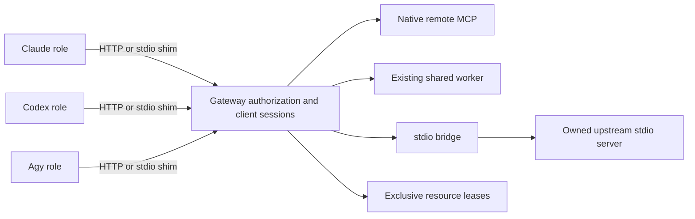

# Shared MCP architecture v3

Normative P24 design; P27 owns implementation. Public definitions and ports live in
`packages/contracts/src/{setup,mcp}.ts`. No Gateway/service module is implemented in P24.

## Implementation status (cập nhật 2026-10-17)

P27 đã có source: `packages/mcp-gateway` (loopback Streamable HTTP, Host/Origin + bearer token,
stdio bridge, đăng ký/revoke client, sharing policy, lease + fencing đơn điệu, quarantine khi
unknown call, chặn elicitation/sampling/OAuth tương tác, `/health`, `/metrics`) và
`packages/mcp-services` (OS service manager user-level, resource pool/quota, dedicated Chrome
profile runtime, loopback-only debugging). P26 `tool-installer` cung cấp capability inventory và
`verifyMcpStartup`; P29 CLI có `bflow mcp status` và bước validate MCP của `up`/`doctor`.
**P30 (source + local test):** daemon Gateway mở control endpoint có xác thực (`gateway-control.json`);
Runtime đăng ký/revoke client theo role/session qua `GatewayControlClient`. **Chưa làm:** chưa gắn
resource lease vào Runtime dispatch; P31 chưa có kiểm thử live (Chrome thật, OS service thật, crash của upstream
trên nhiều repo đồng thời). Test hiện có là deterministic/local; same-user compromise,
multi-host lease và cách ly tài nguyên không giới hạn vẫn NOT VERIFIED. Câu "No Gateway/service
module is implemented in P24" dưới đây mô tả baseline P24, không phải trạng thái hiện tại.

## Separate tools, services and agent communication

Herdr remains the only inter-role transport. RoleMessage, correlated receipts, progress,
clarification, delegation, verification and approvals follow existing Runtime → Herdr
paths. Shared MCP Gateway manages tool connections and authorization. Its API cannot
send to an arbitrary role/pane, start a task or replace the Runtime scheduler.
Existing native host tools remain Runtime endpoints: a role calling one requests Runtime
policy enforcement, and any resulting inter-role message still goes through Herdr.
The Gateway must never turn a tool call into an alternative direct agent mailbox.

| Tool category | Contract representation | Connection/lifecycle |
| --- | --- | --- |
| CLI-only tool (git/node/compiler) | `ToolCapability.kind = cli_only` | ToolInstaller/inventory + existing constrained runner; no MCP service, port or fictitious tools/list |
| Existing shared worker | `existing_shared_worker`, workerId, endpoint, external ownership | Adopt/health-check approved endpoint; worker must speak MCP or use an explicitly implemented adapter. Never spawn a duplicate just because Bflow starts |
| Native remote MCP server | `native_remote_mcp`, HTTPS endpoint, external ownership | Negotiate protocol/auth directly; share authorized connection pool without copying tokens to roles |
| stdio MCP | `stdio_mcp`, pinned executable/argv/secret bindings, Bflow ownership, bridgeRequired | Gateway owns one eligible upstream process per service/config/security partition; bridge exposes scoped multi-client sessions |
| Exclusive tool resource (Chrome) | Any MCP kind + `tool.resource.sharing = exclusive`, stable resourceKey | Sharing connection does not permit concurrent browser actions; Gateway resource lease/fence serializes access |

Resource sharing is orthogonal to transport. A server may accept many clients while
all operations mutating one browser remain exclusive. A CLI-only tool is rejected by
`MCPServiceDefinitionSchema`; P27 must not pretend a command becomes MCP by naming it
as a service. Existing worker acquisition checks actual protocol, not merely PID/port.

## Public contracts

| Contract | Fields / port semantics |
| --- | --- |
| `ToolCapability` | Versioned tool inventory: kind/version/operations, required flag, concurrent capacity or exclusive resource key |
| `ToolInstaller` | `plan(ToolInstallRequest) → SetupStep`, `apply(SetupApplyRequest) → SetupReceipt`, `reconcile(SetupApplyRequest) → SetupReceipt`; only pinned owned install steps, not arbitrary shell |
| `MCPServiceDefinition` | Versioned service ID/revision/scope, tool, connection union, auth references, health/idle timeouts and bounded restart limit |
| `MCPServiceManager` | `ensure(service, ScopedOperation)`, `inspect(serviceId, ScopedOperation)`, `release(serviceId, ScopedOperation)` return `OperationResult<MCPServiceObservation>` |
| `MCPClientRegistration` | Versioned environment/provider/role/session, allowed service/tool sets, client transport config, secret token reference, digest/expiry/idempotency |
| `SharedMCPGateway` | `register`, `revoke`, `acquireResource`, `renewResource`, `releaseResource`, `call`, `reconcileCall`, all using typed requests and OperationResult |
| `MCPResourceLease` | Dedicated resource lease ID, client/service/resource identity, monotonic fence and acquisition/expiry; separate from Registry task leases |
| `MCPToolCall` / `MCPToolCallResult` | Bounded command correlation, client/service/tool/input, optional resource proof, idempotency; outcome completed/failed/unknown |

Schemas are strict and version 3 at the document boundary. Dynamic tool input/output
uses JsonValue at this boundary; Gateway must also validate against negotiated MCP tool
input/output schemas. MCP protocolVersion is separately negotiated and never inferred
from Bflow schemaVersion. `MCPServiceObservation.ready` requires protocol and discovered
tools; service reachability alone is insufficient for agent readiness.

The upstream/client protocol follows MCP's stdio and Streamable HTTP transport model.
stdio is a subprocess channel; Streamable HTTP supports an independent server with
multiple client connections. Bridge design must implement real protocol sessions and
request mapping, not broadcast byte streams to all clients.
[MCP transport specification](https://modelcontextprotocol.io/specification/2025-11-25/basic/transports).

## Connection topology and authorization

One machine service manager can serve concurrent repositories, but connections and
processes are partitioned by canonical service definition digest, credentials/audience,
machine principal, repo trust, runtime isolation and upstream statefulness. Never reuse
a process that can expose another repo's cwd, files, browser profile, secret or conversation
state. Default partition is per repo/security boundary; machine-wide sharing requires
explicit operator capability approval and a stateless or genuinely partitioned upstream.

Each role gets a separate client registration and short-lived token. Gateway resolves
the principal from host-issued authentication, not `role`, registrationId or tool input
claimed by the model. Bind token to machine/repository/session/environment/role and
allowed service/tool set; require unexpired registration for every tools/list and call.
Apply intersection of machine policy, repo selection, role capability, permission profile
and task grant. Hide unauthorized tools and reject guessed names even if provider-side
filters fail. Do not share upstream auth token, admin API, signing key or another role's
registration with the model. Secret references never contain bearer token values.

Client HTTP endpoint is loopback by default, private realm, authenticated and Origin/
Host validated. Non-loopback requires TLS and reviewed remote deployment policy. stdio
clients use a small pinned shim connecting to the same gateway; the shim never starts
one expensive upstream worker per role. URL userinfo/query/fragment credentials are
rejected; DNS/redirect/SSRF/egress checks are enforced by the manager, not URL schema alone.
Remote OAuth credentials are audience-bound, rotated by operator flow and never forwarded
to a different origin. No arbitrary remote endpoint is accepted from repository/model text.

Repository/service configuration only refers to preapproved service IDs and capabilities.
Adding a new executable/URL/credential binding is a setup plan change, not `up` discovery
that silently trusts new code. Provider adapter renders only launch-local MCP config;
global Claude/Codex/Agy settings remain unchanged unless an explicit setup step owns it.

## Lifecycle, adoption and crash recovery

1. Setup validates the desired catalog; install only via explicit P26 plan/apply. `up`
   resolves requirements and acquires a reference for its exact scope/environment.
2. `ensure` single-flights under machine lock using service revision/config digest and
   recorded ownership. Existing worker is probed/adopted; owned stdio process starts
   only after durable intent. Negotiate initialize, protocol, tools and credentials.
3. Register a separate provider/role client. Missing/denied required tool or unknown
   upstream state blocks readiness; no fake success service.
4. On restart, reconstruct owned process/client/call ledger and verify process identity,
   executable digest and start generation. PID reuse is not ownership. Never kill an
   external worker or a process whose ownership cannot be proven.
5. Revoke expired/down session clients, release exact reference/resource grants. Stop
   Bflow-owned service only after reference count zero + idle policy + no uncertain call.
   External workers and native remote servers always survive repo shutdown.

Persist idempotency keys and request fingerprints. Conflicting same-key payload is
conflict. Before-write timeout is safely not_started; timeout after possible mutating
tool effect is `unknown`, retained across restart. `reconcileCall` can prove completion,
non-delivery/failure or remain unknown; no automatic replay of an uncertain mutating call.
Underlying MCP/HTTP request IDs are correlation, not an exactly-once side-effect guarantee.
Read-only observation retry is separately allowed with bounded budgets. Distinguish
failed tool response (`isError`) from successful output and from transport uncertainty.

Session/server restart limit is bounded by `restartLimit`; backoff/output/memory/call
timeouts are host-enforced. Cancellation attempts do not prove that upstream mutations
stopped. Reconcile or quarantine affected resources before reassignment. Do not restart
a browser mid-call and tell the next client its old action definitely failed.

## Remote upstream example: hosted Context7

A `native_remote_mcp` service has no Bflow-owned process: every agent shares one upstream, and the Gateway is the only
HTTP client of it. Implemented in `packages/mcp-gateway/src/http-upstream.ts`; configured by `bflow setup`
(`createContext7RemoteService`) for `https://mcp.context7.com/mcp`.

- **Protocol.** `Accept` lists `application/json` and `text/event-stream` (the hosted server answers HTTP 406 otherwise and
  replies in SSE even for a single message). The negotiated `MCP-Protocol-Version` is echoed, `notifications/initialized`
  is sent, and an `Mcp-Session-Id` issued by the server is kept and replayed. A server that issues none (Context7 does
  not) is stateless. A dropped session (HTTP 404) is re-established once and the request replayed, because the server
  rejected it before processing. Concurrent callers share one handshake.
- **Sharing.** One upstream session serves all agents; this is valid only because the service is stateless and its tools
  read documentation. Per-agent authorization stays in the Gateway: a registration needs the service id *and* the tool
  names, and the Conversation role is never registered. A stateful upstream with per-client state would need per-client
  sessions and must not reuse this policy.
- **Retry.** Exponential backoff with jitter (base 250 ms, cap 4 s, 3 attempts), honouring `Retry-After` up to 10 s;
  longer waits are reported as `rate_limited` with `retryAfterMs` instead of being slept through. Only the handshake,
  discovery and tools the **host's** policy lists read-only are replayed. A server's own `readOnlyHint` is advice from the
  party being called and is never trusted for this. Everything else runs once; an ambiguous failure is reported as
  `unknown`, never replayed. The host declares Context7's two tools read-only by exact endpoint (`trustedGatewayPolicy`).
  Without that declaration the Gateway treats every tool as a possible write and discards the failure cause.
- **Errors** are structured in `ContractError.details` (`kind`: `auth_missing`, `auth_rejected`, `rate_limited`, `network`,
  `timeout`, `protocol`, `upstream_http`, `session_lost`, `cancelled`; plus `status`, `retryAfterMs`, `attempts`). A tool-level
  failure (`isError`, HTTP 200) is returned as tool output; the documentation layer classifies it from the text
  (`library_not_found`, `version_not_found`, `auth_invalid`, `invalid_arguments`).
- **Metrics** (`perService[id].upstreamHttp`): `request`, `retry`, `rate_limited`, `auth_failure`, `network_error`, `timeout`,
  `protocol_error`, `upstream_error`, `session_started`, `session_reinitialized`. No payload or credential is recorded.
- **Credentials.** `authentication.mode: "bearer"` names a `secret://` reference the Gateway resolves from memory. A configured
  credential that is unavailable fails the request before it is sent (`auth_missing`); it is never silently dropped.
- **Health.** `ready` means the Gateway completed initialize and `tools/list`. `bflow docs status` / `doctor` additionally
  make a real `resolve-library-id` and `query-docs` call under a real registration, because an invalid key still yields HTTP 200.

## Exclusive resource example: Chrome

Use a stable resourceKey identifying the actual Chrome instance/profile, not a random
task ID. A client acquires a TTL lease, receives a monotonic fencing token, then supplies
the exact lease with each call. Gateway rechecks current registration, owner, service,
resource, fence and expiry immediately before the upstream effect. Renew uses the exact
current lease; stale release/renew cannot affect a newer owner. Agent Registry task lease
is still independently required for Runtime dispatch.

One browser transaction may require several calls. Keep the lease across that transaction;
do not interleave navigation/click/screenshot of unrelated roles. Bounded queue wait,
explicit busy diagnostics and per-role session limits prevent monopolization. On timeout,
crash or lease expiry, fence stale holders and reconcile in-flight upstream effects before
issuing a new holder; TTL expiry alone cannot stop a late Chrome command. If upstream
cannot enforce fence, Gateway serializes the effect and quarantines uncertainty. Isolated
browser profiles/contexts may run concurrently only after demonstrating real resource
separation, no shared cookies/tabs/debugging port or cross-project visibility.

## User decisions and evidence

Intercept MCP elicitation, OAuth interactive requests, browser permission dialogs and
operator approval needs. A specialist cannot forward them directly to the user's
terminal. Return blocked diagnostic to Runtime, preserve correlation, route the question
to Conversation via Herdr and resume only with authenticated, unexpired authority.
The Gateway itself does not approve, modify a spec or write a human ApprovalDecision.

Gateway audit records client identity, service/config digest, call/lease/fence IDs,
timestamps and scrubbed outcome. Large reports/screenshots enter ArtifactStore through
ArtifactProposal ingestion; only ArtifactStore returns trusted references. Neither tool
output nor service health promotes a task to succeeded. Runtime/Verification/Quality
Gates still independently assess evidence on the exact revision.

P27/P31 tests must cover external-worker survival, no duplicate stdio upstream, client
revocation, cross-repo leakage, denied guessed tools, stale/expired fences, Chrome late
effects, stdio framing/backpressure, request-ID remapping, credential rotation and
unknown-call restart recovery. Same-user compromise, multi-host distributed leases and
unbounded resource isolation remain unverified until backed by separate evidence.
