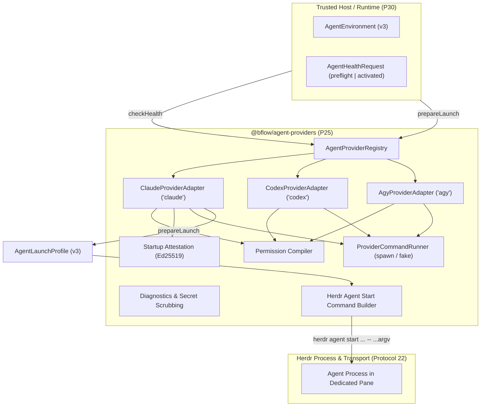

# @bflow/agent-providers

`@bflow/agent-providers` implements the **Provider Adapters** package (Phase P25 of Bflow Platform v3).
It manages external agent CLI discovery, capability detection, preflight and activated readiness observations, permission profile flag compilation, deterministic launch preparation, startup attestation signing/verification, and Herdr launch command generation across Claude Code, Codex CLI, and Antigravity CLI.

## Architectural Boundaries

In accordance with [docs/provider-contracts.md](../../docs/provider-contracts.md) and [AGENTS.md](../../AGENTS.md):
- **Contracts-Only Leaf Dependency**: Depends exclusively on `@bflow/contracts` and `zod`. Never imports `@bflow/pane-manager`, `@bflow/runtime`, `@bflow/core`, or `apps/cli`.
- **Launch Data Only**: Produces validated launch profiles and start command arguments only. Process execution and terminal pane lifecycle are strictly owned by Herdr and Pane Manager.
- **Strict Version 3 Schema Validation**: All public inputs and outputs are validated with `@bflow/contracts` Zod schemas (`AgentHealthRequestSchema`, `AgentHealthResultSchema`, `AgentEnvironmentSchema`, `AgentLaunchProfileSchema`, `AgentLaunchAttestationSchema`).
- **Secret Isolation**: Secrets are bound via opaque `secret://` references in `secretBindings` and resolved by the trusted host at launch. Raw secret tokens are forbidden in `argv`, `environmentVariables`, config files, or diagnostic reports.

---

## Architecture Overview



---

## Supported Providers

| Provider | Executable | Installed / Target Version | Capabilities | MCP Transports | Unattended Support | Native Attestation |
| --- | --- | --- | --- | --- | --- | --- |
| **Claude Code** (`claude`) | `claude` | 2.1.301 | Implementation, Review, Conversation | stdio, streamable_http | Yes (with OS sandbox / bwrap) | Yes |
| **Codex CLI** (`codex`) | `codex` | 0.162.0 | Implementation, Review, Testing | stdio, streamable_http | Yes (with OS sandbox / bwrap) | Yes |
| **Antigravity CLI** (`agy`) | `agy` | 1.4.0 | Implementation, Review | stdio, streamable_http | No (Uncertified) | No (Uncertified) |

---

## Health Checks Matrix (`checkHealth`)

`checkHealth` performs non-destructive observation without auto-login or modifying environment state.
Every check returns `status: "passed" | "failed" | "unknown"`. Overall status is:
- `"ready"`: Every check for the stage is `"passed"`.
- `"unsupported"`: Provider capability is unsupported (e.g. Agy unattended execution, missing OS sandbox).
- `"blocked"`: Operational failure (e.g. missing binary, expired authentication, insecure permissions).

| Check | Stage | Description |
| --- | --- | --- |
| `binary` | preflight, activated | Validates executable presence, regular file, execute permissions, and digest matching `pinnedExecutableDigest`. |
| `version` | preflight, activated | Inspects CLI version and verifies it satisfies minimum required semver (e.g. Claude >= 2.0.0, Codex >= 0.150.0). |
| `authentication` | preflight, activated | Runs provider auth status (`claude auth status --json`, `codex login status`, `agy models`) and minimal execution probe (`--print`, `exec`). Distinguishes expired vs missing credentials. |
| `environment` | preflight, activated | Validates canonical directory paths for `cwd` and `stateDirectory` (no symlinks), private `0o700` permissions, and absence of dangerous env variables (`LD_PRELOAD`) or secret tokens. |
| `mcp` | preflight, activated | Verifies client transport compatibility and registration of all `requiredMcpServiceIds`. |
| `launch_arguments` | preflight, activated | Validates that launch CLI flags match supported provider capabilities. |
| `permissions` | preflight, activated | Validates permission profile constraints (`restricted`, `workspace_auto`, `unattended_isolated`). |
| `skills` | preflight, activated | Verifies resolved skill manifest matches `environment.skillManifestDigest` and allowed role/provider bindings. |
| `native_binding` | **activated only** | Verifies Ed25519 signature on `AgentLaunchAttestation`, matching executable/config digests on disk, and live pane interactive readiness. |

---

## Permission Modes

1. **`restricted`**:
   - Read-only filesystem (`filesystem: "read_only"`, `writableRoots: []`).
   - Claude: `--restricted`, `--tools "Read,Glob,Grep"`, `--permission-mode dontAsk`.
   - Codex: `--sandbox read-only`, `--ask-for-approval never`.
   - Agy: `--sandbox`, `--mode plan`.

2. **`workspace_auto`**:
   - Scoped workspace writes (`filesystem: "workspace_write"`), no global bypass.
   - Claude: `--restricted`, `--tools "Read,Glob,Grep,Edit,Write"`, `--permission-mode dontAsk`.
   - Codex: `--sandbox workspace-write`, `--ask-for-approval never`.
   - Agy: `--sandbox`, `--mode accept-edits`.

3. **`unattended_isolated`**:
   - Requires session scope and OS process sandbox (`/usr/bin/bwrap`) or container isolation.
   - Prohibits machine-wide bypass flags (`--dangerously-skip-permissions`, `--dangerously-bypass-approvals-and-sandbox`, `danger-full-access`).
   - Claude & Codex: Enforces OS sandbox verification.
   - Agy: Reports `unsupported` (`agy_unattended_unsupported`) until officially certified.

---

## Launch Attestation (`AgentLaunchAttestation`)

Startup proof uses an Ed25519 signature over canonical JSON prefixed by domain separator:
```
bflow.agent-launch-attestation.v3\n{...canonical JSON of unsigned attestation body...}
```
The signature is verified against configured trusted host public keys (`trustedIssuerKeys`).

---

## Herdr Launch Integration

Launch execution commands are built with `buildHerdrAgentStartCommand`:
```bash
herdr agent start <agentName> --kind <provider> --pane <paneId> [--timeout <ms>] -- <argv...>
```
Arguments after `--` are strictly validated to prevent multiline shell breaks, NUL bytes, or secret tokens.
Provider environment variables (`PATH`, `HOME`, `XDG_*`, `BHOME`, `BFLOW_*`) isolate configuration per session.
