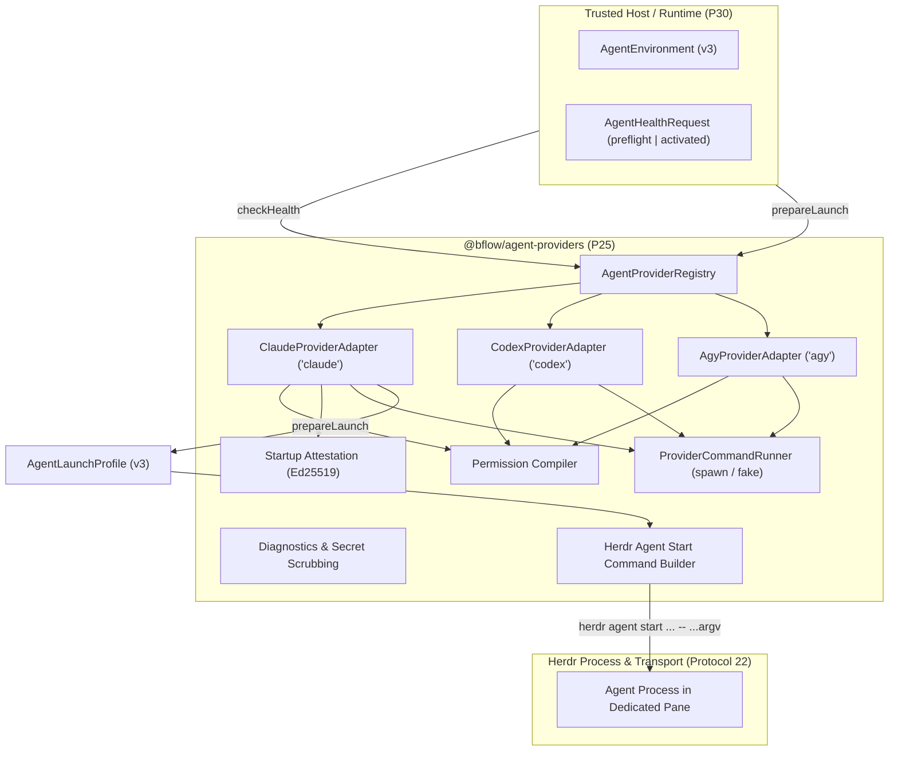

# @bflow/agent-providers

`@bflow/agent-providers` implements the **Provider Adapters** package (Phase P25 of Bflow Platform v3).
It manages external agent CLI discovery, capability detection, preflight and activated readiness observations, permission profile flag compilation, deterministic launch preparation, startup attestation signing/verification, and Herdr launch command generation across Claude Code, Codex CLI, and Antigravity CLI.

## Architectural Boundaries

In accordance with [docs/provider-contracts.md](../../docs/provider-contracts.md) and [AGENTS.md](../../AGENTS.md):
- **Contracts-Only Leaf Dependency**: Depends exclusively on `@bflow/contracts` and `zod`. Never imports `@bflow/pane-manager`, `@bflow/runtime`, `@bflow/core`, or `apps/cli`.
- **Launch Data Only**: Produces validated launch profiles and start command arguments only. Process execution and terminal pane lifecycle are strictly owned by Herdr and Pane Manager.
- **Strict Version 3 Schema Validation**: All public inputs and outputs are validated with `@bflow/contracts` Zod schemas (`AgentHealthRequestSchema`, `AgentHealthResultSchema`, `AgentEnvironmentSchema`, `AgentLaunchProfileSchema`, `AgentLaunchAttestationSchema`).
- **Secret Isolation**: Secrets are bound via opaque `secret://` references in `secretBindings` and resolved by the trusted host at launch. Raw secret tokens are forbidden in `argv`, `environmentVariables`, config files, or diagnostic reports.

---

## Architecture Overview



---

## Supported Providers

| Provider | Executable | Installed / Target Version | Capabilities | MCP Transports | Unattended Support | Native Attestation |
| --- | --- | --- | --- | --- | --- | --- |
| **Claude Code** (`claude`) | `claude` | 2.1.301 | Implementation, Review, Conversation | stdio, streamable_http | Yes (with OS sandbox / bwrap) | Yes |
| **Codex CLI** (`codex`) | `codex` | 0.162.0 | Implementation, Review, Testing | stdio, streamable_http | Yes (with OS sandbox / bwrap) | Yes |
| **Antigravity CLI** (`agy`) | `agy` | 1.4.0 | Implementation, Review | stdio, streamable_http | No (Uncertified) | No (Uncertified) |

---

## Health Checks Matrix (`checkHealth`)

`checkHealth` performs non-destructive observation without auto-login or modifying environment state.
Every check returns `status: "passed" | "failed" | "unknown"`. Overall status is:
- `"ready"`: Every check for the stage is `"passed"`.
- `"unsupported"`: Provider capability is unsupported (e.g. Agy unattended execution, missing OS sandbox).
- `"blocked"`: Operational failure (e.g. missing binary, expired authentication, insecure permissions).

| Check | Stage | Description |
| --- | --- | --- |
| `binary` | preflight, activated | Validates executable presence, regular file, execute permissions, and digest matching `pinnedExecutableDigest`. |
| `version` | preflight, activated | Inspects CLI version and verifies it satisfies minimum required semver (e.g. Claude >= 2.0.0, Codex >= 0.150.0). |
| `authentication` | preflight, activated | Runs provider auth status (`claude auth status --json`, `codex login status`, `agy models`) and minimal execution probe (`--print`, `exec`). Distinguishes expired vs missing credentials. |
| `environment` | preflight, activated | Validates canonical directory paths for `cwd` and `stateDirectory` (no symlinks), private `0o700` permissions, and absence of dangerous env variables (`LD_PRELOAD`) or secret tokens. |
| `mcp` | preflight, activated | Verifies client transport compatibility and registration of all `requiredMcpServiceIds`. |
| `launch_arguments` | preflight, activated | Validates that launch CLI flags match supported provider capabilities. |
| `permissions` | preflight, activated | Validates permission profile constraints (`restricted`, `workspace_auto`, `unattended_isolated`). |
| `skills` | preflight, activated | Verifies resolved skill manifest matches `environment.skillManifestDigest` and allowed role/provider bindings. |
| `native_binding` | **activated only** | Verifies Ed25519 signature on `AgentLaunchAttestation`, matching executable/config digests on disk, and live pane interactive readiness. |

---

## Permission Modes

1. **`restricted`**:
   - Read-only filesystem (`filesystem: "read_only"`, `writableRoots: []`).
   - Claude: `--restricted`, `--tools "Read,Glob,Grep"`, `--permission-mode dontAsk`.
   - Codex: `--sandbox read-only`, `--ask-for-approval never`.
   - Agy: `--sandbox`, `--mode plan`.

2. **`workspace_auto`**:
   - Scoped workspace writes (`filesystem: "workspace_write"`), no global bypass.
   - Claude: `--restricted`, `--tools "Read,Glob,Grep,Edit,Write"`, `--permission-mode dontAsk`.
   - Codex: `--sandbox workspace-write`, `--ask-for-approval never`.
   - Agy: `--sandbox`, `--mode accept-edits`.

3. **`unattended_isolated`**:
   - Requires session scope and OS process sandbox (`/usr/bin/bwrap`) or container isolation.
   - Prohibits machine-wide bypass flags (`--dangerously-skip-permissions`, `--dangerously-bypass-approvals-and-sandbox`, `danger-full-access`).
   - Claude & Codex: Enforces OS sandbox verification.
   - Agy: Reports `unsupported` (`agy_unattended_unsupported`) until officially certified.

---

## Launch Attestation (`AgentLaunchAttestation`)

Startup proof uses an Ed25519 signature over canonical JSON prefixed by domain separator:
```
bflow.agent-launch-attestation.v3\n{...canonical JSON of unsigned attestation body...}
```
The signature is verified against configured trusted host public keys (`trustedIssuerKeys`).

---

## Host MCP, Gateway and Native Hook Material

`prepareLaunch` writes one MCP config file and one settings file per role. Their content comes from
`resolveLaunchMaterial` (`src/launch-material.ts`), which `checkHealth` also evaluates, so preflight and launch
cannot disagree. All written files are covered by `configFiles` digests.

| Option | Meaning |
| --- | --- |
| `hostMcpServers` | Trusted Bflow host stdio servers. Names match `^[a-z][a-z0-9_-]{0,63}$`; `command` must be absolute. |
| `mcpRegistrations` | `stdio` entries keep `command`/`args`. `streamable_http` entries need `mcpTokenEnvironmentNames[registrationId]`. |
| `mcpTokenEnvironmentNames` | registrationId → environment variable **name** (`^[A-Z_][A-Z0-9_]*$`) that holds the bearer token. Token values are never accepted or written. |
| `hostHooks` | Full shell command for `SessionStart`, `UserPromptSubmit`, `Stop`, `PreToolUse`. Supersedes `nativeSessionHookCommand` for `SessionStart`. |
| `nativeSessionHookCommand` | Legacy single `SessionStart` hook (timeout 10 s), unchanged when used alone. |

Rendered shapes (`<role>.mcp-config.json`):

- Claude: `{"mcpServers":{"bflow":{"command":"<abs>","args":[...]},"gateway-dev":{"type":"http","url":"<endpoint>","headers":{"Authorization":"Bearer ${BFLOW_GATEWAY_TOKEN}"}}}}`. Claude expands `${VAR}` at launch.
- Codex: the same file is converted into `-c mcp_servers={"bflow"={"command"=...,"args"=[...]},"gateway-dev"={"url"="<endpoint>","bearer_token_env_var"="BFLOW_GATEWAY_TOKEN"}}`.
- Hooks (Claude settings and Codex `-c hooks=`): `{"<Event>":[{"hooks":[{"type":"command","command":"<cmd>","timeout":30}]}]}`.

Fail-closed rules:

- A `streamable_http` registration without a valid token environment mapping → `validation`.
- A registration or host server named the same as another → `validation`.
- Hooks requested for a provider without native hooks (Agy) → `validation` from `prepareLaunch`; `unsupported` from `checkHealth`.
- Agy has no verified header/env-reference form, so `streamable_http` registrations fail. Host MCP servers fail unless the CLI advertises `--mcp-config`.

The launched process must receive each token in the environment variable named in the config. The adapter does not inject it: `buildProviderEnvironment` builds only the fixed Bflow variables plus `environmentVariables`, and `BFLOW_*` keys are rejected there. The Runtime integrator supplies the token value through the pane environment.

---

## Codex Inherited Global MCP Servers and Hooks (L3)

Codex loads user `config.toml` and `hooks.json` in every invocation. Bflow keeps its existing L3 MCP isolation: it enumerates configured global MCP servers and disables those servers only after its own MCP table, in both launch arguments and the read-only readiness probe. Unenumerable, colliding or unsafe MCP names remain blocked.

Global hooks use a separate explicit operator review flow. The package exports:

- `inspectCodexHooks(options?)` and the strict `CodexHookReviewSchema` for a read-only inventory.
- `approveCodexHooks(review, { expectedDigest, approvedBy, ...options })` and `CodexHookApprovalSchema` for exact-digest approval after re-reading the inventory immediately before writing.
- `defaultCodexHookApprovalPath(environment?, homeDirectory?)` and `CODEX_HOOK_APPROVAL_FILE` (`codex-hook-approvals.json`).

The default receipt lives under `${XDG_STATE_HOME:-$HOME/.local/state}/bflow/`, outside Codex home and repository config. Runtime may provide an explicit private machine-state path. The 0600 atomic receipt can hold approvals for multiple canonical Codex homes; each approval is bound to its home and complete reviewed digest. Inspection and check/plan are read-only. Approval does not grant Bflow permissions, widen the sandbox, or approve a different future snapshot.

The inventory hashes raw `hooks.json` bytes and captures event, matcher, command, directly referenced local files and digests. Codex TOML parsing includes executable `[hooks]` events and explicit plugin enablement; validated `hooks.state` trust metadata (including plugin-scoped identifiers) and unrelated credentials/MCP data are excluded from the digest. Native Codex trust metadata never supplies Bflow approval. Commands support absolute Bun/Node/Python binaries with an absolute script and literal arguments, and pinned `/bin/sh` or Bash plus absolute script and literal arguments. Direct absolute executables accept at most 16 literal words including the executable; shebang scripts additionally pin their absolute interpreter. `env` shebangs, interpreter flags, shell expansion/control operators, relative executable paths, malformed/special/symlinked or oversized files, and unpinned shell source dependencies fail closed.

Explicitly enabled plugins are inspected from a single unambiguous local cache version. Their supported native or compatibility manifest, declared hook files (or absent default `hooks/hooks.json`), commands and directly resolved code enter the same snapshot. Multiple cached versions, unavailable installations, escaping/symlinked hook paths and dynamic plugin commands remain unsupported. Plugin discovery through other config layers or implicit remote installation is not covered by this local inventory. Plugin enablement or hook-source changes invalidate previous approval; older receipts remain readable but do not approve the new inventory digest.

The six complete POSIX Claude-Mem bootstrap commands reviewed from its 14.0.1 Codex hook source are a bounded exception to the general shell-expansion rejection. Recognition compares complete command hashes, never just a plugin name or version label. Inspection does not execute their shell: it pins the local plugin scripts, explicit selector roots, every bounded numeric cache fallback and marketplace fallback (including absent script facts), plus the resolved shell/utilities, Node and Bun. Compiled workers have an 8 MiB limit; Node/Bun binaries have a 256 MiB streaming-hash limit. Adding a candidate installation or changing a script, selector, PATH or selected runtime invalidates approval. Empty/relative/whitespace-containing PATH entries, relative selectors, symlinked/unsafe dependencies, unbounded caches, unsupported cygpath conversion and altered command forms remain blocked. This does not approve arbitrary shell commands or disable Claude-Mem; the resulting inventory still requires the normal exact-digest operator approval. Script packages and worker runtime data remain subject to the transitive-dependency limitations below.

`createManagedCodexHookEnvironment` supplies the shared setup/host inspection environment. It preserves the chosen HOME and PATH and the Claude-Mem root/Bun selectors (`CLAUDE_CONFIG_DIR`, `CLAUDE_PLUGIN_ROOT`, `PLUGIN_ROOT`, `BUN`, `BUN_PATH`, `BUN_INSTALL`), explicitly binding absent selectors to empty values in child processes. It explicitly empties the outer Orca pane/root/endpoint/port selectors in Bflow child processes. It does not change the parent environment or user configuration and does not remove Bflow's native Herdr/Runtime hooks. Direct inspection with an explicitly supplied Orca endpoint still fails closed.

Binary health and launch preparation resolve against the same PATH used by provider child commands. Health preserves `binary_missing`, `binary_not_executable`, `binary_untrusted` and inaccessible/other verification failures separately. A failed ownership or mode check is not reported as a missing installation.
PATH lookup skips directories, dangling entries and files without execute access, so a plugin's `codex/` directory cannot shadow the actual CLI. It preserves physical symlink/parent traversal and treats an empty PATH component as the current directory, matching process spawning. The first executable candidate still must pass ownership and permission verification; an unsafe executable is not silently replaced by a later candidate. Explicit executable paths remain strict. Authentication and execution probes use the verified canonical executable, including when the execution probe changes its working directory.

Reviewed Claude-Mem hooks require an explicit absolute HOME and reject dot/parent components in HOME or root/runtime selectors before constructing dependency paths. Interpreter PATH lookup preserves physical symlink traversal. Bun fallback lookup follows symlinks and skips dangling overrides, matching the reviewed runner's existence checks; it still rejects unsafe selected executables.

Shell dependency checks follow the explicit interpreter or direct script's shebang, independently of filename suffix. Absolute Bash/Sh installations outside system bin directories still pin the script argument. Direct scripts require execute permission; a script read by an explicit interpreter may remain non-executable. Unsupported-command reasons omit raw argument text, and provider health redacts opaque credential flags, environment assignments and JSON credential fields before truncation, including incomplete quoted output.

The known Orca inline wrapper is matched as a complete fixed command template. Its `${ORCA_AGENT_HOOK_ROOT}/agent-hooks/codex-hook.sh` candidate and `$HOME/.orca/agent-hooks/codex-hook.sh` fallback are recorded with file hashes or absent-file facts. A changed root, appearing fallback or changed script changes the digest. The known script's source endpoint is accepted only while `ORCA_AGENT_HOOK_ENDPOINT` is absent; when set, the hook remains unsupported and the endpoint file/token is not read. Herdr shell integration scripts are pinned by digest.

Unapproved or unsupported hooks block before Codex login/auth/model execution probes and before launch files are written; read-only version/help/config inventory may still run. The approval digest is stored in private, non-provider-executed launch settings whose file digest contributes to the launch fingerprint. Activated health re-inspects the current inventory and rejects drift from the prepared profile even if a new snapshot was approved after launch preparation. Bflow's existing per-invocation `--dangerously-bypass-hook-trust` is retained for native hook startup and is reached only after the global snapshot passes this gate; it does not approve global hook sources or change provider permissions.

This review binds hook configuration and directly referenced code. It pins directly resolved interpreters, but does not recursively pin the operating system, system utilities, packages, arbitrary runtime data or other transitive dependencies. Approved hooks are not isolated from a hostile process or from their host account's available resources and permissions. This is operator trust for exact hook sources, not a hostile-code sandbox. No real installed hook is executed or approved by the provider tests.

## Herdr Launch Integration

Launch execution commands are built with `buildHerdrAgentStartCommand`:
```bash
herdr agent start <agentName> --kind <provider> --pane <paneId> [--timeout <ms>] -- <argv...>
```
Arguments after `--` are strictly validated to prevent multiline shell breaks, NUL bytes, or secret tokens.
Provider environment variables (`PATH`, `HOME`, `XDG_*`, `BHOME`, `BFLOW_*`) isolate configuration per session.
