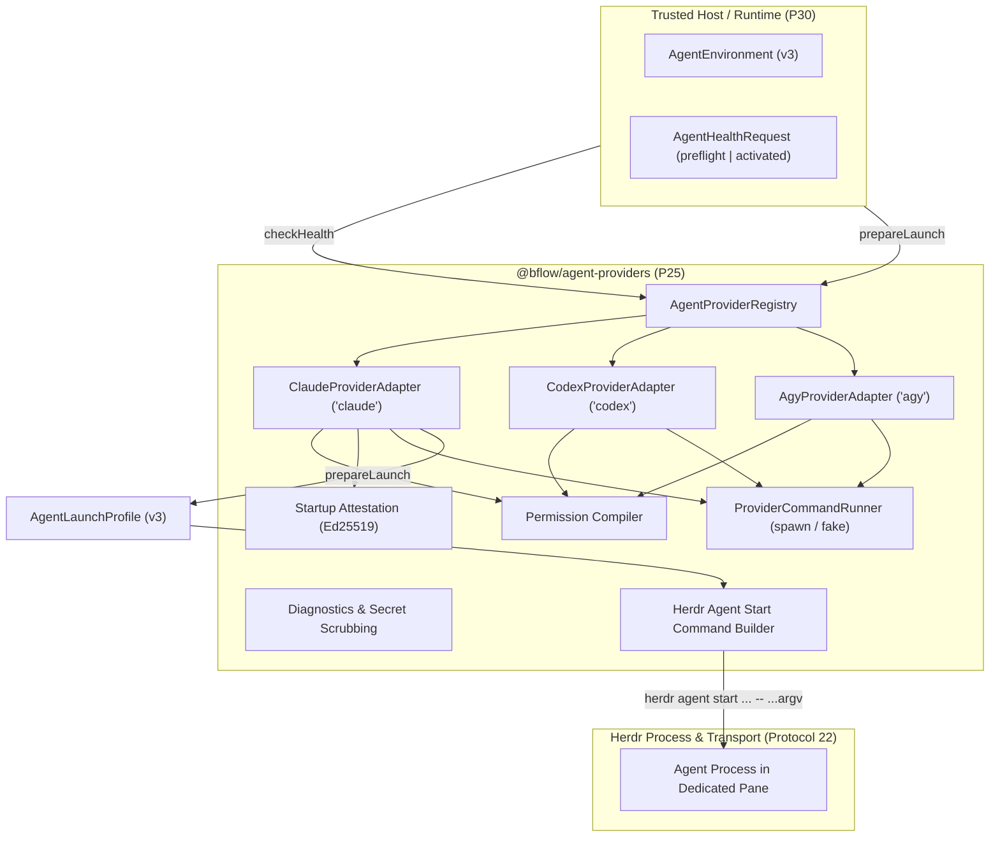

# @bflow/agent-providers

`@bflow/agent-providers` triển khai package **Provider Adapters** (Phase P25 của Bflow Platform v3).
Package này quản lý việc discovery CLI của agent bên ngoài, phát hiện capability, quan sát readiness ở giai đoạn preflight và activated, biên dịch cờ permission profile, chuẩn bị launch một cách xác định, ký/xác minh startup attestation, và sinh lệnh launch Herdr cho Claude Code, Codex CLI và Antigravity CLI.

## Ranh giới kiến trúc

Các subprocess readiness và launch Claude do Bflow quản lý nhận `DISABLE_AUTOUPDATER=1`
trong môi trường riêng của phiên. Updater nền không được đổi executable giữa prepare và
activation; kiểm tra digest vẫn từ chối binary bị đổi thật. Cấu hình global không bị sửa.
Xem [cơ chế cập nhật của Claude](https://code.claude.com/docs/en/setup#disable-auto-updates).

Theo [docs/provider-contracts.md](../../docs/provider-contracts.md) và [AGENTS.md](../../AGENTS.md):
- **Leaf chỉ phụ thuộc Contracts**: Chỉ phụ thuộc `@bflow/contracts` và `zod`. Không bao giờ import `@bflow/pane-manager`, `@bflow/runtime`, `@bflow/core` hay `apps/cli`.
- **Chỉ tạo dữ liệu launch**: Chỉ sinh launch profile đã validate và argument của lệnh start. Việc thực thi process và vòng đời terminal pane thuộc hoàn toàn về Herdr và Pane Manager.
- **Validate schema Version 3 nghiêm ngặt**: Mọi input và output công khai đều được validate bằng Zod schema của `@bflow/contracts` (`AgentHealthRequestSchema`, `AgentHealthResultSchema`, `AgentEnvironmentSchema`, `AgentLaunchProfileSchema`, `AgentLaunchAttestationSchema`).
- **Cô lập secret**: Secret được gắn qua tham chiếu `secret://` mờ trong `secretBindings` và được trusted host resolve lúc launch. Token bí mật dạng thô bị cấm trong `argv`, `environmentVariables`, file cấu hình hay báo cáo chẩn đoán.

---

## Tổng quan kiến trúc



---

## Các Provider được hỗ trợ

| Provider | Executable | Phiên bản cài đặt / mục tiêu | Capabilities | MCP Transports | Hỗ trợ Unattended | Native Attestation |
| --- | --- | --- | --- | --- | --- | --- |
| **Claude Code** (`claude`) | `claude` | 2.1.301 | Implementation, Review, Conversation | stdio, streamable_http | Có (với OS sandbox / bwrap) | Có |
| **Codex CLI** (`codex`) | `codex` | 0.162.0 | Implementation, Review, Testing | stdio, streamable_http | Có (với OS sandbox / bwrap) | Có |
| **Antigravity CLI** (`agy`) | `agy` | 1.4.0 | Implementation, Review | stdio, streamable_http | Không (chưa chứng nhận) | Không (chưa chứng nhận) |

---

## Ma trận Health Check (`checkHealth`)

`checkHealth` thực hiện quan sát không phá hủy, không tự đăng nhập và không sửa trạng thái môi trường.
Mỗi check trả về `status: "passed" | "failed" | "unknown"`. Trạng thái tổng thể là:
- `"ready"`: Mọi check của giai đoạn đều `"passed"`.
- `"unsupported"`: Capability của provider không được hỗ trợ (ví dụ thực thi unattended của Agy, thiếu OS sandbox).
- `"blocked"`: Lỗi vận hành (ví dụ thiếu binary, authentication hết hạn, permission không an toàn).

| Check | Giai đoạn | Mô tả |
| --- | --- | --- |
| `binary` | preflight, activated | Xác minh sự hiện diện của executable, là regular file, quyền execute, và digest khớp `pinnedExecutableDigest`. |
| `version` | preflight, activated | Kiểm tra phiên bản CLI và xác minh thỏa semver tối thiểu yêu cầu (ví dụ Claude >= 2.0.0, Codex >= 0.150.0). |
| `authentication` | preflight, activated | Chạy auth status của provider (`claude auth status --json`, `codex login status`, `agy models`). Với `executionProbe: "disabled"`, không gọi model; linked Codex kiểm tra quyền đọc catalog bằng GET `/models`. Caller cũ mặc định vẫn có probe thực thi tối thiểu (`--print`, `exec`); Runtime startup chọn `disabled`. |
| `environment` | preflight, activated | Xác minh đường dẫn thư mục canonical của `cwd` và `stateDirectory` (không symlink), quyền riêng tư `0o700`, và không có biến môi trường nguy hiểm (`LD_PRELOAD`) hay token bí mật. |
| `mcp` | preflight, activated | Xác minh tương thích transport của client và đăng ký của mọi `requiredMcpServiceIds`. |
| `launch_arguments` | preflight, activated | Xác minh các cờ CLI launch khớp với capability được provider hỗ trợ. |
| `permissions` | preflight, activated | Xác minh các ràng buộc của permission profile (`restricted`, `workspace_auto`, `unattended_isolated`). |
| `skills` | preflight, activated | Xác minh skill manifest đã resolve khớp `environment.skillManifestDigest` và các binding role/provider được phép. |
| `native_binding` | **chỉ activated** | Xác minh chữ ký Ed25519 trên `AgentLaunchAttestation`, digest executable/config khớp trên đĩa, và readiness tương tác của pane đang chạy. |

---

## Tái sử dụng tùy chọn của Codex model execution probe

Một host adapter factory có thể tạo `createProviderExecutionProbeCoalescer({ runner })` một lần cho mỗi
`ProviderCommandRunner` **thô** bên dưới, rồi truyền nó làm `executionProbeCoalescer` cho các adapter của mình.
Giữ runner ràng buộc theo operation thông thường cho mọi lệnh khác. Coalescer sở hữu việc hủy/timeout
độc lập của từng waiter và hủy subprocess có giới hạn của nó khi mọi waiter đã rời đi.
Mặc định nó chỉ lưu các entry đang chạy dở (in-flight). Để chọn tái sử dụng **model execution
probe** thành công đã hoàn tất, truyền `successfulResultTtlMs: 30_000` (hoặc một khoảng không âm ngắn hơn) khi
tạo coalescer. Giá trị trên 30 giây, âm hoặc không hữu hạn bị từ chối.
Tuổi monotonic bắt đầu tính từ lúc subprocess hoàn tất và không bao giờ được kéo dài bởi một lần cache hit.
Các thành công đã hết hạn yêu cầu thực thi lại, kể cả khi chúng hết hạn trong lúc validate snapshot.
Việc lưu giữ bị giới hạn ở 128 quan sát thành công cho mỗi factory; entry hết hạn được dọn khi dùng.
Bỏ qua hoặc đặt TTL bằng 0 giữ nguyên hành vi chỉ gộp các lần chạy chồng nhau.

Chỉ Codex chọn dùng. Việc chia sẻ yêu cầu khớp scope session/repository/machine, binary và digest
canonical, argument ping (gồm model/effort và isolation kế thừa), cwd, môi trường process hiệu lực,
biến môi trường/tham chiếu secret và output account vừa được quan sát mới. Các key là
digest SHA-256. Danh tính file config/auth của Codex và metadata thay đổi mức nanosecond, config/instruction
của project tổ tiên, nguồn/dependency hook đã được duyệt và approval receipt phải không đổi.
Việc kiểm tra TOML có giới hạn quan sát config global và config project tổ tiên, gồm mọi profile. Các dependency
`model_instructions_file` là đường dẫn tuyệt đối literal phải vẫn là regular file an toàn; các
`project_doc_fallback_filenames` là basename đơn giản được quan sát trên các thư mục tổ tiên của cwd, kể cả việc vắng mặt. Đường dẫn tương đối hoặc
mơ hồ, giá trị không được hỗ trợ, selector file/path/directory lạ (gồm các thiết lập instruction-file
cũ và `model_catalog_json`), hoặc vượt giới hạn kiểm tra sẽ tắt việc tái sử dụng
và coalescing và chạy từng probe riêng. Việc kiểm tra config chỉ giữ đường dẫn dependency; snapshotter
không đọc byte credential của `auth.json`. Thiếu `config.toml`/`auth.json` bắt buộc,
symlink, file đặc biệt, input không truy cập được hoặc chính sách hook trust-all sẽ dùng probe riêng lẻ.
Thay đổi trong lúc một probe đủ điều kiện đang chạy sẽ chặn quan sát đó và yêu cầu health check mới.

Mọi role vẫn kiểm tra riêng authentication, capabilities, environment, permission policy, skills,
MCP, hook trust/drift và native launch attestation. Một ping dùng chung bị lỗi không bao giờ
được tái sử dụng làm bằng chứng cho follower; follower không đổi sẽ tự thực thi ping của mình trong
ngân sách ban đầu. Mỗi cache hit đã hoàn tất đều revalidate snapshot có thể thay đổi trước khi chấp nhận; drift hoặc sự không chắc chắn
sẽ chặn quan sát và evict nó. Các lần thực thi thất bại, bị từ chối, bị hủy và timeout không bao giờ
được giữ lại. Mỗi caller nhận một outcome object riêng. Không có cache bền vững hoặc toàn cục/tĩnh,
và không có health, native launch, attestation hay bằng chứng task nào được chia sẻ. Test bao phủ việc giảm lệnh cục bộ
cho các role khớp chồng nhau và tuần tự; đây không phải bằng chứng khởi động provider/Herdr thật hay bảo đảm cô lập filesystem
cùng UID.

---

## Isolator Profiles and Linked Codex Backends

Failed execution probes prefer a terminal CLI `ERROR:`/`FATAL:` over asynchronous timestamped
worker logs, so an incidental MCP authentication log cannot hide a missing provider environment
variable. `environment_variable_missing` remains blocked and asks the operator to export the
named variable in the same terminal that starts Bflow. A successful ping with incidental MCP
logs does not establish the readiness of required MCP services; their independent checks remain.

The trusted host may pass `ProviderAdapterOptions.isolatorEnvironment` after resolving an existing
AI Isolator profile. The adapter does not read repository environment files or resolve profile
names itself. With this option set, provider version, help, authentication, MCP inventory and
execution probes receive the supplied environment and set `inheritEnvironment: false`, so the
process runner passes only explicit variables to the subprocess. Omitting the option preserves the
legacy inherited-environment behavior.

Codex hook and MCP inspection uses the selected environment's `CODEX_HOME` or
`$HOME/.codex`. The configured machine-owned `codexHookApprovalPath` remains outside that provider
home. Agy uses the selected `HOME` directly; it does not copy authentication material from the
outer process home or replace the selected home with a generated session home. The adapter does
not write profile credentials or tokens into launch files.

For a trusted linked Codex LB, the host may also supply `codexBackendUrl`. Codex readiness and
launch arguments select `codex-lb` at `<root>/backend-api/codex` with the Responses API, websocket
support, the `x-openai-actor-authorization` header, and native OpenAI auth disabled. Native
`codex login status` is skipped only for this linked mode; the real `codex exec ... ping` remains
required in execution-probe mode and its failure blocks that diagnostic. Runtime startup instead
requires authenticated GET access to the backend's `/models` catalog; missing/invalid catalog access
blocks startup without falling back to inference. If a trusted `CODEX_LB_API_KEY` is present, the adapter
passes it only in the in-memory execution-probe environment or catalog Authorization header, and puts only its variable name in
Codex configuration arguments. The Runtime remains responsible for supplying the selected
environment and key to the launched pane.

---

## Permission Modes

Các pattern permission MCP được suy ra từ cùng launch material đã validate với
cấu hình MCP, gồm `bflow` do host cung cấp và các Gateway registration được chọn. Các role Claude Conversation và Coordinator không có
tool repository native; các tool MCP đã cấu hình của chúng được cho phép tường minh dưới `dontAsk` ở cả
launch argument lẫn session settings. Với Codex, mỗi server trong bảng `mcp_servers` đã cấu hình
được gắn `default_tools_approval_mode="approve"`, vì dưới `--ask-for-approval never` Codex tự từ chối
mọi MCP call cần approval. MCP server chưa cấu hình không nhận grant nào.

1. **`restricted`**:
   - Filesystem chỉ đọc (`filesystem: "read_only"`, `writableRoots: []`).
   - Claude: `--restricted`, `--tools "Read,Glob,Grep"`, `--permission-mode dontAsk`.
   - Codex: `--sandbox read-only`, `--ask-for-approval never`.
   - Agy: `--sandbox`, `--mode plan`.

2. **`workspace_auto`**:
   - Ghi trong workspace theo scope (`filesystem: "workspace_write"`), không có global bypass.
   - Claude: `--restricted`, `--tools "Read,Glob,Grep,Edit,Write"`, `--permission-mode dontAsk`.
   - Codex: `--sandbox workspace-write`, `--ask-for-approval never`.
   - Agy: `--sandbox`, `--mode accept-edits`.

3. **`unattended_isolated`**:
   - Yêu cầu session scope và OS process sandbox (`/usr/bin/bwrap`) hoặc cô lập container.
   - Cấm các cờ bypass toàn máy (`--dangerously-skip-permissions`, `--dangerously-bypass-approvals-and-sandbox`, `danger-full-access`).
   - Claude & Codex: Bắt buộc xác minh OS sandbox.
   - Agy: Báo `unsupported` (`agy_unattended_unsupported`) cho đến khi được chứng nhận chính thức.

---

## Launch Attestation (`AgentLaunchAttestation`)

Bằng chứng khởi động dùng chữ ký Ed25519 trên JSON canonical có tiền tố domain separator:
```
bflow.agent-launch-attestation.v3\n{...canonical JSON of unsigned attestation body...}
```
Chữ ký được xác minh với các public key của trusted host đã cấu hình (`trustedIssuerKeys`).

---

## Host MCP, Gateway và Native Hook Material

`prepareLaunch` ghi một file cấu hình MCP và một file settings cho mỗi role. Nội dung của chúng đến từ
`resolveLaunchMaterial` (`src/launch-material.ts`), cũng được `checkHealth` đánh giá, nên preflight và launch
không thể mâu thuẫn nhau. Mọi file được ghi đều được bao phủ bởi digest `configFiles`.

| Option | Ý nghĩa |
| --- | --- |
| `hostMcpServers` | Các stdio server của Bflow host đáng tin. Tên khớp `^[a-z][a-z0-9_-]{0,63}$`; `command` phải là đường dẫn tuyệt đối. |
| `mcpRegistrations` | Entry `stdio` giữ `command`/`args`. Entry `streamable_http` cần `mcpTokenEnvironmentNames[registrationId]`. |
| `mcpTokenEnvironmentNames` | registrationId → **tên** biến môi trường (`^[A-Z_][A-Z0-9_]*$`) giữ bearer token. Giá trị token không bao giờ được chấp nhận hay ghi. |
| `hostHooks` | Lệnh shell đầy đủ cho `SessionStart`, `UserPromptSubmit`, `Stop`, `PreToolUse`. Thay thế `nativeSessionHookCommand` cho `SessionStart`. |
| `nativeSessionHookCommand` | Hook `SessionStart` đơn cũ (timeout 10 s), không đổi khi dùng một mình. |

Dạng được render (`<role>.mcp-config.json`):

- Claude: `{"mcpServers":{"bflow":{"command":"<abs>","args":[...]},"gateway-dev":{"type":"http","url":"<endpoint>","headers":{"Authorization":"Bearer ${BFLOW_GATEWAY_TOKEN}"}}}}`. Claude expand `${VAR}` lúc launch.
- Codex: cùng file đó được chuyển thành `-c mcp_servers={"bflow"={"command"=...,"args"=[...]},"gateway-dev"={"url"="<endpoint>","bearer_token_env_var"="BFLOW_GATEWAY_TOKEN"}}`.
- Hooks (settings của Claude và `-c hooks=` của Codex): `{"<Event>":[{"hooks":[{"type":"command","command":"<cmd>","timeout":30}]}]}`.

Quy tắc fail-closed:

- Một registration `streamable_http` không có ánh xạ biến môi trường token hợp lệ → `validation`.
- Một registration hoặc host server trùng tên với cái khác → `validation`.
- Hooks được yêu cầu cho provider không có native hooks (Agy) → `validation` từ `prepareLaunch`; `unsupported` từ `checkHealth`.
- Agy không có dạng header/env-reference đã được xác minh, nên các registration `streamable_http` thất bại. Host MCP server thất bại trừ khi CLI quảng bá `--mcp-config`.

Process được launch phải nhận mỗi token trong biến môi trường có tên ghi trong config. Adapter không inject nó: `buildProviderEnvironment` chỉ dựng các biến Bflow cố định cộng `environmentVariables`, và các key `BFLOW_*` bị từ chối ở đó. Runtime integrator cung cấp giá trị token qua môi trường của pane.

---

## Các MCP Server và Hook global kế thừa của Codex (L3)

Codex nạp `config.toml` và `hooks.json` của người dùng trong mọi lần gọi. Bflow giữ nguyên cô lập MCP L3 hiện có: nó liệt kê các MCP server global đã cấu hình và chỉ vô hiệu hóa các server đó sau bảng MCP của chính nó, ở cả launch argument lẫn readiness probe chỉ đọc. Tên MCP không liệt kê được, xung đột hoặc không an toàn vẫn bị chặn.

Inventory mô tả việc thực thi Codex do Bflow quản lý. Các plugin ID đã retire
`claude-mem@claude-mem-local` và `claude-mem@thedotmack` luôn bị vô hiệu hóa
bằng override `-c plugins.<id>.enabled=false` theo từng lần gọi
trong việc liệt kê MCP, execution probe readiness và launch profile. Hook của chúng
bị loại trừ kèm chẩn đoán inventory tường minh; config global và file plugin
được giữ nguyên. Các plugin ID khác và hook global vẫn phải qua review.
Cả hai override được gửi kể cả khi plugin vắng mặt, nên việc bật nó trong
lúc liệt kê không thể chạy các hook đã bị loại khỏi snapshot.
Khai báo `hooks: {}` inline rỗng của plugin nghĩa là không có hook; các envelope hook sai định dạng,
gồm `hooks.json` dựa trên file không có object `hooks`, vẫn bị chặn.

Hook global dùng một luồng review riêng tường minh của operator. Package export:

- `inspectCodexHooks(options?)` và `CodexHookReviewSchema` nghiêm ngặt cho inventory chỉ đọc.
- `approveCodexHooks(review, { expectedDigest, approvedBy, ...options })` và `CodexHookApprovalSchema` để duyệt theo digest chính xác sau khi đọc lại inventory ngay trước khi ghi.
- `defaultCodexHookApprovalPath(environment?, homeDirectory?)` và `CODEX_HOOK_APPROVAL_FILE` (`codex-hook-approvals.json`).

Receipt mặc định nằm dưới `${XDG_STATE_HOME:-$HOME/.local/state}/bflow/`, ngoài Codex home và config của repository. Runtime có thể cung cấp đường dẫn machine-state riêng tư tường minh. Receipt atomic 0600 có thể giữ approval cho nhiều Codex home canonical; mỗi approval gắn với home của nó và digest đầy đủ đã review. Inspection và check/plan là chỉ đọc. Approval không cấp quyền Bflow, không mở rộng sandbox, và không duyệt một snapshot tương lai khác.

Operator có thể cấp riêng `trustAllCodexHooks({ approvedBy, ...options })`.
Receipt `codex-hook-approvals.policy.json` riêng tư, atomic của nó có scope theo
Codex home canonical và đường dẫn approval-store chính xác. Khi đó `inspectCodexHooks` trả về
`status: approved`, `approvalMode: trust_all` và một policy digest ổn định, bỏ qua
việc kiểm tra nguồn/dependency hook kể cả với permission không an toàn hay lệnh động.
Đây là sự tin cậy tường minh cho mọi hook hiện tại và tương lai, không phải inventory đã xác minh.
Grant là idempotent; cập nhật nguồn thông thường không làm nó mất hiệu lực. `flock`
cục bộ tuần tự hóa mỗi chu trình đọc/cập nhật/ghi policy hoàn chỉnh, nên các grant đồng thời
không thể khôi phục một home đã revoke thành công. Kernel nhả lock nếu
process đang cập nhật thoát. Vì vậy grant/revoke cần lệnh `flock` của util-linux
(Linux) trên PATH; nếu thiếu, chúng thất bại với lỗi tường minh và không ghi policy.
Inspection dưới policy thêm các chẩn đoán `Warning:` mang tính tham khảo (loại khỏi
digest) khi Codex home, `hooks.json` hoặc `config.toml` ghi được bởi group/world hoặc
thuộc owner khác; chúng không bao giờ chặn. Policy store sai định dạng hoặc gắn với owner khác sẽ fail closed
với lỗi nêu đường dẫn của nó; hãy giữ lại và kiểm tra, rồi xóa thủ công để reset.
`revokeAllCodexHookTrust(options)` khôi phục hành vi snapshot chính xác và giữ lại
các snapshot receipt. Trạng thái policy sai định dạng, symlink, của owner khác hoặc không riêng tư sẽ chặn
việc sử dụng. Các home/store khác không nhận grant nào. Hook Bflow bắt buộc, auth, permission,
sandbox và cô lập MCP không đổi. Profile đã chuẩn bị vẫn gắn digest của policy
receipt, nên việc revoke hoặc thay đổi policy làm mất hiệu lực thẩm quyền cũ của chúng.

Inventory băm các byte thô của `hooks.json` và ghi lại event, matcher, command, các file cục bộ được tham chiếu trực tiếp cùng digest. Việc parse TOML của Codex gồm các event `[hooks]` thực thi được và việc bật plugin tường minh; metadata trust `hooks.state` đã validate (gồm định danh theo scope plugin) và credential/dữ liệu MCP không liên quan bị loại khỏi digest. Metadata trust native của Codex không bao giờ cung cấp approval của Bflow. Command hỗ trợ binary Bun/Node/Python tuyệt đối với script tuyệt đối và argument literal, và `/bin/sh` hoặc Bash đã pin cùng script tuyệt đối và argument literal. Executable tuyệt đối trực tiếp chấp nhận tối đa 16 từ literal gồm cả executable; script shebang còn pin thêm interpreter tuyệt đối của nó. Shebang `env`, cờ interpreter, shell expansion/toán tử điều khiển, đường dẫn executable tương đối, file sai định dạng/đặc biệt/symlink hoặc quá lớn, và dependency nguồn shell chưa pin đều fail closed.

Các plugin được bật tường minh được kiểm tra từ một phiên bản cache cục bộ duy nhất, không mơ hồ. Manifest native hoặc tương thích được hỗ trợ, các file hook khai báo (hoặc `hooks/hooks.json` mặc định vắng mặt), command và code được resolve trực tiếp của chúng đi vào cùng snapshot. Nhiều phiên bản cache, bản cài không khả dụng, đường dẫn hook thoát ra ngoài/symlink và command plugin động vẫn không được hỗ trợ. Việc khám phá plugin qua các lớp config khác hoặc cài đặt remote ngầm định không được inventory cục bộ này bao phủ. Thay đổi bật plugin hoặc nguồn hook làm mất hiệu lực approval trước đó; receipt cũ vẫn đọc được nhưng không duyệt digest inventory mới.

`createManagedCodexHookEnvironment` cung cấp môi trường inspection dùng chung cho setup/host. Nó giữ nguyên HOME và PATH đã chọn. Nó làm rỗng tường minh các selector pane/root/endpoint/port Orca bên ngoài trong các child process của Bflow. Nó không đổi môi trường của parent hay cấu hình người dùng và không gỡ các hook Herdr/Runtime native của Bflow. Inspection trực tiếp với endpoint Orca được cung cấp tường minh vẫn fail closed.

Binary health và việc chuẩn bị launch resolve theo cùng PATH mà các child command của provider dùng. Health giữ `binary_missing`, `binary_not_executable`, `binary_untrusted` và các lỗi xác minh không truy cập được/khác tách biệt nhau. Việc kiểm tra ownership hoặc mode thất bại không được báo là thiếu bản cài.

Các execution probe thất bại phân loại lỗi model từ văn bản lỗi model tường minh. Các dòng banner `model:` và
`approval: never` thông thường, hoặc một thư mục thiếu không liên quan, không xác lập việc model không tương thích.
Văn bản authentication ngẫu nhiên và output `tokens used` không xác lập credential hết hạn. Credential hết hạn yêu cầu
một lỗi expiration tường minh; các lỗi authentication tường minh khác báo `auth_missing`. Chẩn đoán
ưu tiên lỗi của provider hơn banner khởi động trước khi áp giới hạn hiển thị 240 ký tự,
redact toàn bộ stream trước khi chọn dòng, và giữ chi tiết lỗi của runner khi output rỗng.
Launch Codex chỉ thêm bootstrap prompt khi có host UserPromptSubmit hook để xử lý cục bộ.
Runtime ghi nhận native session thật rồi chặn đúng prompt gắn với `BFLOW_ENVIRONMENT_ID` trước
inference bằng exit 2; không yêu cầu model trả `pong`. Hook lỗi chặn prompt thay vì cho qua.
Input người dùng thông thường như `ping` vẫn đi qua Conversation Gateway.

Tra cứu PATH bỏ qua thư mục, entry dangling và file không có quyền execute, nên thư mục `codex/` của một plugin không thể che CLI thật. Nó giữ nguyên việc duyệt symlink/parent vật lý và coi thành phần PATH rỗng là thư mục hiện tại, khớp với cách spawn process. Ứng viên executable đầu tiên vẫn phải qua xác minh ownership và permission; một executable không an toàn không bị âm thầm thay bằng ứng viên sau. Đường dẫn executable tường minh vẫn nghiêm ngặt. Probe authentication và execution dùng executable canonical đã xác minh, kể cả khi execution probe đổi working directory.

Kiểm tra dependency shell đi theo shebang của interpreter tường minh hoặc script trực tiếp, độc lập với hậu tố tên file. Bản cài Bash/Sh tuyệt đối ngoài các thư mục bin hệ thống vẫn pin argument script. Script trực tiếp yêu cầu quyền execute; script do interpreter tường minh đọc có thể không có quyền execute. Lý do command không được hỗ trợ bỏ qua văn bản argument thô, và provider health redact các cờ credential mờ, phép gán biến môi trường và trường credential JSON trước khi cắt ngắn, gồm cả output có dấu ngoặc kép chưa đóng.

Wrapper inline Orca đã biết được khớp như một command template cố định hoàn chỉnh. Ứng viên `${ORCA_AGENT_HOOK_ROOT}/agent-hooks/codex-hook.sh` và fallback `$HOME/.orca/agent-hooks/codex-hook.sh` của nó được ghi lại cùng hash file hoặc sự kiện file vắng mặt. Root thay đổi, fallback mới xuất hiện hoặc script thay đổi sẽ đổi digest. Endpoint nguồn của script đã biết chỉ được chấp nhận khi `ORCA_AGENT_HOOK_ENDPOINT` vắng mặt; khi nó được đặt, hook vẫn không được hỗ trợ và file/token endpoint không được đọc. Các script tích hợp shell của Herdr được pin bằng digest.

Không có chính sách all-hook tường minh, hook chưa duyệt hoặc không được hỗ trợ sẽ chặn trước các probe login/auth/thực thi model của Codex và trước khi ghi file launch; việc inventory version/help/config chỉ đọc vẫn có thể chạy. Approval digest được lưu trong launch settings riêng tư, không do provider thực thi, mà digest file của nó đóng góp vào launch fingerprint. Activated health kiểm tra lại inventory hiện tại và từ chối drift so với profile đã chuẩn bị, kể cả khi một snapshot mới được duyệt sau khi chuẩn bị launch. `--dangerously-bypass-hook-trust` theo từng lần gọi hiện có của Bflow được giữ lại cho việc khởi động native hook và chỉ đạt tới sau khi snapshot được chọn hoặc chính sách all-hook qua cổng này; nó không duyệt nguồn hook global hay đổi permission của provider.

Review này ràng buộc cấu hình hook và code được tham chiếu trực tiếp. Nó pin các interpreter được resolve trực tiếp, nhưng không pin đệ quy hệ điều hành, tiện ích hệ thống, package, dữ liệu runtime tùy ý hay các dependency bắc cầu khác. Hook đã duyệt không được cô lập khỏi process thù địch hay khỏi tài nguyên và permission sẵn có của tài khoản host. Đây là sự tin cậy của operator đối với nguồn hook chính xác, không phải sandbox cho code thù địch. Không có hook cài đặt thật nào được thực thi hay duyệt bởi test của provider.

## Tích hợp Herdr Launch

Lệnh thực thi launch được dựng bằng `buildHerdrAgentStartCommand`:
```bash
herdr agent start <agentName> --kind <provider> --pane <paneId> [--timeout <ms>] -- <argv...>
```
Các argument sau `--` được validate nghiêm ngặt để ngăn ngắt dòng shell nhiều dòng, byte NUL hoặc token bí mật.
Các biến môi trường của provider (`PATH`, `HOME`, `XDG_*`, `BHOME`, `BFLOW_*`) cô lập cấu hình theo từng session.

### Hooks Codex dùng chung với profile cô lập

Provider chấp nhận các thư mục con thuộc người dùng hiện tại bên dưới profile root
riêng tư đã được Runtime xác thực, kể cả khi `.codex` có mode `775`. Các nguồn hooks
vẫn được đọc có giới hạn và kiểm tra đường dẫn, chủ sở hữu, symlink và thay đổi nội dung.

Nếu profile liên kết đúng `hooks.json` native và machine store đã có policy cho nguồn
native đó, provider dùng lại thẩm quyền của đúng nguồn được liên kết. Plugin đã bật ở
native chỉ được dùng lại policy khi phiên bản và toàn bộ nội dung khớp bản trong profile.
Plugin riêng chỉ chứa hướng dẫn và khai báo hooks rỗng không cần phê duyệt hook.
Các hooks riêng, plugin khác nội dung, symlink đổi đích hoặc policy bị thu hồi vẫn bị
kiểm tra độc lập; adapter không tạo policy `trust_all` mới cho profile. Native source,
policy và nội dung plugin được ràng buộc vào digest và kiểm tra lại trước khi thực thi.

Readiness probe Codex đặt tất cả override `-c` trước subcommand `exec`, gồm backend
đã liên kết và reasoning effort. Một danh sách `-c` sau `exec` có thể thay thế override
ở cấp root trong CLI, làm mất backend profile và gửi ping đến sai provider.
