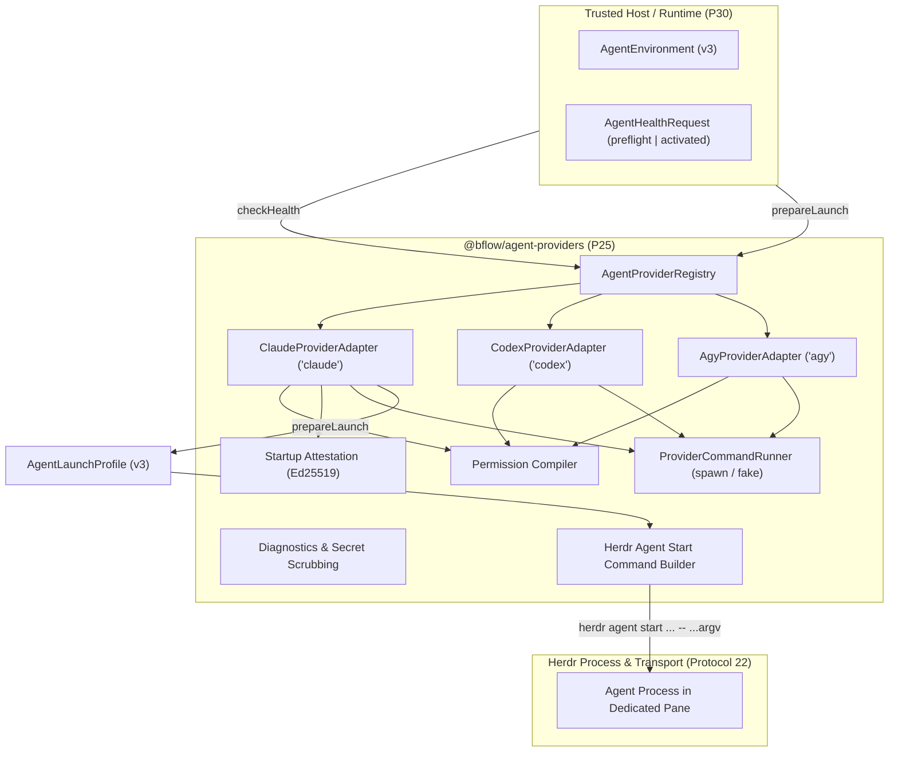

# @bflow/agent-providers

`@bflow/agent-providers` implements the **Provider Adapters** package (Phase P25 of Bflow Platform v3).
It manages external agent CLI discovery, capability detection, preflight and activated readiness observations, permission profile flag compilation, deterministic launch preparation, startup attestation signing/verification, and Herdr launch command generation across Claude Code, Codex CLI, and Antigravity CLI.

## Architectural Boundaries

In accordance with [docs/provider-contracts.md](../../docs/provider-contracts.md) and [AGENTS.md](../../AGENTS.md):
- **Contracts-Only Leaf Dependency**: Depends exclusively on `@bflow/contracts` and `zod`. Never imports `@bflow/pane-manager`, `@bflow/runtime`, `@bflow/core`, or `apps/cli`.
- **Launch Data Only**: Produces validated launch profiles and start command arguments only. Process execution and terminal pane lifecycle are strictly owned by Herdr and Pane Manager.
- **Strict Version 3 Schema Validation**: All public inputs and outputs are validated with `@bflow/contracts` Zod schemas (`AgentHealthRequestSchema`, `AgentHealthResultSchema`, `AgentEnvironmentSchema`, `AgentLaunchProfileSchema`, `AgentLaunchAttestationSchema`).
- **Secret Isolation**: Secrets are bound via opaque `secret://` references in `secretBindings` and resolved by the trusted host at launch. Raw secret tokens are forbidden in `argv`, `environmentVariables`, config files, or diagnostic reports.

---

## Architecture Overview



---

## Supported Providers

| Provider | Executable | Installed / Target Version | Capabilities | MCP Transports | Unattended Support | Native Attestation |
| --- | --- | --- | --- | --- | --- | --- |
| **Claude Code** (`claude`) | `claude` | 2.1.301 | Implementation, Review, Conversation | stdio, streamable_http | Yes (with OS sandbox / bwrap) | Yes |
| **Codex CLI** (`codex`) | `codex` | 0.162.0 | Implementation, Review, Testing | stdio, streamable_http | Yes (with OS sandbox / bwrap) | Yes |
| **Antigravity CLI** (`agy`) | `agy` | 1.4.0 | Implementation, Review | stdio, streamable_http | No (Uncertified) | No (Uncertified) |

---

## Health Checks Matrix (`checkHealth`)

`checkHealth` performs non-destructive observation without auto-login or modifying environment state.
Every check returns `status: "passed" | "failed" | "unknown"`. Overall status is:
- `"ready"`: Every check for the stage is `"passed"`.
- `"unsupported"`: Provider capability is unsupported (e.g. Agy unattended execution, missing OS sandbox).
- `"blocked"`: Operational failure (e.g. missing binary, expired authentication, insecure permissions).

| Check | Stage | Description |
| --- | --- | --- |
| `binary` | preflight, activated | Validates executable presence, regular file, execute permissions, and digest matching `pinnedExecutableDigest`. |
| `version` | preflight, activated | Inspects CLI version and verifies it satisfies minimum required semver (e.g. Claude >= 2.0.0, Codex >= 0.150.0). |
| `authentication` | preflight, activated | Runs provider auth status (`claude auth status --json`, `codex login status`, `agy models`) and minimal execution probe (`--print`, `exec`). Distinguishes expired vs missing credentials. |
| `environment` | preflight, activated | Validates canonical directory paths for `cwd` and `stateDirectory` (no symlinks), private `0o700` permissions, and absence of dangerous env variables (`LD_PRELOAD`) or secret tokens. |
| `mcp` | preflight, activated | Verifies client transport compatibility and registration of all `requiredMcpServiceIds`. |
| `launch_arguments` | preflight, activated | Validates that launch CLI flags match supported provider capabilities. |
| `permissions` | preflight, activated | Validates permission profile constraints (`restricted`, `workspace_auto`, `unattended_isolated`). |
| `skills` | preflight, activated | Verifies resolved skill manifest matches `environment.skillManifestDigest` and allowed role/provider bindings. |
| `native_binding` | **activated only** | Verifies Ed25519 signature on `AgentLaunchAttestation`, matching executable/config digests on disk, and live pane interactive readiness. |

---

## Permission Modes

1. **`restricted`**:
   - Read-only filesystem (`filesystem: "read_only"`, `writableRoots: []`).
   - Claude: `--restricted`, `--tools "Read,Glob,Grep"`, `--permission-mode dontAsk`.
   - Codex: `--sandbox read-only`, `--ask-for-approval never`.
   - Agy: `--sandbox`, `--mode plan`.

2. **`workspace_auto`**:
   - Scoped workspace writes (`filesystem: "workspace_write"`), no global bypass.
   - Claude: `--restricted`, `--tools "Read,Glob,Grep,Edit,Write"`, `--permission-mode dontAsk`.
   - Codex: `--sandbox workspace-write`, `--ask-for-approval never`.
   - Agy: `--sandbox`, `--mode accept-edits`.

3. **`unattended_isolated`**:
   - Requires session scope and OS process sandbox (`/usr/bin/bwrap`) or container isolation.
   - Prohibits machine-wide bypass flags (`--dangerously-skip-permissions`, `--dangerously-bypass-approvals-and-sandbox`, `danger-full-access`).
   - Claude & Codex: Enforces OS sandbox verification.
   - Agy: Reports `unsupported` (`agy_unattended_unsupported`) until officially certified.

---

## Launch Attestation (`AgentLaunchAttestation`)

Startup proof uses an Ed25519 signature over canonical JSON prefixed by domain separator:
```
bflow.agent-launch-attestation.v3\n{...canonical JSON of unsigned attestation body...}
```
The signature is verified against configured trusted host public keys (`trustedIssuerKeys`).

---

## Host MCP, Gateway and Native Hook Material

`prepareLaunch` writes one MCP config file and one settings file per role. Their content comes from
`resolveLaunchMaterial` (`src/launch-material.ts`), which `checkHealth` also evaluates, so preflight and launch
cannot disagree. All written files are covered by `configFiles` digests.

| Option | Meaning |
| --- | --- |
| `hostMcpServers` | Trusted Bflow host stdio servers. Names match `^[a-z][a-z0-9_-]{0,63}$`; `command` must be absolute. |
| `mcpRegistrations` | `stdio` entries keep `command`/`args`. `streamable_http` entries need `mcpTokenEnvironmentNames[registrationId]`. |
| `mcpTokenEnvironmentNames` | registrationId → environment variable **name** (`^[A-Z_][A-Z0-9_]*$`) that holds the bearer token. Token values are never accepted or written. |
| `hostHooks` | Full shell command for `SessionStart`, `UserPromptSubmit`, `Stop`, `PreToolUse`. Supersedes `nativeSessionHookCommand` for `SessionStart`. |
| `nativeSessionHookCommand` | Legacy single `SessionStart` hook (timeout 10 s), unchanged when used alone. |

Rendered shapes (`<role>.mcp-config.json`):

- Claude: `{"mcpServers":{"bflow":{"command":"<abs>","args":[...]},"gateway-dev":{"type":"http","url":"<endpoint>","headers":{"Authorization":"Bearer ${BFLOW_GATEWAY_TOKEN}"}}}}`. Claude expands `${VAR}` at launch.
- Codex: the same file is converted into `-c mcp_servers={"bflow"={"command"=...,"args"=[...]},"gateway-dev"={"url"="<endpoint>","bearer_token_env_var"="BFLOW_GATEWAY_TOKEN"}}`.
- Hooks (Claude settings and Codex `-c hooks=`): `{"<Event>":[{"hooks":[{"type":"command","command":"<cmd>","timeout":30}]}]}`.

Fail-closed rules:

- A `streamable_http` registration without a valid token environment mapping → `validation`.
- A registration or host server named the same as another → `validation`.
- Hooks requested for a provider without native hooks (Agy) → `validation` from `prepareLaunch`; `unsupported` from `checkHealth`.
- Agy has no verified header/env-reference form, so `streamable_http` registrations fail. Host MCP servers fail unless the CLI advertises `--mcp-config`.

The launched process must receive each token in the environment variable named in the config. The adapter does not inject it: `buildProviderEnvironment` builds only the fixed Bflow variables plus `environmentVariables`, and `BFLOW_*` keys are rejected there. The Runtime integrator supplies the token value through the pane environment.

---

## Codex Inherited Global MCP Servers and Hooks (L3)

Codex merges the user's `~/.codex/config.toml` and `~/.codex/hooks.json` (or `$CODEX_HOME`) into every
invocation. The Bflow `-c mcp_servers={...}` table therefore does not isolate a role on its own: live probing
with codex-cli 0.162.0 showed `gitnexus` and `playwright` starting inside a Bflow role, plus the warning
"loading hooks from both .../hooks.json and .../config.toml".

Research (codex-cli 0.162.0, read-only commands only):

- `codex mcp list --help`: `--json` "Output the configured servers as JSON"; `-c, --config <key=value>`
  "Override a configuration value ... Use a dotted path (`foo.bar.baz`) to override nested values".
- `codex mcp list --json -c 'mcp_servers.gitnexus.enabled=false'` reports `gitnexus` with `"enabled": false`,
  so the dotted per-invocation override is resolved by the same config loader that Codex uses for the role.
- Override ordering is verified: `-c mcp_servers.<name>.enabled=false` placed before `-c mcp_servers={...}`
  is reset by the table override (the server reports `enabled: true`); placed after it, it is kept. The
  adapter therefore appends the disables after the Bflow table.
- Table override semantics are verified: `-c mcp_servers={"bflow-gw"={command=...}}` merges with the global
  servers (they are still listed), so the global entries must be disabled explicitly.
- An `enabled=false` override for a name that is not in the config aborts config loading
  (`invalid transport in mcp_servers.<name>`). Only names enumerated from the config are passed.
- Dotted-key quoting (`mcp_servers."a.b".enabled`) could not be verified against a real server name; names
  outside `^[A-Za-z0-9_-]+$` therefore fail closed.
- Hooks: `codex --help` lists `--dangerously-bypass-hook-trust` ("Run enabled hooks without requiring persisted
  hook trust"), which bypasses trust only and does not skip hook sources. `codex features list` shows
  `hooks  stable  true`, and `--disable hooks` would also disable Bflow's own native hooks (SessionStart
  receipts, PreToolUse). `--profile` layers `$CODEX_HOME/<name>.config.toml` on top of the base config and
  does not skip it. `CODEX_HOME` would hide the user login and is not used. The binary identifies hook sources
  as `hooks.json` and `config.toml` (`[hooks]`) next to the config layers. No per-invocation switch was found
  that ignores user hook sources while keeping Bflow hooks, so global hooks are not isolated by mechanism.
- Not verified: runtime start behaviour of an `enabled=false` server during `codex exec` (the adapter did not
  run an interactive or model-backed session). The `codex mcp list` evidence is config-level.

Adapter behaviour (`src/codex-adapter.ts`, `resolveInheritedIsolation`):

1. Global MCP servers are enumerated with `codex mcp list --json` through the runner. If that fails, the
   `[mcp_servers.<name>]` tables of `<codexHome>/config.toml` are used (missing file = none). An unreadable
   or unparseable source fails closed.
2. Every global server not named by the Bflow launch is disabled with `-c mcp_servers.<name>.enabled=false`
   after the Bflow `mcp_servers=` override. The same arguments are prepended to the readiness probe so global
   servers are not started there either. Adding or removing a global server changes the argv and therefore the
   launch fingerprint.
3. Fail-closed MCP cases, reported as `mcp` check `codex_global_mcp_not_isolated`: the global set cannot be
   enumerated; a global name collides with a Bflow launch server (it would inherit the global `enabled` state);
   or a global name is outside `^[A-Za-z0-9_-]+$`.
4. Global hooks (`<codexHome>/hooks.json` with any non-empty entry, or `hooks`/`[hooks]` in `config.toml`) are
   reported as `permissions` check `codex_global_hooks_not_isolated` with remediation: move personal hooks into a
   Codex profile that Bflow does not use. Bflow does not modify these files. Plugin-bundled hooks are not
   inspected.

The Codex home is `codexHomeDirectory` (option), then `$CODEX_HOME`, then `~/.codex`. It is only read.
Claude and Agy behaviour is unchanged (`resolveInheritedIsolation` returns no arguments and no failures).

## Herdr Launch Integration

Launch execution commands are built with `buildHerdrAgentStartCommand`:
```bash
herdr agent start <agentName> --kind <provider> --pane <paneId> [--timeout <ms>] -- <argv...>
```
Arguments after `--` are strictly validated to prevent multiline shell breaks, NUL bytes, or secret tokens.
Provider environment variables (`PATH`, `HOME`, `XDG_*`, `BHOME`, `BFLOW_*`) isolate configuration per session.
