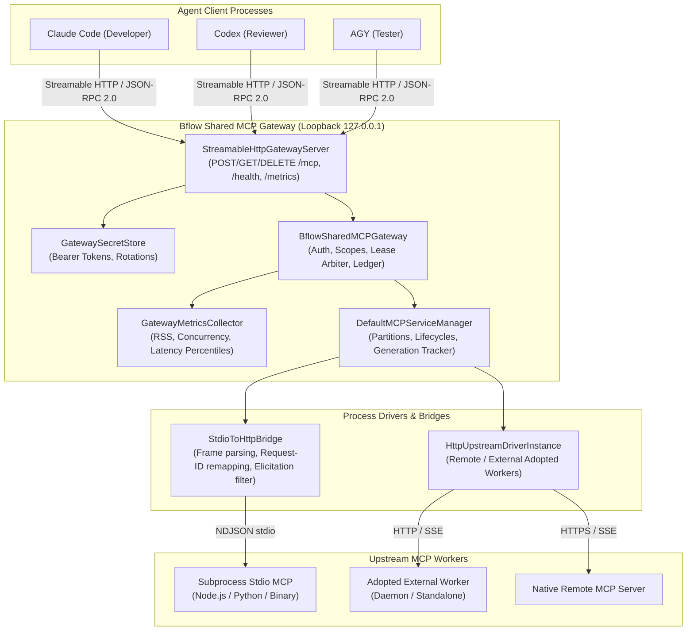
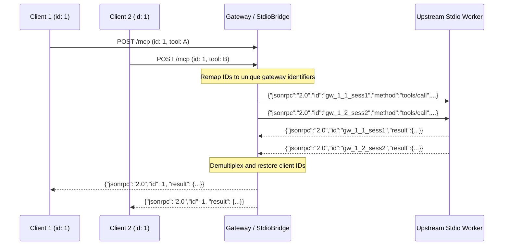

# Đặc tả giao thức Bflow Shared MCP Gateway

- **Package**: `@bflow/mcp-gateway`
- **Protocol Version**: Platform Schema Version 3 (`CURRENT_PLATFORM_SCHEMA_VERSION = 3`)
- **MCP Baseline**: Model Context Protocol Specification `2025-11-25`
- **Trạng thái**: Đặc tả giao thức có thẩm quyền

---

## 1. Tổng quan và topology kiến trúc

`@bflow/mcp-gateway` cung cấp một gateway loopback dùng chung, ghép kênh cho kết nối tool MCP (Model Context Protocol) xuyên suốt các session đa agent (`claude`, `codex`, `agy` trên các role coordinator, developer, reviewer và tester).

### Bất biến: Chỉ kết nối Tool

> [!IMPORTANT]
> MCP Gateway chỉ dành cho **gọi tool và chia sẻ resource**. Nó **KHÔNG BAO GIỜ** đóng vai trò transport giao tiếp liên role cho các payload `RoleMessage`. Mọi message liên role vẫn phải đi qua transport Workflow Runtime / Herdr.

### Topology kiến trúc Gateway



---

## 2. Giao thức Streamable HTTP

Theo mặc định, gateway chỉ lắng nghe trên các interface loopback (`127.0.0.1`, `localhost`, `[::1]`). Việc bind vào địa chỉ không phải loopback yêu cầu cấu hình tường minh và TLS termination (`allowNonLoopbackTls: true`).

### 2.1 Các HTTP Endpoint

| Endpoint | Method | Mô tả | Content-Type | Status Codes |
|---|---|---|---|---|
| `/mcp` | `POST` | Dispatch các request JSON-RPC 2.0 (`initialize`, `tools/list`, `tools/call`, `ping`, notification). | `application/json` hoặc `text/event-stream` | `200`, `202`, `400`, `401`, `403`, `500` |
| `/mcp` | `GET` | Thiết lập kết nối SSE keepalive cho một client session. | `text/event-stream` | `200`, `400`, `401`, `403`, `404` |
| `/mcp` | `DELETE` | Ngắt kết nối một client session đang hoạt động và giải phóng các lease tạm thời liên quan. | `none` | `204`, `401`, `403` |
| `/health` | `GET` | Endpoint health check báo mức sẵn sàng của gateway và timestamp. | `application/json` | `200`, `401`, `403` |
| `/metrics` | `GET` | Trả về snapshot metric của gateway (`activeProcessCount`, RAM, độ trễ). | `application/json` | `200`, `401`, `403` |

### 2.2 Đặc tả Header và bất biến bảo mật

1. **`Authorization: Bearer <token>`** (Bắt buộc cho mọi route):
   - Token ngẫu nhiên 256-bit an toàn mật mã được phát hành trong `gateway.register()`.
   - Được `GatewaySecretStore` ánh xạ nội bộ tới một `MCPClientRegistration` đang hoạt động.
   - Token thiếu hoặc không xác định trả về `401 Unauthorized` kèm lỗi JSON-RPC.
2. **`Mcp-Session-Id: <sessionId>`** (Bắt buộc cho theo dõi session có trạng thái):
   - Được sinh trong response của `initialize` (`session-<uuid>`).
   - Mọi request có header `Mcp-Session-Id` đều được đối chiếu với đăng ký của client đã xác thực.
   - Nếu một client cố cung cấp session ID thuộc về client hoặc project partition khác, gateway lập tức từ chối request với **`403 Forbidden`** (`Forbidden: session belongs to another client`).
3. **Validate Header `Host`**:
   - Phải là một interface loopback hợp lệ (`127.0.0.1`, `localhost`, `[::1]`) hoặc một host được đăng ký tường minh trong `allowedHosts`.
   - Các nỗ lực DNS rebinding (ví dụ `Host: evil.example.com`) bị từ chối với **`403 Forbidden`** (`Forbidden: invalid host header`).
4. **Validate Header `Origin`**:
   - `Origin` rỗng hoặc thiếu được cho phép với các caller CLI và daemon cục bộ.
   - Mọi header origin của trình duyệt (ví dụ `Origin: https://evil.example.com` hoặc `Origin: http://localhost:3000`) bị từ chối với **`403 Forbidden`** (`Forbidden: invalid origin header`) trừ khi được đưa tường minh vào `allowedOrigins`.

### 2.3 Ví dụ giao thức trên đường truyền

#### Khởi tạo Session (`POST /mcp`)

**Request**:
```http
POST /mcp HTTP/1.1
Host: 127.0.0.1:41235
Authorization: Bearer 9f8a7c2e...
Content-Type: application/json

{
  "jsonrpc": "2.0",
  "id": 1,
  "method": "initialize",
  "params": {
    "protocolVersion": "2025-11-25",
    "capabilities": {},
    "clientInfo": { "name": "claude-code", "version": "1.0.0" }
  }
}
```

**Response**:
```http
HTTP/1.1 200 OK
Content-Type: application/json
Mcp-Session-Id: session-7b4d1a9e-2f3c-4e1a-8f5b-6d0e7c8a9b1c

{
  "jsonrpc": "2.0",
  "id": 1,
  "result": {
    "protocolVersion": "2025-11-25",
    "capabilities": { "tools": {} },
    "serverInfo": { "name": "bflow-mcp-gateway", "version": "0.1.0" },
    "sessionId": "session-7b4d1a9e-2f3c-4e1a-8f5b-6d0e7c8a9b1c"
  }
}
```

#### Gọi Tool (`POST /mcp` với SSE streaming)

**Request**:
```http
POST /mcp HTTP/1.1
Host: 127.0.0.1:41235
Authorization: Bearer 9f8a7c2e...
Mcp-Session-Id: session-7b4d1a9e-2f3c-4e1a-8f5b-6d0e7c8a9b1c
Accept: text/event-stream
Content-Type: application/json

{
  "jsonrpc": "2.0",
  "id": 42,
  "method": "tools/call",
  "params": {
    "name": "git_status",
    "arguments": { "path": "/workspace" }
  }
}
```

**Response**:
```http
HTTP/1.1 200 OK
Content-Type: text/event-stream
Cache-Control: no-cache
Connection: keep-alive

event: message
data: {"jsonrpc":"2.0","id":42,"result":{"schemaVersion":3,"callId":"call-123","status":"completed","output":{"clean":true},"observedAt":"2026-10-16T16:00:00.000Z"}}

```

---

## 3. Giao thức Stdio-to-HTTP Bridge

`StdioToHttpBridge` chuyển đổi các request streamable HTTP/JSON-RPC thành các frame JSON-RPC 2.0 phân tách bằng newline qua các pipe `stdin`/`stdout` tới các stdio worker upstream.

### 3.1 Ánh xạ lại Request-ID và ghép kênh

Để đảm bảo các request đồng thời từ nhiều client dùng chung một tiến trình stdio không bao giờ xung đột (kể cả khi hai client cùng gửi `id: 1`), bridge ánh xạ lại mọi request ID của client thành một định danh upstream duy nhất toàn cục:

$$\text{upstreamId} = \texttt{gw\_}\langle\text{startGeneration}\rangle\texttt{\_}\langle\text{seq}\rangle\texttt{\_}\langle\text{sessionId}\rangle$$

- `startGeneration`: Tăng đơn điệu mỗi lần backend restart.
- `seq`: Số thứ tự nguyên tử trong instance bridge.
- `sessionId`: Định danh session partition của agent gọi.

Khi upstream trả lời với `id: upstreamId`, bridge ánh xạ ngược về ID gốc của client và trả response tới socket của client.



### 3.2 Bảo vệ Frame và Backpressure

- **`maxFrameBytes` (Mặc định: 4MB)**: Nếu một dòng đến từ upstream vượt `maxFrameBytes` mà chưa có newline, hoặc một dòng đã parse vượt `maxFrameBytes`, bridge lập tức crash theo kiểu fail-closed với `frame_size_exceeded` để chống cạn kiệt heap.
- **`maxPendingWrites` (Mặc định: 128)**: Nếu stdin upstream bị dồn ứ vượt quá `maxPendingWrites`, các dispatch tiếp theo thất bại nhanh với `Stdio bridge write backpressure limit reached`.

### 3.3 Chặn Interactive Elicitation

Các prompt tương tác trực tiếp từ MCP server upstream tới terminal agent vi phạm ranh giới kiến trúc của Bflow (chỉ Conversation Agent mới được hỏi người dùng).

Bridge kiểm tra các method đến và **chặn ngay lập tức**:
- `elicitation/create` (hoặc bất kỳ `elicitation/*`)
- `sampling/createMessage`
- `oauth/interactive`
- `browser/permissionPrompt`
- `roots/list_interactive`

**Cơ chế chặn**:
1. Nếu prompt từ upstream có `id`, bridge lập tức gửi lại lỗi JSON-RPC `-32000`:
   `"Interactive user prompt blocked by Bflow Gateway; route via Conversation"`.
2. Lời gọi tool in-flight đang hoạt động bị từ chối với:
   `diagnosticCode: "interactive_prompt_blocked"`.
3. Audit log ghi `action: "interactive.blocked"` với diagnostic code `interactive_blocked`.

---

## 4. Ma trận chính sách chia sẻ và cô lập

Mỗi MCP service definition được gắn với một `MCPBackendSharingPolicy` tại thời điểm đăng ký.

| Chiều chính sách chia sẻ | Giá trị được hỗ trợ | Mặc định cho `stdio_mcp` | Mặc định cho `existing_shared_worker` | Mặc định cho `exclusive` |
|---|---|---|---|---|
| **`transportCapabilities`** | `streamableHttp`, `stdio`, `sse`, `supportsCancellation`, `maxFrameBytes` | `stdio: true, streamableHttp: false` | `streamableHttp: true, sse: true` | Kế thừa kết nối |
| **`concurrencyModel`** | `multiplexed`, `serialized`, `exclusive_lease`, `single_client_isolated`, `unsupported` | `multiplexed` | `multiplexed` | `exclusive_lease` |
| **`sessionIsolationPolicy`** | `protocol_session`, `repository_partition`, `session_partition`, `task_isolated`, `unsupported` | `repository_partition` | `protocol_session` | `repository_partition` (hoặc `protocol_session` nếu là machine) |
| **`sharedStatePolicy`** | `stateless`, `partitioned_by_repo`, `partitioned_by_session`, `mutable_shared_exclusive`, `unsafe_unshareable` | `partitioned_by_repo` | `stateless` (hoặc `partitioned_by_repo`) | `mutable_shared_exclusive` |
| **`resourceOwnership`** | `bflow_managed`, `external_adopted`, `external_remote`, `exclusive_lease_bound` | `bflow_managed` | `external_adopted` | `exclusive_lease_bound` |
| **`reconnectBehavior`** | `reinitialize_session`, `stateless_retry`, `quarantine_on_disconnect`, `fail_closed` | `reinitialize_session` | `stateless_retry` | `quarantine_on_disconnect` |

### Dẫn xuất Partition Key

Partition key phân vùng các instance tiến trình backend theo chính sách:

$$\text{partitionKey} = \text{computePartitionKey}(\text{service}, \text{policy}, \text{callerScope})$$

- Nếu policy chứa `concurrencyModel: "unsupported"` hoặc `sharedStatePolicy: "unsafe_unshareable"`, `computePartitionKey` trả về `{ diagnosticCode: "sharing_unsupported" }` và service chuyển sang `status: "blocked"`.
- Nếu `sessionIsolationPolicy` là `repository_partition`:
  $$\text{key} = \langle\text{serviceId}\rangle\texttt{@r}\langle\text{rev}\rangle\texttt{:m:}\langle\text{machineId}\rangle\texttt{:repo:}\langle\text{repoId}\rangle\texttt{:root:}\langle\text{workspaceRoot}\rangle$$
  Repo A và Repo B **không bao giờ** dùng chung một tiến trình stdio có trạng thái!

---

## 5. Giao thức Exclusive Resource Lease và Monotonic Fencing Token

Với các tool có trạng thái, tác động đến trình duyệt hoặc độc quyền phần cứng (`sharing: "exclusive"` hoặc `browserAffecting: true`), client PHẢI giữ một `MCPResourceLease` đang hoạt động.

```mermaid
stateDiagram-v2
    [*] --> Idle: Resource registered
    Idle --> Leased: acquireResource(ttlMs)\n[fencingToken = fence + 1]
    Leased --> Leased: renewResource(ttlMs)\n[same fencingToken]
    Leased --> Idle: releaseResource()\n[graceful release]
    Leased --> Quarantined: Mutating Call Timeout / Upstream Crash\n[status: unknown]
    Quarantined --> Idle: reconcileCall()\n[outcome confirmed: completed | failed | not_delivered]
    Leased --> Idle: Lease expired (TTL elapsed)
```



### 5.1 Quy tắc Fencing Token

1. Mỗi lần acquire tăng `currentFence` đơn điệu của resource thêm 1.
2. Caller phải đính kèm `MCPResourceLease` vào mọi `MCPToolCall`.
3. Các kiểm tra validate trước dispatch:
   - Lease ID khớp với lease đang hoạt động.
   - Registration ID khớp với đăng ký của caller.
   - `fencingToken` khớp với giá trị fence đơn điệu hiện tại.
   - `expiresAt` nằm trong tương lai.
4. Nếu bất kỳ kiểm tra nào thất bại, gateway từ chối ngay lời gọi với `details: { diagnosticCode: "stale_lease" }` mà không chuyển tiếp tới upstream.

### 5.2 Giao thức Timeout không chắc chắn và Quarantine

Khi một lời gọi tool mutating gặp gián đoạn bất ngờ (timeout sau dispatch hoặc tiến trình upstream crash):

1. **Trạng thái không chắc chắn**: Lời gọi trả về:
   ```json
   {
     "schemaVersion": 3,
     "callId": "call-123",
     "status": "unknown",
     "output": {
       "diagnosticCode": "uncertain_mutating_outcome",
       "message": "Mutating tool call outcome is unknown after timeout/crash; reconcile before retry"
     }
   }
   ```
2. **Quarantine Resource**: Exclusive resource lập tức bị quarantine (`quarantinedByCallId = callId`).
3. **Khóa Fail-Closed**: Mọi lời gọi hay lần acquire lease tiếp theo cho resource này bị từ chối với:
   `details: { diagnosticCode: "resource_quarantined", quarantinedByCallId: "call-123" }`.
4. **Reconciliation (`reconcileCall`)**:
   - Coordinator/runtime gọi `gateway.reconcileCall(request)`.
   - Gateway truy vấn upstream qua `reconcileRequest(callId, requestId)` hoặc kiểm tra call ledger.
   - Khi đã được giải quyết (`completed`, `failed`, hoặc `not_delivered`), quarantine được gỡ và resource được mở khóa.
   - **Không tự động phát lại**: Gateway KHÔNG BAO GIỜ tự động phát lại một lời gọi mutating khi ở trạng thái không chắc chắn!

---

## 6. Audit Logging và xóa bí mật

Mọi sự kiện bảo mật, chuyển trạng thái vòng đời lease và lời gọi tool đều được ghi vào `auditLog` trong bộ nhớ.

### Bất biến xóa bí mật (Scrubbing)

Trước khi bất kỳ văn bản nào được ghi vào audit log hoặc phát ra qua các response HTTP:
- `Bearer [A-Za-z0-9._~+/=-]+` $\to$ `Bearer [REDACTED]`
- `secret://[A-Za-z0-9._/-]+` $\to$ `secret://[REDACTED]`
- `sk-[A-Za-z0-9_-]{8,}` $\to$ `[REDACTED_KEY]`
- `ghp_[A-Za-z0-9]{8,}` $\to$ `[REDACTED_TOKEN]`
- Các key nhạy cảm (`token`, `secret`, `password`, `authorization`, `credential`, trừ `fencingtoken`, `schemaversion`, `maxtokens` nằm trong whitelist) được thay bằng `"[REDACTED]"`.
