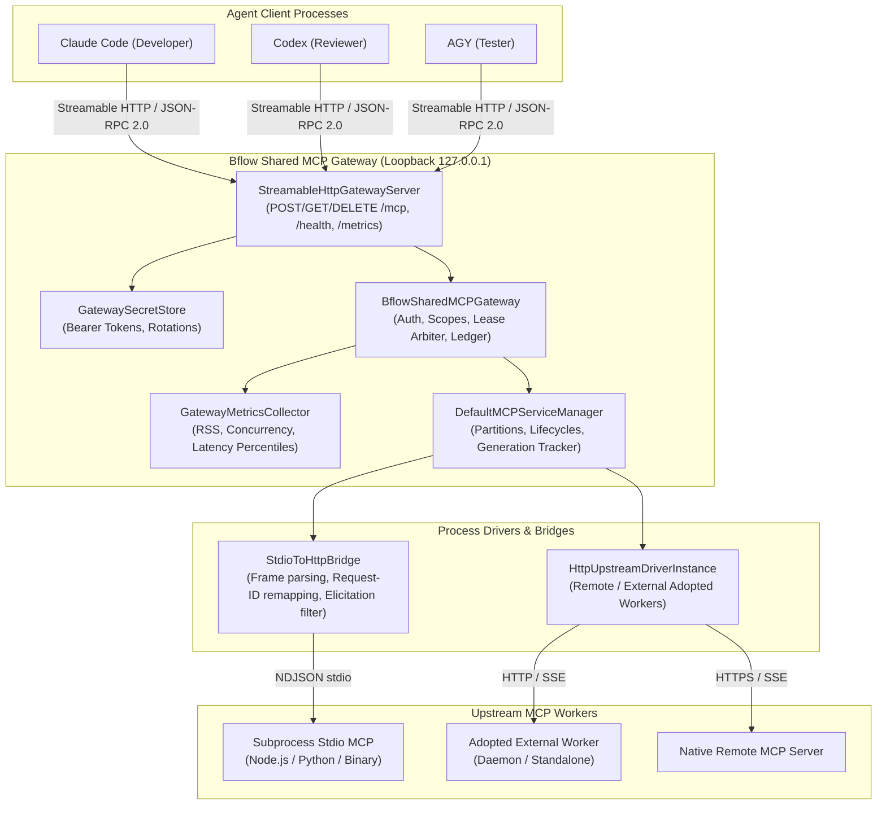
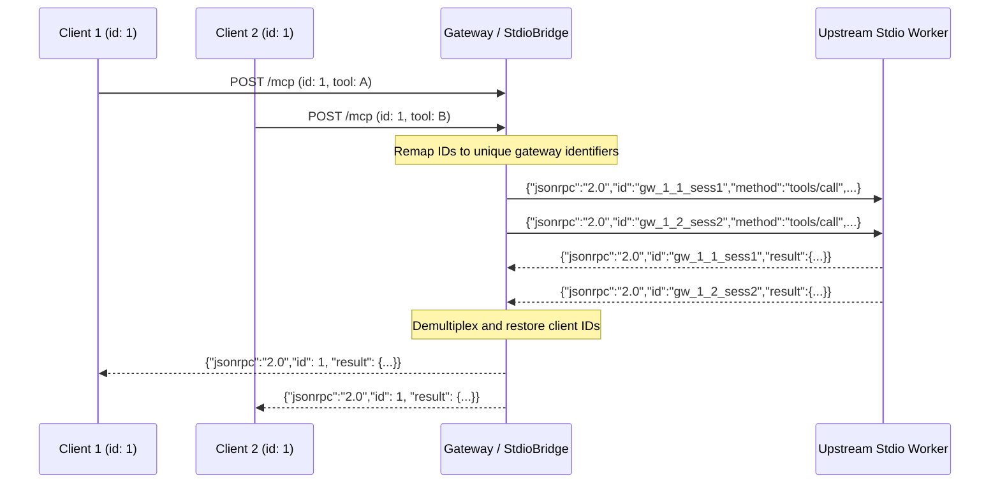
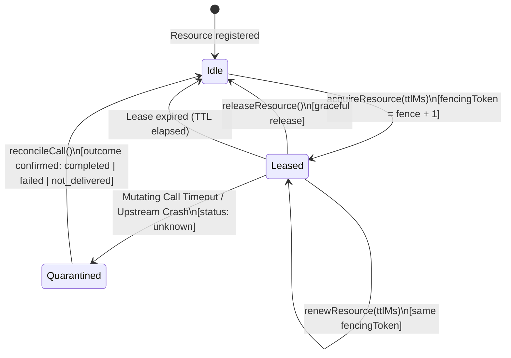

# Bflow Shared MCP Gateway Protocol Specification

- **Package**: `@bflow/mcp-gateway`
- **Protocol Version**: Platform Schema Version 3 (`CURRENT_PLATFORM_SCHEMA_VERSION = 3`)
- **MCP Baseline**: Model Context Protocol Specification `2025-11-25`
- **Status**: Authoritative Protocol Specification

---

## 1. Overview & Architectural Topology

`@bflow/mcp-gateway` provides a shared, multiplexing loopback gateway for MCP (Model Context Protocol) tool connectivity across multi-agent sessions (`claude`, `codex`, `agy` across coordinator, developer, reviewer, and tester roles).

### Invariant: Tool Connectivity Only

> [!IMPORTANT]
> The MCP Gateway is strictly for **tool invocation and resource sharing**. It **NEVER** serves as an inter-role communication transport for `RoleMessage` payloads. All inter-role messages must continue to traverse the Workflow Runtime / Herdr transport.

### Gateway Architecture Topology



---

## 2. Streamable HTTP Protocol

The gateway listens exclusively on loopback interfaces (`127.0.0.1`, `localhost`, `[::1]`) by default. Binding to non-loopback addresses requires explicit configuration and TLS termination (`allowNonLoopbackTls: true`).

### 2.1 HTTP Endpoints

| Endpoint | Method | Description | Content-Type | Status Codes |
|---|---|---|---|---|
| `/mcp` | `POST` | Dispatches JSON-RPC 2.0 requests (`initialize`, `tools/list`, `tools/call`, `ping`, notifications). | `application/json` or `text/event-stream` | `200`, `202`, `400`, `401`, `403`, `500` |
| `/mcp` | `GET` | Establishes an SSE keepalive connection for a client session. | `text/event-stream` | `200`, `400`, `401`, `403`, `404` |
| `/mcp` | `DELETE` | Disconnects an active client session and releases associated transient leases. | `none` | `204`, `401`, `403` |
| `/health` | `GET` | Health check endpoint reporting gateway readiness and timestamp. | `application/json` | `200`, `401`, `403` |
| `/metrics` | `GET` | Returns gateway metrics snapshot (`activeProcessCount`, RAM, latencies). | `application/json` | `200`, `401`, `403` |

### 2.2 Header Specification & Security Invariants

1. **`Authorization: Bearer <token>`** (Required for all routes):
   - Cryptographically random 256-bit token issued during `gateway.register()`.
   - Mapped internally by `GatewaySecretStore` to an active `MCPClientRegistration`.
   - Missing or unknown token returns `401 Unauthorized` with JSON-RPC error.
2. **`Mcp-Session-Id: <sessionId>`** (Required for stateful session tracking):
   - Generated during `initialize` response (`session-<uuid>`).
   - Every request with an `Mcp-Session-Id` header is validated against the authenticated client's registration.
   - If a client attempts to supply a session ID belonging to another client or project partition, the gateway immediately rejects the request with **`403 Forbidden`** (`Forbidden: session belongs to another client`).
3. **`Host` Header Validation**:
   - Must evaluate to a valid loopback interface (`127.0.0.1`, `localhost`, `[::1]`) or an explicitly registered host in `allowedHosts`.
   - DNS rebinding attempts (e.g. `Host: evil.example.com`) are rejected with **`403 Forbidden`** (`Forbidden: invalid host header`).
4. **`Origin` Header Validation**:
   - Empty or missing `Origin` is permitted for local CLI and daemon callers.
   - Any browser-origin header (e.g. `Origin: https://evil.example.com` or `Origin: http://localhost:3000`) is rejected with **`403 Forbidden`** (`Forbidden: invalid origin header`) unless explicitly included in `allowedOrigins`.

### 2.3 Wire Protocol Examples

#### Session Initialization (`POST /mcp`)

**Request**:
```http
POST /mcp HTTP/1.1
Host: 127.0.0.1:41235
Authorization: Bearer 9f8a7c2e...
Content-Type: application/json

{
  "jsonrpc": "2.0",
  "id": 1,
  "method": "initialize",
  "params": {
    "protocolVersion": "2025-11-25",
    "capabilities": {},
    "clientInfo": { "name": "claude-code", "version": "1.0.0" }
  }
}
```

**Response**:
```http
HTTP/1.1 200 OK
Content-Type: application/json
Mcp-Session-Id: session-7b4d1a9e-2f3c-4e1a-8f5b-6d0e7c8a9b1c

{
  "jsonrpc": "2.0",
  "id": 1,
  "result": {
    "protocolVersion": "2025-11-25",
    "capabilities": { "tools": {} },
    "serverInfo": { "name": "bflow-mcp-gateway", "version": "0.1.0" },
    "sessionId": "session-7b4d1a9e-2f3c-4e1a-8f5b-6d0e7c8a9b1c"
  }
}
```

#### Tool Call (`POST /mcp` with SSE streaming)

**Request**:
```http
POST /mcp HTTP/1.1
Host: 127.0.0.1:41235
Authorization: Bearer 9f8a7c2e...
Mcp-Session-Id: session-7b4d1a9e-2f3c-4e1a-8f5b-6d0e7c8a9b1c
Accept: text/event-stream
Content-Type: application/json

{
  "jsonrpc": "2.0",
  "id": 42,
  "method": "tools/call",
  "params": {
    "name": "git_status",
    "arguments": { "path": "/workspace" }
  }
}
```

**Response**:
```http
HTTP/1.1 200 OK
Content-Type: text/event-stream
Cache-Control: no-cache
Connection: keep-alive

event: message
data: {"jsonrpc":"2.0","id":42,"result":{"schemaVersion":3,"callId":"call-123","status":"completed","output":{"clean":true},"observedAt":"2026-10-16T16:00:00.000Z"}}

```

---

## 3. Stdio-to-HTTP Bridge Protocol

The `StdioToHttpBridge` translates streamable HTTP/JSON-RPC requests into newline-delimited JSON-RPC 2.0 frames over `stdin`/`stdout` pipes to upstream stdio workers.

### 3.1 Request-ID Remapping & Multiplexing

To guarantee that concurrent requests from multiple clients sharing the same stdio process never collide (even if two clients send `id: 1` simultaneously), the bridge remaps every client request ID into a globally unique upstream identifier:

$$\text{upstreamId} = \texttt{gw\_}\langle\text{startGeneration}\rangle\texttt{\_}\langle\text{seq}\rangle\texttt{\_}\langle\text{sessionId}\rangle$$

- `startGeneration`: Monotonically incremented on every backend restart.
- `seq`: Atomic sequence number within the bridge instance.
- `sessionId`: Session partition identifier of the calling agent.

When upstream replies with `id: upstreamId`, the bridge maps it back to the client's original ID and returns the response to the client socket.



### 3.2 Frame Protection & Backpressure

- **`maxFrameBytes` (Default: 4MB)**: If an incoming line from upstream exceeds `maxFrameBytes` without a newline, or a parsed line exceeds `maxFrameBytes`, the bridge immediately crashes closed with `frame_size_exceeded` to protect against heap exhaustion.
- **`maxPendingWrites` (Default: 128)**: If upstream stdin buffers back up beyond `maxPendingWrites`, further dispatches fail fast with `Stdio bridge write backpressure limit reached`.

### 3.3 Interactive Elicitation Blocking

Direct interactive prompts from upstream MCP servers to terminal agents violate Bflow's architectural boundary (only the Conversation Agent may prompt the user).

The bridge inspects inbound methods and **immediately blocks**:
- `elicitation/create` (or any `elicitation/*`)
- `sampling/createMessage`
- `oauth/interactive`
- `browser/permissionPrompt`
- `roots/list_interactive`

**Interception Mechanism**:
1. If the upstream prompt has an `id`, the bridge immediately sends back JSON-RPC error `-32000`:
   `"Interactive user prompt blocked by Bflow Gateway; route via Conversation"`.
2. The active in-flight tool call is rejected with:
   `diagnosticCode: "interactive_prompt_blocked"`.
3. Audit log records `action: "interactive.blocked"` with diagnostic code `interactive_blocked`.

---

## 4. Sharing & Isolation Policy Matrix

Every MCP service definition is bound to an `MCPBackendSharingPolicy` at registration time.

| Sharing Policy Dimension | Supported Values | Default for `stdio_mcp` | Default for `existing_shared_worker` | Default for `exclusive` |
|---|---|---|---|---|
| **`transportCapabilities`** | `streamableHttp`, `stdio`, `sse`, `supportsCancellation`, `maxFrameBytes` | `stdio: true, streamableHttp: false` | `streamableHttp: true, sse: true` | Inherits connection |
| **`concurrencyModel`** | `multiplexed`, `serialized`, `exclusive_lease`, `single_client_isolated`, `unsupported` | `multiplexed` | `multiplexed` | `exclusive_lease` |
| **`sessionIsolationPolicy`** | `protocol_session`, `repository_partition`, `session_partition`, `task_isolated`, `unsupported` | `repository_partition` | `protocol_session` | `repository_partition` (or `protocol_session` if machine) |
| **`sharedStatePolicy`** | `stateless`, `partitioned_by_repo`, `partitioned_by_session`, `mutable_shared_exclusive`, `unsafe_unshareable` | `partitioned_by_repo` | `stateless` (or `partitioned_by_repo`) | `mutable_shared_exclusive` |
| **`resourceOwnership`** | `bflow_managed`, `external_adopted`, `external_remote`, `exclusive_lease_bound` | `bflow_managed` | `external_adopted` | `exclusive_lease_bound` |
| **`reconnectBehavior`** | `reinitialize_session`, `stateless_retry`, `quarantine_on_disconnect`, `fail_closed` | `reinitialize_session` | `stateless_retry` | `quarantine_on_disconnect` |

### Partition Key Derivation

Partition keys partition backend process instances according to the policy:

$$\text{partitionKey} = \text{computePartitionKey}(\text{service}, \text{policy}, \text{callerScope})$$

- If policy contains `concurrencyModel: "unsupported"` or `sharedStatePolicy: "unsafe_unshareable"`, `computePartitionKey` returns `{ diagnosticCode: "sharing_unsupported" }` and the service is transitioned to `status: "blocked"`.
- If `sessionIsolationPolicy` is `repository_partition`:
  $$\text{key} = \langle\text{serviceId}\rangle\texttt{@r}\langle\text{rev}\rangle\texttt{:m:}\langle\text{machineId}\rangle\texttt{:repo:}\langle\text{repoId}\rangle\texttt{:root:}\langle\text{workspaceRoot}\rangle$$
  Repo A and Repo B **never** share a stateful stdio process!

---

## 5. Exclusive Resource Lease & Monotonic Fencing Token Protocol

For stateful, browser-affecting, or hardware-exclusive tools (`sharing: "exclusive"` or `browserAffecting: true`), clients MUST hold an active `MCPResourceLease`.



### 5.1 Fencing Token Rules

1. Every acquisition increments the resource's monotonic `currentFence` by 1.
2. The caller must attach the `MCPResourceLease` to every `MCPToolCall`.
3. Pre-dispatch validation checks:
   - Lease ID matches active lease.
   - Registration ID matches caller's registration.
   - `fencingToken` matches current monotonic fence value.
   - `expiresAt` is in the future.
4. If any check fails, the gateway rejects the call immediately with `details: { diagnosticCode: "stale_lease" }` without forwarding to upstream.

### 5.2 Timeout Uncertainty & Quarantine Protocol

When a mutating tool call experiences an unexpected interruption (post-dispatch timeout or upstream process crash):

1. **Uncertain Status**: The call returns:
   ```json
   {
     "schemaVersion": 3,
     "callId": "call-123",
     "status": "unknown",
     "output": {
       "diagnosticCode": "uncertain_mutating_outcome",
       "message": "Mutating tool call outcome is unknown after timeout/crash; reconcile before retry"
     }
   }
   ```
2. **Resource Quarantine**: The exclusive resource is immediately quarantined (`quarantinedByCallId = callId`).
3. **Fail-Closed Locking**: Any subsequent call or lease acquisition for this resource is rejected with:
   `details: { diagnosticCode: "resource_quarantined", quarantinedByCallId: "call-123" }`.
4. **Reconciliation (`reconcileCall`)**:
   - The coordinator/runtime invokes `gateway.reconcileCall(request)`.
   - The gateway queries upstream via `reconcileRequest(callId, requestId)` or inspects the call ledger.
   - Once resolved (`completed`, `failed`, or `not_delivered`), quarantine is cleared and the resource is unblocked.
   - **No Automatic Replay**: The gateway NEVER automatically replays a mutating call under uncertain state!

---

## 6. Audit Logging & Secret Scrubbing

Every security event, lease lifecycle transition, and tool call is recorded in the in-memory `auditLog`.

### Scrubbing Invariant

Before any text is written to the audit log or emitted across HTTP responses:
- `Bearer [A-Za-z0-9._~+/=-]+` $\to$ `Bearer [REDACTED]`
- `secret://[A-Za-z0-9._/-]+` $\to$ `secret://[REDACTED]`
- `sk-[A-Za-z0-9_-]{8,}` $\to$ `[REDACTED_KEY]`
- `ghp_[A-Za-z0-9]{8,}` $\to$ `[REDACTED_TOKEN]`
- Sensitive keys (`token`, `secret`, `password`, `authorization`, `credential` except whitelisted `fencingtoken`, `schemaversion`, `maxtokens`) are replaced with `"[REDACTED]"`.
