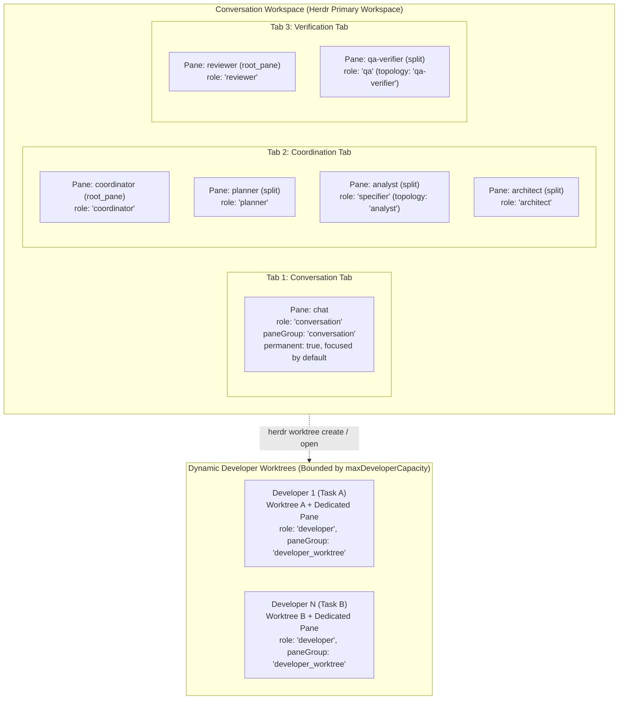

# @bflow/pane-manager

`@bflow/pane-manager` implements the **Herdr Role & Pane Manager** (Phase P13 of Bflow Agentic SDLC v2). It provides physical terminal process and multi-pane orchestration across Herdr workspaces, tabs, panes, and agent instances for all SDLC roles.

## Architectural Boundaries

In accordance with [Architecture v2](../../docs/architecture-v2.md) and [AGENTS.md](../../AGENTS.md):
- **Contracts-Only Dependency**: Strictly depends on `@bflow/contracts`. It does not import `@bflow/herdr-adapter`, `@bflow/core`, `@bflow/runtime`, or `apps/cli`.
- **No CLI / Workflow Engine Logic**: CLI lifecycle commands (`bflow init`, `bflow up`) belong to `apps/cli` (P12). Task DAG orchestration belongs to `@bflow/core` and `@bflow/runtime` (P19).
- **Physical Orchestration Only**: Manages Herdr workspaces, tabs, panes, agent processes, and Git worktrees. Inter-agent messaging is transported over Herdr protocol 22, and user interaction attaches exclusively to the conversation pane.
- **Strict Runtime Ingress Validation**: All manifests and pane bindings exchanged across package boundaries are validated using Zod schemas (`SessionManifestSchema`, `PaneBindingSchema`).

---

## Managed Topology



### Role Mapping Reference

| Topology Role | `@bflow/contracts` `AgentRole` | `PaneGroup` | Tab Key | Permanent | Read-Only Workspace | Default Agent Name |
| :--- | :--- | :--- | :--- | :--- | :--- | :--- |
| `chat` | `conversation` | `conversation` | `conversation` | `true` | `true` | `chat` |
| `coordinator` | `coordinator` | `coordination` | `coordination` | `true` | `true` | `coordinator` |
| `planner` | `planner` | `coordination` | `coordination` | `true` | `true` | `planner` |
| `analyst` | `specifier` | `coordination` | `coordination` | `true` | `true` | `analyst` |
| `architect` | `architect` | `coordination` | `coordination` | `true` | `true` | `architect` |
| `reviewer` | `reviewer` | `verification` | `verification` | `true` | `true` | `reviewer` |
| `qa-verifier` | `qa` | `verification` | `verification` | `true` | `true` | `qa-verifier` |
| `developer` | `developer` | `developer_worktree` | `developer` | `false` | `false` | `dev-<task>` |

---

## 10 Core Capabilities

1. **`initializeTopology`**: Creates or reconciles the full topology (Conversation workspace, Conversation/Coordination/Verification tabs, and shell panes/agents for all permanent roles). Reuses the workspace's root pane for `chat`, the tab root pane for the first role in each tab, and splits for subsequent roles. Focuses the `chat` pane by default.
2. **`reconcileTopology`**: Idempotent reconciliation of the topology against live Herdr state, reusing existing workspaces, tabs, panes, and agents without creating duplicates.
3. **`startAgentInPane`**: Preflight checks pane shell readiness (`pane get` and `pane process-info`), validates agent name syntax (`/^[a-z][a-z0-9_-]{0,31}$/`) and session uniqueness, then spawns the agent via `herdr agent start`.
4. **`inspectRoleHealth`**: Detailed health evaluation of an individual role (`ready`, `working`, `blocked`, `unknown`, `not_ready`, `pane_missing`, `agent_replaced`).
5. **`inspectTopologyHealth`**: Audits all bindings in the manifest, detects anomalies, and updates `SessionManifest.status` (`up` if all permanent roles are healthy, `degraded` if any anomalies exist).
6. **`recoverAfterRestart`**: Restores topology after a Herdr daemon or system restart. Detects newly assigned Herdr workspace, tab, pane, and terminal IDs, re-launches stopped agents into ready shell panes, recreates missing panes, and updates bindings with the new Herdr IDs.
7. **`focusConversationPane`**: Focuses workspace, tab, and `chat` pane (`herdr agent focus <paneId>`), updating `attachTarget` in the manifest.
8. **`allocateDeveloper`**: Allocates a dynamic Developer agent in a dedicated Git worktree and pane (`herdr worktree create` or `herdr worktree open`). Enforces `maxDeveloperCapacity`, single-writer worktree/branch mutex, and uncommitted dirty change guards.
9. **`releaseDeveloper`**: Releases a developer allocation. Verifies that the worktree is clean before releasing or closing; rejects release with a `conflict` error if uncommitted changes exist.
10. **`moveRolePane`**: Moves an existing pane to a different tab or workspace (`herdr pane move`), immediately replacing the old `paneId` with the new ID returned by Herdr.

---

## Invariants & Safety Constraints

1. **Shell Readiness Before Agent Launch**: A pane is only ready for `agent start` when `agent === null`, `shellPid` is valid, and no non-shell foreground processes are running.
2. **Never Predict Herdr IDs**: All workspace, tab, pane, and terminal IDs are obtained directly from Herdr CLI JSON responses.
3. **Pane Existence != Agent Readiness**: A pane that exists with `agent === null`, or an agent in `blocked`, `unknown`, `launchPending`, or `interactiveReady: false` state is never reported as `ready`.
4. **Never Retain Stale IDs on Pane Move or Recreate**: When `herdr pane move` or restart recovery returns a new `pane_id`, `PaneBinding.paneId` (and `attachTarget.paneId` if `chat`) is immediately updated.
5. **Agent Name Validation & Uniqueness**: Agent names must match `/^[a-z][a-z0-9_-]{0,31}$/` and must not collide with any active pane in the session.
6. **Single-Writer Worktree Mutex**: Never allocate two developer agents to the same `worktreePath` or `branchName`.
7. **Developer Capacity Limits**: Never exceed `maxDeveloperCapacity` (default 2).
8. **Dirty Worktree Allocation Guard**: Never allocate a developer in a worktree containing uncommitted changes not belonging to the task.
9. **Dirty Worktree Release Guard**: Never auto-close a pane or remove a worktree containing uncommitted changes (`isClean: false`).
10. **Atomic Manifest Persistence**: File-based manifest persistence uses atomic temporary file creation and replacement.

The production Git inspector clears inherited `GIT_*` repository/index overrides
and disables Git fsmonitor for its read operations. Allocation and release reject
`assume-unchanged` and `skip-worktree` index flags because Git status can hide edits
behind them. Clear flags explicitly after inspecting the files; sparse checkouts
using these flags are unsupported. Ignored files also make the tree dirty, so
preserve or remove generated files explicitly before releasing a worktree. The
inspector never clears flags, deletes files or discards edits.

`shutdownTopology` first obtains a successful live pane listing and closes only
the recorded panes still present. It records `down` after each required close
confirms success. Failed/timed-out closes retain the previous manifest; retry
uses another successful listing to reconcile panes already closed. Runtime
quiesce and durable checkpoints remain the caller's responsibility.

Permanent-role startup persists an `initializing` manifest and `launchIntent`
binding before each `agent start`, then persists each successful binding. A
blocked startup or lost acknowledgement therefore retains the exact pane for
reconciliation. A pending/blocked occupant is inspected in place; reconciliation
does not start a duplicate or split another pane for that launch. Manifest load
errors and failed intent writes stop startup. Workspace/tab creation before the
first role intent remains reconciled from live Herdr topology.

`readOnlyWorkspace` describes a role's policy in the manifest. Agent startup does
not install an OS sandbox or filesystem access controls. Dedicated panes and Git
worktrees isolate routing and ordinary edits, but processes under the same user
can access other worktrees and repository state. Do not treat this metadata as a
security boundary against a malicious agent.

`buildProviderRoleLaunch({ agentKind, role, systemPrompt, model?, mcpServers?,
nativeSessionHookCommand? })` is an explicit opt-in helper for `claude` and
`codex`. Pass its returned argv through `roleConfigs[role].args`; arbitrary other
supported providers retain their existing launch configuration. Claude uses
restricted mode, explicit built-in tool lists, `dontAsk`, isolated MCP config and
launch-local settings; Conversation/Coordinator receive no native tools, while
other read-only roles receive Read/Glob/Grep rather than shell or write tools.
Native file tools deny `.bflow`, `.git` and common credential directories. Codex
uses read-only or workspace-write sandbox, never approvals,
and per-launch MCP/instructions/hooks overrides. Configured MCP servers remain
trusted capabilities and must enforce their own role policy. Developer shell
tools still require the host's implementation/command policy; a write sandbox
alone cannot enforce Git approvals or protect secrets within its readable paths.

The optional native SessionStart hook command is operator-owned and applies only
to this launch; it installs no user/global hook and changes no credentials.
Codex's invocation-local hook-trust bypass is emitted only for that explicit
vetted hook. This is separate from approval/sandbox bypass, which is never used.
Herdr interactive readiness proves transport readiness, not provider login,
authenticated session identity, TDD evidence or task success. The host must
validate those separately. Installed CLI parse checks used Herdr 0.9.5 protocol
22, Claude 2.1.299 and Codex 0.162.0; release labels are diagnostics, not allowlists.
Codex hook format follows the [official hooks documentation](https://learn.chatgpt.com/docs/hooks).

`await buildProviderRoleLaunchFromFiles({ agentKind, role, systemPrompt,
mcpConfigFile, hooksSettingsFile, model? })` consumes the launch descriptor from
the trusted Runtime host and preserves every configured native lifecycle hook.
Claude receives the launch-local file paths; Codex receives equivalent inline
TOML overrides. Hook files are trusted executable configuration, not model input.

An optional real-provider probe runs in an isolated named Herdr session and a
private disposable Claude profile cloned from the existing login. It answers the
trust question only for its generated workspace, reports the actual native
SessionStart identity via `pane.report_agent_session`, and requests one real
model reply. It does not install global hooks or modify the original profile.
This is provider/transport evidence, not a complete Agentic SDLC workflow:

```sh
BFLOW_LIVE_CLAUDE=1 TMPDIR=/tmp pnpm exec vitest run packages/pane-manager/test/provider-live.test.ts --maxWorkers=1 --minWorkers=1
```

---

## Herdr CLI Protocol & API Map

All CLI commands are executed via argv-based `spawn` with `shell: false`. Stderr JSON error responses (`{ id: string, error: { code: string, message: string } }`) are parsed and mapped to typed `ContractError` values.

| Operation | CLI Command | Expected JSON Type | Fields Consumed | Purpose |
| :--- | :--- | :--- | :--- | :--- |
| List Workspaces | `herdr workspace list` | `workspace_list` | `.result.workspaces[]` | Detect existing session workspace |
| Create Workspace | `herdr workspace create --cwd <path> --label <name> --no-focus` | `workspace_created` | `.result.workspace.workspace_id`, `.result.tab.tab_id`, `.result.root_pane.pane_id` | Initialize primary workspace & chat pane |
| Focus Workspace | `herdr workspace focus <workspace_id>` | `workspace_info` | `.result.workspace` | Switch workspace focus |
| List Tabs | `herdr tab list --workspace <ws_id>` | `tab_list` | `.result.tabs[]` | Enumerate tabs in workspace |
| Create Tab | `herdr tab create --workspace <ws_id> --cwd <path> --label <name> --no-focus` | `tab_created` | `.result.tab.tab_id`, `.result.root_pane.pane_id` | Create Coordination or Verification tab |
| Focus Tab | `herdr tab focus <tab_id>` | `tab_info` | `.result.tab` | Switch tab focus |
| List Panes | `herdr pane list [--workspace <ws_id>]` | `pane_list` | `.result.panes[]` | Enumerate panes |
| Inspect Pane | `herdr pane get <pane_id>` | `pane_info` | `.result.pane` (`pane_id`, `terminal_id`, `agent`, `agent_status`) | Check pane existence and occupant |
| Inspect Process | `herdr pane process-info --pane <pane_id>` | `pane_process_info` | `.result.process_info` (`shell_pid`, `foreground_process_group_id`, `foreground_processes`) | Verify shell is ready before agent start |
| Split Pane | `herdr pane split <pane_id> --direction <right\|down> --cwd <path> --no-focus` | `pane_info` | `.result.pane.pane_id`, `.result.pane.terminal_id` | Create additional pane in tab |
| Rename Pane | `herdr pane rename <pane_id> <label>` | `pane_info` | `.result.pane` | Label pane with role name |
| Move Pane | `herdr pane move <pane_id> ...` | `pane_move` | `.result.move_result.pane.pane_id`, `.result.move_result.pane.workspace_id`, `.result.move_result.pane.tab_id` | Move pane and update IDs |
| Close Pane | `herdr pane close <pane_id>` | `ok` | `.result.type === "ok"` | Close released developer pane |
| List Agents | `herdr agent list` | `agent_list` | `.result.agents[]` | Audit running agents across panes |
| Inspect Agent | `herdr agent get <target>` | `agent_info` | `.result.agent` (`name`, `agent`, `agent_status`, `interactive_ready`, `launch_pending`) | Check agent health and readiness |
| Start Agent | `herdr agent start <name> --kind <kind> --pane <pane_id> [--timeout <ms>] [-- <args...>]` | `agent_started` | `.result.agent` | Launch agent process in shell pane |
| Focus Agent | `herdr agent focus <target>` | `agent_info` | `.result.agent` | Focus conversation chat pane |
| Create Worktree | `herdr worktree create --workspace <ws_id> --branch <br> --path <path> --label <lbl> --no-focus` | `worktree_created` | `.result.workspace`, `.result.tab`, `.result.root_pane`, `.result.worktree` | Allocate developer in new worktree |
| Open Worktree | `herdr worktree open --workspace <ws_id> --path <path> --label <lbl> --no-focus` | `worktree_opened` | `.result.workspace`, `.result.tab`, `.result.root_pane`, `.result.worktree` | Allocate developer in existing worktree |
| Remove Worktree | `herdr worktree remove --workspace <ws_id>` | `worktree_removed` | `.result.workspace_id`, `.result.path` | Clean up developer worktree |
| Socket: Create Workspace | socket `workspace.create` `{ cwd, label, focus: false, env }` | `workspace_created` result | `.result.workspace`, `.result.tab`, `.result.root_pane` | Env-bearing Conversation workspace (`herdr status server --json` resolves the socket) |
| Socket: Create Tab | socket `tab.create` `{ workspace_id, cwd, label, focus: false, env }` | `tab_created` result | `.result.tab`, `.result.root_pane` | Env-bearing tab root |
| Socket: Split Pane | socket `pane.split` `{ target_pane_id, direction, cwd?, focus: false, env }` | `pane_info` result | `.result.pane` | Env-bearing role or Developer pane |

---

## Validation & Testing

Run unit and integration tests:

```bash
# Targeted package test suite
pnpm exec vitest run packages/pane-manager/test

# Full workspace verification
pnpm check:deps
pnpm typecheck
pnpm test
```

## Provider launch profiles (P30)

`RoleAgentConfig.launch` (also accepted on `startAgentInPane` and `DeveloperAllocationRequest`)
starts a role from a validated provider launch profile:
`{ argv, env, launchId, launchFingerprint, provider: "claude" | "codex" | "agy" }`.
The Herdr command becomes `agent start <name> --kind <provider> --pane <id> [--timeout N] -- <argv...>`.
`env` is applied at pane creation, never on `agent start`. Live finding (Herdr 0.9.5):
`herdr agent start` types the provider command into the pane's existing shell, so variables
passed on the `agent start` invocation do not reach the provider, while env set when a pane is
created is inherited by its shell. Therefore, a role or Developer whose launch has non-empty
`env` gets its pane through the Herdr socket API with `env` (`workspace.create` for the
Conversation root, `tab.create` for a new tab root, `pane.split` for other panes, and
`pane.split` on the worktree root for Developers, after which that root is closed). The
`agent start` invocation carries no env. The CLI is never given env, so no token reaches argv
or CLI env. Env values are never persisted, logged or echoed in errors. `launchId` and
`launchFingerprint` are recorded in `PaneBinding.metadata` and preserved by reconciliation
and health refresh. Without `launch` or with empty `env`, the existing CLI path is unchanged.

Because env is fixed at creation, a launch never starts in a pane recorded for a different
launch. For an env-bearing launch, a pane whose `launchId` differs from the new launch (or has
none) is never reused: it is replaced by a new pane created with the new env, and the old
Bflow-owned role pane is closed after the replacement exists and before the new agent starts.
A released Developer pane with another launch's `launchId` is replaced the same way. Panes
created by this run for a launch may only be taken by that launch; unbound empty shells are
never adopted by an env-bearing role.

Env-bearing creation requires `RolePaneManagerOptions.socket` (a `HerdrSocketPort`).
Without it, `initializeTopology`, `reconcileTopology`, `recoverAfterRestart` and
`allocateDeveloper` return `validation` before any side effect. `createHerdrSocketPort({ runner,
sessionId })` is the default implementation: it resolves the socket path with
`herdr status server --json` through the same repository-scoped runner, rejects a socket whose
`session` differs or which is not `running`, sends one newline-delimited `{ id, method, params }`
request per call, enforces a 30 s default timeout and a 1 MiB response limit, and maps Herdr
error codes to `not_found` or `validation` without echoing params or Herdr's message. A timeout
or lost response is `transport_unavailable` (retryable only after reconciliation).

Validation runs before any Herdr call and returns `validation` on failure: provider must
equal the configured agent kind; argv items must not contain NUL/newline or look like
secrets (`sk-…`, `Bearer …`, `ghp_…`, `AIza…`, `secret://`); env keys must match
`/^[A-Z_][A-Z0-9_]*$/` and values must not contain NUL/newline. For `chat` and `coordinator`,
the profile argv must already reference the original Bflow role prompt file (it is not
rewritten), and that file is verified as before.

`inspectLaunchObservation(role)` reports `paneId`, `agentName`, Herdr `transportState`,
`interactiveReady` (true only for `idle`, `working` or `done` with no pending launch and no
`interactive_ready: false`), `launchPending` and the native session locator. It reuses the
`inspectRoleHealth` agent/pane inspection. Herdr `done` is turn completion only and is never
reported as task success.

Limitations: the pane-creation env delivery (socket `env` is inherited by the pane shell) is
verified against Herdr 0.9.5 by live finding only; it is not yet covered by a live acceptance
test. Restart recovery cannot re-create a Developer pane's env because the Developer launch
profile is not persisted; a recovered Developer is started with the launch supplied to that
call (none, from recovery). Reusing an
already-running agent in a pane does not re-record launch metadata (the fingerprint of an
existing occupant cannot be verified). No live Herdr or provider evidence exists for this
path; tests use a fake runner (`packages/pane-manager/test/launch-profile.test.ts`).

## Startup presentation and original role prompts

New Coordination topology uses balanced right/down splits to form a 2x2 grid.
Conversation remains a full pane and Verification has two panes. Every role pane
is named; an adopted initial tab is renamed to conversation. Reconciliation
resizes existing owned splits by leaf count, preserving pane IDs and shell/agent
processes. Tabs containing operator-added panes are left alone. Native
`layout.apply` creates replacement terminals in the installed Herdr, so reflow
deliberately uses only `pane resize`.

Chat and Coordinator load complete installed `agents/*/system-prompt.md` assets
before launch. Native file flags avoid terminal line limits; host-generated files
must contain the original role instructions. Missing, symlink or oversized assets
fail before agent launch. Existing healthy panes are not reset to inject prompts.
Late native session identity is captured only for recorded pending launches; an
already-bound session cannot be silently replaced during reconciliation.

Blocked startup classifies update, repository trust, sign-in and unknown dialogs
and returns role/provider/pane/session plus exact manual commands. It never
presses an update, trust or permission confirmation, and never exposes raw screen
contents in the error. `pane read` remains an explicit operator action.

`readBuiltinRolePrompt(role)` resolves installed `agents/` assets per topology role, trying candidates in order: `chat/system-prompt.md`, `coordinator/system-prompt.md`, `analyst/system-prompt.md` then `analyst/prompt.md`, `architect/system-prompt.md` then `architect/prompt.md`, `planner/system-prompt.md`, `developer/system-prompt.md`, `reviewer/system-prompt.md`, and `verifier/system-prompt.md` then `verifier/prompt.md` for `qa-verifier`. It opens files no-follow/nonblocking, requires a regular non-empty file of at most 64 KiB and throws if no candidate loads. The package also exports `NON_USER_FACING_AUTONOMOUS_POLICY` and `STRUCTURED_RESULT_REQUIRED_FIELDS` (the same text and field list used by the registry and Runtime host). `startAgentInPane` itself injects the original prompt file only for `chat` and `coordinator` panes; other roles receive prompts from the Runtime host launch configuration. Tests: `pnpm exec vitest run packages/pane-manager/test/role-prompts.test.ts`.
