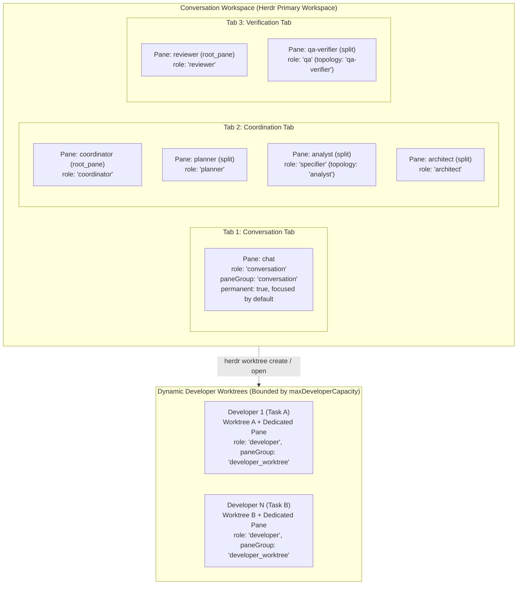

# @bflow/pane-manager

`@bflow/pane-manager` triển khai **Herdr Role & Pane Manager** (Phase P13 của Bflow Agentic SDLC v2). Package cung cấp việc điều phối process terminal vật lý và đa pane trên các Herdr workspace, tab, pane và agent instance cho mọi SDLC role.

## Ranh giới kiến trúc

Theo [Architecture v2](../../docs/architecture-v2.md) và [AGENTS.md](../../AGENTS.md):
- **Chỉ phụ thuộc Contracts**: Chỉ phụ thuộc nghiêm ngặt vào `@bflow/contracts`. Không import `@bflow/herdr-adapter`, `@bflow/core`, `@bflow/runtime` hay `apps/cli`.
- **Không có logic CLI / Workflow Engine**: Các lệnh vòng đời CLI (`bflow init`, `bflow up`) thuộc `apps/cli` (P12). Việc điều phối Task DAG thuộc `@bflow/core` và `@bflow/runtime` (P19).
- **Chỉ điều phối vật lý**: Quản lý Herdr workspace, tab, pane, agent process và Git worktree. Việc nhắn tin giữa các agent được vận chuyển qua Herdr protocol 22, và tương tác người dùng chỉ gắn vào conversation pane.
- **Validate ingress lúc runtime nghiêm ngặt**: Mọi manifest và pane binding trao đổi qua ranh giới package đều được validate bằng Zod schema (`SessionManifestSchema`, `PaneBindingSchema`).

---

## Topology được quản lý



### Tham chiếu ánh xạ Role

| Topology Role | `@bflow/contracts` `AgentRole` | `PaneGroup` | Tab Key | Permanent | Read-Only Workspace | Default Agent Name |
| :--- | :--- | :--- | :--- | :--- | :--- | :--- |
| `chat` | `conversation` | `conversation` | `conversation` | `true` | `true` | `chat` |
| `coordinator` | `coordinator` | `coordination` | `coordination` | `true` | `true` | `coordinator` |
| `planner` | `planner` | `coordination` | `coordination` | `true` | `true` | `planner` |
| `analyst` | `specifier` | `coordination` | `coordination` | `true` | `true` | `analyst` |
| `architect` | `architect` | `coordination` | `coordination` | `true` | `true` | `architect` |
| `reviewer` | `reviewer` | `verification` | `verification` | `true` | `true` | `reviewer` |
| `qa-verifier` | `qa` | `verification` | `verification` | `true` | `true` | `qa-verifier` |
| `developer` | `developer` | `developer_worktree` | `developer` | `false` | `false` | `dev-<task>` |

---

## 10 Capability cốt lõi

1. **`initializeTopology`**: Tạo hoặc đối soát toàn bộ topology (Conversation workspace, các tab Conversation/Coordination/Verification, và shell pane/agent cho mọi permanent role). Tái sử dụng root pane của workspace cho `chat`, root pane của tab cho role đầu tiên trong mỗi tab, và split cho các role sau. Focus pane `chat` theo mặc định.
2. **`reconcileTopology`**: Đối soát idempotent topology với trạng thái Herdr đang chạy, tái sử dụng workspace, tab, pane và agent hiện có mà không tạo bản sao.
3. **`startAgentInPane`**: Preflight kiểm tra shell của pane đã sẵn sàng (`pane get` và `pane process-info`), validate cú pháp tên agent (`/^[a-z][a-z0-9_-]{0,31}$/`) và tính duy nhất trong session, rồi spawn agent qua `herdr agent start`.
4. **`inspectRoleHealth`**: Đánh giá health chi tiết của một role riêng lẻ (`ready`, `working`, `blocked`, `unknown`, `not_ready`, `pane_missing`, `agent_replaced`).
5. **`inspectTopologyHealth`**: Audit mọi binding trong manifest, phát hiện bất thường, và cập nhật `SessionManifest.status` (`up` nếu mọi permanent role khỏe mạnh, `degraded` nếu có bất thường).
6. **`recoverAfterRestart`**: Khôi phục topology sau khi Herdr daemon hoặc hệ thống khởi động lại. Phát hiện các ID workspace, tab, pane và terminal mới do Herdr gán, khởi chạy lại các agent đã dừng vào các shell pane sẵn sàng, tạo lại pane bị thiếu, và cập nhật binding với các Herdr ID mới.
7. **`focusConversationPane`**: Focus workspace, tab và pane `chat` (`herdr agent focus <paneId>`), cập nhật `attachTarget` trong manifest.
8. **`allocateDeveloper`**: Cấp phát một Developer agent động trong một Git worktree và pane riêng (`herdr worktree create` hoặc `herdr worktree open`). Thực thi `maxDeveloperCapacity`, mutex một-writer cho worktree/branch, và các guard chống thay đổi chưa commit (dirty).
9. **`releaseDeveloper`**: Giải phóng một developer allocation. Xác minh worktree sạch trước khi giải phóng hoặc đóng; từ chối release với lỗi `conflict` nếu có thay đổi chưa commit.
10. **`moveRolePane`**: Di chuyển một pane hiện có sang tab hoặc workspace khác (`herdr pane move`), thay `paneId` cũ ngay lập tức bằng ID mới do Herdr trả về.

---

## Invariant và ràng buộc an toàn

1. **Shell sẵn sàng trước khi launch agent**: Một pane chỉ sẵn sàng cho `agent start` khi `agent === null`, `shellPid` hợp lệ và không có process foreground nào không phải shell đang chạy.
2. **Không bao giờ đoán trước Herdr ID**: Mọi ID workspace, tab, pane và terminal đều lấy trực tiếp từ phản hồi JSON của Herdr CLI.
3. **Pane tồn tại != Agent sẵn sàng**: Một pane tồn tại với `agent === null`, hoặc một agent ở trạng thái `blocked`, `unknown`, `launchPending` hay `interactiveReady: false` không bao giờ được báo là `ready`.
4. **Không bao giờ giữ ID cũ khi di chuyển hoặc tạo lại pane**: Khi `herdr pane move` hoặc khôi phục sau restart trả về `pane_id` mới, `PaneBinding.paneId` (và `attachTarget.paneId` nếu là `chat`) được cập nhật ngay.
5. **Validate và tính duy nhất của tên agent**: Tên agent phải khớp `/^[a-z][a-z0-9_-]{0,31}$/` và không được trùng với bất kỳ pane đang hoạt động nào trong session.
6. **Mutex worktree một-writer**: Không bao giờ cấp phát hai developer agent cho cùng một `worktreePath` hoặc `branchName`.
7. **Giới hạn Developer Capacity**: Không bao giờ vượt `maxDeveloperCapacity` (mặc định 2).
8. **Guard khi cấp phát worktree dirty**: Không bao giờ cấp phát developer trong worktree chứa thay đổi chưa commit không thuộc task.
9. **Guard khi release worktree dirty**: Không bao giờ tự động đóng pane hoặc xóa worktree chứa thay đổi chưa commit (`isClean: false`).
10. **Lưu manifest atomic**: Việc lưu manifest dựa trên file dùng cơ chế tạo file tạm và thay thế atomic.

Git inspector production xóa các override `GIT_*` repository/index được kế thừa
và tắt Git fsmonitor cho các thao tác đọc của nó. Allocation và release từ chối
các cờ index `assume-unchanged` và `skip-worktree` vì Git status có thể che các chỉnh sửa
đằng sau chúng. Hãy xóa cờ tường minh sau khi kiểm tra các file; sparse checkout
dùng các cờ này không được hỗ trợ. File bị ignore cũng làm cây dirty, nên
hãy giữ lại hoặc xóa tường minh các file được sinh ra trước khi release một worktree. Inspector
không bao giờ xóa cờ, xóa file hay loại bỏ chỉnh sửa.

`shutdownTopology` trước tiên đối soát các pane đang chạy trong mọi workspace được ghi nhận,
gồm cả workspace Developer, và chỉ đóng các pane được ghi nhận vẫn còn tồn tại.
Nếu một workspace đã biến mất, phản hồi `not_found` có cấu trúc cùng một danh sách workspace
mới thành công mà không có nó cho phép shutdown tiếp tục. Timeout,
phản hồi sai định dạng hoặc danh sách mâu thuẫn khiến shutdown chưa hoàn tất. Nó ghi
`down` sau khi mọi lần đóng bắt buộc xác nhận thành công. Các lần đóng thất bại/timeout giữ lại manifest trước đó; retry
dùng một danh sách thành công khác để đối soát các pane đã đóng. Runtime
quiesce và checkpoint bền vững vẫn là trách nhiệm của caller.

Các lần chờ khởi động native agent bị chặn ở giới hạn protocol của Herdr là 300000 ms.
Timeout được yêu cầu/theo role vẫn là cận trên; ngân sách vòng đời tổng lớn hơn
không bao giờ được chuyển tiếp nguyên vẹn. `OperationOptions.timeoutMs` và `deadline` tiếp tục
giới hạn việc chờ, gồm cả thời gian dành cho kiểm tra shell sẵn sàng và validate
prompt. Mỗi lần retry busy đã được xác nhận sẽ tính lại ngân sách còn lại. Ngân sách
còn lại từ 3000 ms trở xuống trả về `timeout` cục bộ với `retrySafety: not_started`
trước khi launch agent; input số không hợp lệ thất bại validation. Command runner
dùng cùng việc chờ có giới hạn và giữ khả năng hủy. Acknowledgement bị mất vẫn
yêu cầu đối soát thay vì replay tự động.

Khởi động permanent role lưu một manifest `initializing` và binding `launchIntent`
trước mỗi `agent start`, rồi lưu từng binding thành công. Do đó một
khởi động bị blocked hoặc acknowledgement bị mất giữ lại đúng pane để
đối soát. Một occupant đang pending/blocked được kiểm tra tại chỗ; đối soát
không khởi động bản sao hay split pane khác cho launch đó. Lỗi nạp manifest
và lỗi ghi intent làm dừng khởi động. Việc tạo workspace/tab trước
role intent đầu tiên vẫn được đối soát từ topology Herdr đang chạy.

Topology reconciliation cấp phát pane và lưu các binding trong hàng đợi theo thứ tự
role đã cấu hình trước khi khởi động agent. Tối đa bốn lần khởi động permanent-role độc lập
sau đó chạy chồng nhau. Tên permanent agent đã cấu hình phải duy nhất trước khi các
side effect của topology bắt đầu. Mỗi worker xóa `launchQueued` trong một intent bền vững trước khi gọi
`agent start`; cùng hàng đợi publication tuần tự ghi các binding thành công
mà không làm mất tiến trình của worker khác. Một lỗi dừng các lần khởi động trong hàng đợi và
ngăn các worker chưa được dispatch tiếp tục sau lỗi ghi intent hoặc
hủy, và xả hết worker cùng các lần ghi trước khi trả về lỗi đầu tiên theo thứ tự role
đã cấu hình. Trạng thái `up` cuối cùng vẫn chờ mọi role bắt buộc. Các đảm bảo này có
độ bao phủ bằng fake-runner cục bộ; độ trễ khởi động provider thật chưa được xác lập ở đây.

`readOnlyWorkspace` mô tả policy của một role trong manifest. Việc khởi động agent không
cài OS sandbox hay kiểm soát truy cập filesystem. Pane riêng và Git
worktree cô lập routing và các chỉnh sửa thông thường, nhưng các process cùng user
có thể truy cập worktree khác và trạng thái repository. Không coi metadata này là
ranh giới bảo mật chống lại agent độc hại.

`buildProviderRoleLaunch({ agentKind, role, systemPrompt, model?, mcpServers?,
nativeSessionHookCommand? })` là helper opt-in tường minh cho `claude` và
`codex`. Truyền argv nó trả về qua `roleConfigs[role].args`; các provider được hỗ trợ khác
giữ nguyên cấu hình launch hiện có. Claude dùng restricted mode, danh sách tool built-in
tường minh, `dontAsk`, cấu hình MCP cô lập và settings cục bộ theo launch;
Conversation/Coordinator không nhận tool native nào, còn các role chỉ-đọc khác nhận
Read/Glob/Grep thay vì tool shell hay ghi.
Tool file native từ chối `.bflow`, `.git` và các thư mục credential phổ biến. Codex
dùng sandbox read-only hoặc workspace-write, không bao giờ approval,
và các override MCP/instruction/hook theo từng launch. MCP server đã cấu hình vẫn là
capability đáng tin và phải tự thực thi role policy của chúng. Tool shell của Developer
vẫn yêu cầu policy implementation/command của host; riêng một write sandbox
không thể thực thi các approval Git hay bảo vệ secret trong các đường dẫn đọc được của nó.

Lệnh native SessionStart hook tùy chọn do operator sở hữu và chỉ áp dụng
cho launch này; nó không cài hook user/global và không đổi credential.
Hook-trust bypass cục bộ theo lần gọi của Codex chỉ được phát ra cho đúng hook đã được
thẩm định tường minh đó. Điều này tách biệt với approval/sandbox bypass, vốn không bao giờ được dùng.
Readiness tương tác của Herdr chứng minh readiness của transport, không phải đăng nhập provider,
danh tính session đã xác thực, bằng chứng TDD hay thành công của task. Host phải
validate các điều đó riêng. Các kiểm tra parse CLI đã cài dùng Herdr 0.9.5 protocol
22, Claude 2.1.299 và Codex 0.162.0; release label chỉ là chẩn đoán, không phải allowlist.
Định dạng hook của Codex theo [tài liệu hooks chính thức](https://learn.chatgpt.com/docs/hooks).

`await buildProviderRoleLaunchFromFiles({ agentKind, role, systemPrompt,
mcpConfigFile, hooksSettingsFile, model? })` tiêu thụ launch descriptor từ
Runtime host đáng tin và giữ nguyên mọi native lifecycle hook đã cấu hình.
Claude nhận đường dẫn file cục bộ theo launch; Codex nhận các override TOML
inline tương đương. File hook là cấu hình thực thi đáng tin, không phải input cho model.

Một real-provider probe tùy chọn chạy trong một Herdr session có tên cô lập và một
profile Claude dùng một lần riêng tư được clone từ đăng nhập hiện có. Nó trả lời
câu hỏi trust chỉ cho workspace do nó sinh ra, báo danh tính native
SessionStart thực tế qua `pane.report_agent_session`, và yêu cầu một phản hồi model thật.
Nó không cài hook global hay sửa profile gốc.
Đây là bằng chứng provider/transport, không phải một workflow Agentic SDLC hoàn chỉnh:

```sh
BFLOW_LIVE_CLAUDE=1 TMPDIR=/tmp pnpm exec vitest run packages/pane-manager/test/provider-live.test.ts --maxWorkers=1 --minWorkers=1
```

---

## Giao thức Herdr CLI & bản đồ API

Mọi lệnh CLI được thực thi qua `spawn` dựa trên argv với `shell: false`. Phản hồi lỗi JSON trên stderr (`{ id: string, error: { code: string, message: string } }`) được parse và ánh xạ thành các giá trị `ContractError` có kiểu.

| Thao tác | Lệnh CLI | Kiểu JSON mong đợi | Trường được dùng | Mục đích |
| :--- | :--- | :--- | :--- | :--- |
| List Workspaces | `herdr workspace list` | `workspace_list` | `.result.workspaces[]` | Phát hiện workspace của session hiện có |
| Create Workspace | `herdr workspace create --cwd <path> --label <name> --no-focus` | `workspace_created` | `.result.workspace.workspace_id`, `.result.tab.tab_id`, `.result.root_pane.pane_id` | Khởi tạo workspace chính & pane chat |
| Focus Workspace | `herdr workspace focus <workspace_id>` | `workspace_info` | `.result.workspace` | Chuyển focus workspace |
| List Tabs | `herdr tab list --workspace <ws_id>` | `tab_list` | `.result.tabs[]` | Liệt kê tab trong workspace |
| Create Tab | `herdr tab create --workspace <ws_id> --cwd <path> --label <name> --no-focus` | `tab_created` | `.result.tab.tab_id`, `.result.root_pane.pane_id` | Tạo tab Coordination hoặc Verification |
| Focus Tab | `herdr tab focus <tab_id>` | `tab_info` | `.result.tab` | Chuyển focus tab |
| List Panes | `herdr pane list [--workspace <ws_id>]` | `pane_list` | `.result.panes[]` | Liệt kê pane |
| Inspect Pane | `herdr pane get <pane_id>` | `pane_info` | `.result.pane` (`pane_id`, `terminal_id`, `agent`, `agent_status`) | Kiểm tra sự tồn tại của pane và occupant |
| Inspect Process | `herdr pane process-info --pane <pane_id>` | `pane_process_info` | `.result.process_info` (`shell_pid`, `foreground_process_group_id`, `foreground_processes`) | Xác minh shell sẵn sàng trước khi agent start |
| Split Pane | `herdr pane split <pane_id> --direction <right\|down> --cwd <path> --no-focus` | `pane_info` | `.result.pane.pane_id`, `.result.pane.terminal_id` | Tạo pane bổ sung trong tab |
| Rename Pane | `herdr pane rename <pane_id> <label>` | `pane_info` | `.result.pane` | Gán nhãn pane bằng tên role |
| Move Pane | `herdr pane move <pane_id> ...` | `pane_move` | `.result.move_result.pane.pane_id`, `.result.move_result.pane.workspace_id`, `.result.move_result.pane.tab_id` | Di chuyển pane và cập nhật ID |
| Close Pane | `herdr pane close <pane_id>` | `ok` | `.result.type === "ok"` | Đóng pane developer đã release |
| List Agents | `herdr agent list` | `agent_list` | `.result.agents[]` | Audit các agent đang chạy trên các pane |
| Inspect Agent | `herdr agent get <target>` | `agent_info` | `.result.agent` (`name`, `agent`, `agent_status`, `interactive_ready`, `launch_pending`) | Kiểm tra health và readiness của agent |
| Start Agent | `herdr agent start <name> --kind <kind> --pane <pane_id> [--timeout <ms>] [-- <args...>]` | `agent_started` | `.result.agent` | Launch agent process trong shell pane |
| Focus Agent | `herdr agent focus <target>` | `agent_info` | `.result.agent` | Focus pane chat của conversation |
| Create Worktree | `herdr worktree create --workspace <ws_id> --branch <br> --path <path> --label <lbl> --no-focus` | `worktree_created` | `.result.workspace`, `.result.tab`, `.result.root_pane`, `.result.worktree` | Cấp phát developer trong worktree mới |
| Open Worktree | `herdr worktree open --workspace <ws_id> --path <path> --label <lbl> --no-focus` | `worktree_opened` | `.result.workspace`, `.result.tab`, `.result.root_pane`, `.result.worktree` | Cấp phát developer trong worktree hiện có |
| Remove Worktree | `herdr worktree remove --workspace <ws_id>` | `worktree_removed` | `.result.workspace_id`, `.result.path` | Dọn dẹp worktree của developer |
| Socket: Create Workspace | socket `workspace.create` `{ cwd, label, focus: false, env }` | kết quả `workspace_created` | `.result.workspace`, `.result.tab`, `.result.root_pane` | Conversation workspace mang env (`herdr status server --json` resolve socket) |
| Socket: Create Tab | socket `tab.create` `{ workspace_id, cwd, label, focus: false, env }` | kết quả `tab_created` | `.result.tab`, `.result.root_pane` | Root của tab mang env |
| Socket: Split Pane | socket `pane.split` `{ target_pane_id, direction, cwd?, focus: false, env }` | kết quả `pane_info` | `.result.pane` | Pane role hoặc Developer mang env |

---

## Validation & Testing

Chạy unit test và integration test:

```bash
# Targeted package test suite
pnpm exec vitest run packages/pane-manager/test

# Full workspace verification
pnpm check:deps
pnpm typecheck
pnpm test
```

## Provider launch profile (P30)

`RoleAgentConfig.launch` (cũng được chấp nhận trên `startAgentInPane` và `DeveloperAllocationRequest`)
khởi động một role từ provider launch profile đã validate:
`{ argv, env, launchId, launchFingerprint, provider: "claude" | "codex" | "agy" }`.
Lệnh Herdr trở thành `agent start <name> --kind <provider> --pane <id> [--timeout N] -- <argv...>`.
`env` được áp dụng lúc tạo pane, không bao giờ trên `agent start`. Phát hiện thực tế (Herdr 0.9.5):
`herdr agent start` gõ lệnh provider vào shell hiện có của pane, nên các biến
truyền trong lời gọi `agent start` không tới được provider, trong khi env đặt khi một pane được
tạo sẽ được shell của nó kế thừa. Do đó, một role hoặc Developer có launch với `env`
không rỗng sẽ lấy pane qua Herdr socket API kèm `env` (`workspace.create` cho
root Conversation, `tab.create` cho root của tab mới, `pane.split` cho các pane khác, và
`pane.split` trên root của worktree cho Developer, sau đó root đó được đóng). Lời gọi
`agent start` không mang env. CLI không bao giờ được cấp env, nên không token nào tới argv
hay env của CLI. Giá trị env không bao giờ được lưu, log hay lặp lại trong lỗi. `launchId` và
`launchFingerprint` được ghi vào `PaneBinding.metadata` và được giữ nguyên qua đối soát
và làm mới health. Không có `launch` hoặc với `env` rỗng, đường CLI hiện có không đổi.

Vì env được cố định lúc tạo, một launch không bao giờ khởi động trong pane đã được ghi nhận cho một
launch khác. Với launch mang env, một pane có `launchId` khác launch mới (hoặc không
có) không bao giờ được tái sử dụng: nó bị thay bằng một pane mới tạo với env mới, và pane
role do Bflow sở hữu cũ được đóng sau khi pane thay thế tồn tại và trước khi agent mới khởi động.
Một pane Developer đã release với `launchId` của launch khác được thay thế theo cùng cách. Pane
do lần chạy này tạo cho một launch chỉ có thể được launch đó nhận; shell rỗng chưa gắn binding
không bao giờ được role mang env nhận nuôi.

Việc tạo pane mang env yêu cầu `RolePaneManagerOptions.socket` (một `HerdrSocketPort`).
Nếu không có, `initializeTopology`, `reconcileTopology`, `recoverAfterRestart` và
`allocateDeveloper` trả về `validation` trước mọi side effect. `createHerdrSocketPort({ runner,
sessionId })` là triển khai mặc định: nó resolve đường dẫn socket bằng
`herdr status server --json` qua cùng runner theo phạm vi repository, từ chối socket có
`session` khác hoặc không `running`, gửi một request `{ id, method, params }` phân tách bằng newline
cho mỗi lời gọi, thực thi timeout mặc định 30 s và giới hạn phản hồi 1 MiB, và ánh xạ mã lỗi
Herdr thành `not_found` hoặc `validation` mà không lặp lại params hay thông điệp của Herdr. Timeout
hoặc phản hồi bị mất là `transport_unavailable` (chỉ retry được sau khi đối soát).

Validation chạy trước mọi lời gọi Herdr và trả về `validation` khi thất bại: provider phải
bằng agent kind đã cấu hình; các phần tử argv không được chứa NUL/newline hay trông giống
secret (`sk-…`, `Bearer …`, `ghp_…`, `AIza…`, `secret://`); key env phải khớp
`/^[A-Z_][A-Z0-9_]*$/` và giá trị không được chứa NUL/newline. Với `chat` và `coordinator`,
argv của profile phải đã tham chiếu file role prompt gốc của Bflow (nó không bị
ghi lại), và file đó được xác minh như trước.

`inspectLaunchObservation(role)` báo `paneId`, `agentName`, `transportState` của Herdr,
`interactiveReady` (true chỉ với `idle`, `working` hoặc `done` không có launch đang pending và không có
`interactive_ready: false`), `launchPending` và native session locator. Nó tái sử dụng việc
kiểm tra agent/pane của `inspectRoleHealth`. Herdr `done` chỉ là hoàn thành lượt và không bao giờ
được báo là thành công của task.

Hạn chế: việc chuyển env lúc tạo pane (socket `env` được shell của pane kế thừa) chỉ
được xác minh với Herdr 0.9.5 bằng phát hiện thực tế; nó chưa được bao phủ bởi test acceptance
thật. Khôi phục sau restart không thể tạo lại env của pane Developer vì launch
profile của Developer không được lưu; một Developer được khôi phục được khởi động với launch được cung cấp cho lời gọi đó
(không có, từ recovery). Tái sử dụng một
agent đang chạy trong pane không ghi lại metadata launch (fingerprint của một
occupant hiện có không thể xác minh). Không có bằng chứng Herdr hay provider thật cho đường
này; test dùng fake runner (`packages/pane-manager/test/launch-profile.test.ts`).

## Trình bày khi khởi động và role prompt gốc

Topology Coordination mới dùng các split right/down cân bằng để tạo lưới 2x2.
Conversation vẫn là một pane đầy đủ và Verification có hai pane. Mọi pane role
đều được đặt tên; tab đầu tiên được nhận nuôi được đổi tên thành conversation. Reconciliation
thay đổi kích thước các split do bflow sở hữu hiện có theo số leaf, giữ nguyên pane ID và process shell/agent.
Tab chứa pane do operator thêm được để nguyên. `layout.apply` native
tạo terminal thay thế trong Herdr đã cài, nên việc reflow
cố ý chỉ dùng `pane resize`.

Chat và Coordinator nạp trọn các asset `agents/*/system-prompt.md` đã cài
trước khi launch. Cờ file native tránh giới hạn dòng của terminal; các file do host sinh ra
phải chứa chỉ dẫn role gốc. Asset thiếu, là symlink hoặc quá lớn
thất bại trước khi launch agent. Pane khỏe mạnh hiện có không bị reset để inject prompt.
Danh tính native session đến muộn chỉ được nắm bắt cho các launch pending đã ghi nhận; một
session đã được bind không thể bị âm thầm thay trong lúc reconciliation.

Khởi động bị blocked phân loại các hộp thoại update, repository trust, sign-in và không rõ
và trả về role/provider/pane/session cùng lệnh thủ công chính xác. Nó không bao giờ
bấm xác nhận update, trust hay permission, và không bao giờ để lộ nội dung màn hình thô
trong lỗi. `pane read` vẫn là hành động tường minh của operator.

`readBuiltinRolePrompt(role)` resolve các asset `agents/` đã cài cho từng topology role, thử các ứng viên theo thứ tự: `chat/system-prompt.md`, `coordinator/system-prompt.md`, `analyst/system-prompt.md` rồi `analyst/prompt.md`, `architect/system-prompt.md` rồi `architect/prompt.md`, `planner/system-prompt.md`, `developer/system-prompt.md`, `reviewer/system-prompt.md`, và `verifier/system-prompt.md` rồi `verifier/prompt.md` cho `qa-verifier`. Nó mở file no-follow/nonblocking, yêu cầu một regular file không rỗng tối đa 64 KiB và ném lỗi nếu không ứng viên nào nạp được. Package cũng export `NON_USER_FACING_AUTONOMOUS_POLICY` và `STRUCTURED_RESULT_REQUIRED_FIELDS` (cùng văn bản và danh sách trường mà registry và Runtime host dùng). Chính `startAgentInPane` chỉ inject file prompt gốc cho các pane `chat` và `coordinator`; các role khác nhận prompt từ cấu hình launch của Runtime host. Test: `pnpm exec vitest run packages/pane-manager/test/role-prompts.test.ts`.

Developer release retains ignored dependencies and local data when Git reports that all dirty
entries are ignored and `removeWorktree` is false. This includes closing the provider pane to
revoke its launch credentials: pane closure preserves the worktree's files. The inspector still
reports the checkout dirty; allocation and worktree removal keep the strict clean guard.
Tracked and ordinary untracked edits still block release. The additive optional `ignoredFiles`
inspection detail changes no `@bflow/contracts` schema; custom inspectors without it remain strict.
No ignored data is deleted or excluded from diagnostics. Platform token revocation remains intact.


## Custom specialist profiles (RP-01)

`DeveloperAllocationRequest.roleProfile` accepts a validated
`ResolvedRoleProfileSnapshot`. Runtime must supply launch material with the same
`roleProfile` pin, `features: ["custom-specialist-profiles-v1"]`, and the validated
provider/model/permission configuration. The manager validates the contract,
provider binding and original base-role prompt prefix before allocation effects.
`AgentLaunchProfile.promptSource` carries a host-validated native-hook prompt path
when the prompt file is not present in argv; the manager reads it as a bounded,
non-symlink regular file. Specialization is appended by Runtime; this package does
not rewrite the prompt or grant permissions.

Profile bindings retain the governance role. Pane labels show the profile display
name, base role, version and digest prefix. Session manifests retain immutable
snapshots after allocation cleanup; changing or dropping an existing snapshot
requires a new session generation. A profiled Developer never inherits a released
pane's native context, including for the same pin and an empty launch environment.
A pin or launch mismatch on an active task is a conflict.

`allocateSpecialist({ role, taskId, roleProfile, launch, ... })` creates a dedicated
non-permanent pane using the base specialist topology. It leaves the permanent
reviewer/QA prompt and context intact. The base slot must be ready, and one active
profile assignment occupies its capacity. Concurrent allocations on the same
manager are serialized. Runtime must also serialize its normal specialist
assignments against this slot; Pane Manager does not arbitrate workflow dispatch.
Supported bases are the existing exact planner/specifier/architect/reviewer/QA
roles. Tester-to-QA aliases and security without an exact launch topology fail
closed. `releaseSpecialist({ taskId | agentId | paneId })` closes only the dedicated
profile pane and retains snapshots.

Profile launch intent and pin are persisted before `agent start`. Restart recovery
accepts only the exact saved pane/name/provider-kind/native-session join. Missing,
changed or unobserved native context blocks before recreation or relaunch and must
be reconciled by Runtime; base configuration never substitutes for a missing
profile launch. Runtime remains responsible for authenticated receipt validation,
source drift, effective permissions, skills, lineage and independent verdicts.

Evidence here is source implementation and fake-runner/package tests. It does not
establish live Herdr/provider compatibility or full SDLC acceptance.
