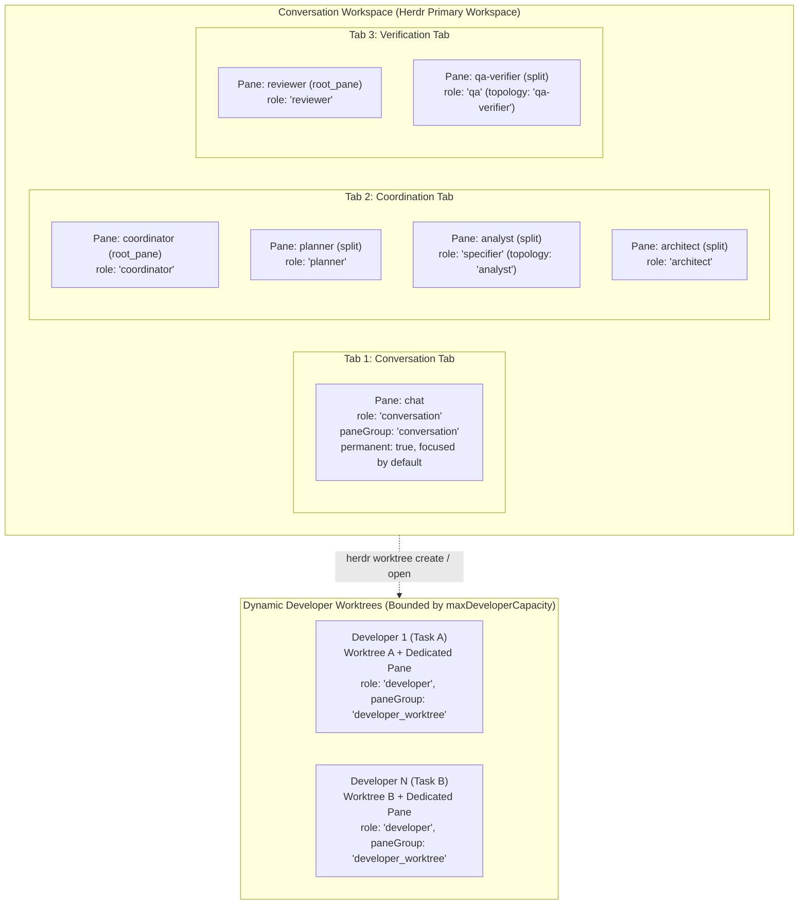

# @bflow/pane-manager

`@bflow/pane-manager` implements the **Herdr Role & Pane Manager** (Phase P13 of Bflow Agentic SDLC v2). It provides physical terminal process and multi-pane orchestration across Herdr workspaces, tabs, panes, and agent instances for all SDLC roles.

## Architectural Boundaries

In accordance with [Architecture v2](../../docs/architecture-v2.md) and [AGENTS.md](../../AGENTS.md):
- **Contracts-Only Dependency**: Strictly depends on `@bflow/contracts`. It does not import `@bflow/herdr-adapter`, `@bflow/core`, `@bflow/runtime`, or `apps/cli`.
- **No CLI / Workflow Engine Logic**: CLI lifecycle commands (`bflow init`, `bflow up`) belong to `apps/cli` (P12). Task DAG orchestration belongs to `@bflow/core` and `@bflow/runtime` (P19).
- **Physical Orchestration Only**: Manages Herdr workspaces, tabs, panes, agent processes, and Git worktrees. Inter-agent messaging is transported over Herdr protocol 22, and user interaction attaches exclusively to the conversation pane.
- **Strict Runtime Ingress Validation**: All manifests and pane bindings exchanged across package boundaries are validated using Zod schemas (`SessionManifestSchema`, `PaneBindingSchema`).

---

## Managed Topology



### Role Mapping Reference

| Topology Role | `@bflow/contracts` `AgentRole` | `PaneGroup` | Tab Key | Permanent | Read-Only Workspace | Default Agent Name |
| :--- | :--- | :--- | :--- | :--- | :--- | :--- |
| `chat` | `conversation` | `conversation` | `conversation` | `true` | `true` | `chat` |
| `coordinator` | `coordinator` | `coordination` | `coordination` | `true` | `true` | `coordinator` |
| `planner` | `planner` | `coordination` | `coordination` | `true` | `true` | `planner` |
| `analyst` | `specifier` | `coordination` | `coordination` | `true` | `true` | `analyst` |
| `architect` | `architect` | `coordination` | `coordination` | `true` | `true` | `architect` |
| `reviewer` | `reviewer` | `verification` | `verification` | `true` | `true` | `reviewer` |
| `qa-verifier` | `qa` | `verification` | `verification` | `true` | `true` | `qa-verifier` |
| `developer` | `developer` | `developer_worktree` | `developer` | `false` | `false` | `dev-<task>` |

---

## 10 Core Capabilities

1. **`initializeTopology`**: Creates or reconciles the full topology (Conversation workspace, Conversation/Coordination/Verification tabs, and shell panes/agents for all permanent roles). Reuses the workspace's root pane for `chat`, the tab root pane for the first role in each tab, and splits for subsequent roles. Focuses the `chat` pane by default.
2. **`reconcileTopology`**: Idempotent reconciliation of the topology against live Herdr state, reusing existing workspaces, tabs, panes, and agents without creating duplicates.
3. **`startAgentInPane`**: Preflight checks pane shell readiness (`pane get` and `pane process-info`), validates agent name syntax (`/^[a-z][a-z0-9_-]{0,31}$/`) and session uniqueness, then spawns the agent via `herdr agent start`.
4. **`inspectRoleHealth`**: Detailed health evaluation of an individual role (`ready`, `working`, `blocked`, `unknown`, `not_ready`, `pane_missing`, `agent_replaced`).
5. **`inspectTopologyHealth`**: Audits all bindings in the manifest, detects anomalies, and updates `SessionManifest.status` (`up` if all permanent roles are healthy, `degraded` if any anomalies exist).
6. **`recoverAfterRestart`**: Restores topology after a Herdr daemon or system restart. Detects newly assigned Herdr workspace, tab, pane, and terminal IDs, re-launches stopped agents into ready shell panes, recreates missing panes, and updates bindings with the new Herdr IDs.
7. **`focusConversationPane`**: Focuses workspace, tab, and `chat` pane (`herdr agent focus <paneId>`), updating `attachTarget` in the manifest.
8. **`allocateDeveloper`**: Allocates a dynamic Developer agent in a dedicated Git worktree and pane (`herdr worktree create` or `herdr worktree open`). Enforces `maxDeveloperCapacity`, single-writer worktree/branch mutex, and uncommitted dirty change guards.
9. **`releaseDeveloper`**: Releases a developer allocation. Verifies that the worktree is clean before releasing or closing; rejects release with a `conflict` error if uncommitted changes exist.
10. **`moveRolePane`**: Moves an existing pane to a different tab or workspace (`herdr pane move`), immediately replacing the old `paneId` with the new ID returned by Herdr.

---

## Invariants & Safety Constraints

1. **Shell Readiness Before Agent Launch**: A pane is only ready for `agent start` when `agent === null`, `shellPid` is valid, and no non-shell foreground processes are running.
2. **Never Predict Herdr IDs**: All workspace, tab, pane, and terminal IDs are obtained directly from Herdr CLI JSON responses.
3. **Pane Existence != Agent Readiness**: A pane that exists with `agent === null`, or an agent in `blocked`, `unknown`, `launchPending`, or `interactiveReady: false` state is never reported as `ready`.
4. **Never Retain Stale IDs on Pane Move or Recreate**: When `herdr pane move` or restart recovery returns a new `pane_id`, `PaneBinding.paneId` (and `attachTarget.paneId` if `chat`) is immediately updated.
5. **Agent Name Validation & Uniqueness**: Agent names must match `/^[a-z][a-z0-9_-]{0,31}$/` and must not collide with any active pane in the session.
6. **Single-Writer Worktree Mutex**: Never allocate two developer agents to the same `worktreePath` or `branchName`.
7. **Developer Capacity Limits**: Never exceed `maxDeveloperCapacity` (default 2).
8. **Dirty Worktree Allocation Guard**: Never allocate a developer in a worktree containing uncommitted changes not belonging to the task.
9. **Dirty Worktree Release Guard**: Never auto-close a pane or remove a worktree containing uncommitted changes (`isClean: false`).
10. **Atomic Manifest Persistence**: File-based manifest persistence uses atomic temporary file creation and replacement.

---

## Herdr CLI Protocol & API Map

All CLI commands are executed via argv-based `spawn` with `shell: false`. Stderr JSON error responses (`{ id: string, error: { code: string, message: string } }`) are parsed and mapped to typed `ContractError` values.

| Operation | CLI Command | Expected JSON Type | Fields Consumed | Purpose |
| :--- | :--- | :--- | :--- | :--- |
| List Workspaces | `herdr workspace list` | `workspace_list` | `.result.workspaces[]` | Detect existing session workspace |
| Create Workspace | `herdr workspace create --cwd <path> --label <name> --no-focus` | `workspace_created` | `.result.workspace.workspace_id`, `.result.tab.tab_id`, `.result.root_pane.pane_id` | Initialize primary workspace & chat pane |
| Focus Workspace | `herdr workspace focus <workspace_id>` | `workspace_info` | `.result.workspace` | Switch workspace focus |
| List Tabs | `herdr tab list --workspace <ws_id>` | `tab_list` | `.result.tabs[]` | Enumerate tabs in workspace |
| Create Tab | `herdr tab create --workspace <ws_id> --cwd <path> --label <name> --no-focus` | `tab_created` | `.result.tab.tab_id`, `.result.root_pane.pane_id` | Create Coordination or Verification tab |
| Focus Tab | `herdr tab focus <tab_id>` | `tab_info` | `.result.tab` | Switch tab focus |
| List Panes | `herdr pane list [--workspace <ws_id>]` | `pane_list` | `.result.panes[]` | Enumerate panes |
| Inspect Pane | `herdr pane get <pane_id>` | `pane_info` | `.result.pane` (`pane_id`, `terminal_id`, `agent`, `agent_status`) | Check pane existence and occupant |
| Inspect Process | `herdr pane process-info --pane <pane_id>` | `pane_process_info` | `.result.process_info` (`shell_pid`, `foreground_process_group_id`, `foreground_processes`) | Verify shell is ready before agent start |
| Split Pane | `herdr pane split <pane_id> --direction <right\|down> --cwd <path> --no-focus` | `pane_info` | `.result.pane.pane_id`, `.result.pane.terminal_id` | Create additional pane in tab |
| Rename Pane | `herdr pane rename <pane_id> <label>` | `pane_info` | `.result.pane` | Label pane with role name |
| Move Pane | `herdr pane move <pane_id> ...` | `pane_move` | `.result.move_result.pane.pane_id`, `.result.move_result.pane.workspace_id`, `.result.move_result.pane.tab_id` | Move pane and update IDs |
| Close Pane | `herdr pane close <pane_id>` | `ok` | `.result.type === "ok"` | Close released developer pane |
| List Agents | `herdr agent list` | `agent_list` | `.result.agents[]` | Audit running agents across panes |
| Inspect Agent | `herdr agent get <target>` | `agent_info` | `.result.agent` (`name`, `agent`, `agent_status`, `interactive_ready`, `launch_pending`) | Check agent health and readiness |
| Start Agent | `herdr agent start <name> --kind <kind> --pane <pane_id> [--timeout <ms>] [-- <args...>]` | `agent_started` | `.result.agent` | Launch agent process in shell pane |
| Focus Agent | `herdr agent focus <target>` | `agent_info` | `.result.agent` | Focus conversation chat pane |
| Create Worktree | `herdr worktree create --workspace <ws_id> --branch <br> --path <path> --label <lbl> --no-focus` | `worktree_created` | `.result.workspace`, `.result.tab`, `.result.root_pane`, `.result.worktree` | Allocate developer in new worktree |
| Open Worktree | `herdr worktree open --workspace <ws_id> --path <path> --label <lbl> --no-focus` | `worktree_opened` | `.result.workspace`, `.result.tab`, `.result.root_pane`, `.result.worktree` | Allocate developer in existing worktree |
| Remove Worktree | `herdr worktree remove --workspace <ws_id>` | `worktree_removed` | `.result.workspace_id`, `.result.path` | Clean up developer worktree |

---

## Validation & Testing

Run unit and integration tests:

```bash
# Targeted package test suite
pnpm exec vitest run packages/pane-manager/test/role-pane-manager.test.ts

# Full workspace verification
pnpm check:deps
pnpm typecheck
pnpm test
```
